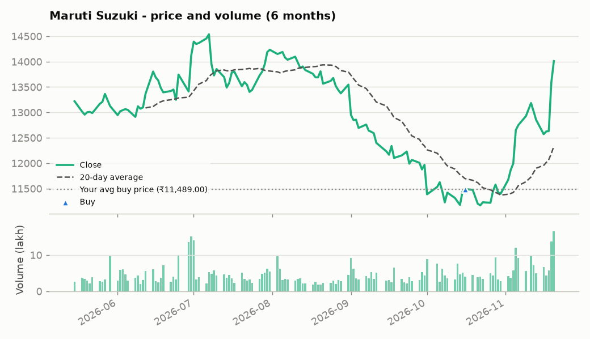
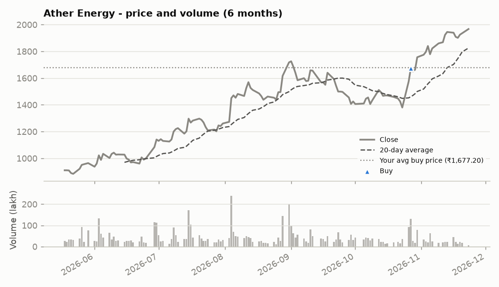

# Core-Equity Virtual Portfolio

> This is a **virtual (paper) portfolio built for learning and skill demonstration**. It is **not investment advice** and not a recommendation to buy, sell or hold any security.

**Last updated:** 27 Nov 2026, 02:32 PM IST  |  **Market data as of:** 2026-11-27  |  **Start date:** 2026-10-16

**Snapshot type:** Live intraday snapshot

_Live snapshot: today's session is still in progress, so volume is partial and "Volume vs 20d avg" will look low. The final end-of-day snapshot is published at 5:45 PM IST._

**Jump to:** [Summary](#portfolio-summary) · [Holdings](#holdings) · [Allocation](#allocation) · [Performance](#performance) · [Trade book](#trade-book) · [Companies](#company-deep-dives) · [Method](#how-this-works--data-sources)

## Portfolio summary

| Metric | Value |
|---|---|
| Current value | **₹2,63,61,002** |
| Total P&L | **₹17,62,272 (+7.16%)** |
| &nbsp;&nbsp;Unrealised (open positions) | ₹21,59,760 |
| &nbsp;&nbsp;Realised (shares already sold) | -₹3,98,488 |
| &nbsp;&nbsp;Dividends received (already inside Total P&L) | ₹1,000 |
| Today's change | -₹2,17,210 (-0.82%) |
| Nifty 50 since start (same money invested) | +11.55% |
| Outperformance vs Nifty 50 | -4.39% |
| Cash (uninvested) | ₹71,42,482 |
| Virtual money put in | ₹2,45,98,730 |

_▲ buy · ▼ sell_

## Holdings

| Stock | Shares | Buy price | Current price | Today's close | Prev close | Day | Value | Weight | P&L | P&L % |
|---|---:|---:|---:|---:|---:|---:|---:|---:|---:|---:|
| Maruti Suzuki | 290 | ₹11,489.00 | ₹13,777.00 | - | ₹14,015.00 | -1.70% | ₹39,95,330 | 15.2% | ₹6,63,520 | +19.91% |
| Ashok Leyland | 1,000 | ₹147.72 | ₹151.36 | - | ₹156.15 | -3.07% | ₹1,51,360 | 0.6% | ₹3,640 | +2.46% |
| Eicher Motors | 1,000 | ₹7,266.00 | ₹8,073.50 | - | ₹8,180.00 | -1.30% | ₹80,73,500 | 30.6% | ₹8,07,500 | +11.11% |
| Linde India | 500 | ₹5,961.00 | ₹6,960.50 | - | ₹6,998.50 | -0.54% | ₹34,80,250 | 13.2% | ₹4,99,750 | +16.77% |
| Linc Ltd | 1,000 | ₹85.00 | ₹84.98 | - | ₹84.39 | +0.70% | ₹84,980 | 0.3% | -₹20 | -0.02% |
| Ather Energy | 1,000 | ₹1,677.20 | ₹1,895.00 | - | ₹1,906.00 | -0.58% | ₹18,95,000 | 7.2% | ₹2,17,800 | +12.99% |
| Bank of India | 1,000 | ₹131.33 | ₹163.10 | - | ₹160.29 | +1.75% | ₹1,63,100 | 0.6% | ₹31,770 | +24.19% |
| Jio Platforms | 1,000 | ₹1,439.20 | ₹1,375.00 | - | ₹1,385.30 | -0.74% | ₹13,75,000 | 5.2% | -₹64,200 | -4.46% |

**Best since buy:** Bank of India (+24.19%)  ·  **Worst since buy:** Jio Platforms (-4.46%)  ·  **Biggest mover today:** Ashok Leyland (-3.07%)

## Allocation

| Sector | Value | Share |
|---|---:|---:|
| Automobiles | ₹1,41,15,190 | 53.5% |
| Cash | ₹71,42,482 | 27.1% |
| Industrial Gases | ₹34,80,250 | 13.2% |
| Telecom & Digital Services | ₹13,75,000 | 5.2% |
| Financials | ₹1,63,100 | 0.6% |
| Stationery & Writing Instruments | ₹84,980 | 0.3% |

## Performance (as on 27 Nov 2026, 02:32 PM IST)

## Trade book

<b>Transaction history</b> - 25 entries, newest first

| Date | Stock | Type | Shares | Price | Amount | Note |
|---|---|---|---:|---:|---:|---|
| 2026-11-20 | Ashok Leyland | DIVIDEND | 1,000 | ₹1.00 | ₹1,000 | Auto-detected from Yahoo Finance: dividend Rs 1 per share; ex-date 2026-11-20 |
| 2026-11-04 | Jio Platforms | BUY | 1,000 | ₹1,439.20 | ₹14,39,200 | Bought 04-Nov-26 at 1439.20 (10:29 AM IST per Google Finance quote) |
| 2026-11-04 | - | DEPOSIT | - | - | ₹14,39,200 | Fresh virtual money to fund Jio Platforms |
| 2026-10-27 | Bank of India | BUY | 1,000 | ₹131.33 | ₹1,31,330 | Bought 27-Oct-26 at 131.33 (12:54 PM IST per Upstox quote) |
| 2026-10-27 | - | DEPOSIT | - | - | ₹1,31,330 | Fresh virtual money to fund Bank of India |
| 2026-10-27 | Ather Energy | BUY | 1,000 | ₹1,677.20 | ₹16,77,200 | Bought 27-Oct-26 at 1677.20 (12:37 PM IST per Upstox quote) |
| 2026-10-27 | - | DEPOSIT | - | - | ₹16,77,200 | Fresh virtual money to fund Ather Energy |
| 2026-10-27 | HDFC Bank | SELL | 4,572 | ₹687.95 | ₹31,45,307 | Sold 27-Oct-26 at 687.95 (12:08 PM IST per Business Standard quote) |
| 2026-10-22 | Linc Ltd | BUY | 1,000 | ₹85.00 | ₹85,000 | Bought 22-Oct-26 at live NSE price 85.00 (12:30:26 PM IST; source NSE_CMDATA) |
| 2026-10-22 | - | DEPOSIT | - | - | ₹85,000 | Fresh virtual money to fund Linc Ltd |
| 2026-10-22 | Eternal (Zomato) | SELL | 10,245 | ₹309.00 | ₹31,65,705 | Sold 22-Oct-26 at live NSE price 309.00 (12:30:26 PM IST; source NSE_CMDATA) |
| 2026-10-21 | Linde India | BUY | 500 | ₹5,961.00 | ₹29,80,500 | Bought 21-Oct-26 from cash at 5961.00 (NSE last traded 10:53:52 AM IST per Upstox web quote) |
| 2026-10-21 | Fiem Industries | SELL | 1,000 | ₹1,816.90 | ₹18,16,900 | Sold 21-Oct-26 at live NSE price 1816.90 (10:03:32 AM IST; source NSE_CMDATA) |
| 2026-10-21 | Manorama Industries | SELL | 1,000 | ₹1,749.00 | ₹17,49,000 | Sold 21-Oct-26 at live NSE price 1749.00 (10:03:32 AM IST; source NSE_CMDATA) |
| 2026-10-21 | Fiem Industries | BUY | 1,000 | ₹1,813.60 | ₹18,13,600 | Bought 21-Oct-26 at live NSE price 1813.60 (10:00:26 AM IST; source NSE_CMDATA) |
| 2026-10-21 | Eicher Motors | BUY | 1,000 | ₹7,266.00 | ₹72,66,000 | Bought 21-Oct-26 at live NSE price 7266.00 (10:00:26 AM IST; source NSE_CMDATA) |
| 2026-10-21 | - | DEPOSIT | - | - | ₹72,66,000 | Fresh virtual money to fund Eicher Motors |
| 2026-10-20 | - | DEPOSIT | - | - | ₹19,00,000 | Fresh virtual money to fund Fiem Industries |
| 2026-10-19 | Manorama Industries | BUY | 1,000 | ₹1,796.80 | ₹17,96,800 | Added on 19-Oct-26 (CMP 1790.40 per Trendlyne) |
| 2026-10-19 | - | DEPOSIT | - | - | ₹18,00,000 | Fresh virtual money to fund Manorama Industries |
| 2026-10-19 | Ashok Leyland | BUY | 1,000 | ₹147.72 | ₹1,47,720 | Added at ~11:25 AM IST |
| 2026-10-19 | - | DEPOSIT | - | - | ₹3,00,000 | Fresh virtual money to fund Ashok Leyland |
| 2026-10-16 | Maruti Suzuki | BUY | 290 | ₹11,489.00 | ₹33,31,810 | Initial allocation |
| 2026-10-16 | Eternal (Zomato) | BUY | 10,245 | ₹325.30 | ₹33,32,698 | Initial allocation |
| 2026-10-16 | HDFC Bank | BUY | 4,572 | ₹728.85 | ₹33,32,302 | Initial allocation |

<b>Closed positions</b> - 4

| Stock | Bought (avg) | Sold (avg) | Held | Invested | Proceeds | Realised P&L | Return |
|---|---:|---:|---:|---:|---:|---:|---:|
| Manorama Industries | 2026-10-19 @ ₹1,796.80 | 2026-10-21 @ ₹1,749.00 | 2 days | ₹17,96,800 | ₹17,49,000 | -₹47,800 | -2.66% |
| Fiem Industries | 2026-10-21 @ ₹1,813.60 | 2026-10-21 @ ₹1,816.90 | 0 days | ₹18,13,600 | ₹18,16,900 | ₹3,300 | +0.18% |
| Eternal (Zomato) | 2026-10-16 @ ₹325.30 | 2026-10-22 @ ₹309.00 | 6 days | ₹33,32,698 | ₹31,65,705 | -₹1,66,993 | -5.01% |
| HDFC Bank | 2026-10-16 @ ₹728.85 | 2026-10-27 @ ₹687.95 | 11 days | ₹33,32,302 | ₹31,45,307 | -₹1,86,995 | -5.61% |

## Company deep-dives

---

### Maruti Suzuki  _(Automobiles)_

[Google Finance](https://www.google.com/finance/quote/MARUTI:NSE) · [All BSE announcements](https://www.bseindia.com/corporates/ann.html?scrip=532500)

| Close | Day change | Day range | Volume | 20d avg volume | Volume vs 20d avg | 20d volatility (ann.) | 52w range |
|---:|---:|---:|---:|---:|---:|---:|---:|
| ₹13,777.00 | -1.70% | ₹13,740.00 - ₹14,060.00 | 321,091 | 744,709 | 0.43x | 38.81% | ₹11,170.00 - ₹17,292.00 |

**Research reports**

- [One-page snapshot](analysis/Maruti_OnePager.pdf)
- [Detailed report](analysis/Maruti_Detailed.pdf)

<b>Official company announcements (BSE)</b>

- No recent filings fetched; see the link above for the full list.

<b>Latest news (trusted publishers + official company newsroom)</b>

- [Maruti Suzuki Share Price Highlights: Maruti Suzuki Stock Price History](https://economictimes.indiatimes.com/markets/stocks/stock-liveblog/maruti-suzuki-stock-price-livestock-price-today-live-updates-26-nov-2026/liveblog/136178767.cms) - _Economic Times, 26 Nov 2026, 10:06 AM IST_
- [Tata Motors, Audi India raise vehicle prices following Maruti Suzuki's move](https://news.google.com/rss/articles/CBMi2wFBVV95cUxQMllSME5UU1UxTTFJZFZ3X3U5THcyQnY4UjE1cjJpU2NXTlBGMlNzNUJTSlNSRWRraWh6cXgyWWF4bENLNExXV3ZOZ0ZINWM1Q0lMb0hoUXg1UmZLb2Z3LVBpOXJRbmtUdXZRdHdweEZHdmIxekV6Qy1Oc0o5SHpVeHdWazVLUm1tWW5ZUHRmRDg1WUtzeU5WNGh6M3pLT1cxZ0ExankyeDZfZ3ZxVjBYd0dMbDlDRDZ5V3oweGlud19aRzc3T1M0dWpZS09MZXU0VFg2aGt0LUtFenfSAeABQVVfeXFMTUhXdEtDS1AtVkRFV2RpUUQ1WUVsS3ZTQ1NNdHBDSXQ1eF9QZzBlcE9VVkUtRWJqYVZVQUVmcDdvZlhOVl91TVpBRGQtMzREWld3ckZfM3N6MURvOUx4RFg2ekhNb2oxUDNhbVlWc2VCT0FjRlVSSGVjbXF5Mmh2bHlmaTFDZmhsQ1czY0htU3k1S0ZKMm9OTTZJaGtWMFphZXVGWENKTy1SZ0wycjR3bjVoQVNBUlJ4Y2JlaUhBVng2MWRnZmpHSzRkdkJ3X2NDOFQ1LWFUemhvazZhRWpLR0U?oc=5) - _Business Standard, 24 Nov 2026, 07:57 PM IST_
- [Tata Motors, Maruti Suzuki, Hyundai and Audi announce hikes: Check company-wise changes](https://news.google.com/rss/articles/CBMizwFBVV95cUxNLWZWUUpwNFNkdkRTVlVEUF9TbUpnS1dQSGg0Nlh1cy1PdFdjSU1kZXlqY25BczhfaUZCdld6dVRWTDZ3MlpnbXVMU0xReUViWGFTa0tvclpPbkFib3p6Z2pYMVlTWk5TeDE5RXhHUm5QSmhqVkx3SmtfNVJudDBmbGR5TjloOG1LNDhxY3hOUUh5YjFYeXRCZFZuV2pIZ3VHbkxHM2lKSE5PdUpjNXNIRW55MkhKaUJwUVNhRWt6azV3VUNMeHZiYU9WZ2EzdDTSAdQBQVVfeXFMUHk2ZFNmMlZaRGpDT1FzS2x3NkVmejVxeWFVejhHaC1hcEVJYU1lbEpJR1FFX19WNml3NDY5LUdDSVR6UkZZOW0zS3hRaTJXU2p4eEdGYTlnNGc2ODAya0F2NjB0S1g1cGJ5MUt0anprakNTSVdhQk5UaHNDOVkxV2d6TEdoRFlpZ1NRU3lpUVdfNTdsclN2VG1GeWFGZkNPWGRPRjk5NHdiRnBfQkJ0TWN4cnFNaTcxc3NnNUl0eHRSSEQwOHBfU0MxcHJjWl9oamNzSDg?oc=5) - _Moneycontrol.com, 24 Nov 2026, 02:57 PM IST_

---

### Ashok Leyland  _(Automobiles)_

[Google Finance](https://www.google.com/finance/quote/ASHOKLEY:NSE) · [All BSE announcements](https://www.bseindia.com/corporates/ann.html?scrip=500477)

| Close | Day change | Day range | Volume | 20d avg volume | Volume vs 20d avg | 20d volatility (ann.) | 52w range |
|---:|---:|---:|---:|---:|---:|---:|---:|
| ₹151.36 | -3.07% | ₹149.21 - ₹156.50 | 30,925,446 | 24,004,701 | 1.29x | 49.27% | ₹138.58 - ₹211.92 |

**Research reports**

- [One-page snapshot](analysis/Ashok_Leyland_OnePager.pdf)
- [Detailed report](analysis/Ashok_Leyland_Detailed.pdf)

<b>Official company announcements (BSE)</b>

- No recent filings fetched; see the link above for the full list.

<b>Latest news (trusted publishers + official company newsroom)</b>

- [Ashok Leyland turns to Bengal for manufacturing expansion: What is the company planning to make in Singur? Details here](https://news.google.com/rss/articles/CBMiiAJBVV95cUxPV0lsT3RIMUpGa3FIYkQ2cTdQdFFaVThKa2dTY1pQRHlXZzJkZDdFYk9oRGZiWUFxZGhLV0UtZ2VuZnVYOUxrcE85VFN4c3hEcXl4ck9ncG5IMUVvVFBXUi1MR2ZWSHNDQzkzd0R2dUxkeTFtakNEQU1tU2pHYnI1WHFhMWJWd2NkLWM5R0tvY01CM3ozTGgwcVdFOGtobE94cEFWaDc3M3lyZGNlOFNNTjZvY0tYaGVpZ2pSM1huRVg1dG5IUWZYX0RJSmtBRUZlRVYyLVk1NW1FMzlWSlVNNENHXzA3dGpadmwzRVE3Wk0xdEVhZDVaM1BRX0gwMllXRnM5RmlTVm7SAY4CQVVfeXFMT0J6cmJaV1ZEYmpOTVFZVnhzV3NnNDZPcHpyREdhUFR1VnZZdGx2NmJtVnVJdlltNGdNOGdxM0R4N3hzNmhRTXRWamRJN1AzX3BFbjYxU3kxVkZBOTlVZ050Qk5OWVFuVFhTSGVFOGNvaXJhLVFFSHBoTzZFallSWGxESW5EV1p5dTN3STZQS2xKQ3lzVzVDeGlXMlJlS1E2a0hNTEV3UDJQazBicFVHOVBrVmdIWllXbjdfYnlxbXpfZXZERXR4Q0FlTW5NZkJ4N3J1bDZDbmtyY1lta1UyR1dwMjVQX0xJajRLZ3ItazFtU0dTTjJmNlV6N1hIdkNnNlMtdkphZW1xaGdleUZ3?oc=5) - _Livemint, 24 Nov 2026, 06:34 PM IST_
- [Ashok Leyland Celebrates Milestone Delivery of 1,000+ Vehicles to Thriveni Transport and Logistics](https://www.ashokleyland.com/in/pressrelease/ashok-leyland-celebrates-milestone-delivery-of-1000-vehicles-to-thriveni-transport-and-logistics) - _Ashok Leyland (official newsroom), 17 Nov 2026_

---

### Eicher Motors  _(Automobiles)_

[Google Finance](https://www.google.com/finance/quote/EICHERMOT:NSE) · [All BSE announcements](https://www.bseindia.com/corporates/ann.html?scrip=505200)

| Close | Day change | Day range | Volume | 20d avg volume | Volume vs 20d avg | 20d volatility (ann.) | 52w range |
|---:|---:|---:|---:|---:|---:|---:|---:|
| ₹8,073.50 | -1.30% | ₹8,066.50 - ₹8,180.50 | 376,347 | 625,488 | 0.6x | 30.02% | ₹6,586.00 - ₹8,336.00 |

**Research reports**

- [One-page snapshot](analysis/Eicher_OnePager.pdf)
- [Detailed report](analysis/Eicher_Detailed.pdf)

<b>Official company announcements (BSE)</b>

- No recent filings fetched; see the link above for the full list.

<b>Latest news (trusted publishers + official company newsroom)</b>

- No fresh headlines from trusted sources in the last few days.

---

### Linde India  _(Industrial Gases)_

[Google Finance](https://www.google.com/finance/quote/LINDEINDIA:NSE) · [All BSE announcements](https://www.bseindia.com/corporates/ann.html?scrip=523457)

| Close | Day change | Day range | Volume | 20d avg volume | Volume vs 20d avg | 20d volatility (ann.) | 52w range |
|---:|---:|---:|---:|---:|---:|---:|---:|
| ₹6,960.50 | -0.54% | ₹6,945.00 - ₹7,077.00 | 17,693 | 58,377 | 0.3x | 51.26% | ₹5,632.50 - ₹7,847.50 |

**Research reports**

_Research report coming soon._

<b>Official company announcements (BSE)</b>

- No recent filings fetched; see the link above for the full list.

<b>Latest news (trusted publishers + official company newsroom)</b>

- No fresh headlines from trusted sources in the last few days.

---

### Linc Ltd  _(Stationery & Writing Instruments)_

[Google Finance](https://www.google.com/finance/quote/LINC:NSE) · [All BSE announcements](https://www.bseindia.com/corporates/ann.html?scrip=531241)

| Close | Day change | Day range | Volume | 20d avg volume | Volume vs 20d avg | 20d volatility (ann.) | 52w range |
|---:|---:|---:|---:|---:|---:|---:|---:|
| ₹84.98 | +0.70% | ₹84.00 - ₹85.80 | 3,462 | 17,620 | 0.2x | 43.75% | ₹76.41 - ₹123.36 |

**Research reports**

_Research report coming soon._

<b>Official company announcements (BSE)</b>

- No recent filings fetched; see the link above for the full list.

<b>Latest news (trusted publishers + official company newsroom)</b>

- No fresh headlines from trusted sources in the last few days.

---

### Ather Energy  _(Automobiles)_

[Google Finance](https://www.google.com/finance/quote/ATHERENERG:NSE) · [All BSE announcements](https://www.bseindia.com/corporates/ann.html?scrip=544397)

| Close | Day change | Day range | Volume | 20d avg volume | Volume vs 20d avg | 20d volatility (ann.) | 52w range |
|---:|---:|---:|---:|---:|---:|---:|---:|
| ₹1,895.00 | -0.58% | ₹1,881.00 - ₹1,914.90 | 893,792 | 2,724,729 | 0.33x | 37.24% | ₹601.35 - ₹1,979.20 |

**Research reports**

_Research report coming soon._

<b>Official company announcements (BSE)</b>

- No recent filings fetched; see the link above for the full list.

<b>Latest news (trusted publishers + official company newsroom)</b>

- [India’s kharif foodgrains estimate 5% lower on weather woes](https://www.thehindubusinessline.com/economy/indias-kharif-foodgrains-estimate-5-lower-on-weather-woes/article71745520.ece) - _BusinessLine, 26 Nov 2026, 08:20 PM IST_
- [Six Stocks To Buy Today, November 25: Ather Energy, TCS, M&M, Coal India, And More](https://news.google.com/rss/articles/CBMimgJBVV95cUxPYU5EcEYydkJyLTF4eUp0NUJUTmZOQXZuOHc4LVFRai1iLUozejE2ME5uNEY2bV9aaDBFc0lvcnotOHU2Y2I5VVJiSlphWXlaYXp0SFdXNk41eEg2c2hPV1RELVNoMmIwZXdPVmlrd2FuQ1labVFWT3hIeG9oMHZBbzR2VmdPTi1LUmg5MjFZUVZWWDZCT1h3dDhwNnJHbF9ndG0zZ0FrS2xSV2V6VlVpY0FRX2xHNER0Z05IdFFLWTFPOUpRdEZWa0FQOUNyYk05b1ZKWW4yV2l6c1RjX0xuY1QwYUtmeGxETmcxUmcxd3VBNEdRWmlFZFJBdWpJVS1yNGlVRUxQM1JYcWJLdFhydGlfMTNZeE9MdHfSAaICQVVfeXFMTnYwRzRhbF92dHBDQlFiT0F4SlpheFZ3OWpHR1h2YlhHaTF1b0VFU0xyUGx3V3NpdlRlWFE5RW5yYjZGLWh5dHRqZTVDakhiUFNPSVlTbkFpVnMxWXNBWk1IeU1hRTE0ZnplYVdMLVZBc2Q0eHJQM1BVQUdSZ0RLbGtlcjBfei1qdzVQa3NKMzFNVnFGdHlvVlBIOFZLU2RiTzNXZXRmME9BYUpIUTlmd0IxaDQ4V2c2OWhQWENBYlNfbndlVF9nLU05c3MtVUFMdXJVWXpzbDhvNEtjNXZSMWtPNkFnUFJia2h5bzVXNzI4LUUyTkNHamkwQWhnckxDRDFmb3otOFpkLWpHNTZPa2c0V1o3Q1dWeDFZWUNLZE5LbWc?oc=5) - _NDTV Profit, 25 Nov 2026, 08:10 AM IST_

---

### Bank of India  _(Financials)_

[Google Finance](https://www.google.com/finance/quote/BANKINDIA:NSE) · [All BSE announcements](https://www.bseindia.com/corporates/ann.html?scrip=532149)

| Close | Day change | Day range | Volume | 20d avg volume | Volume vs 20d avg | 20d volatility (ann.) | 52w range |
|---:|---:|---:|---:|---:|---:|---:|---:|
| ₹163.10 | +1.75% | ₹160.00 - ₹168.98 | 23,223,382 | 11,491,415 | 2.02x | 33.85% | ₹126.32 - ₹177.20 |

**Research reports**

_Research report coming soon._

<b>Official company announcements (BSE)</b>

- No recent filings fetched; see the link above for the full list.

<b>Latest news (trusted publishers + official company newsroom)</b>

- [The Reserve Bank of India has luck on its side—here's why](https://news.google.com/rss/articles/CBMivwFBVV95cUxPWEVsSHBSVWxDM21kYk1nU1luMWdYRl85VHhYRjBHYlFuZzBSQXlvTTZXck9vV3dZMDdwb1dyZzdIeVVDUnBYbDFLcTlZeV9qOVpiOUZwS0tXaGNCaWdOeUt5b0ZSdkdFNHVCR0ZxOWdaMy1UbDRTRUhzMFE5VVA5YUxyMWU1UkNqbjVkUjl5TFRBWTM2OS1nV1c5akxHQnFoYmg2NWZmOVp2S2hCdjR1aFBzUEVVQjNyMUJiQUpfONIBxAFBVV95cUxOQWp6aFF5WGFmMktFSmVhQlRUbC03Q2JEZ09nbEZ4Y3ktNHlqeFpjbi1INzEzc0dLc3BSUmJVR3NOZEV2aHpuZVdBV1FIdHdqbk5fWUlsM3ZUdzhPS0VOdzlzeFByZmlLSFpXWTNlZFBCckhVd0NIRjNKTmRHdEFmZU5YYW84NVZ1SFJPUE03bW9TSzNLYVBnaWw5QUUxV1JlR1BPTEtMN1VmNWsza21lRkJSUDVZalE1ck5oQm9FZUY1bEQ1?oc=5) - _Livemint, 26 Nov 2026, 04:00 PM IST_
- [State Bank of India hires 1,540 Junior Associates to fill backlog vacancies and improve customer service](https://news.google.com/rss/articles/CBMiigJBVV95cUxObmlaUlFnZXFMSWRUV0FWTkI1NENiVGZTSGV5VzlDZlNEVlhTX2w0VkFydW90eWpMYk9pd0wyeTM4UGhTZjlQanVVcGVLTWR3VkJtOUhCazdSU1ZmOUxMdjBTbzM5aWxSdlNoNW94RHc4eEJhWUVoOHYxUF81SHhVUmtYVzZyeGVHLXFZZ3RHXzl3VmdmdTdObFJsRC05bkgyeGd2RFEtRnV2YnVodkZ5Wk83OFZQZjBwbzhkbHBNQkJBcDZnTXVsNk1URmtXam9sdGhWdU5EelUybFNpNVFxRkxxZFlCeUxzRVdJNXFqQ1M4OHFlT3hhWnBXdWk3NTAwdldCbUZ0bGFGQdIBjwJBVV95cUxQV080ZjVidjJEWDZ3c2xZeWhPdzJWWlJhTnZnZmkxTGhRaU9Cc0I4SEV2WEZ5OU1TbDlfamVLTFhrNm42RDRua3FGX3BzRHg1TDkybm50WmdPS00zdjNmVUNjckJWZi05VE9IV2p2WldsUl9WRTNuSE1MaHlEa3c1eUhnRVFUclJ3YjdTbGF0S2l4c1RFWk1aSjFCTzVJS2pDOFlYcHJrSWpYOWY3RWhxQWpqX2YweWZlRXFpWWZyVTVITDRSZ3RnX0J0VmxfMGNWVmdrWW94djJHSTQwd2VST2NKQWVLYTZVUzJudzNpV2w3cU1yVUJjTW5fejZIbFFwb25FRnRZVlNubDdMOEc0?oc=5) - _The Economic Times, 26 Nov 2026, 03:33 PM IST_
- [Stock Radar: Union Bank of India stock hit a fresh record high in November 2026; time to buy or book profi](https://news.google.com/rss/articles/CBMijAJBVV95cUxQX25GcnRLaFJPWUxlVmt1NTloM1Y5ZjY0N3BDWllyaU1UaktZT2FhRDJ1TDRkYUUwVUhVMU5XOWY4QVI2cWFuNzA0OXRESWIxamdlVnJ3eEIyX2xzMnFVOE00MXVyWW5KNFNpUDg5c1ZfR0RrbU1qdkd5NENTQmlxYmxNVDRVY0NWR2JkbWRGTFZ4MlUwMzViS2VSU2lXQWYzbmtiNlE4aGhyYW0zTDJ5VU91UkV3OXl3WFp3Q3NuYTM5M0NJdkhWNlJmanVRM2xaanNCRjMyQldOdklMTWlIUVllRzdnUHE4RjFTVWFab29CWjZkaUZZUkt5UTNGTWc4Y09fZElSX1Jlcm9V0gGSAkFVX3lxTFBDRG9tT0t2UE5qZnRnUk1CTlA2RWdfbktFUGVaZ2t3WE92di1qQnBsa0U4UDJTeXpGeGlXbjlNaTVLTEtQVFp6OUJIM0ZNQVFlU3k1S01hY1hvOVBXVDRBMFpSb2NzdDRCYVlpd2ttUEFseDhrNUMzelJORVl3MUlDZjBidG1QX0VDYzEyODRtZGtUVXY2YlBuMlpaWnBGa2VuREZuSC1LTnF0b3JSbEd5NzBxc0RueG9FT0dPWXBYeUctX2lLODhRSHhCQXhGa2FQTjhKVVFIc01ldUg1NENZWFdTR051SGNhYTBQSnJzeWEzLTcyYzZjUzdMTGtXU1NZSlNaXzBVMFFici0wb2pwY3c?oc=5) - _The Economic Times, 26 Nov 2026, 05:00 AM IST_
- [Trade Spotlight: How should you trade Coforge, Torrent Pharma, Siemens Energy, Union Bank of India,...](https://news.google.com/rss/articles/CBMipgJBVV95cUxNdXJzTXB1TUxVaTZSVVBxOC1ZOEFRWlB4bHZDdnZqWUE2eG9NN0RSMXk1QkpvVG1UZm1Vam5IeVFMU1hiZzJaMllCVTdabHA4Y0M4MnIwSkFDbFRsdDd1bHV2SmEwQ0ItUjZmaXN3WHZrOV9TNVp3VjlCaDE5NkpwTDBpNzZOalFzR3hDbGFGNlhwOENlUXFiLVpFN0ZxVVcwbU5aN0I4MHQ3NFNLVVBIbEZmdUczZG5JLUdRX3VPTGFXVXFmTE40NFFrXzlyb01nTjFzTGgyejBoZXV0YU5oVDJ6d0NiN25SdjcwOGVqbjJXREREaEE1U1pLTy1mWVBBdGVfZGpiQmMtbC10VGVzTXdtNGo1d1VOTXJjZjJzMU9wazVTeWfSAasCQVVfeXFMUFpTM3NCb3RWbkJTWllZdjcxc29idnV2eU1kVF9qcm9Rbm9FLTNVY3BDeWQwaFd2YVBnY2kyMWJsX0hSYVhZQ0JVcHphQmNpYW9wSjlnQ1hIazR3MTFfOFVUR2tsYTBUNmhHNnlySFM0c2hibUR4MThNRUUzRnlUU2d0a1J3bXZnUFdfYkRHTENHR1VpV3g3c2xHQ3BCcEpYUDlSb28zOXBhVDVRMmcwVXdtTVJjOWJya2xjRUpKNm9tb1hZVUx6bENrMWxHUFcxdWI3VTZmSTBEVDF0UFZDLVYtdVR5UkM5d1V6NWlROVVMOG5oT1ppaFgwQW1LbEhGTlY5b01fV08tMDc2YXZqYXk1YUdkMGhxenNUaF9wOUVObnNCRW5GSnRtWDA?oc=5) - _Moneycontrol.com, 25 Nov 2026, 08:22 AM IST_
- [Bank of India 500-day FD offers up to 7.65% interest: Check rates for senior citizens and other depositors](https://news.google.com/rss/articles/CBMiggJBVV95cUxOUkdrLWhfaEFYZlliR0hTWXJpN2ZET0duUWktOElwR0FLc1FNeXVRcWExemtCTnZtVEJnazcwZ0t3UDVrdHN6MS1tSWtZY1dSYk0tM2VOc08wdnNBdmloVFJzQmpEekZaRmtmbE5qbi11cFNCWDlVTGFFTUJLbGt1dGt1N21NTDhmb0VVS2gtRU1MRVl5YXg4dkpzcjY1UlpJbjJDNzBmRmJDb21fQkEyT0FjcHIzLXV3VkZ5aDFsd09HWmJOVWNMNThTSmZqdHRFTlVtTlNLNDAyTnJEaXdSNENWUTllbmVOb1pWYW53R1lLVS0yWkNDeEhOU2FNMHNrSFHSAYcCQVVfeXFMTnZDWFR0TUxvb09aWVVfUDl1TmpIMGpmTG9ZOElYLXB3VHRhaDctTm9mcFlFNnBjclhMaGhSYXo4Rno0S0xvQnNGeFRvOTFYSTZSbHc0ajZJMEFEQnZwckJmc0R3cXVLNGFXckV4T3l1ZzdMWnBRNTlXTUUtT29kRWNSZHlaaUN3UFZ2YU5ZaHNEMDZYTDVYdF9pVE14Zm5oTW51cFltNjQyNWYyODVya211aGY4ZXh0ZVctVFBTQ08wQ2pfZnVFd3VUYkpCZEVHRUcwaGhacE9sY0syNFM5SUFIVkFLTzZzb01HOTZXTjVyRjdrU09VZHBOUTJFZEJJQnhIZDNBRFU?oc=5) - _Livemint, 24 Nov 2026, 05:27 PM IST_

---

### Jio Platforms  _(Telecom & Digital Services)_

[Google Finance](https://www.google.com/finance/quote/JPL:NSE) · [All BSE announcements](https://www.bseindia.com/corporates/ann.html?scrip=545004)

| Close | Day change | Day range | Volume | 20d avg volume | Volume vs 20d avg | 20d volatility (ann.) | 52w range |
|---:|---:|---:|---:|---:|---:|---:|---:|
| ₹1,375.00 | -0.74% | ₹1,366.10 - ₹1,391.50 | 8,202,184 | 18,480,508 | 0.44x | 13.39% | ₹1,369.10 - ₹1,437.40 |

**Research reports**

_Research report coming soon._

<b>Official company announcements (BSE)</b>

- No recent filings fetched; see the link above for the full list.

<b>Latest news (trusted publishers + official company newsroom)</b>

- [Reliance enters India's growing digital astrology market with JioAstro](https://news.google.com/rss/articles/CBMi1gFBVV95cUxOVXBJU3J0OEJKY2dMcnJtZU1hSnNUbmt1Y3I3LUtTbHBkSC1PNkxDbUM3OFFlVU9ieWJzeFg5bHJ6ME5ZbWpWYVZFVEJfUm1Uakh4QW55VjRjWG1nZGczM1pDQXBFRFlucWtYYmNyakFER25EMkJKdHlwQWoySlV4ZkdQQi1qc2x6d0lJOXJKR1czU1dtZGRSVkhYb2Z1TVFPbEtRSlk1clZSR3c3Mmp0czdGVElhcnJLbTYwYTFCN0VzQnhkTV9NYnhoT1ZVLW9oSGk0UXR30gHbAUFVX3lxTE53Mzl6aU95cEZ1X1ZZWmEyRE9IQzlDLVVPYktGcW1iM19HZDZQdzVLajhHbTFJOG1sTzBiX1ZzT3NUUGRxMU9DSFVES2hjSWJuMWtNX2IwM2Z3VUhheGdaM09US3dNMks4NTAyUFdDelNXOEJmNXhLVVVwN21yMmd0dHROc1lWN3RyYmxpQlZGRDZxZDczV1hYUmh3S1Z6SzJ6SllCVXlGOWlzdTl1MEgxVVVqdkFaTVRpbTJnclVRR2FXemlFcFNON0ZxaWtfX0dWOEJEU1FOc2hrbw?oc=5) - _Business Standard, 26 Nov 2026, 11:15 AM IST_
- [Jio Financial Services vs Reliance vs Jio Platforms shares: Which Mukesh Ambani's stock to buy amid Dalal Street rally?](https://news.google.com/rss/articles/CBMilAJBVV95cUxNMThQczI3WlYyOWpfaXZ2MXZJM2M0Ml9RQUtCM3U3U3F4RFNWQnhnLUJURnJSQmpQZmVHS2xBdFRyN3VBRW5IZnVpUXpzLVJwWXZBLTkwaEVrN0JKWFlDSldvNm5BNXQ0SkJrc01MckZlMDBoWE9xbHNGVEFzOXFlZE9WbE03VVpiTXB3U0hjMndleWtQVHg3c0oteUlxOXA1LVBmZ1IwY0tmZDBad2tnR3RaRzJ0bFlsdGNiVWh1aUl2NGZSSzNNWndLT3Y5Y1ptUWNBQjRpSGhmV3F0NDd5SGdMTFRtVDNjNEg2ZEFBVlBZOFIwTTBOaGRXWmk2aWFaVF9keWtSZmNuSjhWS29icjR4elnSAZoCQVVfeXFMTWVrNWhPU3ZMa01lZEFlZ3J5SjNIaERSbHNrUU56TnN1R2dZT0lhZTg1VGc1OHZOMUxXa2F4NWR1bzMzbFVwQWx1VHQ3STIxRUFXMVI2V19XTUNCY0FwMDB6M3BDbGNwdU9URnhyNEFIVzR2MWtXS0lKZ0VlWmtCNHhrVWN0VjYtN3JyNHplX0JGd2M1NDA1dnFKNXBKUndoT2JIZTVqRkJwRzhJUFlkbE1EX3dyNFZLQS1od1kzd2M5VWtKcXBrZWkxeG11MzJORVdhS25JRDZrWXRCLXVtak5GWjRScndFX01CaE16X3ZMaml4R3pTWlFYMkdhSmdHcmM2a3pXNHJJZG1UNWdUbXRpTlF4Y0syYlln?oc=5) - _Livemint, 25 Nov 2026, 01:09 PM IST_

---

## How this works & data sources

- **Prices / volume:** Yahoo Finance via the open-source `yfinance` library (unofficial; may differ slightly from NSE official data).
- **Trades:** every buy / sell / deposit is a line in `transactions.csv`. A trade happens at the closing price of its date (live price for today). Average-cost method; no brokerage or taxes (virtual portfolio).
- **Corporate actions:** splits, bonus issues and dividends are detected from Yahoo Finance and added to `transactions.csv` as event lines on the ex-date (nothing old is edited). A split multiplies the share count and divides the average cost, so the invested amount stays the same; dividends add cash.
- **Benchmark:** every rupee put into the portfolio is also put into the Nifty 50 on the same day, so the comparison is like-for-like.
- **News:** Google News RSS + publisher RSS feeds, filtered to a whitelist of trusted publishers, de-duplicated, last 72 hours only. Each item links to the original article.
- **Official filings:** BSE corporate announcements (best-effort, with link to the full list).
- **Automation:** GitHub Actions refreshes this dashboard on weekdays every 30 minutes from 9:30 AM to 3:30 PM IST (live snapshots) and at 5:45 PM IST (end-of-day final snapshot + AI daily report); skips market holidays.
- **Metrics:** Volatility = 20-day std-dev of daily returns, annualised. Volume ratio = today's volume / average of previous 20 sessions.

> This is a **virtual (paper) portfolio built for learning and skill demonstration**. It is **not investment advice** and not a recommendation to buy, sell or hold any security.
