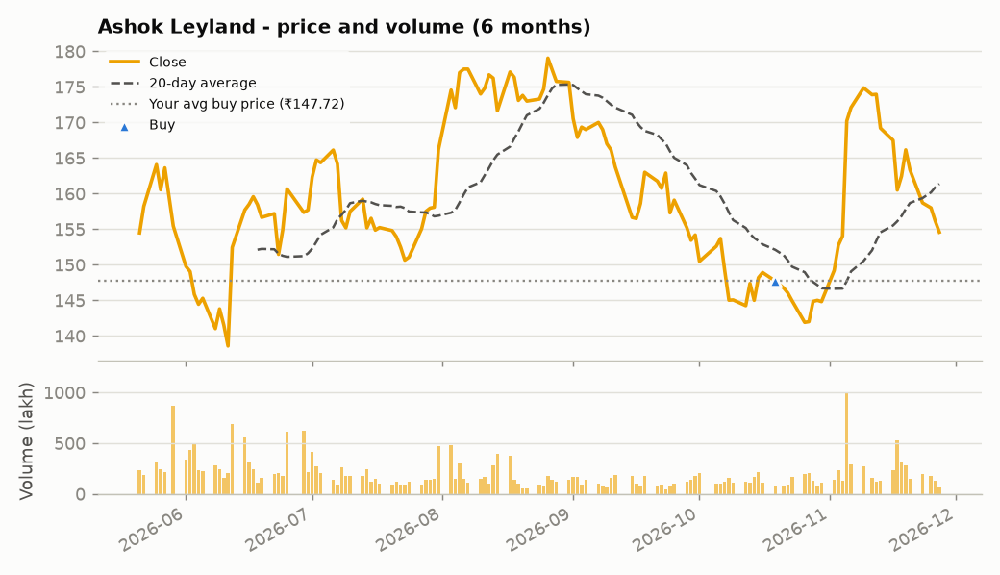

# Core-Equity Virtual Portfolio

> This is a **virtual (paper) portfolio built for learning and skill demonstration**. It is **not investment advice** and not a recommendation to buy, sell or hold any security.

**Last updated:** 17 Nov 2026, 11:32 AM IST  |  **Market data as of:** 2026-11-17  |  **Start date:** 2026-10-16

**Snapshot type:** Live intraday snapshot

_Live snapshot: today's session is still in progress, so volume is partial and "Volume vs 20d avg" will look low. The final end-of-day snapshot is published at 5:45 PM IST._

**Jump to:** [Summary](#portfolio-summary) · [Holdings](#holdings) · [Allocation](#allocation) · [Performance](#performance) · [Trade book](#trade-book) · [Companies](#company-deep-dives) · [Method](#how-this-works--data-sources)

## Portfolio summary

| Metric | Value |
|---|---|
| Current value | **₹2,56,67,552** |
| Total P&L | **₹10,68,822 (+4.35%)** |
| &nbsp;&nbsp;Unrealised (open positions) | ₹14,67,310 |
| &nbsp;&nbsp;Realised (shares already sold) | -₹3,98,488 |
| Today's change | ₹23,610 (+0.09%) |
| Nifty 50 since start (same money invested) | +10.57% |
| Outperformance vs Nifty 50 | -6.22% |
| Cash (uninvested) | ₹71,41,482 |
| Virtual money put in | ₹2,45,98,730 |

_▲ buy · ▼ sell_

## Holdings

| Stock | Shares | Buy price | Current price | Today's close | Prev close | Day | Value | Weight | P&L | P&L % |
|---|---:|---:|---:|---:|---:|---:|---:|---:|---:|---:|
| Maruti Suzuki | 290 | ₹11,489.00 | ₹12,660.00 | - | ₹12,571.00 | +0.71% | ₹36,71,400 | 14.3% | ₹3,39,590 | +10.19% |
| Ashok Leyland | 1,000 | ₹147.72 | ₹166.30 | - | ₹167.49 | -0.71% | ₹1,66,300 | 0.7% | ₹18,580 | +12.58% |
| Eicher Motors | 1,000 | ₹7,266.00 | ₹7,686.00 | - | ₹7,650.00 | +0.47% | ₹76,86,000 | 29.9% | ₹4,20,000 | +5.78% |
| Linde India | 500 | ₹5,961.00 | ₹6,848.00 | - | ₹6,911.50 | -0.92% | ₹34,24,000 | 13.3% | ₹4,43,500 | +14.88% |
| Linc Ltd | 1,000 | ₹85.00 | ₹87.10 | - | ₹89.06 | -2.20% | ₹87,100 | 0.3% | ₹2,100 | +2.47% |
| Ather Energy | 1,000 | ₹1,677.20 | ₹1,930.70 | - | ₹1,939.60 | -0.46% | ₹19,30,700 | 7.5% | ₹2,53,500 | +15.11% |
| Bank of India | 1,000 | ₹131.33 | ₹158.97 | - | ₹152.97 | +3.92% | ₹1,58,970 | 0.6% | ₹27,640 | +21.05% |
| Jio Platforms | 1,000 | ₹1,439.20 | ₹1,401.60 | - | ₹1,402.00 | -0.03% | ₹14,01,600 | 5.5% | -₹37,600 | -2.61% |

**Best since buy:** Bank of India (+21.05%)  ·  **Worst since buy:** Jio Platforms (-2.61%)  ·  **Biggest mover today:** Bank of India (+3.92%)

## Allocation

| Sector | Value | Share |
|---|---:|---:|
| Automobiles | ₹1,34,54,400 | 52.4% |
| Cash | ₹71,41,482 | 27.8% |
| Industrial Gases | ₹34,24,000 | 13.3% |
| Telecom & Digital Services | ₹14,01,600 | 5.5% |
| Financials | ₹1,58,970 | 0.6% |
| Stationery & Writing Instruments | ₹87,100 | 0.3% |

## Performance (as on 17 Nov 2026, 11:32 AM IST)

## Trade book

<b>Transaction history</b> - 24 entries, newest first

| Date | Stock | Type | Shares | Price | Amount | Note |
|---|---|---|---:|---:|---:|---|
| 2026-11-04 | Jio Platforms | BUY | 1,000 | ₹1,439.20 | ₹14,39,200 | Bought 04-Nov-26 at 1439.20 (10:29 AM IST per Google Finance quote) |
| 2026-11-04 | - | DEPOSIT | - | - | ₹14,39,200 | Fresh virtual money to fund Jio Platforms |
| 2026-10-27 | Bank of India | BUY | 1,000 | ₹131.33 | ₹1,31,330 | Bought 27-Oct-26 at 131.33 (12:54 PM IST per Upstox quote) |
| 2026-10-27 | - | DEPOSIT | - | - | ₹1,31,330 | Fresh virtual money to fund Bank of India |
| 2026-10-27 | Ather Energy | BUY | 1,000 | ₹1,677.20 | ₹16,77,200 | Bought 27-Oct-26 at 1677.20 (12:37 PM IST per Upstox quote) |
| 2026-10-27 | - | DEPOSIT | - | - | ₹16,77,200 | Fresh virtual money to fund Ather Energy |
| 2026-10-27 | HDFC Bank | SELL | 4,572 | ₹687.95 | ₹31,45,307 | Sold 27-Oct-26 at 687.95 (12:08 PM IST per Business Standard quote) |
| 2026-10-22 | Linc Ltd | BUY | 1,000 | ₹85.00 | ₹85,000 | Bought 22-Oct-26 at live NSE price 85.00 (12:30:26 PM IST; source NSE_CMDATA) |
| 2026-10-22 | - | DEPOSIT | - | - | ₹85,000 | Fresh virtual money to fund Linc Ltd |
| 2026-10-22 | Eternal (Zomato) | SELL | 10,245 | ₹309.00 | ₹31,65,705 | Sold 22-Oct-26 at live NSE price 309.00 (12:30:26 PM IST; source NSE_CMDATA) |
| 2026-10-21 | Linde India | BUY | 500 | ₹5,961.00 | ₹29,80,500 | Bought 21-Oct-26 from cash at 5961.00 (NSE last traded 10:53:52 AM IST per Upstox web quote) |
| 2026-10-21 | Fiem Industries | SELL | 1,000 | ₹1,816.90 | ₹18,16,900 | Sold 21-Oct-26 at live NSE price 1816.90 (10:03:32 AM IST; source NSE_CMDATA) |
| 2026-10-21 | Manorama Industries | SELL | 1,000 | ₹1,749.00 | ₹17,49,000 | Sold 21-Oct-26 at live NSE price 1749.00 (10:03:32 AM IST; source NSE_CMDATA) |
| 2026-10-21 | Fiem Industries | BUY | 1,000 | ₹1,813.60 | ₹18,13,600 | Bought 21-Oct-26 at live NSE price 1813.60 (10:00:26 AM IST; source NSE_CMDATA) |
| 2026-10-21 | Eicher Motors | BUY | 1,000 | ₹7,266.00 | ₹72,66,000 | Bought 21-Oct-26 at live NSE price 7266.00 (10:00:26 AM IST; source NSE_CMDATA) |
| 2026-10-21 | - | DEPOSIT | - | - | ₹72,66,000 | Fresh virtual money to fund Eicher Motors |
| 2026-10-20 | - | DEPOSIT | - | - | ₹19,00,000 | Fresh virtual money to fund Fiem Industries |
| 2026-10-19 | Manorama Industries | BUY | 1,000 | ₹1,796.80 | ₹17,96,800 | Added on 19-Oct-26 (CMP 1790.40 per Trendlyne) |
| 2026-10-19 | - | DEPOSIT | - | - | ₹18,00,000 | Fresh virtual money to fund Manorama Industries |
| 2026-10-19 | Ashok Leyland | BUY | 1,000 | ₹147.72 | ₹1,47,720 | Added at ~11:25 AM IST |
| 2026-10-19 | - | DEPOSIT | - | - | ₹3,00,000 | Fresh virtual money to fund Ashok Leyland |
| 2026-10-16 | Maruti Suzuki | BUY | 290 | ₹11,489.00 | ₹33,31,810 | Initial allocation |
| 2026-10-16 | Eternal (Zomato) | BUY | 10,245 | ₹325.30 | ₹33,32,698 | Initial allocation |
| 2026-10-16 | HDFC Bank | BUY | 4,572 | ₹728.85 | ₹33,32,302 | Initial allocation |

<b>Closed positions</b> - 4

| Stock | Bought (avg) | Sold (avg) | Held | Invested | Proceeds | Realised P&L | Return |
|---|---:|---:|---:|---:|---:|---:|---:|
| Manorama Industries | 2026-10-19 @ ₹1,796.80 | 2026-10-21 @ ₹1,749.00 | 2 days | ₹17,96,800 | ₹17,49,000 | -₹47,800 | -2.66% |
| Fiem Industries | 2026-10-21 @ ₹1,813.60 | 2026-10-21 @ ₹1,816.90 | 0 days | ₹18,13,600 | ₹18,16,900 | ₹3,300 | +0.18% |
| Eternal (Zomato) | 2026-10-16 @ ₹325.30 | 2026-10-22 @ ₹309.00 | 6 days | ₹33,32,698 | ₹31,65,705 | -₹1,66,993 | -5.01% |
| HDFC Bank | 2026-10-16 @ ₹728.85 | 2026-10-27 @ ₹687.95 | 11 days | ₹33,32,302 | ₹31,45,307 | -₹1,86,995 | -5.61% |

## Company deep-dives

---

### Maruti Suzuki  _(Automobiles)_

[Google Finance](https://www.google.com/finance/quote/MARUTI:NSE) · [All BSE announcements](https://www.bseindia.com/corporates/ann.html?scrip=532500)

| Close | Day change | Day range | Volume | 20d avg volume | Volume vs 20d avg | 20d volatility (ann.) | 52w range |
|---:|---:|---:|---:|---:|---:|---:|---:|
| ₹12,660.00 | +0.71% | ₹12,600.00 - ₹12,815.00 | 142,968 | 566,617 | 0.25x | 28.95% | ₹11,170.00 - ₹17,292.00 |

**Research reports**

- [One-page snapshot](analysis/Maruti_OnePager.pdf)
- [Detailed report](analysis/Maruti_Detailed.pdf)

<b>Official company announcements (BSE)</b>

- No recent filings fetched; see the link above for the full list.

<b>Latest news (trusted publishers + official company newsroom)</b>

- [Maruti 800, once every middle-class family's dream car, becomes first Indian vehicle to win FIVA heritage](https://news.google.com/rss/articles/CBMilAJBVV95cUxOU0tmYVp4Rk1NOW91RF90QlZSbVdWaVlFVEhBejJ0TGpaa1BjSUF1eW1NQ2habVRfa3hNWUdMOEo1bkRsanhoYmM0eFNhU1NyeFk2Z19IOXFxS1dyMk01Tzh0SW42SS1XN3hETmRHN3RNNkNDZkZTYjlja2IteUYzTi14WVBZTHVCZFlHVHU0NkFUd1VkMk5KOUNXZzBNRmtKaDZoVlVmWnNWeUJvWmNVUXBTQ2hvT28zb1otejFkdGNtTjExLVdGb2Mzak04NTNjSmNaanY4bkZjaFR2Y3VDQWFEQ2R2clNqM1F0dWRxQWo4MFRFcm82WEF3aFdTZHp1OUpGU3hXY2ctODJxUk1qbDRQbGHSAZoCQVVfeXFMTkZzSXRQNUhPdUR3Y3M0S0FXczdONzU3ZVlTYjRGWXFlbmdWMVhLaV9iMnJud1dwclRhWHhtZkg2NHBDMnVuTFNqOWhJSHpMS3hmUm16cEVhQ0ZpaFBVd2t3NUpoX1JiNUVuWEUxLThmNlZkOF9ueHVDSG5oT2RzS2lGeEcwbzlXb0pQWTRLQk83aTU0WXQyaWFWOHdDWFRUdDVWQlk2c3Z6a1h3LVJMVFZoNmN3NWRoNmJiZHVrbGFZaDlOUHZxSzc2Rm1yN2pGdE5yOHA1X1cyZFN1WHVQTXJSbVA2V2VRTTREaEpVMzN2NVpVUlVJRk0yZFF6OVJPUVNLenk5dkFDRnZDSGFKODRleGtwU0cyalZB?oc=5) - _The Economic Times, 16 Nov 2026, 07:18 PM IST_
- [Maruti drives car exports as rivals lose ground](https://news.google.com/rss/articles/CBMipgFBVV95cUxPYzBKdjd3TlFEMEF2ekxvd21TV2Zpb3VqTjdubWRudHZwRjZOdE9jT0lVYjJsNDBaN3hUNU1WZXZhY1dDQnFYMUFzWThnTHZyWTFUMUlHWHhnM0tRME1INy1hRG5LZmFsVzlrVF9MWDFpS1NmRXNnR1NFbkg1YnNpalBQc28wd096TXdSYTNJb2dNNWhMS2U2dExUdkhTS3VCOS1Yd2p30gGsAUFVX3lxTE1HSXdyeDJKbHZzTFctU21FS296NzVpemlwRkZ5MDdtN2ZPYWJxQXh4ZlBVXzFUanJLdUY3NHZkRWVPQldZbXd4OFA3dEhTRENfdU9GMGYxaWg0aFZsLUpmVklHQUJ3LWtQTGRBZzVuOGgybmRsRUFkN0hLQ2prRC10WXE5WllfZU8xVGVQTEFfUnpiZDVSNjA1UkFoaEllN2RTSGcxczNYdEVhT1A?oc=5) - _The Financial Express, 15 Nov 2026, 07:26 PM IST_
- [Planning to buy a new Maruti Suzuki car? Here’s a list of top five highest-selling cars in October | Details](https://news.google.com/rss/articles/CBMi8gFBVV95cUxOZ2xnZi1XQ2hDbE9LZFdXd21RZXo2YVhYZlJaZ3pCZXJ5ZG5JY1prY2l4NmFOZmFmQXpuRVNMUE05RUQzUXc2VnB2OEtrTHozdUpvRjE4VDBZV21kbXRJbDlLd0lfUlVVa0lhVDZ4NGF3ZEk4WFhBdFl3QVdWSGNMdUIzcXR2SE5mckRlU202aFZ0RlM2bFNMZ19BZ1pZMGd6ZHRtbXVDcURCMFlQYURPQmFOMUJGUklLblBNZjNfUmVOVWp6VGN3ZG1RakNIM0JrZEt4NHBfc1hGWm9xOTJyNENXODBKWDRMY0RqNVdqTUVCQdIB9wFBVV95cUxQRm12NFdlSEc1NGpTVlp5bUNPcEFtX0lrZm1mMC1QUGt4b0R6X2VYMHd0NExUemNSbkdBcThabldUdDR0S1Vab25wSHVGTHY0VFZVaDNZOG9nTG54YzgydFlmWEVRaUxJRlhITlliUm9ENFhfY1RYS3BScm1GTkVOcVM3UVA1OXhzb1RMaTlPcHJWeFh6X3BwYm5YcW1QYkZyVU5EbHRjdkFIWXVkR25yWnlYZHVJRURrRUM5X1J1LTZZdHhmNUEzTzlxTEJPNlAzLXd6SjJyLUpqbS1paEo0dTJmRzFRWDBDRjhNTXdsemlfQWxOTHBv?oc=5) - _Livemint, 14 Nov 2026, 11:51 AM IST_

---

### Ashok Leyland  _(Automobiles)_

[Google Finance](https://www.google.com/finance/quote/ASHOKLEY:NSE) · [All BSE announcements](https://www.bseindia.com/corporates/ann.html?scrip=500477)

| Close | Day change | Day range | Volume | 20d avg volume | Volume vs 20d avg | 20d volatility (ann.) | 52w range |
|---:|---:|---:|---:|---:|---:|---:|---:|
| ₹166.30 | -0.71% | ₹165.85 - ₹172.80 | 25,504,346 | 19,764,289 | 1.29x | 43.45% | ₹138.58 - ₹211.92 |

**Research reports**

- [One-page snapshot](analysis/Ashok_Leyland_OnePager.pdf)
- [Detailed report](analysis/Ashok_Leyland_Detailed.pdf)

<b>Official company announcements (BSE)</b>

- No recent filings fetched; see the link above for the full list.

<b>Latest news (trusted publishers + official company newsroom)</b>

- [Broker’s call: Ashok Leyland (Hold)](https://www.thehindubusinessline.com/markets/brokers-call-ashok-leyland-hold/article71707959.ece) - _BusinessLine, 16 Nov 2026, 06:19 PM IST_

---

### Eicher Motors  _(Automobiles)_

[Google Finance](https://www.google.com/finance/quote/EICHERMOT:NSE) · [All BSE announcements](https://www.bseindia.com/corporates/ann.html?scrip=505200)

| Close | Day change | Day range | Volume | 20d avg volume | Volume vs 20d avg | 20d volatility (ann.) | 52w range |
|---:|---:|---:|---:|---:|---:|---:|---:|
| ₹7,686.00 | +0.47% | ₹7,610.50 - ₹7,729.50 | 200,444 | 468,559 | 0.43x | 23.31% | ₹6,586.00 - ₹8,190.00 |

**Research reports**

- [One-page snapshot](analysis/Eicher_OnePager.pdf)
- [Detailed report](analysis/Eicher_Detailed.pdf)

<b>Official company announcements (BSE)</b>

- No recent filings fetched; see the link above for the full list.

<b>Latest news (trusted publishers + official company newsroom)</b>

- [Eicher Motors: Nomura maintains 'Neutral', cuts target price to Rs 8,022 after 2Q margin miss](https://news.google.com/rss/articles/CBMi7gFBVV95cUxPZW9XTTRCS1BGamN6TzhzOWYyangtRGVNdERKQThkV3ljZzZNVDYzcThQTUswZ01yMENjOFV0ZXhVTWY1TzBxYVJSSWQ4WDBzRl9BUFQ4RC1YN0hFLWptR3BkWDZFSHdHcWFHdHotVkNfR0o2M2J0eUdpUGRoV2JYdHBJbXNMYWdmSUthODdsdDRIUEJ4bWlhWGRxbnhUcmVXcDZGcHFjeVgtdUtEOUE1T0ZHTkYyVVNsakZwTW9DdGJob1VlZmt5R25iRGthMHM3QWI0YlVvN1BTM1c1N2VLaWFWWjRfSTRyZjR4bnZB0gHuAUFVX3lxTE9lb1dNNEJLUEZqY3pPOHM5ZjJqeC1EZU10REpBOGRXeWNnNk1UNjNxOFBNSzBnTXIwQ2M4VXRleFVNZjVPMHFhUlJJZDhYMHNGX0FQVDhELVg3SEUtam1HcGRYNkVId0dxYUd0ei1WQ19HSjYzYnR5R2lQZGhXYlh0cEltc0xhZ2ZJS2E4N2x0NEhQQnhtaWFYZHFueFRyZVdwNkZwcWN5WC11S0Q5QTVPRkdORjJVU2xqRnBNb0N0YmhvVWVma3lHbmJEa2EwczdBYjRiVW83UFMzVzU3ZUtpYVZaNF9JNHJmNHhudkE?oc=5) - _Moneycontrol.com, 17 Nov 2026, 09:40 AM IST_
- [New Royal Enfield Interceptor 650 Coming In 2027, Here's What Could Change](https://news.google.com/rss/articles/CBMiuAFBVV95cUxPa1RSRHNzT0dNRmtheHRaNkVha1NnNmllRExkXzlDVEtyVDY1SUFIV3d2UnM0THN4ZDIwak5hVDhKMHJqbVh5cDF5T1QxRW9SaXhWelFUTnp5R0piRnFCcGhhVUlaZUlyRjZPV1NtQURVbnp0ejRSQ1VCbHNrN01IZU5SSFY1dEVlVy04Nk53Y2FEeVdKb2xLaUNOOFU3amM3OV92WFZzeDZVSWtQbjQ1VmZoc0djUDNs0gHAAUFVX3lxTE1YcV9MNHhxM3RkVExtMXBIVHhzN2xVZzRoMDJoNVRiVzM1VFpjbVBOVXJocTR2V18zb2o3bEJtOGVNNmh4a0hXblJiRUhlRk5jQnB2SGkzcld5R3UxSHRTRDRMQjRnYkNfSl9mVTZ4X2hJWlBVX1psLTJOTm5VZ3A3X3g3WTI1bmFTX29nS0NvR05LTHo4aVFRRWoxWHo4Rmx0ZmNGOEpyYjZsLVo2azlIMlJoclhsMHQ3X21wX19VNQ?oc=5) - _NDTV Profit, 16 Nov 2026, 07:08 PM IST_
- [Eicher Motors margins under pressure despite strong Royal Enfield demand](https://news.google.com/rss/articles/CBMi1gFBVV95cUxOWmhKZzVyT29uMWtUV3NVTHVldHdzQjJxQTRtellxcmdVdnNPTlByejdnTktLVDc5dk5aSkNnVmxkZkdudTI1Y19EbnVQN0h3R0VEZ2VxWFJsSVh3VzBUX2daNWcwb3NwblFyWVJ6c1hwZzR3US1HbmJoblhDc1o0MFg5bVdLTE5hU051QmdXbmJzc25CZVA0UE01REV0c2xLdjZWcGRfaEJua3RMVDdXa1lhZTFtZ0RSSzVzSGFIS0x5S2RLZ0RSR3M3Z2xtbFMtZENyTzV30gHbAUFVX3lxTE9nal9vZ1UzNmR1ODJ3dEtvTEZlQVBZamJ5cTA3aFQ4bU82UFIwWVRMN2VpXzVSenJiV3gtbVJLZWxpVWt3NzIyaGVNeEhqN2tOWENING16Y0htVTItUkNfRERiYlh2bHA1TTdlY19VczQ4ZWtfUW51WjBiSjBFVmlMX1dXbldDRW1iN2Fsa2wtdnI1cnlRRHl4MF9ZQV9WYWFZcGFjLUhwNXhXYnJ1bklLaUQxd0NRQ0toa19xV0hIQTY3T01YOEwzOFpYY25wUllKeFZrUDJ1aEZVSQ?oc=5) - _Business Standard, 16 Nov 2026, 04:49 PM IST_
- [Live: Market breadth negative; Tata Motors PV, Eicher Motors drop post Q2 | Closing Bell](https://news.google.com/rss/articles/CBMi7AFBVV95cUxPelVNZVpHWHJ3RG5XbGhpMC1SYUNIUVRjcGFIbEpnam5kMjdZblJZelA3aW0wME1YT2RNMFpxa2JpZnY5cHgyel9HWW84dHFleHhLd0R4M0o5R1FueDduYnp4YkEyWjNvck5MWXMwbzNOX0xwSHp4bU5PMWt0eWE2ZXNia1JDOVVlaHNubEtZWGpscTgtclFXNmdHV0ZMWFZJbktGQW5mNm04REVsbXhkR293SXhlNU54R3QxNHVJUmFGWjQ5c0ZuektvV1VPeGZaY09OQzlxNVpZcmpUR2ZEUjZNX05QbHFQalE0NtIB8gFBVV95cUxOaXNhdFlfVnhFU2Q1RS1TY0FpZV8tcHRBZ25JOTIwcXE2emNXVEJzZTZ0aGtTZlVhQ3YzdmJiRjRwMEUwSDFpSDB2UE5oQ0xjZk4yaHVjaWFIVXFSVGFKWXp6NU4xOGVrZkhpRE9ZbDF4Tkh1Sk1ORUtfTDR0SHhjVURudFE4MVRfRHExVlI3V0FPYVZzWEU3dnJCYTF1QW9PUmZFUkpjQzZhdDNldmJpMThhcU9vbWRnQUdRdnhRa08wUTNTTG9CZnNUV0V6VDRaUWh2SkhnYUx1SnBCTExqdXYxRFhoOERhS3phTUpOdjJPdw?oc=5) - _Moneycontrol.com, 16 Nov 2026, 03:00 PM IST_
- [Tata Motors PV vs Eicher Motors: Which auto stock is set to race ahead, and which should you buy after Q2 results?](https://news.google.com/rss/articles/CBMijgJBVV95cUxONGw0eE55S29NaE80UWUwYXhUaUE1U1MwMnhjblE5NEJhd3lZNzljN3F6RUduQk9kWE11Vkk4V3hRbDVoVlk2aGdWVDVHRXp0ZmRpQWRHOFctX21TalNHUHpEOW0tcFdFenRtQzJkR0FJX2UzdExTZWRMa1prN0huNDVUVTZRc3VXUWtpNDhLYk9vSDF3bHUtTHNEOG5zX3hrMnJOV2g0dFlCa1BRMU1UR3lRem82MDRsREtwZWdtMEp6eUhuYmZSVkJIbVlBNHYtSzAwNmZFS3hFZ3dvWXFjZllFTlVPYk9JVnRLVksxckV0U1BWbTQ4ZXAyb19CaENiVS1sQzM1MWpWY0pwNHfSAZMCQVVfeXFMTmFzMEVqMlRHM1hxZ2ZJeDNCQnN6TklmQ2w3N19kTUJfcUVHTEpUYzlMU1kybkE3WWlXUUw5clNIMWpmajRLNEJzRlFvR1RVWUZjbHBrdlVnVmxkY0ZIM2FuQ2Mwc1V1dFpaQmNCYVdrbXFidUNTSm5RVTVCSFIzRXNiM2V3d052UXpRbExRTE1pdGNNRThsekRwOHljaWwySmozelQ0Slg1Qko2Y0xFUTMwSHozQ2N2cmNCTXFNbXVsRVByVlNFcGVodl9KeTE0ajZ2aXhyNDNUR1p6Y0E2ZDJoMzNuTzlCNkVUMnFZU2dvX3p1SS0yQTZXUVdoNFJaSEV6WEN4YmpwQnE3R2ZVd2paVTQ?oc=5) - _Livemint, 16 Nov 2026, 02:12 PM IST_

---

### Linde India  _(Industrial Gases)_

[Google Finance](https://www.google.com/finance/quote/LINDEINDIA:NSE) · [All BSE announcements](https://www.bseindia.com/corporates/ann.html?scrip=523457)

| Close | Day change | Day range | Volume | 20d avg volume | Volume vs 20d avg | 20d volatility (ann.) | 52w range |
|---:|---:|---:|---:|---:|---:|---:|---:|
| ₹6,848.00 | -0.92% | ₹6,848.00 - ₹7,009.50 | 12,423 | 46,741 | 0.27x | 50.83% | ₹5,632.50 - ₹7,847.50 |

**Research reports**

_Research report coming soon._

<b>Official company announcements (BSE)</b>

- No recent filings fetched; see the link above for the full list.

<b>Latest news (trusted publishers + official company newsroom)</b>

- No fresh headlines from trusted sources in the last few days.

---

### Linc Ltd  _(Stationery & Writing Instruments)_

[Google Finance](https://www.google.com/finance/quote/LINC:NSE) · [All BSE announcements](https://www.bseindia.com/corporates/ann.html?scrip=531241)

| Close | Day change | Day range | Volume | 20d avg volume | Volume vs 20d avg | 20d volatility (ann.) | 52w range |
|---:|---:|---:|---:|---:|---:|---:|---:|
| ₹87.10 | -2.20% | ₹86.70 - ₹90.48 | 3,189 | 62,077 | 0.05x | 107.21% | ₹76.41 - ₹125.23 |

**Research reports**

_Research report coming soon._

<b>Official company announcements (BSE)</b>

- No recent filings fetched; see the link above for the full list.

<b>Latest news (trusted publishers + official company newsroom)</b>

- No fresh headlines from trusted sources in the last few days.

---

### Ather Energy  _(Automobiles)_

[Google Finance](https://www.google.com/finance/quote/ATHERENERG:NSE) · [All BSE announcements](https://www.bseindia.com/corporates/ann.html?scrip=544397)

| Close | Day change | Day range | Volume | 20d avg volume | Volume vs 20d avg | 20d volatility (ann.) | 52w range |
|---:|---:|---:|---:|---:|---:|---:|---:|
| ₹1,930.70 | -0.46% | ₹1,906.00 - ₹1,972.00 | 1,109,731 | 3,681,631 | 0.3x | 61.57% | ₹601.35 - ₹1,945.00 |

**Research reports**

_Research report coming soon._

<b>Official company announcements (BSE)</b>

- No recent filings fetched; see the link above for the full list.

<b>Latest news (trusted publishers + official company newsroom)</b>

- [Ola Electric vs Ather Energy: Ather shines, Ola struggles in Q2; which EV stock offers better upside?](https://news.google.com/rss/articles/CBMi-wFBVV95cUxPQVgwb2RhM3F5ZTdFNWZIOEdXcGNSem9OczdEVXFPWmVsMUphTkI2eExnbHpPS1d1dWZLSjRYYjZyTHhnTXNsY2VOcldlbVNTdU0wVGpEdFJqRS11OWtQNGo3bzNwWTk5MHV4Xy0wMFlQWHFZVGk2dWJFWWtvbjRtYmhHQl94MkwwckZIaXZSMGRhRVdYNUFMenJWTkFTLXoyVVpaRjNvdUZudHJJaFRkaXJ3cTBGNmdsVUx1Z2ROOEVWcTEzdUNPNmF4eHdJTVMxYUhLeWV0elpuUHpDTnQyVEVMc3Noa3BiZmVMS3pnTjRIdGFmT0pNa3dfc9IBgAJBVV95cUxObkF2dlpDTWtQWEhHaXlDa0pSQUh1T3pUSEl0MDJjQVFWazFJdG5VM1RkbXVLNG94LUs4LUFzZDRVSl81T01qbk5SN2tRak1Gd0t5SWRmU2ZxUkctOW1XU0lpeUxvVDFaUDdVZWRucUVZd00xbnp4d3ZBclBsRVoxS1M1TFhLZkk2Vi1TeVpTb2dyU1VOc0JrSXdmV0xuLTdnUTNKN3BvNnpzVXF5R01FRlgxOXBBTGdhcHdnd1RESGM4ek9WVC00b1ozWVhJMjRiRS1ZbXBXbDQzeWdpbXotZHV1QWtqMFRyV3M3Q0JMVVhBbzRHVUpXZkF5ZE13UGlM?oc=5) - _Livemint, 16 Nov 2026, 03:18 PM IST_

---

### Bank of India  _(Financials)_

[Google Finance](https://www.google.com/finance/quote/BANKINDIA:NSE) · [All BSE announcements](https://www.bseindia.com/corporates/ann.html?scrip=532149)

| Close | Day change | Day range | Volume | 20d avg volume | Volume vs 20d avg | 20d volatility (ann.) | 52w range |
|---:|---:|---:|---:|---:|---:|---:|---:|
| ₹158.97 | +3.92% | ₹153.21 - ₹159.20 | 10,599,821 | 10,501,603 | 1.01x | 40.80% | ₹126.32 - ₹177.20 |

**Research reports**

_Research report coming soon._

<b>Official company announcements (BSE)</b>

- No recent filings fetched; see the link above for the full list.

<b>Latest news (trusted publishers + official company newsroom)</b>

- [Bank of India waives 100% processing charges on home, four-wheeler loans till March 2027](https://news.google.com/rss/articles/CBMi9wFBVV95cUxNMXhPOERVMmF5NGc2UzhhWmdRelB1NFR2TlJSYTl6ZUVScjVaR2V2aG1KZktPUWUtTHhnaTI1dVpCUmJWQ1hlZTVXLVQtYmJPMl9vZzZuc0VuTzBrSk5CcFJDNGpnMTN5eTNwTklwQ2hMbDFvVm5RazBhUTNwemdFQWVUaWhKd3RlQWpqTjVCWlYxaW9FRWl0SFJXQjBINXRrRGlCdW1MWjRsUVE4Zy14QkxSakpYMS1wb1dTYW5fMzJzbkFGZVV0OUEtOEdXMEd6TDhBU2V4cGpxMTlIa1NwM2xfOEl6VnhSamVUSmZySHdRSWFSX3FB0gH3AUFVX3lxTE0xeE84RFUyYXk0ZzZTOGFaZ1F6UHU0VHZOUlJhOXplRVJyNVpHZXZobUpmS09RZS1MeGdpMjV1WkJSYlZDWGVlNVctVC1iYk8yX29nNm5zRW5PMGtKTkJwUkM0amcxM3l5M3BOSXBDaExsMW9WblFrMGFRM3B6Z0VBZVRpaEp3dGVBampONUJaVjFpb0VFaXRIUldCMEg1dGtEaUJ1bUxaNGxRUThnLXhCTFJqSlgxLXBvV1Nhbl8zMnNuQUZlVXQ5QS04R1cwR3pMOEFTZXhwanExOUhrU3AzbF84SXpWeFJqZVRKZnJId1FJYVJfcUE?oc=5) - _Moneycontrol.com, 16 Nov 2026, 12:07 PM IST_
- [Bank of India - Suzlon Energy among 5 midcap stocks that saw highest mutual fund buying in October](https://news.google.com/rss/articles/CBMi8gFBVV95cUxObGRtTVVrbHJselpCUzdVcm8tQVpnenRQSkFKNW5qWlkzNDZseHBnR09UOXdkWld1TUdEQnhlUlJkUEROVktEZHJEdVlFODZOdTFLM05aOC1SSFZwdDRpUUxkbzdEZzFaczJ6cUhlT2lyUWcyYWJFQ1BTZTI0RlM5dmhrQzdRXzA4aC1yNDg1eV82cEh6VnlGdHl6SlBncjFvdjlWbWFfMHhsa2NHLVVZU1g0VENEdjlxUlhnaTBCcUVibHhFb0FMSmoxQkdDTXhUWm44NEthOGp5d2NaVUI4WWdNTUR4MXRqenNLYmEtTE1xZw?oc=5) - _The Economic Times, 15 Nov 2026, 09:38 PM IST_
- [SCoR, Central Bank of India ink pact to extend welfare facilities for railway staff](https://news.google.com/rss/articles/CBMi7AFBVV95cUxPaGtWbkFVM084cEFDWGFoZ09HRzdxbjB5OWJRY19rR1JvWWlHcmRJQVg4OXlsYUJOZERocDlaSHNLNmcyMWQwUHhBMGRvRTA3M0FvZHFEd0ZQMHE3dDNTcXl2UmJpVUIwU2FQek1ib3NtZmMwVWJkUGNLaDZiR3A3OFVnbGNXbHFnZ3YzOVI2dHlTOWV3Ny1JSHI4QTJ5dS1kTVBVZERwNjA1Q0NuSXhtaUR1dmFrQnVVMkxhczloTTRWbXZlcTRnWUwzTUJaQVg0UVpqMEhUQXh0LUViLVY1SS1kN2Q3T0RJYkFqdtIB8wFBVV95cUxPbXFsSWZtczVlSlViVFpNcDNsdzdaeHo4MjEyd05qazFHb3Y4dkI0TzlBYm9fZFY5bG8xeGZVZE1TcmpyWmRtZUxNVDJodXZ4djFmQmpSNmgweFIyTEpsVlJoVHVEUTlTY0hVcEllNmtEdE9MM3ZHSkRhTnNmMTRJOUlMSHpUdzYxcGlzWkprbnBpVmdDZU5pTnBObmFNOTk1SFBKYUJRZERpcUtCOF9BbnR6YWF4UkNXVjVsVGlDN3Q5SnNwNnlOdFVQSXdTcmg2dzZ1QTY3b1VXWXRYQmpwRjRrQ0J2TEExT1lGZEk3N1dHYkk?oc=5) - _The Hindu, 14 Nov 2026, 11:49 PM IST_

---

### Jio Platforms  _(Telecom & Digital Services)_

[Google Finance](https://www.google.com/finance/quote/JPL:NSE) · [All BSE announcements](https://www.bseindia.com/corporates/ann.html?scrip=545004)

| Close | Day change | Day range | Volume | 20d avg volume | Volume vs 20d avg | 20d volatility (ann.) | 52w range |
|---:|---:|---:|---:|---:|---:|---:|---:|
| ₹1,401.60 | -0.03% | ₹1,400.50 - ₹1,408.30 | 1,127,849 | 25,226,815 | 0.04x | 10.60% | ₹1,395.90 - ₹1,437.40 |

**Research reports**

_Research report coming soon._

<b>Official company announcements (BSE)</b>

- No recent filings fetched; see the link above for the full list.

<b>Latest news (trusted publishers + official company newsroom)</b>

- [23 companies to see IPO lock-in expiry by Nov-end; Jio Platforms in focus](https://news.google.com/rss/articles/CBMi1gFBVV95cUxQOXF4c3ppMEZXcjJweGg1MzlMZ1JsWHFqdmx5U3BHUjZESWZjRUZDb1FLNzlmaktta3BjZ1VXYi1BYXNIYVZxbXF5SVo2UENBSjVHU1l0RmNrRzg1YmxscmJYWS1lMUpXOGI5WGdUbkFYX1JkTFltbE5VU2RwYWpSWms5UzFFVlNLa2ZlSmFSY1hzVEJQR2duQlJCQVlhN3BpcmdYUzNldEJ1RGxuMmliemR4V3huTWtZVzlkYVdtNUV2aFAwSC1QRjE3clktRWt3dlhWVi1B0gHbAUFVX3lxTE9iLXVxYWMzSEp5WjExaGlwc2RLQ2x1SHJNc2UtVS01OFoxcWJHTFlJcC1HN1ljWEVWbVRfNUZFd01pQnVzSWljTVJ3WTkzQmNXOXhtUU9mbENjbWFScWZhVWZuVTZjUGJQbE9JakpyZURXVTd2LU1GcEJpbGJPNVlIWVdGRi0yMGkzZ2hIZkh2ajc3WVdueFU1eEhXcTVwZHZsWFNDeE5SWHNvSHpxNnV2VlY2NEZoQXdFWnpCU25hMXViSTlNSGRWbUJJZEFmTXpIaXJ1SVg3NWdkUQ?oc=5) - _Business Standard, 16 Nov 2026, 11:49 AM IST_
- [Video | Mutual Funds' October Stock Picks: Jio Platforms, Airtel Among Top Buys; HDFC Bank Sold](https://news.google.com/rss/articles/CBMivwFBVV95cUxQOE1FN3VaWlZzSkxQU05oTkMyVU5uQmlIbnluVXFjQnduYTJJWWlwVGZKcHBISjBHV01mbnRnTXNkZDVNVkM1T1Mwb0Q0emhNWVlMVmpkTXRzcnhXSmtUb3RidTdJNk5ycW9iajhIV18tRm9YWVNWRG1yR1NaQ2EzWUlmcGpSTWZ6UkpnR0tlbFJkOGxGUk1LanBadXcza1RmT0FrOTJMOG9JOFl6WGJoWlBQUDFtX2xrVkVDaGdGaw?oc=5) - _NDTV Profit, 16 Nov 2026, 11:28 AM IST_
- [Mutual Funds Buy Jio Platforms, Airtel, Infosys In October; Dump HDFC Bank, ICICI Bank, Reliance](https://news.google.com/rss/articles/CBMiiwJBVV95cUxOZlA2bFdGaG1zcno3UkljblhTNXFxazFSbDV5SlJCTmZ3ek9qSng0MFN6RVRfUVR3cTNJR0NRaXhMS09fMmE0YWp5YTkwM2lXZEZPaHBPX3RYdW1mWjFvRTlPNndTLW9MTnlwWm5VZnZBQkZmaEFaRFJUdmdYRVdVYVdVZmg3bUpEc1pSaHVJZkRsQm42RU5jRnRrYi1kNkR4ai1EM0taOUsxZTFrcnNHcldQNnJHc1Z3cnp6cTEwc0N2Wml4SXhWSVlrbUtzUUZ1VWROUmhuN3lLdzdDODFjcTJxYlRMRW93bEkzZVBmc3dMeVB1dWw4RVJFQ0o4Mm11WmpKY2MySG5FUVXSAZMCQVVfeXFMT3FlczhJSkF3VWlMdzFqdTFaWmUyYVhPeUJZa0FHZTdNa3UwUmJEcEdSQlhvZWdheGpaLUk3djVxRmdQdGlsLW1ITHY5YTl6TGd5dC1jazlaV2Z6blJneTZVV044eGFkRzNPV0d5UlBXdUxHbi1nV01sMEFSeFJXZGhLMlloUno1XzRJNDVTMHJGUzlLaUlUck1kMnhUcVpHWk9VQVhiUDZreTVXeGNDWlhlTmRhMHlhOS1WcEI0SnN5Z3JtOXhaRk5lWVBpRm5KZEF5SzVUQ2ZqcG5fdnBuQ1FVYy1mQU5lUTFlTTZvTndhRXd2aktrT2d3czNjbWhLTWpubE1PdWFianZ0Y0VBeGFoQVE?oc=5) - _NDTV Profit, 16 Nov 2026, 10:16 AM IST_
- [Jio Platforms begins talks with Indian firms for satellite launch- Mint By Investing.com](https://news.google.com/rss/articles/CBMiywFBVV95cUxQeXgxSmpEYmhBU1NNM3A2YWw1TlhmXzlialR0Mmw3bXExeDVldmNhTi1RSGZ3YlNPVHRucWhkZVZna1ZWbzVuNHVyUHFFVTl6VmEyaXZaNkJLdFk1MDZUSmMzUHNtaGVpc3FaMHlyTDloU2VrZTNnVlRkWGFrazByOHJOZnJyNU5aUDhVeGJ2ZElZLTd4OU5rdXZXUGZFM2Zoa2pnbmV2RExReTNEMDZYMUZFRHk3aFdaZ3VFZ3RESVZPNGNqS19pM2h3RQ?oc=5) - _Investing.com South Africa, 16 Nov 2026, 09:50 AM IST_
- [Jio explores Indian launch partners for satellite constellation; rocket capacity a hurdle](https://news.google.com/rss/articles/CBMisAFBVV95cUxOelVlMEZZTEo3ZjUzNjI2aDR2SUdzR3ZjWEpCMEdUZ2E3bXFRMTBlX3JHWWptQjdJcFQ5Q1lWWHNhT3ZNclR3S0huMkhsSWFvQUFCR3VHcjFqOGZndFVEbGVMSHBYT0JpcE1SOVFJZXJjWmIyTnhHTk5MZGhHd1RUdXJVb0prNEROdDFNRnQyeDZ1SndkeHZYUHFVQWVNTTBaNHF2N3djLVJlUVdraC1WN9IBtgFBVV95cUxQV3hqN2J1Z0VvTVVUeE9KNWNYdnRxSS1Fc1NXbHlVMXpucTV0M3NPZm1aZ0FnVktaOFJKb2lXYklqUDg0VlBxYXFBRV9xZS0waFNSNmlKZjMtcFd4cVVjVXdYOUdNVlVpVlQxRGJKMTE3akpjTHc5YS1lM0MxNjQ4S3hpcFFJQ0RuUW1Kak5nTHdMaDdQZkUyVFN0OVhPb05PaFJTZkhJanJDR2F6QkczdjBvNjg5dw?oc=5) - _Livemint, 16 Nov 2026, 05:48 AM IST_

---

## How this works & data sources

- **Prices / volume:** Yahoo Finance via the open-source `yfinance` library (unofficial; may differ slightly from NSE official data).
- **Trades:** every buy / sell / deposit is a line in `transactions.csv`. A trade happens at the closing price of its date (live price for today). Average-cost method; no brokerage or taxes (virtual portfolio).
- **Corporate actions:** splits, bonus issues and dividends are detected from Yahoo Finance and added to `transactions.csv` as event lines on the ex-date (nothing old is edited). A split multiplies the share count and divides the average cost, so the invested amount stays the same; dividends add cash.
- **Benchmark:** every rupee put into the portfolio is also put into the Nifty 50 on the same day, so the comparison is like-for-like.
- **News:** Google News RSS + publisher RSS feeds, filtered to a whitelist of trusted publishers, de-duplicated, last 72 hours only. Each item links to the original article.
- **Official filings:** BSE corporate announcements (best-effort, with link to the full list).
- **Automation:** GitHub Actions refreshes this dashboard on weekdays every 30 minutes from 9:30 AM to 3:30 PM IST (live snapshots) and at 5:45 PM IST (end-of-day final snapshot + AI daily report); skips market holidays.
- **Metrics:** Volatility = 20-day std-dev of daily returns, annualised. Volume ratio = today's volume / average of previous 20 sessions.

> This is a **virtual (paper) portfolio built for learning and skill demonstration**. It is **not investment advice** and not a recommendation to buy, sell or hold any security.
