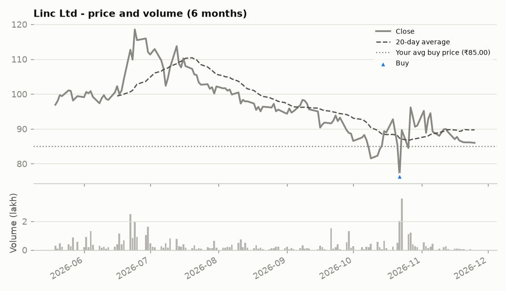

# Core-Equity Virtual Portfolio

> This is a **virtual (paper) portfolio built for learning and skill demonstration**. It is **not investment advice** and not a recommendation to buy, sell or hold any security.

**Last updated:** 23 Nov 2026, 03:32 PM IST  |  **Market data as of:** 2026-11-23  |  **Start date:** 2026-10-16

**Snapshot type:** End-of-day final snapshot

**Jump to:** [Summary](#portfolio-summary) · [Holdings](#holdings) · [Allocation](#allocation) · [Performance](#performance) · [Trade book](#trade-book) · [Companies](#company-deep-dives) · [Method](#how-this-works--data-sources)

## Portfolio summary

| Metric | Value |
|---|---|
| Current value | **₹2,66,10,772** |
| Total P&L | **₹20,12,042 (+8.18%)** |
| &nbsp;&nbsp;Unrealised (open positions) | ₹24,09,530 |
| &nbsp;&nbsp;Realised (shares already sold) | -₹3,98,488 |
| &nbsp;&nbsp;Dividends received (already inside Total P&L) | ₹1,000 |
| Today's change | ₹2,69,300 (+1.02%) |
| Nifty 50 since start (same money invested) | +10.15% |
| Outperformance vs Nifty 50 | -1.97% |
| Cash (uninvested) | ₹71,42,482 |
| Virtual money put in | ₹2,45,98,730 |

_▲ buy · ▼ sell_

## Holdings

| Stock | Shares | Buy price | Current price | Today's close | Prev close | Day | Value | Weight | P&L | P&L % |
|---|---:|---:|---:|---:|---:|---:|---:|---:|---:|---:|
| Maruti Suzuki | 290 | ₹11,489.00 | ₹14,010.00 | ₹14,010.00 | ₹14,011.00 | -0.01% | ₹40,62,900 | 15.3% | ₹7,31,090 | +21.94% |
| Ashok Leyland | 1,000 | ₹147.72 | ₹158.70 | ₹158.70 | ₹163.35 | -2.85% | ₹1,58,700 | 0.6% | ₹10,980 | +7.43% |
| Eicher Motors | 1,000 | ₹7,266.00 | ₹8,172.50 | ₹8,172.50 | ₹8,113.00 | +0.73% | ₹81,72,500 | 30.7% | ₹9,06,500 | +12.48% |
| Linde India | 500 | ₹5,961.00 | ₹6,961.50 | ₹6,961.50 | ₹6,572.00 | +5.93% | ₹34,80,750 | 13.1% | ₹5,00,250 | +16.78% |
| Linc Ltd | 1,000 | ₹85.00 | ₹86.13 | ₹86.13 | ₹86.15 | -0.02% | ₹86,130 | 0.3% | ₹1,130 | +1.33% |
| Ather Energy | 1,000 | ₹1,677.20 | ₹1,979.20 | ₹1,979.20 | ₹1,935.40 | +2.26% | ₹19,79,200 | 7.4% | ₹3,02,000 | +18.01% |
| Bank of India | 1,000 | ₹131.33 | ₹159.01 | ₹159.01 | ₹164.70 | -3.45% | ₹1,59,010 | 0.6% | ₹27,680 | +21.08% |
| Jio Platforms | 1,000 | ₹1,439.20 | ₹1,369.10 | ₹1,369.10 | ₹1,387.20 | -1.30% | ₹13,69,100 | 5.1% | -₹70,100 | -4.87% |

**Best since buy:** Maruti Suzuki (+21.94%)  ·  **Worst since buy:** Jio Platforms (-4.87%)  ·  **Biggest mover today:** Linde India (+5.93%)

## Allocation

| Sector | Value | Share |
|---|---:|---:|
| Automobiles | ₹1,43,73,300 | 54.0% |
| Cash | ₹71,42,482 | 26.8% |
| Industrial Gases | ₹34,80,750 | 13.1% |
| Telecom & Digital Services | ₹13,69,100 | 5.1% |
| Financials | ₹1,59,010 | 0.6% |
| Stationery & Writing Instruments | ₹86,130 | 0.3% |

## Performance (as on 23 Nov 2026, 03:32 PM IST)

## Trade book

<b>Transaction history</b> - 25 entries, newest first

| Date | Stock | Type | Shares | Price | Amount | Note |
|---|---|---|---:|---:|---:|---|
| 2026-11-20 | Ashok Leyland | DIVIDEND | 1,000 | ₹1.00 | ₹1,000 | Auto-detected from Yahoo Finance: dividend Rs 1 per share; ex-date 2026-11-20 |
| 2026-11-04 | Jio Platforms | BUY | 1,000 | ₹1,439.20 | ₹14,39,200 | Bought 04-Nov-26 at 1439.20 (10:29 AM IST per Google Finance quote) |
| 2026-11-04 | - | DEPOSIT | - | - | ₹14,39,200 | Fresh virtual money to fund Jio Platforms |
| 2026-10-27 | Bank of India | BUY | 1,000 | ₹131.33 | ₹1,31,330 | Bought 27-Oct-26 at 131.33 (12:54 PM IST per Upstox quote) |
| 2026-10-27 | - | DEPOSIT | - | - | ₹1,31,330 | Fresh virtual money to fund Bank of India |
| 2026-10-27 | Ather Energy | BUY | 1,000 | ₹1,677.20 | ₹16,77,200 | Bought 27-Oct-26 at 1677.20 (12:37 PM IST per Upstox quote) |
| 2026-10-27 | - | DEPOSIT | - | - | ₹16,77,200 | Fresh virtual money to fund Ather Energy |
| 2026-10-27 | HDFC Bank | SELL | 4,572 | ₹687.95 | ₹31,45,307 | Sold 27-Oct-26 at 687.95 (12:08 PM IST per Business Standard quote) |
| 2026-10-22 | Linc Ltd | BUY | 1,000 | ₹85.00 | ₹85,000 | Bought 22-Oct-26 at live NSE price 85.00 (12:30:26 PM IST; source NSE_CMDATA) |
| 2026-10-22 | - | DEPOSIT | - | - | ₹85,000 | Fresh virtual money to fund Linc Ltd |
| 2026-10-22 | Eternal (Zomato) | SELL | 10,245 | ₹309.00 | ₹31,65,705 | Sold 22-Oct-26 at live NSE price 309.00 (12:30:26 PM IST; source NSE_CMDATA) |
| 2026-10-21 | Linde India | BUY | 500 | ₹5,961.00 | ₹29,80,500 | Bought 21-Oct-26 from cash at 5961.00 (NSE last traded 10:53:52 AM IST per Upstox web quote) |
| 2026-10-21 | Fiem Industries | SELL | 1,000 | ₹1,816.90 | ₹18,16,900 | Sold 21-Oct-26 at live NSE price 1816.90 (10:03:32 AM IST; source NSE_CMDATA) |
| 2026-10-21 | Manorama Industries | SELL | 1,000 | ₹1,749.00 | ₹17,49,000 | Sold 21-Oct-26 at live NSE price 1749.00 (10:03:32 AM IST; source NSE_CMDATA) |
| 2026-10-21 | Fiem Industries | BUY | 1,000 | ₹1,813.60 | ₹18,13,600 | Bought 21-Oct-26 at live NSE price 1813.60 (10:00:26 AM IST; source NSE_CMDATA) |
| 2026-10-21 | Eicher Motors | BUY | 1,000 | ₹7,266.00 | ₹72,66,000 | Bought 21-Oct-26 at live NSE price 7266.00 (10:00:26 AM IST; source NSE_CMDATA) |
| 2026-10-21 | - | DEPOSIT | - | - | ₹72,66,000 | Fresh virtual money to fund Eicher Motors |
| 2026-10-20 | - | DEPOSIT | - | - | ₹19,00,000 | Fresh virtual money to fund Fiem Industries |
| 2026-10-19 | Manorama Industries | BUY | 1,000 | ₹1,796.80 | ₹17,96,800 | Added on 19-Oct-26 (CMP 1790.40 per Trendlyne) |
| 2026-10-19 | - | DEPOSIT | - | - | ₹18,00,000 | Fresh virtual money to fund Manorama Industries |
| 2026-10-19 | Ashok Leyland | BUY | 1,000 | ₹147.72 | ₹1,47,720 | Added at ~11:25 AM IST |
| 2026-10-19 | - | DEPOSIT | - | - | ₹3,00,000 | Fresh virtual money to fund Ashok Leyland |
| 2026-10-16 | Maruti Suzuki | BUY | 290 | ₹11,489.00 | ₹33,31,810 | Initial allocation |
| 2026-10-16 | Eternal (Zomato) | BUY | 10,245 | ₹325.30 | ₹33,32,698 | Initial allocation |
| 2026-10-16 | HDFC Bank | BUY | 4,572 | ₹728.85 | ₹33,32,302 | Initial allocation |

<b>Closed positions</b> - 4

| Stock | Bought (avg) | Sold (avg) | Held | Invested | Proceeds | Realised P&L | Return |
|---|---:|---:|---:|---:|---:|---:|---:|
| Manorama Industries | 2026-10-19 @ ₹1,796.80 | 2026-10-21 @ ₹1,749.00 | 2 days | ₹17,96,800 | ₹17,49,000 | -₹47,800 | -2.66% |
| Fiem Industries | 2026-10-21 @ ₹1,813.60 | 2026-10-21 @ ₹1,816.90 | 0 days | ₹18,13,600 | ₹18,16,900 | ₹3,300 | +0.18% |
| Eternal (Zomato) | 2026-10-16 @ ₹325.30 | 2026-10-22 @ ₹309.00 | 6 days | ₹33,32,698 | ₹31,65,705 | -₹1,66,993 | -5.01% |
| HDFC Bank | 2026-10-16 @ ₹728.85 | 2026-10-27 @ ₹687.95 | 11 days | ₹33,32,302 | ₹31,45,307 | -₹1,86,995 | -5.61% |

## Company deep-dives

---

### Maruti Suzuki  _(Automobiles)_

[Google Finance](https://www.google.com/finance/quote/MARUTI:NSE) · [All BSE announcements](https://www.bseindia.com/corporates/ann.html?scrip=532500)

| Close | Day change | Day range | Volume | 20d avg volume | Volume vs 20d avg | 20d volatility (ann.) | 52w range |
|---:|---:|---:|---:|---:|---:|---:|---:|
| ₹14,010.00 | -0.01% | ₹13,989.00 - ₹14,333.00 | 1,281,256 | 685,270 | 1.87x | 36.96% | ₹11,170.00 - ₹17,292.00 |

**Research reports**

- [One-page snapshot](analysis/Maruti_OnePager.pdf)
- [Detailed report](analysis/Maruti_Detailed.pdf)

<b>Official company announcements (BSE)</b>

- No recent filings fetched; see the link above for the full list.

<b>Latest news (trusted publishers + official company newsroom)</b>

- [Crash proof stocks: Sensex, Nifty bleed but these shares come out in flying green colour - HCL, TCS, Infy, Maruti - List](https://news.google.com/rss/articles/CBMijgJBVV95cUxOYjhodGw4V29LV0FyQTBvOEJsREpQZlQyenlpdDFMU3JwQkpzNGt0ZEprNnl5NkNDTzlNUkZwckVqWk4zSUFmdUkwMzhEWFZNU3pOenhOX1lvVDhCeXVaUUVSSjZGd0FCNG5RWFpObTZERFkzNElEMHBRakRmeWhkN08tbi1fZHpPZ1FQSHJ0UHV4NVFRVEFoRTRrdVpIRVM2VnZ1Y0tXX1llQmpPUW55SHExOUpDZFEycXRzNlpUVzJRa2tGWmFtZkZ4cGNkbU55cnNDRlhnVGJvTWdsdmd6cnl2ZEY3X2w4RHo1aWlLdFVhV29jX2FUX1NIeFN5aFRwTDNONWVuT3Y0T0tpVnfSAZMCQVVfeXFMTWwzSjljMjB1OWY2TDBkdUROVlFuUHBKTzlSWmhVMThvZkZMRWx6UzV3OXpRVUNDZVRzRVY2S0ZUUWtTRWdtRnZ1MENPUl82emtZLVJJVTRtN0diQkhSOVAycDBWZlRhVGVQX21JOW5SRGNaTHBQTDFWTFZNQ3ZZNndCMVZHTDJ3aDg2QzduNjlIMENGenczZm9PRm1LWEFqc0p5dnZXM0hVQ18xbmd6cnNVMTZMckZMay1FdDY0NjV6dXdQektsM0hqS2lqcTEtcklWU1hoaFdkV25Fc1o5S1ZCdkN1NlpEd2RSREJYU09mOWZ0a0ZXdjB1Tkx6bzlSb0hIdE4zeG1INDVhajhldXF4RkE?oc=5) - _Livemint, 23 Nov 2026, 01:40 PM IST_
- [Maruti Suzuki gains 2% on price hike; stock up 14% in one week](https://news.google.com/rss/articles/CBMixAFBVV95cUxQTFNUZ1dFekdmN3N1ZDJkbkdQaHQ2S1BQZ3lQUjhZdkZaT0gxNDN2R3Q2dVA3ZG1tY2pWTEkzTFY5Ynd3dnFYTXpmMURVQXhCU1JXQTdCYW1ueU9BamowSF95bU5tcHdKdFIxNGpCZFZuMU9RMVBvSmdqcmhmb01EMmgwcExBUEhvcWJNS0pwODRTZDVVbjhYelgxMWZMcG1Ed21VTENMenJRc2w2azY5Zkt0Rk1BVzNBRkl6aS1PZ1FsajVJ0gHKAUFVX3lxTFBwZ1lMSmlYYURvbGIxbHNlR0hqdmRiWnhndDVpMmwyX1FTdEx6NXplUzV1RDdBcjNVdTE4eHgzeW5PSmhHZTNKYm41RG1oZ3JJRkZBTnN4WC04OVEtZVBrTmtWMjdzUHYzdDd1SlJjRmpEdDR3dUFqT3dwbnJoQS1vMmEzb0Rpb2F1Y3pZR2NRVkNtaEFHZWdBVFM3QngwU0w1Q1Z3RUljT2FTNl9lNjRzMTh1LUtPOXFsSHUwQjNOOGt5QlNxa2Zncnc?oc=5) - _Business Standard, 23 Nov 2026, 11:01 AM IST_
- [Stocks to watch: Tata Steel, Waaree, Adani Energy, Maruti, IndusInd Bank](https://www.business-standard.com/markets/news/stocks-to-watch-tata-steel-waaree-adani-energy-maruti-indusind-bank-126112300090_1.html) - _Business Standard, 23 Nov 2026, 08:02 AM IST_
- [Top stocks to watch today: Tata Steel, APL Apollo Tubes, Maruti Suzuki, RVNL, Waaree Energies & 17 others in focus](https://news.google.com/rss/articles/CBMiiAJBVV95cUxOVjl2UFpxdnlUaVk1SkV1anJqQUtnRWFHU0k5b2V6dXlpTUNmN3hlcTBtM3Bjdk85OWVYbmdnbHoxTUpPZlplcGk4WlR0Q1VXSFpRRTUzTGxnTVdGRk9EdmdRakpjdGt3ak1nY0hJLTN2UjlIWDd3N0s2SEk5Y195ckhwcWl2NnVudW5neXNwTnI3UHlQcTRpME5nZ3Y0SzNlaE5hczhibGM4M1lTU0hyai1mREpJaFNWTUtWZUhMeWktUHRhZFV0YUhpVU02cDZWRHhQaWhQTEtMbDN5Z2dseC1zR1A2ci11R0xJQk5US3ZPME1zcG9Ya1puMDVuM2hPOXJUREdrU1HSAY4CQVVfeXFMT29ZeGRCS3MtajZndFZkeVhIQk9MUDlycnZJTU9LeXF0NUJtbE8zY20zUW9DLVJ1ZkRJU015UDFCc0VDeXFFbmJwSkJtcnVSWUhlcGRaVWtTcVUwYURSM0lZazZFa3J6ckdENk03T1ljcHJWZzhqY3pmS2F2TW1jeHNpV1pEYzZ4YmFmdHZVbnpHb2tZWnNieldrdEhHQktxTXZQd2paNkg3eEFrNmhiTXpFSjdZbjk4Zm9scGl6RnRLb2pLcTYxMjF1dktLS3JTQ3gxNnpxXzY3MTd5Sk1Pb2tRaEtaVWxmcks4OUZ4Z3pFNjFGSXpzXzkwT1JFM0V3TTdLb1RYTi1QYkJNSERB?oc=5) - _Livemint, 23 Nov 2026, 07:57 AM IST_
- [Stocks to watch, Nov 23: Tata Steel, APL Apollo Tubes, IndusInd Bank, NSE, Adani Energy, Waaree Energies, Premier Explosives, Maruti Suzuki, Texmaco Rail, RVNL, Ashoka Buildcon](https://www.thehindubusinessline.com/markets/stock-markets/stocks-to-watch-nov-23-tata-steel-apl-apollo-tubes-indusind-bank-nse-adani-energy-waaree-energies-premier-explosives-maruti-suzuki-texmaco-rail-rvnl-ashoka-buildcon/article71733190.ece) - _BusinessLine, 23 Nov 2026, 06:59 AM IST_

---

### Ashok Leyland  _(Automobiles)_

[Google Finance](https://www.google.com/finance/quote/ASHOKLEY:NSE) · [All BSE announcements](https://www.bseindia.com/corporates/ann.html?scrip=500477)

| Close | Day change | Day range | Volume | 20d avg volume | Volume vs 20d avg | 20d volatility (ann.) | 52w range |
|---:|---:|---:|---:|---:|---:|---:|---:|
| ₹158.70 | -2.85% | ₹158.70 - ₹165.00 | 20,252,215 | 24,298,146 | 0.83x | 48.45% | ₹138.58 - ₹211.92 |

**Research reports**

- [One-page snapshot](analysis/Ashok_Leyland_OnePager.pdf)
- [Detailed report](analysis/Ashok_Leyland_Detailed.pdf)

<b>Official company announcements (BSE)</b>

- No recent filings fetched; see the link above for the full list.

<b>Latest news (trusted publishers + official company newsroom)</b>

- [Two decades after Tata Nano exit, can Ashok Leyland bring industry back to Singur? What we know so far](https://news.google.com/rss/articles/CBMi7AFBVV95cUxQSGNSRjRvN0h4WFRYTjBPaHVaZy1WdlVOVXNTSkdCZ2RUdXJuWHRqSmpCa2VTRDdCTkJldm13QWF1TnF4YlZpMFFzaDFCLUZDSlVKLUNaUzlWVnZvWUVhempXLWk4RDl5UDBDbnAtcGlrckI3bTAwejRTejhqMU1rWUVnT25ubUctZ3Qtd2xjWHlRakNuTkRiMkFEckhvOTF4eVFmUGlFNjRPSENMSGVxdjlTTWRhTDNtZ1RhT25nSlEtQk9XS214RzhjMjBhWlV0dzRCcUlaNGFEU3hnbkl5VW1jMUQ4Vm0tTjlIONIB8gFBVV95cUxQQXl3TmtJOXpHZ3dYZTdHaG1OUjgzaWNBU2c1NTJzWmtDVThHZ0FYTk9IM3B6Wm9tXzB3Z0pyYXBwOVNUWWZWQnpTaXhuajhnYk9BUUFhbURJZXFNdDlPN0xQa1lpOW5wbGZlY0JiRFZ2OFVtZmRjSlRLUm5HVzVXYlpWRVp5SDJOQ0REa2g3dDNwQ2RIalhGRVNnZzlfa0FLY0JMdGNKOVkzWHRTVkU4V0VPNG4xWHo4b2p5eVZtODM1bDBaNmtuMFUzcDZlUVo4dmRxS01XTm9Eb1NVX0ZxMThuUlFHTTJGN25WbXM0Y24zdw?oc=5) - _Livemint, 23 Nov 2026, 10:37 AM IST_
- [Ashok Leyland expands EV push with order of 200 trucks for cement transport, eyes wider LCV market](https://news.google.com/rss/articles/CBMi9wFBVV95cUxPMDJOY3E0T25CWWZqLXZaN0xXUEduZGxNQzl5ZmlWM1NuWmpPR0NwRHl0czJib09fYjRXbDFULU5ZWWNDbDI1NHVZeFBxd1RiVU9EV2F4VmVxbFNQUURmMkh1NVo0cW9qVnhqWjF0OUdKN1BnTHVzNVRTc242TnE2VHhjRG9tXzRaYnEzMnhuV2x6SDVUMzRXMXhac0U3akFrYlloQURDYWtDLUU5UktHV01lY20yN3JQZ0xCWmZ4VnlHdmZnQS1VQ1UzLUZxNEZmbXBCZWlFOXhJenR0ZlpNeWRzQzZ5RmtfcnVqbXhMUFRKTEVTdG1V0gH-AUFVX3lxTE5jXzdLQi0teV9qLWVpbWo3WWVMb0o4aWNLQldsNUR3VHp6V2pPa1RHaE1GdXRxeHBTX1BSNTJjRXR3LVEwc2dKYWFJakllcU5qSGlzMG9QTnRWblhsQXB4NUhWa0ZWM1N3dTl4VExLNlJNTEh0d3dwaFh1ZGZ0Q3VnNFZ3R0VVMUo4RU5KNlhqdTMzazJoS3lJdFNQUjJjLXlibElBWkZjZ3lLM0FBVFdNbDV1N3MxelN4SHBsbzdwYXc1YmFuZWJDcFpDRW1vT25iR0xhajVPUjUyc3p1LTVPcko0UW94ekV2TXp2X0ktVEppTkVVNVVtSkh3U3JR?oc=5) - _BusinessLine, 22 Nov 2026, 10:59 AM IST_
- [Ashok Leyland truck plant to be set up in Singur, work to begin soon: Sukanta Majumdar](https://news.google.com/rss/articles/CBMi5gFBVV95cUxNNWJlT1haZzBtUk5xOWpFR2xRV2cySXlJVEhpeVFKMmprUVdqS00yU1ZXXzRYQ3ZFbFBDQi1lY1BYTXd3Q3oycmZ4U0V1XzRnUF9Od3BBc0QtaVJ1RjFuMmxxbDByNjc1WktJd2t4R2xXQTRCd3RvZXZxSV9EM0RrZjV3c0JtcklSRV9oOEtmYzNXMzlLX2ZxWXhrZXFrQ3I3TDN1Nkh5cGljdkE1a055VGFNRm4wQU5WWFdJZGo0ZjFZVTJZV1E0cWFpc0x0Z2pvbkNtNDhMc2F1eFh2Tm1Xa3hzVDlSUdIB7AFBVV95cUxNTXpITXVKWFgwX3ZBZHd5YUpjbUwtdlN2YnRwRVZsR2h1eWJZQ012WXllYWdSb0dOWFNVZUdWaVl6SFJfdWxzX0VaMXhpVTJQUUFEd0k1T2FWd1VXcVdyRjZ3TDhCRnk2WmVXZm1jZ1ZfdXhSVjYzTUJzZS1mQUExbjBSaXA0NWxMNDdRZTNxYlh6blpnTUtRQ05kVUY1SDRfeVlOWnZvQjJ2WDZnRFhlcm5sZG5LNWVxclFVMEpPNlRvNVpKTDM5ZFR3WjRVVWk2cWo3OVJoYjZidGZ4NFl6WUM2WFliZ3FaQmtxNw?oc=5) - _BusinessLine, 21 Nov 2026, 07:28 PM IST_
- [Stock Market Update: Stocks Radar Ashok Leyland, ONGC, Rain Industries](https://news.google.com/rss/articles/CBMilgFBVV95cUxQdGFGa28tSUpjSjljampOUk9fYVF6eFgtUXBRS0tMYUZfeGQ5SEFNSHhndWFmNTh6NG41ODJnVC1uVmRWQmlsMHJNcUY1RFR3b2ZQNjh0cERUR0Vzd0V3Wkt3ZXdxemdjM0tUQjJZV3dSZDc3S3VaT2M4YmNfOERmdDNVNFpTUHlfWmhUcDFYOUJteU15TFE?oc=5) - _NDTV Profit, 21 Nov 2026, 06:11 PM IST_
- [Ashok Leyland Celebrates Milestone Delivery of 1,000+ Vehicles to Thriveni Transport and Logistics](https://www.ashokleyland.com/in/pressrelease/ashok-leyland-celebrates-milestone-delivery-of-1000-vehicles-to-thriveni-transport-and-logistics) - _Ashok Leyland (official newsroom), 17 Nov 2026_

---

### Eicher Motors  _(Automobiles)_

[Google Finance](https://www.google.com/finance/quote/EICHERMOT:NSE) · [All BSE announcements](https://www.bseindia.com/corporates/ann.html?scrip=505200)

| Close | Day change | Day range | Volume | 20d avg volume | Volume vs 20d avg | 20d volatility (ann.) | 52w range |
|---:|---:|---:|---:|---:|---:|---:|---:|
| ₹8,172.50 | +0.73% | ₹8,126.00 - ₹8,275.00 | 792,276 | 574,796 | 1.38x | 27.67% | ₹6,586.00 - ₹8,190.00 |

**Research reports**

- [One-page snapshot](analysis/Eicher_OnePager.pdf)
- [Detailed report](analysis/Eicher_Detailed.pdf)

<b>Official company announcements (BSE)</b>

- No recent filings fetched; see the link above for the full list.

<b>Latest news (trusted publishers + official company newsroom)</b>

- [Eicher Motors hits all-time high; here's why stock rallied 17% in one month](https://news.google.com/rss/articles/CBMi1wFBVV95cUxPbWtZZGFDNzFOby1Nam5uY0w3RjZndnZFYjl2aFlncXhFNVNwVGdUNUJOQVY5dnFrRVVTVXIwRlRFbk9rM0t6X1lWZ09FUVB3NVl6R2pEWWR4NXlhR0Y2OHVWQTAyYks5TXV3ZGpwV29zak5Jc3RNRkh6Q25WWm1PV0t5Sl91WmRHLVd2Wk5laUJodnBnVHkxSnV3Uy1rVHlwcXpwREhYR0ctMy0tRkt5Rm5wQjNid0g3TnBQTV92ejFVb2dBaEp2Tmp3N3lVVHk4TnlQWVJ0d9IB3AFBVV95cUxQNnBEd1psRXcwZ1R3S056bm8yNk5vREFiMHpUVEJmUEZCdnMyQVpfb2VWN0VIVFhPdV9ia1QwdFRlOVdQTTlnOWdjRklvUlRoY2VvdEI4QV9NNVZDdVJlWjNYMFd1cGZhR2lxenU3TEw3N2FEcUNhb0dtOUpxOEFYRVZCcWJKNmZiQUFDZ2piUzZGSjc1VDFXWTgxemJ6N09zU2FEd2dyWFZRcU0wYklXQ1Fic01uUXY4R21VYk1sOGQ1M0U5SEpVYUdIcTd4eGRaWHdTQXJnTDJDVmxR?oc=5) - _Business Standard, 23 Nov 2026, 10:12 AM IST_

---

### Linde India  _(Industrial Gases)_

[Google Finance](https://www.google.com/finance/quote/LINDEINDIA:NSE) · [All BSE announcements](https://www.bseindia.com/corporates/ann.html?scrip=523457)

| Close | Day change | Day range | Volume | 20d avg volume | Volume vs 20d avg | 20d volatility (ann.) | 52w range |
|---:|---:|---:|---:|---:|---:|---:|---:|
| ₹6,961.50 | +5.93% | ₹6,567.00 - ₹7,099.00 | 212,371 | 46,834 | 4.53x | 51.77% | ₹5,632.50 - ₹7,847.50 |

**Research reports**

_Research report coming soon._

<b>Official company announcements (BSE)</b>

- No recent filings fetched; see the link above for the full list.

<b>Latest news (trusted publishers + official company newsroom)</b>

- [Linde India Trader Analysis | StockIQ](https://news.google.com/rss/articles/CBMiiAFBVV95cUxPUnZnZkRNUnVWbnJwenZza3FXWmJFQmFFdHktRlJLcUdWckVsYm9ZTWtpTDMyb0xNNFNaY0x1SU5KdU1DbUlyb2N4cnIySWlJcWR1bG5jYzBDcFR2b0FNOHd2MFdWRTA1alRFVEN1SG9ZcDZKV0lrdzVaX0pYSXU2cTYtUmV3NEo3?oc=5) - _The Economic Times, 21 Nov 2026, 06:11 AM IST_

---

### Linc Ltd  _(Stationery & Writing Instruments)_

[Google Finance](https://www.google.com/finance/quote/LINC:NSE) · [All BSE announcements](https://www.bseindia.com/corporates/ann.html?scrip=531241)

| Close | Day change | Day range | Volume | 20d avg volume | Volume vs 20d avg | 20d volatility (ann.) | 52w range |
|---:|---:|---:|---:|---:|---:|---:|---:|
| ₹86.13 | -0.02% | ₹85.00 - ₹86.79 | 6,142 | 46,357 | 0.13x | 70.55% | ₹76.41 - ₹123.36 |

**Research reports**

_Research report coming soon._

<b>Official company announcements (BSE)</b>

- No recent filings fetched; see the link above for the full list.

<b>Latest news (trusted publishers + official company newsroom)</b>

- No fresh headlines from trusted sources in the last few days.

---

### Ather Energy  _(Automobiles)_

[Google Finance](https://www.google.com/finance/quote/ATHERENERG:NSE) · [All BSE announcements](https://www.bseindia.com/corporates/ann.html?scrip=544397)

| Close | Day change | Day range | Volume | 20d avg volume | Volume vs 20d avg | 20d volatility (ann.) | 52w range |
|---:|---:|---:|---:|---:|---:|---:|---:|
| ₹1,979.20 | +2.26% | ₹1,936.00 - ₹1,983.80 | 1,431,928 | 3,715,231 | 0.39x | 57.87% | ₹601.35 - ₹1,979.20 |

**Research reports**

_Research report coming soon._

<b>Official company announcements (BSE)</b>

- No recent filings fetched; see the link above for the full list.

<b>Latest news (trusted publishers + official company newsroom)</b>

- [Bulls take a breather! Sensex dives 1,500 pts intraday; a short-term blip?](https://www.business-standard.com/markets/news/bulls-take-a-breather-sensex-dives-1-000-pts-intraday-a-short-term-blip-126112300436_1.html) - _Business Standard, 23 Nov 2026, 12:56 PM IST_
- [Asia’s stock rescue efforts gather pace after Wall Street plunge](https://economictimes.indiatimes.com/markets/us-stocks/news/asia-steps-up-stock-rescue-efforts-after-wall-street-rout/articleshow/136086374.cms) - _Economic Times, 23 Nov 2026, 06:53 AM IST_
- [InvIT IPO rush gathers pace, 4-5 trusts likely to go public by Mar 2027](https://www.business-standard.com/markets/ipo/invit-ipo-rush-gathers-pace-4-5-trusts-likely-to-go-public-by-mar-2027-126112200225_1.html) - _Business Standard, 22 Nov 2026, 12:26 PM IST_
- [Ather staggers entry-level Konarc launch as capacity catches up with demand](https://news.google.com/rss/articles/CBMizAFBVV95cUxOZEFXSXV5VXV1d0dQZXFLSnZzZG5BY3F1b0g0czh4N2J2NHhSZkZVbnNYU3luTUVYS1RaMFlZSVg5MjRkaDZSYTJGUU5fRE1TaVE5Q1NHNlpnaWxNYjl0MnZiVWRBQ2NHYVpubG1taU10VFdEbmFqcDFkVUtMQy1kYjBDNVFDODNHSTNZUnFVdE82LU9jWjFtWXBfWGszc21pRDN1RGZFNGRQMDNRVXlVeEpDOUR0aVg1RC1jbkxnWGtyeE5SMkVjYUNMRzDSAdMBQVVfeXFMT3dQdm5RZUdjMTVmclZjYzVkODB4OGFMQW1yY3Q4MHQxbEt0TXIzWWs0NlEzWTlxb2tCSzN6dkV2UngxYzlpVi1FTzZrM0JlaDctOWZpUzlxSHM4YlBTb3RtYndWenZBU2ZNVERaSUxWb19BOE9LcVNLTEFsS1FWQmZsS2pGeVc3REQ2cGRtSUY1OEx6aDgtWFlsREZ0VUlUV3Q4dmlDaHc1UTZoVmRYRzNnbU9XNU84Ty10UWZQOXd1bl9zMEtCeFMxOXl5Nm9ZSzNuZw?oc=5) - _The Financial Express, 20 Nov 2026, 06:14 PM IST_

---

### Bank of India  _(Financials)_

[Google Finance](https://www.google.com/finance/quote/BANKINDIA:NSE) · [All BSE announcements](https://www.bseindia.com/corporates/ann.html?scrip=532149)

| Close | Day change | Day range | Volume | 20d avg volume | Volume vs 20d avg | 20d volatility (ann.) | 52w range |
|---:|---:|---:|---:|---:|---:|---:|---:|
| ₹159.01 | -3.45% | ₹158.25 - ₹166.85 | 16,199,005 | 11,787,747 | 1.37x | 39.64% | ₹126.32 - ₹177.20 |

**Research reports**

_Research report coming soon._

<b>Official company announcements (BSE)</b>

- No recent filings fetched; see the link above for the full list.

<b>Latest news (trusted publishers + official company newsroom)</b>

- [Best 3 stocks to buy under ₹200: Jammu and Kashmir Bank, Canara Bank, Bank of India by Mehul Kothari of Anand Rathi](https://news.google.com/rss/articles/CBMikgJBVV95cUxOczZxZDkwdEZrYkxuVmZFaWN6WDAzakFXTnd2MDJiU29DQkViSmE2WnlCV2ZIckZTN3h3THF6UTU2eWplbE5feUFfMi1oVzJYTjNBZVpWUnlzU3kwTFZSaTQyT3UzYzExLXR6TjFIa0szLVJNbVhoTnllRkV5ZDdTc283VWpnc2Zza1lFRTBLY041WFNUT194bEpTV1lfaXBrZzR6SW5pWlZOYlZhX05zWkpUN09Wa1U1a2RvUDVyOEh6cnkzd2hTVG1lem5wR1Zpei1tQWNKejQ0Y1ZwZ3Z5empicDV4UW9fbWpORC1OZmhQdjVNZ3EwZXN6YjN2elp5a2NGTFlxSURGVzBGLV9WSld30gGXAkFVX3lxTE1CV2I2NG54MnRha3E2d3JiQkd4b2NMOC00T3JsRlJGRGo1YVZDZXBXSWx6Y2JmSGl2d0tfV0xRcGgzaG9hSTFQc0Z4TUxydmpjaGJxRmNDaEROTGsyRldHM1dKQmp2WEUxa080MURWR0tWUG5fVlExcEFGSmROQVQ3UkwzS01uSmlGMmhxTElnVnM0dXRscmlsUXdxVmxyVkkxeTl5Wm02SDFXcG9qdUlVQUdKclU3QkE4dGw3MGstbFdlWmR3QTlfQURNc3paMS13ejZSVGlnOXBjWlZZT3M4RXlUV3BVWTU5NFAyTUNrN3g4dEtrdlR4aGRHYXZsZ3N5ZVptdTFjQ1Q3bnFXeTh2MUxmMUZRWQ?oc=5) - _Livemint, 21 Nov 2026, 06:30 AM IST_

---

### Jio Platforms  _(Telecom & Digital Services)_

[Google Finance](https://www.google.com/finance/quote/JPL:NSE) · [All BSE announcements](https://www.bseindia.com/corporates/ann.html?scrip=545004)

| Close | Day change | Day range | Volume | 20d avg volume | Volume vs 20d avg | 20d volatility (ann.) | 52w range |
|---:|---:|---:|---:|---:|---:|---:|---:|
| ₹1,369.10 | -1.30% | ₹1,365.00 - ₹1,394.00 | 2,512,704 | 20,910,590 | 0.12x | 10.95% | ₹1,369.10 - ₹1,437.40 |

**Research reports**

_Research report coming soon._

<b>Official company announcements (BSE)</b>

- No recent filings fetched; see the link above for the full list.

<b>Latest news (trusted publishers + official company newsroom)</b>

- [Jio Platforms, ITC and BSE among 15 stocks added by MFs in October 2026](https://news.google.com/rss/articles/CBMi2wFBVV95cUxQOGFraVdhVlJ0ai1QTWxJTm0tRzgwdlBVX3B3SG4zTFJfWlljaWFSQjB5ZDg0VnFxZGdpLTM3TjV0aGJyUXFNeFZudV9INlRsNG9DLXplaEF1N1NyLVJkdHpCNU1DT0F3M0VIZ3Fqd0NPczQ4QVoyc2dPTlk5V1hDTkYzSmtjd2h2MWhCNnNHRDAtYTNLSThwVWJOMXQxVF9Ld09ub2U3dEtkbTZadUtJVmpBY05uSnFlNk5RY2lnTkFWUnd2Z0REN3Z5dE5wTnRZV0gwbVdBUjR4dVk?oc=5) - _The Economic Times, 22 Nov 2026, 10:35 AM IST_
- [Google Trend: Jio, Bonfiglioli to Mahanadi among 5 most searched IPOs in last 1 month](https://news.google.com/rss/articles/CBMi2AFBVV95cUxPZ3p5WjlDQUlMUUJFZ2tlTV9ZOTcwYXVhN01ydGVVSG1iZElRS25RY0Y2TFdoczI1OXVlUE5yS0NaV2lpWF9obEV0a3BobzRTRHE5NUF5eHdtaXlTYkFrWWZ5WDhNbV9oRDZnTGpMMzBFUC1TeVpPT0lsSmV5UWdwNFJMYVpCQlFNbnFhaVpVdUZXQTIxVE5uTlBoM0RDS0FqQmRjQnhUMHBuSjQxeXplNFl2TmZVcDBwYlB1RFN3Znpyb1pOSUEyRDhlOTdtZF9qOXA2Z2dDMm3SAd8BQVVfeXFMUDBiUmZhLXNLdHNiLXFiQU43V0M5U0NHb0cyMjAtbl81aXNRLXBoQ2ZWUXNRQ28zTHM2b0xzaDNpWHRuUzhBSmVEblp4bFpZVU9EbUJTTXlMXzU0Tm5nT1dGZXFfbHRMaFJ4Q2ZSR2ZDbDcyWUpuaUQzd3I2RWYzZXp6d0ZVUklSYVg2WFExcl90Yjd5VWs4MDlSb1cxWlpRX0Y3S3h0RXdOaUluM2xnZ3Q0NFIweDUyZTdqYnR6WnFHUm1JSVplOXphRThoLTA1N3g1bVRTRnhuVC11MC0wcw?oc=5) - _The Financial Express, 20 Nov 2026, 04:25 PM IST_

---

## How this works & data sources

- **Prices / volume:** Yahoo Finance via the open-source `yfinance` library (unofficial; may differ slightly from NSE official data).
- **Trades:** every buy / sell / deposit is a line in `transactions.csv`. A trade happens at the closing price of its date (live price for today). Average-cost method; no brokerage or taxes (virtual portfolio).
- **Corporate actions:** splits, bonus issues and dividends are detected from Yahoo Finance and added to `transactions.csv` as event lines on the ex-date (nothing old is edited). A split multiplies the share count and divides the average cost, so the invested amount stays the same; dividends add cash.
- **Benchmark:** every rupee put into the portfolio is also put into the Nifty 50 on the same day, so the comparison is like-for-like.
- **News:** Google News RSS + publisher RSS feeds, filtered to a whitelist of trusted publishers, de-duplicated, last 72 hours only. Each item links to the original article.
- **Official filings:** BSE corporate announcements (best-effort, with link to the full list).
- **Automation:** GitHub Actions refreshes this dashboard on weekdays every 30 minutes from 9:30 AM to 3:30 PM IST (live snapshots) and at 5:45 PM IST (end-of-day final snapshot + AI daily report); skips market holidays.
- **Metrics:** Volatility = 20-day std-dev of daily returns, annualised. Volume ratio = today's volume / average of previous 20 sessions.

> This is a **virtual (paper) portfolio built for learning and skill demonstration**. It is **not investment advice** and not a recommendation to buy, sell or hold any security.
