# Core-Equity Virtual Portfolio

> This is a **virtual (paper) portfolio built for learning and skill demonstration**. It is **not investment advice** and not a recommendation to buy, sell or hold any security.

**Last updated:** 09 Nov 2026, 09:32 AM IST  |  **Market data as of:** 2026-11-09  |  **Start date:** 2026-10-16

**Snapshot type:** Live intraday snapshot

_Live snapshot: today's session is still in progress, so volume is partial and "Volume vs 20d avg" will look low. The final end-of-day snapshot is published at 5:45 PM IST._

**Jump to:** [Summary](#portfolio-summary) · [Holdings](#holdings) · [Allocation](#allocation) · [Performance](#performance) · [Trade book](#trade-book) · [Companies](#company-deep-dives) · [Method](#how-this-works--data-sources)

## Portfolio summary

| Metric | Value |
|---|---|
| Current value | **₹2,54,72,932** |
| Total P&L | **₹8,74,202 (+3.55%)** |
| &nbsp;&nbsp;Unrealised (open positions) | ₹12,72,690 |
| &nbsp;&nbsp;Realised (shares already sold) | -₹3,98,488 |
| Today's change | -₹93,010 (-0.36%) |
| Nifty 50 since start (same money invested) | +8.36% |
| Outperformance vs Nifty 50 | -4.81% |
| Cash (uninvested) | ₹71,41,482 |
| Virtual money put in | ₹2,45,98,730 |

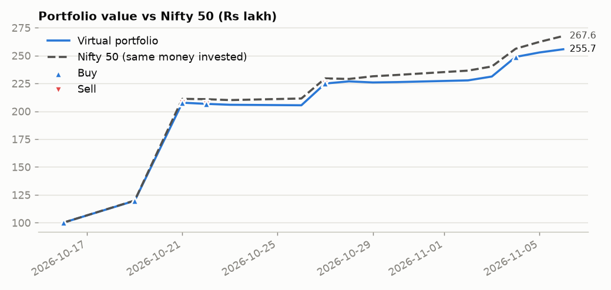

_▲ buy · ▼ sell_

## Holdings

| Stock | Shares | Buy price | Current price | Today's close | Prev close | Day | Value | Weight | P&L | P&L % |
|---|---:|---:|---:|---:|---:|---:|---:|---:|---:|---:|
| Maruti Suzuki | 290 | ₹11,489.00 | ₹12,754.00 | - | ₹12,750.00 | +0.03% | ₹36,98,660 | 14.5% | ₹3,66,850 | +11.01% |
| Ashok Leyland | 1,000 | ₹147.72 | ₹175.70 | - | ₹172.09 | +2.10% | ₹1,75,700 | 0.7% | ₹27,980 | +18.94% |
| Eicher Motors | 1,000 | ₹7,266.00 | ₹7,625.00 | - | ₹7,669.50 | -0.58% | ₹76,25,000 | 29.9% | ₹3,59,000 | +4.94% |
| Linde India | 500 | ₹5,961.00 | ₹6,712.00 | - | ₹6,859.00 | -2.14% | ₹33,56,000 | 13.2% | ₹3,75,500 | +12.60% |
| Linc Ltd | 1,000 | ₹85.00 | ₹89.54 | - | ₹89.20 | +0.38% | ₹89,540 | 0.3% | ₹4,540 | +5.34% |
| Ather Energy | 1,000 | ₹1,677.20 | ₹1,834.10 | - | ₹1,821.70 | +0.68% | ₹18,34,100 | 7.2% | ₹1,56,900 | +9.35% |
| Bank of India | 1,000 | ₹131.33 | ₹141.45 | - | ₹138.57 | +2.08% | ₹1,41,450 | 0.6% | ₹10,120 | +7.71% |
| Jio Platforms | 1,000 | ₹1,439.20 | ₹1,411.00 | - | ₹1,406.40 | +0.33% | ₹14,11,000 | 5.5% | -₹28,200 | -1.96% |

**Best since buy:** Ashok Leyland (+18.94%)  ·  **Worst since buy:** Jio Platforms (-1.96%)  ·  **Biggest mover today:** Linde India (-2.14%)

## Allocation

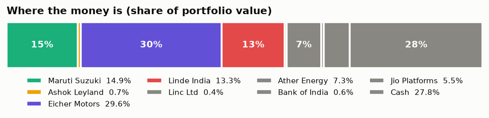

| Sector | Value | Share |
|---|---:|---:|
| Automobiles | ₹1,33,33,460 | 52.3% |
| Cash | ₹71,41,482 | 28.0% |
| Industrial Gases | ₹33,56,000 | 13.2% |
| Telecom & Digital Services | ₹14,11,000 | 5.5% |
| Financials | ₹1,41,450 | 0.6% |
| Stationery & Writing Instruments | ₹89,540 | 0.3% |

## Performance (as on 09 Nov 2026, 09:32 AM IST)

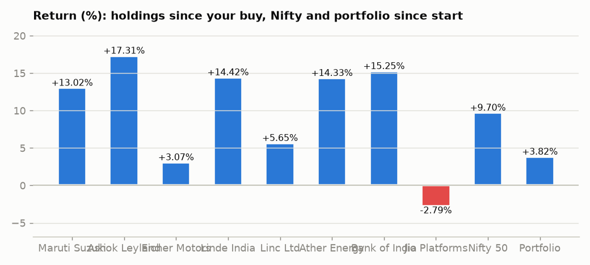

## Trade book

<b>Transaction history</b> - 24 entries, newest first

| Date | Stock | Type | Shares | Price | Amount | Note |
|---|---|---|---:|---:|---:|---|
| 2026-11-04 | Jio Platforms | BUY | 1,000 | ₹1,439.20 | ₹14,39,200 | Bought 04-Nov-26 at 1439.20 (10:29 AM IST per Google Finance quote) |
| 2026-11-04 | - | DEPOSIT | - | - | ₹14,39,200 | Fresh virtual money to fund Jio Platforms |
| 2026-10-27 | Bank of India | BUY | 1,000 | ₹131.33 | ₹1,31,330 | Bought 27-Oct-26 at 131.33 (12:54 PM IST per Upstox quote) |
| 2026-10-27 | - | DEPOSIT | - | - | ₹1,31,330 | Fresh virtual money to fund Bank of India |
| 2026-10-27 | Ather Energy | BUY | 1,000 | ₹1,677.20 | ₹16,77,200 | Bought 27-Oct-26 at 1677.20 (12:37 PM IST per Upstox quote) |
| 2026-10-27 | - | DEPOSIT | - | - | ₹16,77,200 | Fresh virtual money to fund Ather Energy |
| 2026-10-27 | HDFC Bank | SELL | 4,572 | ₹687.95 | ₹31,45,307 | Sold 27-Oct-26 at 687.95 (12:08 PM IST per Business Standard quote) |
| 2026-10-22 | Linc Ltd | BUY | 1,000 | ₹85.00 | ₹85,000 | Bought 22-Oct-26 at live NSE price 85.00 (12:30:26 PM IST; source NSE_CMDATA) |
| 2026-10-22 | - | DEPOSIT | - | - | ₹85,000 | Fresh virtual money to fund Linc Ltd |
| 2026-10-22 | Eternal (Zomato) | SELL | 10,245 | ₹309.00 | ₹31,65,705 | Sold 22-Oct-26 at live NSE price 309.00 (12:30:26 PM IST; source NSE_CMDATA) |
| 2026-10-21 | Linde India | BUY | 500 | ₹5,961.00 | ₹29,80,500 | Bought 21-Oct-26 from cash at 5961.00 (NSE last traded 10:53:52 AM IST per Upstox web quote) |
| 2026-10-21 | Fiem Industries | SELL | 1,000 | ₹1,816.90 | ₹18,16,900 | Sold 21-Oct-26 at live NSE price 1816.90 (10:03:32 AM IST; source NSE_CMDATA) |
| 2026-10-21 | Manorama Industries | SELL | 1,000 | ₹1,749.00 | ₹17,49,000 | Sold 21-Oct-26 at live NSE price 1749.00 (10:03:32 AM IST; source NSE_CMDATA) |
| 2026-10-21 | Fiem Industries | BUY | 1,000 | ₹1,813.60 | ₹18,13,600 | Bought 21-Oct-26 at live NSE price 1813.60 (10:00:26 AM IST; source NSE_CMDATA) |
| 2026-10-21 | Eicher Motors | BUY | 1,000 | ₹7,266.00 | ₹72,66,000 | Bought 21-Oct-26 at live NSE price 7266.00 (10:00:26 AM IST; source NSE_CMDATA) |
| 2026-10-21 | - | DEPOSIT | - | - | ₹72,66,000 | Fresh virtual money to fund Eicher Motors |
| 2026-10-20 | - | DEPOSIT | - | - | ₹19,00,000 | Fresh virtual money to fund Fiem Industries |
| 2026-10-19 | Manorama Industries | BUY | 1,000 | ₹1,796.80 | ₹17,96,800 | Added on 19-Oct-26 (CMP 1790.40 per Trendlyne) |
| 2026-10-19 | - | DEPOSIT | - | - | ₹18,00,000 | Fresh virtual money to fund Manorama Industries |
| 2026-10-19 | Ashok Leyland | BUY | 1,000 | ₹147.72 | ₹1,47,720 | Added at ~11:25 AM IST |
| 2026-10-19 | - | DEPOSIT | - | - | ₹3,00,000 | Fresh virtual money to fund Ashok Leyland |
| 2026-10-16 | Maruti Suzuki | BUY | 290 | ₹11,489.00 | ₹33,31,810 | Initial allocation |
| 2026-10-16 | Eternal (Zomato) | BUY | 10,245 | ₹325.30 | ₹33,32,698 | Initial allocation |
| 2026-10-16 | HDFC Bank | BUY | 4,572 | ₹728.85 | ₹33,32,302 | Initial allocation |

<b>Closed positions</b> - 4

| Stock | Bought (avg) | Sold (avg) | Held | Invested | Proceeds | Realised P&L | Return |
|---|---:|---:|---:|---:|---:|---:|---:|
| Manorama Industries | 2026-10-19 @ ₹1,796.80 | 2026-10-21 @ ₹1,749.00 | 2 days | ₹17,96,800 | ₹17,49,000 | -₹47,800 | -2.66% |
| Fiem Industries | 2026-10-21 @ ₹1,813.60 | 2026-10-21 @ ₹1,816.90 | 0 days | ₹18,13,600 | ₹18,16,900 | ₹3,300 | +0.18% |
| Eternal (Zomato) | 2026-10-16 @ ₹325.30 | 2026-10-22 @ ₹309.00 | 6 days | ₹33,32,698 | ₹31,65,705 | -₹1,66,993 | -5.01% |
| HDFC Bank | 2026-10-16 @ ₹728.85 | 2026-10-27 @ ₹687.95 | 11 days | ₹33,32,302 | ₹31,45,307 | -₹1,86,995 | -5.61% |

## Company deep-dives

---

### Maruti Suzuki  _(Automobiles)_

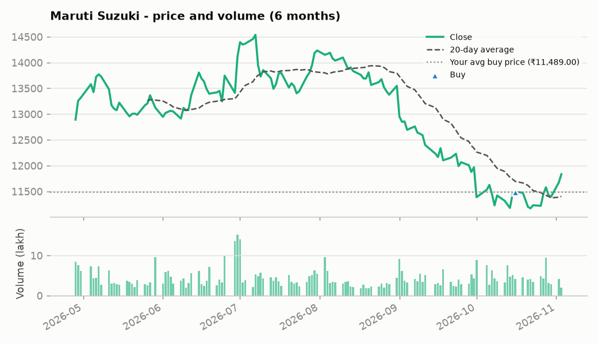

[Google Finance](https://www.google.com/finance/quote/MARUTI:NSE) · [All BSE announcements](https://www.bseindia.com/corporates/ann.html?scrip=532500)

| Close | Day change | Day range | Volume | 20d avg volume | Volume vs 20d avg | 20d volatility (ann.) | 52w range |
|---:|---:|---:|---:|---:|---:|---:|---:|
| ₹12,754.00 | +0.03% | ₹12,657.00 - ₹12,876.00 | 61,364 | 517,606 | 0.12x | 26.96% | ₹11,170.00 - ₹17,292.00 |

**Research reports**

- [One-page snapshot](analysis/Maruti_OnePager.pdf)
- [Detailed report](analysis/Maruti_Detailed.pdf)

<b>Official company announcements (BSE)</b>

- No recent filings fetched; see the link above for the full list.

<b>Latest news (trusted publishers + official company newsroom)</b>

- [Maruti Suzuki rides Dhanteras demand with 30,000 deliveries in one day, eyes 12-15% festive growth](https://news.google.com/rss/articles/CBMi5gFBVV95cUxNRjliMTRZeWFYNklZTTFOcVRnVmExb0dOX1U1cktuRGcxWmFVbHR4cFNRVlFuOVNyeTh1cEszTmlib2dPUTRIYkh3RkJfUGJFeGJvLU16NUc4WjNGTXQ0b0JWUEVSemhGZ2t5X1BXbkpFd19icXJWMEdLNHl5X2sxMWVmUk02bjEtRG9kQ0ZHNXlUN2kwckVnaEZTN1lKdjZGMmhQY2VDVXJ2SEJsWmdMb015Yk9OOU5STkRIZnJmRFlhZ0lMZXVzR19KbmNfcExCem92VUdHMkxuN3FlSmttSjFhbXB4d9IB6wFBVV95cUxQNkh4SVFNWHc0RE16OWtTSnRmdjZUOVhhTzEzcnFyaFB2VDUyYzFvUWhpenFUeVlpN3M3a2pWMGRfdl9mSFF4QzkwcWIyUGNqVXg1RWNSMmdFNjI4WlA0MTVUc1BINDZWcTBlYm40TDNMOXl5dlQ4TXR1ZE5TbVhzbGdodGN0VjN1Yl9FRldjeGlYanJWYmxRTFllYUIzUWQ2d3hMdlJRX2dyWEpuQ0Q1eFBPbkpfSmZQZ0c1NEdYRzNodE1Rb1ItbFNZOVlpUDhObzJfY0gtVS1LbGZHeEdaWFR4Tm5haVVJZFY0?oc=5) - _Livemint, 06 Nov 2026, 07:20 PM IST_
- [Festive demand remains strong as Maruti Suzuki expects 30,000 Dhanteras deliveries, Hyundai targets 16,000](https://news.google.com/rss/articles/CBMi8AFBVV95cUxOMGhTeHg0N2dJSzVsZC1UYzAyMC1wOGpQUmFlRFdqWWFaTFh3MnFvRXlVVE1Xa3BoNUl3UVF4Vi15dU9MQTQ3aU9MenNGQ3BWOWlPS3JRNVBIbXJVd2Rpa2N4OUktR2pVdVZJdEV5cDZTVGVXZmIzal9vRjg4NmhoWUV0WTFWRlJ6ODVVVC16WlA3aTBsNU85dzB0dV9sdkEtaU01Sk5NUVBqZDg5MVhLZDdTdkdGMmxOeU1XdGwxRmpvM1N3UEJ2QjE5QjRTeENHRzhMLTJYbkJJS2lBaUh5SDdpT05UTlRFdFR1Qlhta1LSAfYBQVVfeXFMTmpVdlFyd1VhdnE3NmhROWNzNFFnZHJGZk90NXhxVlFkUnVQWTdLVENrWEVDN0ZiS0I4YUtlOGQ3M1lSOEZBczFkUVFKY3dUUG9hYlREMThrVTRVN3Z4Yk5OUVR4V3gzQjBUQXNULXBCNVF1cGg2MnpVN1h1TXo0WHRaWXFkNVFSTmNhMXJvZS1EN2NmaHRvY19XSUVUX0YtVFJLNGRVM3dQcGF1NHFTUjdOcGw2X3Jtc3BJZTdSZFBpNjNBVHh2WHJsUHQ5YXhqM1kwMkxqTGMzR0lCZVV1TjZqZnBiQWNobjJacVpvclc0eVg2aHJR?oc=5) - _Moneycontrol.com, 06 Nov 2026, 07:17 PM IST_
- [Maruti Suzuki to set up 12 automated driving licence test tracks in Telangana](https://news.google.com/rss/articles/CBMi6gFBVV95cUxQNHQteWQ5MWtHT2l2dmFrc25WbEVDQUNqNGdtdWktZXFET0tKcUZZM1g0djZxNWlWZk1RQzVqSHh2NE81QUFHS25kZUZra1hYd0ppQXVaNlZHUWY1VVpkM0VLNXFJMW1oMnRMMzFwZjk1UE15VzEzV09ldmIxcklBYm8tRXhtUnowTEVoekF3am4zal9vX1l1TUhfTWhrbUlBTUdZWUUzalo3T0ptTTlmRElwTjJldVg1bmliRERFdTRQcVZSeVJkd0NwSEMtMm90V1BKQWh3U090cUNhRE84NUdoZFVWRThId2fSAe8BQVVfeXFMTk1QWXpGNGIzOHB3dTQ2b1ViajVKYmJHcjVSTFRjOFdqR3VCSnJjRjNIeFlvNGlCcjd5ZnpNdXgwTkxRRUh0US1aS1JlVjRTSHdrLVl5TG1jdkFQNUItLW5YQW1IeHU0ZzNIaUJUeDJ1YXhMYm9rNkxxR1h2Ni1Ld3ZGQjN2NmUwZ1R4MVNDN05lcGtTTndMeVdTRlVkVmNzeEdtVjNFN3M5aWVaYk05MlFfeW0zVlJZOVprT0phUjFtQmJYZFliSmxzVy1tWmdOY3hab1BhdGxWcW5JNzRkRlY3MVotQ0tyTzBDaFZCd3M?oc=5) - _The Economic Times, 06 Nov 2026, 10:22 AM IST_

---

### Ashok Leyland  _(Automobiles)_

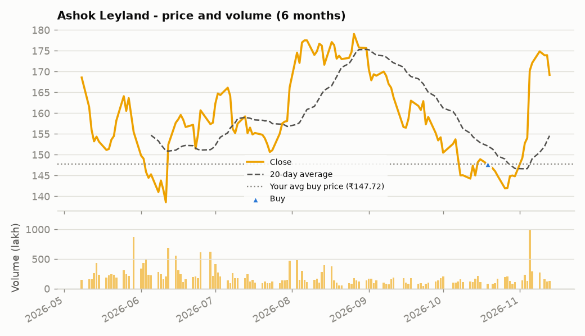

[Google Finance](https://www.google.com/finance/quote/ASHOKLEY:NSE) · [All BSE announcements](https://www.bseindia.com/corporates/ann.html?scrip=500477)

| Close | Day change | Day range | Volume | 20d avg volume | Volume vs 20d avg | 20d volatility (ann.) | 52w range |
|---:|---:|---:|---:|---:|---:|---:|---:|
| ₹175.70 | +2.10% | ₹174.85 - ₹178.83 | 3,007,660 | 18,805,470 | 0.16x | 42.26% | ₹138.58 - ₹211.92 |

**Research reports**

- [One-page snapshot](analysis/Ashok_Leyland_OnePager.pdf)
- [Detailed report](analysis/Ashok_Leyland_Detailed.pdf)

<b>Official company announcements (BSE)</b>

- No recent filings fetched; see the link above for the full list.

<b>Latest news (trusted publishers + official company newsroom)</b>

- [Diwali Muhurat Trading Stock Picks 2026 under ₹200: Start Samvat 2083 with Ashok Leyland, Swiggy, PNB | By Anand Rathi](https://news.google.com/rss/articles/CBMikwJBVV95cUxNTk9KRFpTVEdHaEZTazl3OTZTS2JFLTgtWUgxaE9SMnY5bkR1NVNWeVZEM3BsRE9yOHl3R1ZZa3U5WXJGZkZxRDUxZURQbmluXzlTaEtOYlBkX0gweXFrVFNqdjM5OHBIRnR1bzcxa3VlRWVfc0hCUERjVzl0TXdkTmdMMW1ham9ybFBVSDd1YXNQNXZiQnZMMFdkVVUyNlI1Uy1SakFDQU1JRi1seFZrcUhRWk82WXhtTXh3enktQThBY0pKWXlQbkJzUHhQdk10UEVFQklrcEltanpYZWFSVW5ZVWZZamJGdUlqYW5XV05IZjBWTXl2Wks0OUdYRGhJNms0bTBOVWVuRlRGOEdBM0J6d9IBmAJBVV95cUxNWU8wWE5KLXVxYS1lWDdXbk9DbDRaS1UtY0k1Z1VqbXU5bi1XcTJxaGxVVUZGSnNnanBwMzVsQk9DQTJ3TjNqSENLVUpmeEtDQl83b2J4ZmY5bUdhVDhyWlQ5akhfUVAxZXdtVVU3aGhIank2V0VyZnF1RWRVTEN3VTc3cENNaTN1d1ByS0ViU0l4V3RqZHQwSTE3UUxkUldYLVZ3UEF0aFZfY2NMWFF6WnlGbWM0NFlESElaYlpHY1A1QU5MUWdMdVB5VXRKbGZKT1ZydzR0RXRHLUNIbDQzUGVzcnhMLVNyUm9abGkwVG5ZOEhEQnQtbml2Z3FEZkhoaGY2ZzNsa3pqOFhTa2YwLUxEMW5Ld3U1?oc=5) - _Livemint, 08 Nov 2026, 11:31 AM IST_
- [Ashok Leyland - Concurrent Gainers: 9 stocks gain for 5 days in a row](https://news.google.com/rss/articles/CBMi1AFBVV95cUxQQmhtbVRIbVNrbC1HbkpjZlpxQW1ZSktiSVJ6VUd5ZXBoQ3c1S2lYTW1hMnVocDNwQ0t3WHdJam5sajZMWVhPVm1NRUZfa0o3aHluMHN1RmhWWHV4QXhNZWl5VW0wR1RSMW9GUDRFZERiNmhxS2FsVktfb2JLUnlNY1RmMEJqYVNuZDN2X2ZXQmxVamRLaGlIUmNfT3hmUEJWaDBaT2lCSWtCVXphazZKNXBybnBJd05CR1djMXBoaXhWZ002MzdWb1JaSDVrdlllek9nWA?oc=5) - _The Economic Times, 07 Nov 2026, 02:24 PM IST_

---

### Eicher Motors  _(Automobiles)_

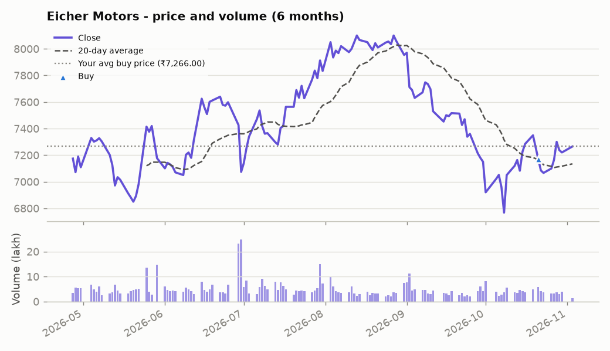

[Google Finance](https://www.google.com/finance/quote/EICHERMOT:NSE) · [All BSE announcements](https://www.bseindia.com/corporates/ann.html?scrip=505200)

| Close | Day change | Day range | Volume | 20d avg volume | Volume vs 20d avg | 20d volatility (ann.) | 52w range |
|---:|---:|---:|---:|---:|---:|---:|---:|
| ₹7,625.00 | -0.58% | ₹7,585.00 - ₹7,661.50 | 29,455 | 439,716 | 0.07x | 24.13% | ₹6,586.00 - ₹8,190.00 |

**Research reports**

- [One-page snapshot](analysis/Eicher_OnePager.pdf)
- [Detailed report](analysis/Eicher_Detailed.pdf)

<b>Official company announcements (BSE)</b>

- No recent filings fetched; see the link above for the full list.

<b>Latest news (trusted publishers + official company newsroom)</b>

- [Eicher Motors Share Price Highlights: Eicher Motors Stock Price History](https://economictimes.indiatimes.com/markets/stocks/stock-liveblog/eicher-motors-share-price-today-live-updates-08-nov-2026/liveblog/135649915.cms) - _Economic Times, 08 Nov 2026, 08:17 AM IST_
- [Royal Enfield takes Flying Flea electric motorcycle to Chennai, plans 14 sales and service touchpoints](https://news.google.com/rss/articles/CBMi7AFBVV95cUxOeGM3WWVoYVNYN1FHVFhoOFFMMHFEaFJsSkZhdENETExzemlkRHduS3RQUkVKOWZqd3RScVkxcVQ2TGpyWHY5aUhucFY5MWxrZEFsbUpSaW9hR2FvZ1pYY2hJNnNaTWJfMmRFLVdXQVo0VFNZQnBCOGxEVDdUMXJQLTNsQVdMYkZqRXFuUDJjZXNmSjFiZmdHdnVVZklLYnlWOHRQaWVSa25yYmlOcGk4dGN4ZERhdUowa0tVSWNjQV91RUZmZUN0RmxoQ2JQWUNPTXBvVWtUaElfTUpmbnNDMWw5X3JFT09lMWh6T9IB8gFBVV95cUxOSWpMdGdNOHZieHFXZ3VVZS1WXzN6YjdOMXpYaEZETHlOOXNWSEhCa0JlblFhVFZ6SXUwTkVxMDI0amlnanJRVVlaZW42UnVhTlFBc3ZXRWpZZG1JWTlvQ1FpaHhSRXhIcUZVY01hcFlLdFBrQi0zYnczZGt0aXVrd0FrM0p4Sk5fVFdfX3M4MDhLNTRYSFhyeTZuYXQxazhmbnlOaXlzTHRhSmJNV1dyX0hReDRuMGZvMGZPOTZyelV2QzRPUk9yYjhTdWhYTDhrSUZoakpQaXlBdGVZZEhVLTZxSWM5VzdHTV9sSXdTeHB1QQ?oc=5) - _Livemint, 07 Nov 2026, 11:49 PM IST_
- [Market wrap: M&M, ICICI Bank, Tata Motors PV, Eicher Motors top gainers and losers on Nifty and Sensex on](https://news.google.com/rss/articles/CBMijgJBVV95cUxNbDRvVUJ0czd2QXZNWUJFdDItODc5VVQ1ek15OU4ycTVRUTVjTWpnbjR2dndiMTBuWXl6dVlLdnM1eWI1WEhvX1Jfd2pJUWpkUk13TDV4R1JFeXQ4TUFBZDBGZEhyc3lXZ0lFMFVNbnFoLVUzbjZMbmNpWFNYeUV3cmZOQ2xyY0ZuTTBwWXVkN0FpYUttemtKVkxVOEpCOF9fUGx1NHFRUDZabXRId2R1SEFYYWxPWmN2N2hhUVlQeUNFNE9JOVJtSDRTcUxmWkY4S2xYbE9Gay03azM1UGV3WUtNV2RLSlk1VWtFSkUxMTl3SWFUS3oyVFNzb2JTTTEyWEhQNWlBRWVRRlZvR2fSAZMCQVVfeXFMTUhuZ3U3YjZGOE1mYVJISkJNY3F2Qk0xTjBIcnZDdW1ZdzJiQXotcjliQ29RUDFZM2VzX3NkM19lWWhXeTA5LWw3SHU5UVpsWGttVUt1ZTV1TEhIcHlJR1J6RTVQSzF3RFZWbXBNcjJTUXEtcFpJUDEybmJhbkVtRTJlVGlqQjlmNUlvQ3N4T0dQN293V1FabEdGclFSZXBXa1Ytd1ZSOXFUZ2hpTEtBUzJ0X2x3YjRaa0ktS3JvMTNJVnd3NDhJU1NCMFNJcFJGODc1U0FMSE9vTGY5SFZqTFhuYWFhMVJDcl81OVpPRl9WMl95Tll3RzFScHpoSXliYVoxOVdqN0gxa0NoTUdGLXUtY0k?oc=5) - _The Economic Times, 06 Nov 2026, 05:31 PM IST_
- [Royal Enfield Shotgun 650 Son of a Gun unveiled at EICMA 2026, only 100 units to be made globally](https://news.google.com/rss/articles/CBMi5gFBVV95cUxQTHFOWkswclVFdHY0cmRWY1dHTjI0QlFpTC1pSXlianJHQ0llc3BnQmRLZE1mNjZCNzlDb3FwZlJtUkU0SmdKN2tERmg1MVEyaC1hZ3hYQl9MbUZQRlNUSi1IaVNQWV8wQWM0cmdHTzViRm5HeWkxeE5PWmo2Mi02QURmWEJFUEFoQ3c5R25OS1VNYnJMTlhrbDJrMUtZRG9mbnFhd2JrVjVMQVhQX05uYU5NTXJxMUo1SHRueGl1cW4xUTlRT0xpNVZlOU9NQ2RMbGhPQmVERVdnSnBfaURjVWx4eGxIQdIB6wFBVV95cUxQN0VYNkNVcGt5WlRmbHNJbXk2eEtVSUhrU0JwXzI3M0FNUERUQkg5OGc5RnV1c3JtU19zcUZJUlN1YS1wVGpwekVQa0NXM2V0S2RuWnpGdDd0U1JpWWFJZG9DSDBQTnpLenNDZ0NHVkJsdDNoX1A5TUN0RGFIdzBuQUFGMkh2ZGhySTZacnJkTVgxSzlLdVlGZTVvR21CTkI1TEtHNG9Wcnk1ZWVfMVVPS2dmUUxMSUxyX2Zhc2NCbHBOcDg3aGZTMTJJbXMzaThYYVdpQkNkZDdscEI3TmlueklIckVwd0NFbG5Z?oc=5) - _Livemint, 06 Nov 2026, 12:03 PM IST_

---

### Linde India  _(Industrial Gases)_

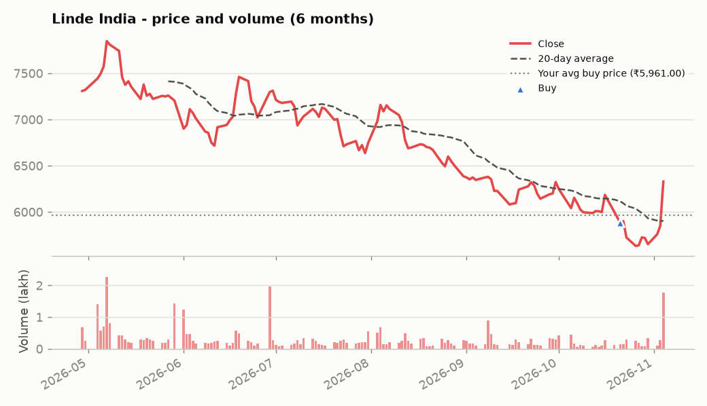

[Google Finance](https://www.google.com/finance/quote/LINDEINDIA:NSE) · [All BSE announcements](https://www.bseindia.com/corporates/ann.html?scrip=523457)

| Close | Day change | Day range | Volume | 20d avg volume | Volume vs 20d avg | 20d volatility (ann.) | 52w range |
|---:|---:|---:|---:|---:|---:|---:|---:|
| ₹6,712.00 | -2.14% | ₹6,629.50 - ₹6,854.50 | 5,602 | 41,156 | 0.14x | 52.10% | ₹5,632.50 - ₹7,847.50 |

**Research reports**

_Research report coming soon._

<b>Official company announcements (BSE)</b>

- No recent filings fetched; see the link above for the full list.

<b>Latest news (trusted publishers + official company newsroom)</b>

- No fresh headlines from trusted sources in the last few days.

---

### Linc Ltd  _(Stationery & Writing Instruments)_

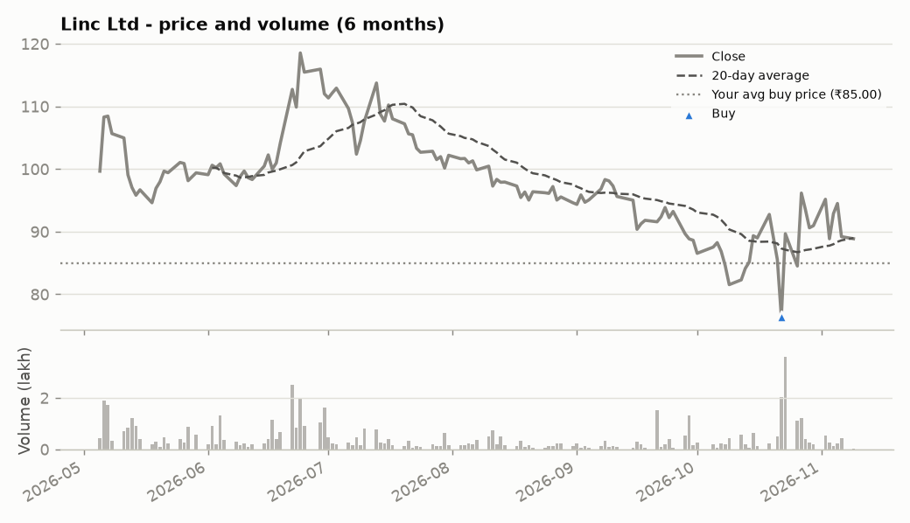

[Google Finance](https://www.google.com/finance/quote/LINC:NSE) · [All BSE announcements](https://www.bseindia.com/corporates/ann.html?scrip=531241)

| Close | Day change | Day range | Volume | 20d avg volume | Volume vs 20d avg | 20d volatility (ann.) | 52w range |
|---:|---:|---:|---:|---:|---:|---:|---:|
| ₹89.54 | +0.38% | ₹89.21 - ₹89.81 | 276 | 65,454 | n/a | 107.84% | ₹76.41 - ₹125.23 |

**Research reports**

_Research report coming soon._

<b>Official company announcements (BSE)</b>

- No recent filings fetched; see the link above for the full list.

<b>Latest news (trusted publishers + official company newsroom)</b>

- No fresh headlines from trusted sources in the last few days.

---

### Ather Energy  _(Automobiles)_

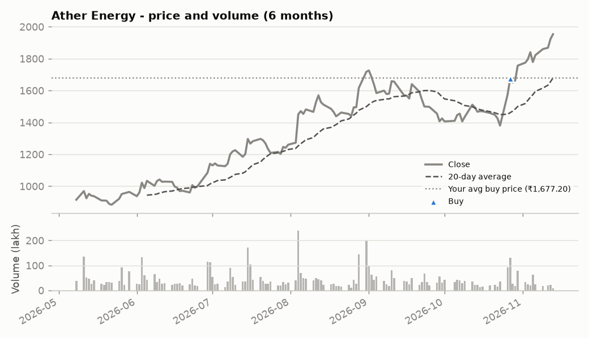

[Google Finance](https://www.google.com/finance/quote/ATHERENERG:NSE) · [All BSE announcements](https://www.bseindia.com/corporates/ann.html?scrip=544397)

| Close | Day change | Day range | Volume | 20d avg volume | Volume vs 20d avg | 20d volatility (ann.) | 52w range |
|---:|---:|---:|---:|---:|---:|---:|---:|
| ₹1,834.10 | +0.68% | ₹1,808.60 - ₹1,838.70 | 206,878 | 3,709,508 | 0.06x | 64.30% | ₹601.35 - ₹1,840.00 |

**Research reports**

_Research report coming soon._

<b>Official company announcements (BSE)</b>

- No recent filings fetched; see the link above for the full list.

<b>Latest news (trusted publishers + official company newsroom)</b>

- [Ather Energy Ltd. - Diwali turned lucky for these 8 stocks! Investors' wealth more than doubled, returns soar up to 191%](https://news.google.com/rss/articles/CBMilAJBVV95cUxQUVBMZGpDMmN3TTk4TjMxTDYzbHpoSVNzRUhPSWk2WGtmRzdwb0dRYm5zazF0Sk5UZjVZWDVTVFRzeGJpY1ZubUh1UjJTMVJlY1MzQXlySjl3NGZIZXBISV9BOVNOX0otbmRGVTI2TFQtcW02aUpjdGtEV3JWc0JSTVoyNm9DUjJMWC1zX0wzVC0ycjNHcGM0dC1LRVJMWWZwXzZxLV9McGdsUS1vclVoQmJVLTRuVzhIaWRhQkc1X0FJbXExMGVTSWx1VTIzTDFDaWNvUkg4RjNYTnhiQWFwZ1NqNi1GbWdqWTJjSWVQdWtRNzFOSEFXY1hjTlh6Ykd4VWppcVQycHJFaUFGdDJ1TjQ0YUw?oc=5) - _The Economic Times, 08 Nov 2026, 11:48 AM IST_

---

### Bank of India  _(Financials)_

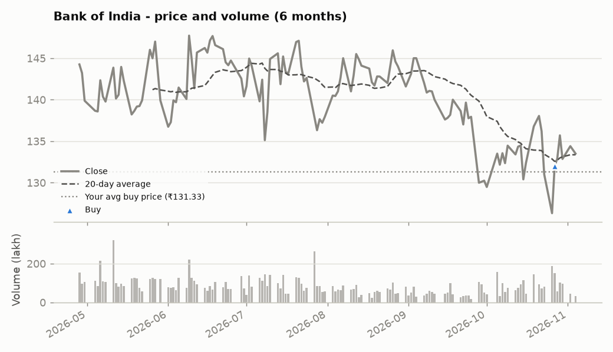

[Google Finance](https://www.google.com/finance/quote/BANKINDIA:NSE) · [All BSE announcements](https://www.bseindia.com/corporates/ann.html?scrip=532149)

| Close | Day change | Day range | Volume | 20d avg volume | Volume vs 20d avg | 20d volatility (ann.) | 52w range |
|---:|---:|---:|---:|---:|---:|---:|---:|
| ₹141.45 | +2.08% | ₹138.75 - ₹141.45 | 1,488,802 | 8,691,156 | 0.17x | 36.99% | ₹126.32 - ₹177.20 |

**Research reports**

_Research report coming soon._

<b>Official company announcements (BSE)</b>

- No recent filings fetched; see the link above for the full list.

<b>Latest news (trusted publishers + official company newsroom)</b>

- [State Bank Of India Share Price, Stock Price - NSE/BSE Live](https://news.google.com/rss/articles/CBMiZEFVX3lxTE1LRlpNamxha3p1eVRuMDFHVUVfbmJ2ZTdTajh6dC1ZS3NGYlZkcVlpVndsWnczUmo0SGNaMWFVR2FEbmpZX01LckdnREZYbnNYbzVCbmRSc2VSVGN1VDNtSjJFN28?oc=5) - _NDTV Profit, 09 Nov 2026, 09:15 AM IST_
- [State Bank of India expands US footprint with new branch in Texas](https://news.google.com/rss/articles/CBMi5wFBVV95cUxPYkJwdW1pYS14OUZpQWtveEk4Si15alVyb1FFZjFwSm93QmFsWEptdFdpbEJ2aEFpRTcxMk9mN1lHOEpMSkFHWm1TNW11bnZ4Z2tOU2hnT0ZKRGFHQkVTa2oxdU1BYmxaYXRZY0l0S3ZjNGJYU3RzSmhxZkJpQmQ4SmVHTkxxT2h1UG52Uk9HLTlqeFhVRTA0OW1iRk94R0pZaE54ZEZ1VG95UGVibU1RZUFWT1VuaGVvTFlLb19iVjRfbTNLUTFhN3NubXpveTBSbDZKb19XRVVraVZnT1dmU1JPZUN5UzTSAewBQVVfeXFMTnBEUUhULU1iQ2lWRkdyQk5XVW1IQXhGSnJYZlN3OTNDcFBjcGZaSlpKZE55YVdNZnlrT2V0eEQ4VUJqWVVqb2NuRmNzOWRLRlowY2paVkh5anlWY2lzY2FMV042aUNhaW1FOGhFbW5LSmxLU2lmY2pYcDhQc3YwV0taVXFsUDhDWXRra29JNjMtM3VPYzc0SVowVkVHbnFESGtjYThleTFuZGFOTFo1V1BTUXBpWHVKc0xYSUhLbWhYUzRLajF4ekJMRWJZX2NKN0diazUzZ1lFRFJNMTd5ajVaN2Vrc3RPclU5Sng?oc=5) - _The Economic Times, 07 Nov 2026, 05:45 PM IST_
- [Bank of India Q3 Results 2026 - Find Bank of India Q3 Earnings Result | BANKINDIA Q3 results](https://news.google.com/rss/articles/CBMihAFBVV95cUxNcmRmQlZ1QWlwOTB4eDgwZmF6LW9pUnIyN2M4QVVtLXBVZ3RXZHpDX2JnZWNVdDFHTmdLXzdBZmJBZXhmcGpZX3lBVVZ0ZnY0RlRHWWt6Yk5lSzhxTmcyNUJwNU05cFFCVjhvMVFzTzd4S1JqbGlKendUM0pnczBDcU43WlI?oc=5) - _Livemint, 06 Nov 2026, 01:30 PM IST_

---

### Jio Platforms  _(Telecom & Digital Services)_

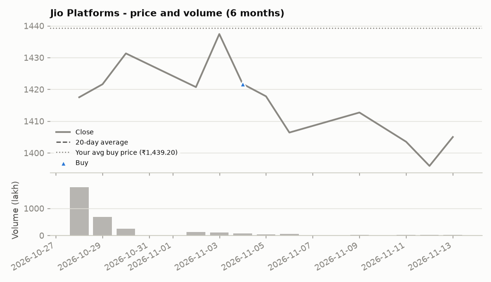

[Google Finance](https://www.google.com/finance/quote/JPL:NSE) · [All BSE announcements](https://www.bseindia.com/corporates/ann.html?scrip=545004)

| Close | Day change | Day range | Volume | 20d avg volume | Volume vs 20d avg | 20d volatility (ann.) | 52w range |
|---:|---:|---:|---:|---:|---:|---:|---:|
| ₹1,411.00 | +0.33% | ₹1,406.70 - ₹1,421.50 | 361,624 | 38,691,641 | 0.01x | 12.70% | ₹1,406.40 - ₹1,437.40 |

**Research reports**

_Research report coming soon._

<b>Official company announcements (BSE)</b>

- No recent filings fetched; see the link above for the full list.

<b>Latest news (trusted publishers + official company newsroom)</b>

- [Top 12 Diwali Muhurat Trading stock picks 2026: Up to 41% gain! Buy Jio Platforms, Adani Ports, 10 more by KC Securities](https://news.google.com/rss/articles/CBMikwJBVV95cUxOdGQ5T2pvVzZSNko0UGxPMkNTVFZTeTJ2MDV6ZGg0UncyNW9qdU1STUZqLUlEem94Q0FTdVZMaXZCcEk4N2pVWV9ob0JERk5lcGVjaFZrMzFKelQtSExOWmN2cVVPcUpLa2dSdjdvaUs3RVJ2RXhlQmFzY1JrWjM1OVhkMXA3blFtWEJzUUJTMWstaGkycnNZc2s2YUJ5eXBfZmEzY3JQMVpmcUY5QTUxcFBfLVlQd1Q5czRjTEFuakFhVFgwQXhvYmM5MnVTdV80NHpybkZmRTBNZzJwTGhGUTE1U09TNnNnaWZZaUZvLWd2QnUxbGpGZUp2QkpWdjNlaldCVTR5Z2doQ2x0Q3M3WUZPONIBmAJBVV95cUxNVWp0c2NPaUlkTGxzaW9aMDFhRl9mUzZ3TjVoc2hsMV9pMXRTckdnbENxU0tIMi1ObkdHZmd2MklFbkwtelhnbkNiRXluSXZqcEhhYW1iZGtaM094Q3hmTmlKQ21nU19xTTZKZHN6NFNULXlxZHdzZ2xhc2lCaHVERmN5dU5uQUZEd2ZXVmFPOTN2RFFlVFM5cWU0R2szQ080YXdHdGRNQXd0cVJ5T0Nic1pHR0dxVXk0emZJTzJfNk5ac25XallBOW56bUpKbUpiclEtY0g1dERiREhJLTdCNE5MY3FYSTdEVUppZ0lnTGwxdnF5RkhlUGRkSV9YUVRTRUV2dEN2MXJqa193RmVTcFRmenBCd3Ry?oc=5) - _Livemint, 08 Nov 2026, 12:45 PM IST_
- [Jio Financial Services Share Price Highlights: Jio Financial Services Stock Price History](https://economictimes.indiatimes.com/markets/stocks/stock-liveblog/jio-financial-services-share-price-live-updates-08-nov-2026/liveblog/135649888.cms) - _Economic Times, 08 Nov 2026, 08:15 AM IST_
- [Bharti Airtel reclaims 2nd spot in mcap rankings, overtakes Jio Platforms](https://news.google.com/rss/articles/CBMi2AFBVV95cUxQNFJKSG9YRUFnU2l4a090ZGZZTDVqalR3V3l3R2hkd1pLSE1tOVlFZkxsRDlSUlhKTzY0NXN5V2dLcG0tTmsyYnY3RVBBSjA4MTA3bGlkNVNTdEhPSHE3TEFjZ3dOY3RKYzhmQlZTTkp3c2wtZFZaWnZaaHl1R3dubTZyeFZpcXdReGEwUDJ5T25IVE50bFNHUC0yUURqVjV3S0pJRy1pM0FZb2ctLTFkRFVCM3p0aUNBeEotU2RCSDdtVkZ0Q1A0NTRHb3liN3VnelpoYThabGjSAd4BQVVfeXFMTkRKQ1NnUE9UV1RrcEVpZkhlQWtQN3VNd284NDFPM0pSLU5pS3p2VUUydnFDOUZOUE1DLWJlN1Nnc2ZGVlJVR093R1R0bEYyM2xvUEtoZlJESkltckhSYlhLVm1CZnlXek1TZ3pENEFhQU5xUkozM0ZrYjZoX3hEbVBLUTh5YlVCMXFOWlpuaGExbU1uT1pCMDdwZ0pmcExZVkotLUFRWlFEeGlqSkIxWU1nT2tOSGlySkRjaGYzR19pR1hMS3l1WV9LUmhiVVlOZ2NTa0RpN0tMVHpNaGZB?oc=5) - _Business Standard, 06 Nov 2026, 05:47 PM IST_
- [Bharti Airtel reclaims No. 2 spot among India's most valuable companies, overtakes Jio Platforms](https://news.google.com/rss/articles/CBMilwJBVV95cUxOMDFoT29LN1NUTXRwd25icnlDaXVRS2pFSkUza253cy1JMlRjdEZ1T0ktNFQtaG5pWXVMRU9UaS1FUDBLelhrMWo3MU1aTmZ1NlJta3gzRWZkSEFfaUJYcUYwVVFGQ0RfbC0xTzBwMjdSekRnci1rbHNGSnNjeTVWaTBCVl9pZzFZZEd1N0VwOWlPeG9qc1FGdFdKeUxkWEpjN0liS25wOS1ub1pBbjdJa1NaS0xwdmMyZDlRR2dYbFFPZ0cyZTFpQVczRDd6d2ZrMVhzbUZaWUNjb3p4RGx4M1A0bTJuLUxkc3FSZ1plc25Rd3hFV2NaM09tV2lMNkxLLVNJR2g3S0FabEZlRzhwdkdlUmxfRE3SAZwCQVVfeXFMTk1JN01YLTZaTzhnRUNUeUtzSkZMUVZYUHozYUtWT3F6ZDVScXJwMlp3eTQzMUt4cWt3SWJFSDQwU2JYVWJTY3U2dVVfNHVYckRXUWNIeWVESXJ0N2lxSFhiazA2bW90QTdvdEJaR1J1bEpOcUZXeC1CYngxempXbFBXd3lBNUVVOExIN20zc0hycjZ6THVSVGtIcWhyZFVQSG1SWXVaSnpyeE1ES3dBUlZVN0pzTVlCSjVxajJfdVFhQ1l0RE1LUkMwbmMwdlg4LWRyRGZzbzMydm51M1QzUEhiRDNXbTZDZ2pHQzMwcWZCa3NjSUkwcGtTVVlyLWU3cHFjNVkzX1BRZ2U3WTVVVDNBY1oyM2Z6TjFXdXk?oc=5) - _The Economic Times, 06 Nov 2026, 04:50 PM IST_
- [Quant Small Cap Fund adds Jio Platforms and 4 others; increases stake in Adani Power, 5 more](https://news.google.com/rss/articles/CBMi7AFBVV95cUxPYnpxQ2ROY0pnZjJraXhUU1UwQkREM2F5VndLSzhkeFcxT2JOdzRSOThkYzN4cjhJUUNvTG9rWm05bUlBTHpsSVdJXzNOMzJ6OW5PZDVDMUFnOTdKWE1YVDJnSUhHOG5zNGFSNWRPa3JnOWlhbTQyZTZfbTBuVG9qbUxHUnp3UjdBOGtFZ2J3dTR5U1gxWUpsRkdzSFg0NTRVWU92SlMyTlhXT21IalhnNlQ1TmNULVhScmp5cVplQUtmcTZZVGd2dWtPUXBhTUhORzAxamV0TUJtYTctWGRkM2Exa2cxdHJBZnZ4b9IB8gFBVV95cUxPZlBud2F4OE11cDNzcFlNbzVUZTVjdE5jM25pc3hxVVBxeW1NTnVidkhFN241T3ZadFVtQV81VWVMNF9XYjhieW13WVFuNkhkYWZ6dzBzQnpsTEFFb1c1bHZIMDRDQUQ1OTQ2cWtZTnpab0hBWnJvMi1pdzZZSlZIWGg5MUxyb3VCWmZWX3ZlYlNDOEFYM255S09waHo0c2VUamFVUUo0R28wSHlMeW1PU1JGam0wa3B0UWYyV0tnQkpWSDRZQnNlVU9WRTlyT21ZYk1qNkNzNzVoak4xcXlpMGZsek9zOFFZR1ptOHpBVnI1dw?oc=5) - _The Economic Times, 06 Nov 2026, 04:12 PM IST_

---

## How this works & data sources

- **Prices / volume:** Yahoo Finance via the open-source `yfinance` library (unofficial; may differ slightly from NSE official data).
- **Trades:** every buy / sell / deposit is a line in `transactions.csv`. A trade happens at the closing price of its date (live price for today). Average-cost method; no brokerage or taxes (virtual portfolio).
- **Corporate actions:** splits, bonus issues and dividends are detected from Yahoo Finance and added to `transactions.csv` as event lines on the ex-date (nothing old is edited). A split multiplies the share count and divides the average cost, so the invested amount stays the same; dividends add cash.
- **Benchmark:** every rupee put into the portfolio is also put into the Nifty 50 on the same day, so the comparison is like-for-like.
- **News:** Google News RSS + publisher RSS feeds, filtered to a whitelist of trusted publishers, de-duplicated, last 72 hours only. Each item links to the original article.
- **Official filings:** BSE corporate announcements (best-effort, with link to the full list).
- **Automation:** GitHub Actions refreshes this dashboard on weekdays every 30 minutes from 9:30 AM to 3:30 PM IST (live snapshots) and at 5:45 PM IST (end-of-day final snapshot + AI daily report); skips market holidays.
- **Metrics:** Volatility = 20-day std-dev of daily returns, annualised. Volume ratio = today's volume / average of previous 20 sessions.

> This is a **virtual (paper) portfolio built for learning and skill demonstration**. It is **not investment advice** and not a recommendation to buy, sell or hold any security.
