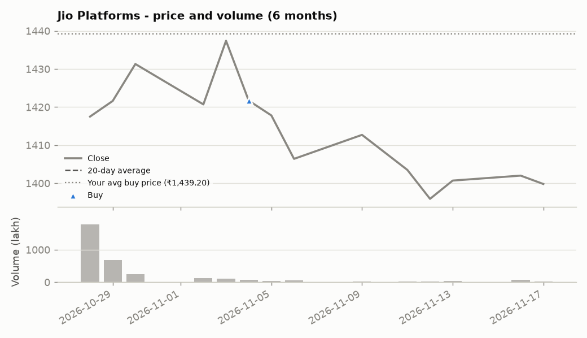

# Core-Equity Virtual Portfolio

> This is a **virtual (paper) portfolio built for learning and skill demonstration**. It is **not investment advice** and not a recommendation to buy, sell or hold any security.

**Last updated:** 25 Nov 2026, 11:32 AM IST  |  **Market data as of:** 2026-11-25  |  **Start date:** 2026-10-16

**Snapshot type:** Live intraday snapshot

_Live snapshot: today's session is still in progress, so volume is partial and "Volume vs 20d avg" will look low. The final end-of-day snapshot is published at 5:45 PM IST._

**Jump to:** [Summary](#portfolio-summary) · [Holdings](#holdings) · [Allocation](#allocation) · [Performance](#performance) · [Trade book](#trade-book) · [Companies](#company-deep-dives) · [Method](#how-this-works--data-sources)

## Portfolio summary

| Metric | Value |
|---|---|
| Current value | **₹2,66,89,242** |
| Total P&L | **₹20,90,512 (+8.50%)** |
| &nbsp;&nbsp;Unrealised (open positions) | ₹24,88,000 |
| &nbsp;&nbsp;Realised (shares already sold) | -₹3,98,488 |
| &nbsp;&nbsp;Dividends received (already inside Total P&L) | ₹1,000 |
| Today's change | ₹78,470 (+0.29%) |
| Nifty 50 since start (same money invested) | +12.64% |
| Outperformance vs Nifty 50 | -4.14% |
| Cash (uninvested) | ₹71,42,482 |
| Virtual money put in | ₹2,45,98,730 |

_▲ buy · ▼ sell_

## Holdings

| Stock | Shares | Buy price | Current price | Today's close | Prev close | Day | Value | Weight | P&L | P&L % |
|---|---:|---:|---:|---:|---:|---:|---:|---:|---:|---:|
| Maruti Suzuki | 290 | ₹11,489.00 | ₹14,109.00 | - | ₹14,010.00 | +0.71% | ₹40,91,610 | 15.3% | ₹7,59,800 | +22.80% |
| Ashok Leyland | 1,000 | ₹147.72 | ₹159.09 | - | ₹158.70 | +0.25% | ₹1,59,090 | 0.6% | ₹11,370 | +7.70% |
| Eicher Motors | 1,000 | ₹7,266.00 | ₹8,320.50 | - | ₹8,172.50 | +1.81% | ₹83,20,500 | 31.2% | ₹10,54,500 | +14.51% |
| Linde India | 500 | ₹5,961.00 | ₹6,915.50 | - | ₹6,961.50 | -0.66% | ₹34,57,750 | 13.0% | ₹4,77,250 | +16.01% |
| Linc Ltd | 1,000 | ₹85.00 | ₹86.55 | - | ₹86.13 | +0.49% | ₹86,550 | 0.3% | ₹1,550 | +1.82% |
| Ather Energy | 1,000 | ₹1,677.20 | ₹1,911.20 | - | ₹1,979.20 | -3.44% | ₹19,11,200 | 7.2% | ₹2,34,000 | +13.95% |
| Bank of India | 1,000 | ₹131.33 | ₹159.76 | - | ₹159.01 | +0.47% | ₹1,59,760 | 0.6% | ₹28,430 | +21.65% |
| Jio Platforms | 1,000 | ₹1,439.20 | ₹1,360.30 | - | ₹1,369.10 | -0.64% | ₹13,60,300 | 5.1% | -₹78,900 | -5.48% |

**Best since buy:** Maruti Suzuki (+22.80%)  ·  **Worst since buy:** Jio Platforms (-5.48%)  ·  **Biggest mover today:** Ather Energy (-3.44%)

## Allocation

| Sector | Value | Share |
|---|---:|---:|
| Automobiles | ₹1,44,82,400 | 54.3% |
| Cash | ₹71,42,482 | 26.8% |
| Industrial Gases | ₹34,57,750 | 13.0% |
| Telecom & Digital Services | ₹13,60,300 | 5.1% |
| Financials | ₹1,59,760 | 0.6% |
| Stationery & Writing Instruments | ₹86,550 | 0.3% |

## Performance (as on 25 Nov 2026, 11:32 AM IST)

## Trade book

<b>Transaction history</b> - 25 entries, newest first

| Date | Stock | Type | Shares | Price | Amount | Note |
|---|---|---|---:|---:|---:|---|
| 2026-11-20 | Ashok Leyland | DIVIDEND | 1,000 | ₹1.00 | ₹1,000 | Auto-detected from Yahoo Finance: dividend Rs 1 per share; ex-date 2026-11-20 |
| 2026-11-04 | Jio Platforms | BUY | 1,000 | ₹1,439.20 | ₹14,39,200 | Bought 04-Nov-26 at 1439.20 (10:29 AM IST per Google Finance quote) |
| 2026-11-04 | - | DEPOSIT | - | - | ₹14,39,200 | Fresh virtual money to fund Jio Platforms |
| 2026-10-27 | Bank of India | BUY | 1,000 | ₹131.33 | ₹1,31,330 | Bought 27-Oct-26 at 131.33 (12:54 PM IST per Upstox quote) |
| 2026-10-27 | - | DEPOSIT | - | - | ₹1,31,330 | Fresh virtual money to fund Bank of India |
| 2026-10-27 | Ather Energy | BUY | 1,000 | ₹1,677.20 | ₹16,77,200 | Bought 27-Oct-26 at 1677.20 (12:37 PM IST per Upstox quote) |
| 2026-10-27 | - | DEPOSIT | - | - | ₹16,77,200 | Fresh virtual money to fund Ather Energy |
| 2026-10-27 | HDFC Bank | SELL | 4,572 | ₹687.95 | ₹31,45,307 | Sold 27-Oct-26 at 687.95 (12:08 PM IST per Business Standard quote) |
| 2026-10-22 | Linc Ltd | BUY | 1,000 | ₹85.00 | ₹85,000 | Bought 22-Oct-26 at live NSE price 85.00 (12:30:26 PM IST; source NSE_CMDATA) |
| 2026-10-22 | - | DEPOSIT | - | - | ₹85,000 | Fresh virtual money to fund Linc Ltd |
| 2026-10-22 | Eternal (Zomato) | SELL | 10,245 | ₹309.00 | ₹31,65,705 | Sold 22-Oct-26 at live NSE price 309.00 (12:30:26 PM IST; source NSE_CMDATA) |
| 2026-10-21 | Linde India | BUY | 500 | ₹5,961.00 | ₹29,80,500 | Bought 21-Oct-26 from cash at 5961.00 (NSE last traded 10:53:52 AM IST per Upstox web quote) |
| 2026-10-21 | Fiem Industries | SELL | 1,000 | ₹1,816.90 | ₹18,16,900 | Sold 21-Oct-26 at live NSE price 1816.90 (10:03:32 AM IST; source NSE_CMDATA) |
| 2026-10-21 | Manorama Industries | SELL | 1,000 | ₹1,749.00 | ₹17,49,000 | Sold 21-Oct-26 at live NSE price 1749.00 (10:03:32 AM IST; source NSE_CMDATA) |
| 2026-10-21 | Fiem Industries | BUY | 1,000 | ₹1,813.60 | ₹18,13,600 | Bought 21-Oct-26 at live NSE price 1813.60 (10:00:26 AM IST; source NSE_CMDATA) |
| 2026-10-21 | Eicher Motors | BUY | 1,000 | ₹7,266.00 | ₹72,66,000 | Bought 21-Oct-26 at live NSE price 7266.00 (10:00:26 AM IST; source NSE_CMDATA) |
| 2026-10-21 | - | DEPOSIT | - | - | ₹72,66,000 | Fresh virtual money to fund Eicher Motors |
| 2026-10-20 | - | DEPOSIT | - | - | ₹19,00,000 | Fresh virtual money to fund Fiem Industries |
| 2026-10-19 | Manorama Industries | BUY | 1,000 | ₹1,796.80 | ₹17,96,800 | Added on 19-Oct-26 (CMP 1790.40 per Trendlyne) |
| 2026-10-19 | - | DEPOSIT | - | - | ₹18,00,000 | Fresh virtual money to fund Manorama Industries |
| 2026-10-19 | Ashok Leyland | BUY | 1,000 | ₹147.72 | ₹1,47,720 | Added at ~11:25 AM IST |
| 2026-10-19 | - | DEPOSIT | - | - | ₹3,00,000 | Fresh virtual money to fund Ashok Leyland |
| 2026-10-16 | Maruti Suzuki | BUY | 290 | ₹11,489.00 | ₹33,31,810 | Initial allocation |
| 2026-10-16 | Eternal (Zomato) | BUY | 10,245 | ₹325.30 | ₹33,32,698 | Initial allocation |
| 2026-10-16 | HDFC Bank | BUY | 4,572 | ₹728.85 | ₹33,32,302 | Initial allocation |

<b>Closed positions</b> - 4

| Stock | Bought (avg) | Sold (avg) | Held | Invested | Proceeds | Realised P&L | Return |
|---|---:|---:|---:|---:|---:|---:|---:|
| Manorama Industries | 2026-10-19 @ ₹1,796.80 | 2026-10-21 @ ₹1,749.00 | 2 days | ₹17,96,800 | ₹17,49,000 | -₹47,800 | -2.66% |
| Fiem Industries | 2026-10-21 @ ₹1,813.60 | 2026-10-21 @ ₹1,816.90 | 0 days | ₹18,13,600 | ₹18,16,900 | ₹3,300 | +0.18% |
| Eternal (Zomato) | 2026-10-16 @ ₹325.30 | 2026-10-22 @ ₹309.00 | 6 days | ₹33,32,698 | ₹31,65,705 | -₹1,66,993 | -5.01% |
| HDFC Bank | 2026-10-16 @ ₹728.85 | 2026-10-27 @ ₹687.95 | 11 days | ₹33,32,302 | ₹31,45,307 | -₹1,86,995 | -5.61% |

## Company deep-dives

---

### Maruti Suzuki  _(Automobiles)_

[Google Finance](https://www.google.com/finance/quote/MARUTI:NSE) · [All BSE announcements](https://www.bseindia.com/corporates/ann.html?scrip=532500)

| Close | Day change | Day range | Volume | 20d avg volume | Volume vs 20d avg | 20d volatility (ann.) | 52w range |
|---:|---:|---:|---:|---:|---:|---:|---:|
| ₹14,109.00 | +0.71% | ₹14,030.00 - ₹14,246.00 | 303,457 | 731,206 | 0.42x | 36.72% | ₹11,170.00 - ₹17,292.00 |

**Research reports**

- [One-page snapshot](analysis/Maruti_OnePager.pdf)
- [Detailed report](analysis/Maruti_Detailed.pdf)

<b>Official company announcements (BSE)</b>

- No recent filings fetched; see the link above for the full list.

<b>Latest news (trusted publishers + official company newsroom)</b>

- No fresh headlines from trusted sources in the last few days.

---

### Ashok Leyland  _(Automobiles)_

[Google Finance](https://www.google.com/finance/quote/ASHOKLEY:NSE) · [All BSE announcements](https://www.bseindia.com/corporates/ann.html?scrip=500477)

| Close | Day change | Day range | Volume | 20d avg volume | Volume vs 20d avg | 20d volatility (ann.) | 52w range |
|---:|---:|---:|---:|---:|---:|---:|---:|
| ₹159.09 | +0.25% | ₹158.60 - ₹162.20 | 8,605,397 | 24,423,885 | 0.35x | 47.49% | ₹138.58 - ₹211.92 |

**Research reports**

- [One-page snapshot](analysis/Ashok_Leyland_OnePager.pdf)
- [Detailed report](analysis/Ashok_Leyland_Detailed.pdf)

<b>Official company announcements (BSE)</b>

- No recent filings fetched; see the link above for the full list.

<b>Latest news (trusted publishers + official company newsroom)</b>

- [Ashok Leyland Celebrates Milestone Delivery of 1,000+ Vehicles to Thriveni Transport and Logistics](https://www.ashokleyland.com/in/pressrelease/ashok-leyland-celebrates-milestone-delivery-of-1000-vehicles-to-thriveni-transport-and-logistics) - _Ashok Leyland (official newsroom), 17 Nov 2026_

---

### Eicher Motors  _(Automobiles)_

[Google Finance](https://www.google.com/finance/quote/EICHERMOT:NSE) · [All BSE announcements](https://www.bseindia.com/corporates/ann.html?scrip=505200)

| Close | Day change | Day range | Volume | 20d avg volume | Volume vs 20d avg | 20d volatility (ann.) | 52w range |
|---:|---:|---:|---:|---:|---:|---:|---:|
| ₹8,320.50 | +1.81% | ₹8,163.50 - ₹8,360.00 | 509,336 | 594,391 | 0.86x | 27.90% | ₹6,586.00 - ₹8,320.50 |

**Research reports**

- [One-page snapshot](analysis/Eicher_OnePager.pdf)
- [Detailed report](analysis/Eicher_Detailed.pdf)

<b>Official company announcements (BSE)</b>

- No recent filings fetched; see the link above for the full list.

<b>Latest news (trusted publishers + official company newsroom)</b>

- [Eicher Motors hits all-time high; here's why stock rallied 17% in one month](https://news.google.com/rss/articles/CBMi1wFBVV95cUxPbWtZZGFDNzFOby1Nam5uY0w3RjZndnZFYjl2aFlncXhFNVNwVGdUNUJOQVY5dnFrRVVTVXIwRlRFbk9rM0t6X1lWZ09FUVB3NVl6R2pEWWR4NXlhR0Y2OHVWQTAyYks5TXV3ZGpwV29zak5Jc3RNRkh6Q25WWm1PV0t5Sl91WmRHLVd2Wk5laUJodnBnVHkxSnV3Uy1rVHlwcXpwREhYR0ctMy0tRkt5Rm5wQjNid0g3TnBQTV92ejFVb2dBaEp2Tmp3N3lVVHk4TnlQWVJ0d9IB3AFBVV95cUxQNnBEd1psRXcwZ1R3S056bm8yNk5vREFiMHpUVEJmUEZCdnMyQVpfb2VWN0VIVFhPdV9ia1QwdFRlOVdQTTlnOWdjRklvUlRoY2VvdEI4QV9NNVZDdVJlWjNYMFd1cGZhR2lxenU3TEw3N2FEcUNhb0dtOUpxOEFYRVZCcWJKNmZiQUFDZ2piUzZGSjc1VDFXWTgxemJ6N09zU2FEd2dyWFZRcU0wYklXQ1Fic01uUXY4R21VYk1sOGQ1M0U5SEpVYUdIcTd4eGRaWHdTQXJnTDJDVmxR?oc=5) - _Business Standard, 23 Nov 2026, 10:12 AM IST_

---

### Linde India  _(Industrial Gases)_

[Google Finance](https://www.google.com/finance/quote/LINDEINDIA:NSE) · [All BSE announcements](https://www.bseindia.com/corporates/ann.html?scrip=523457)

| Close | Day change | Day range | Volume | 20d avg volume | Volume vs 20d avg | 20d volatility (ann.) | 52w range |
|---:|---:|---:|---:|---:|---:|---:|---:|
| ₹6,915.50 | -0.66% | ₹6,864.50 - ₹7,098.00 | 26,116 | 56,031 | 0.47x | 51.25% | ₹5,632.50 - ₹7,847.50 |

**Research reports**

_Research report coming soon._

<b>Official company announcements (BSE)</b>

- No recent filings fetched; see the link above for the full list.

<b>Latest news (trusted publishers + official company newsroom)</b>

- No fresh headlines from trusted sources in the last few days.

---

### Linc Ltd  _(Stationery & Writing Instruments)_

[Google Finance](https://www.google.com/finance/quote/LINC:NSE) · [All BSE announcements](https://www.bseindia.com/corporates/ann.html?scrip=531241)

| Close | Day change | Day range | Volume | 20d avg volume | Volume vs 20d avg | 20d volatility (ann.) | 52w range |
|---:|---:|---:|---:|---:|---:|---:|---:|
| ₹86.55 | +0.49% | ₹85.06 - ₹86.80 | 405 | 28,773 | 0.01x | 67.33% | ₹76.41 - ₹123.36 |

**Research reports**

_Research report coming soon._

<b>Official company announcements (BSE)</b>

- No recent filings fetched; see the link above for the full list.

<b>Latest news (trusted publishers + official company newsroom)</b>

- No fresh headlines from trusted sources in the last few days.

---

### Ather Energy  _(Automobiles)_

[Google Finance](https://www.google.com/finance/quote/ATHERENERG:NSE) · [All BSE announcements](https://www.bseindia.com/corporates/ann.html?scrip=544397)

| Close | Day change | Day range | Volume | 20d avg volume | Volume vs 20d avg | 20d volatility (ann.) | 52w range |
|---:|---:|---:|---:|---:|---:|---:|---:|
| ₹1,911.20 | -3.44% | ₹1,887.80 - ₹1,993.80 | 1,436,527 | 3,613,600 | 0.4x | 39.10% | ₹601.35 - ₹1,979.20 |

**Research reports**

_Research report coming soon._

<b>Official company announcements (BSE)</b>

- No recent filings fetched; see the link above for the full list.

<b>Latest news (trusted publishers + official company newsroom)</b>

- [Six Stocks To Buy Today, November 25: Ather Energy, TCS, M&M, Coal India, And More](https://news.google.com/rss/articles/CBMimgJBVV95cUxPYU5EcEYydkJyLTF4eUp0NUJUTmZOQXZuOHc4LVFRai1iLUozejE2ME5uNEY2bV9aaDBFc0lvcnotOHU2Y2I5VVJiSlphWXlaYXp0SFdXNk41eEg2c2hPV1RELVNoMmIwZXdPVmlrd2FuQ1labVFWT3hIeG9oMHZBbzR2VmdPTi1LUmg5MjFZUVZWWDZCT1h3dDhwNnJHbF9ndG0zZ0FrS2xSV2V6VlVpY0FRX2xHNER0Z05IdFFLWTFPOUpRdEZWa0FQOUNyYk05b1ZKWW4yV2l6c1RjX0xuY1QwYUtmeGxETmcxUmcxd3VBNEdRWmlFZFJBdWpJVS1yNGlVRUxQM1JYcWJLdFhydGlfMTNZeE9MdHfSAaICQVVfeXFMTnYwRzRhbF92dHBDQlFiT0F4SlpheFZ3OWpHR1h2YlhHaTF1b0VFU0xyUGx3V3NpdlRlWFE5RW5yYjZGLWh5dHRqZTVDakhiUFNPSVlTbkFpVnMxWXNBWk1IeU1hRTE0ZnplYVdMLVZBc2Q0eHJQM1BVQUdSZ0RLbGtlcjBfei1qdzVQa3NKMzFNVnFGdHlvVlBIOFZLU2RiTzNXZXRmME9BYUpIUTlmd0IxaDQ4V2c2OWhQWENBYlNfbndlVF9nLU05c3MtVUFMdXJVWXpzbDhvNEtjNXZSMWtPNkFnUFJia2h5bzVXNzI4LUUyTkNHamkwQWhnckxDRDFmb3otOFpkLWpHNTZPa2c0V1o3Q1dWeDFZWUNLZE5LbWc?oc=5) - _NDTV Profit, 25 Nov 2026, 08:10 AM IST_
- [Dollar takes breather ahead of US data on Fed path; Aussie jumps on CPI](https://economictimes.indiatimes.com/markets/forex/forex-news/dollar-takes-breather-ahead-of-us-data-on-fed-path-aussie-jumps-on-cpi/articleshow/136145689.cms) - _Economic Times, 25 Nov 2026, 07:28 AM IST_
- [Persistent Systems, Ather Energy shares: Top 2 stocks to buy on 25 Nov; check expected returns, stop loss, target price](https://news.google.com/rss/articles/CBMikgJBVV95cUxNbk5Sc0ppYWF5czdQeWZQbzNDMkljYW55d0FQX0V6ck1VYi1DaG5sRFZIMmJYNENseGNHT2FPSU0wZ3dJS0hGSVVuZldDYldnSkVhenZzRnJ4MFQ1TnUzS3pjdlVRTkpyYW5KYjZSak81bWpfNFlxelhydVB2b1UzaGxkS1o1ZlcyNlIwSFNnNk13NlpfaHYtZHRDb25COVZ2QXZQeUZHVjlPamJtendsMk5fMUNPT2ZPZXIxdWUwRklqNU5WcHJFdUhxVHBQNXdOUW8yelkxYlEwOTIwaGJ6XzVhRF9UYml4dnNxVEluVlRjMWFhVmx1WGZ6QjdseGJZQ1E3a1V4eUV1aFpBUDR4a3ln0gGXAkFVX3lxTE85eURFdTZRajdpbkM2dXF0am9odHN3NkM2Q19nZ05KZXVXaUp4LUdlUTVsWDlYVUlZdUUxbUwxWXRabDJhT2JDWmFGZ2djcHNJT05QUjM2dWV1YS1xVU5SMlJUbjhaNERtcjEwTWh3dVI2OUlmdGlvdnVvbE1ObUUtdUxJazRnU0NVT1hjTFhSYmpiMlRnTVdmOS1FWFJtbjFySU9XTlJPMWpIZVY4aWk0WWZDXzFCVEdDak9JN0RnanFMSV9CT2JwRDB4QV8xWXhOaWRQMGsxallFci1Ka3k5Yk1BZDVBR0diaS1xa2tsQ0pSRlNUeDB3TTc1UUFidGVnWGUxcDZoNUZ4bm9kbjZQVWNtZHlHUQ?oc=5) - _Livemint, 24 Nov 2026, 08:45 AM IST_
- [South Korea’s Kospi rockets 8% as AI-linked stocks get breather after Jensen Huang’s return as Nvidia CEO. Worst over?](https://economictimes.indiatimes.com/markets/us-stocks/news/south-korean-shares-rebound-as-huangs-nvidia-return-lifts-ai-stocks/articleshow/136118071.cms) - _Economic Times, 24 Nov 2026, 08:35 AM IST_
- [Rupee retreats with stocks as rally takes a breather, positive bias lingers](https://economictimes.indiatimes.com/markets/forex/rupee-retreats-with-stocks-as-rally-takes-a-breather-positive-bias-lingers/articleshow/136098391.cms) - _Economic Times, 23 Nov 2026, 03:58 PM IST_

---

### Bank of India  _(Financials)_

[Google Finance](https://www.google.com/finance/quote/BANKINDIA:NSE) · [All BSE announcements](https://www.bseindia.com/corporates/ann.html?scrip=532149)

| Close | Day change | Day range | Volume | 20d avg volume | Volume vs 20d avg | 20d volatility (ann.) | 52w range |
|---:|---:|---:|---:|---:|---:|---:|---:|
| ₹159.76 | +0.47% | ₹159.47 - ₹164.50 | 5,313,359 | 12,183,688 | 0.44x | 35.87% | ₹126.32 - ₹177.20 |

**Research reports**

_Research report coming soon._

<b>Official company announcements (BSE)</b>

- No recent filings fetched; see the link above for the full list.

<b>Latest news (trusted publishers + official company newsroom)</b>

- No fresh headlines from trusted sources in the last few days.

---

### Jio Platforms  _(Telecom & Digital Services)_

[Google Finance](https://www.google.com/finance/quote/JPL:NSE) · [All BSE announcements](https://www.bseindia.com/corporates/ann.html?scrip=545004)

| Close | Day change | Day range | Volume | 20d avg volume | Volume vs 20d avg | 20d volatility (ann.) | 52w range |
|---:|---:|---:|---:|---:|---:|---:|---:|
| ₹1,360.30 | -0.64% | ₹1,360.00 - ₹1,368.30 | 2,333,601 | 19,888,670 | 0.12x | 10.75% | ₹1,360.30 - ₹1,437.40 |

**Research reports**

_Research report coming soon._

<b>Official company announcements (BSE)</b>

- No recent filings fetched; see the link above for the full list.

<b>Latest news (trusted publishers + official company newsroom)</b>

- [Jio Financial Services Share Price Live Updates: Jio Financial Services Stock Price History](https://economictimes.indiatimes.com/markets/stocks/stock-liveblog/jio-financial-services-share-price-today-live-updates-23-nov-2026/liveblog/136092528.cms) - _Economic Times, 23 Nov 2026, 12:18 PM IST_

---

## How this works & data sources

- **Prices / volume:** Yahoo Finance via the open-source `yfinance` library (unofficial; may differ slightly from NSE official data).
- **Trades:** every buy / sell / deposit is a line in `transactions.csv`. A trade happens at the closing price of its date (live price for today). Average-cost method; no brokerage or taxes (virtual portfolio).
- **Corporate actions:** splits, bonus issues and dividends are detected from Yahoo Finance and added to `transactions.csv` as event lines on the ex-date (nothing old is edited). A split multiplies the share count and divides the average cost, so the invested amount stays the same; dividends add cash.
- **Benchmark:** every rupee put into the portfolio is also put into the Nifty 50 on the same day, so the comparison is like-for-like.
- **News:** Google News RSS + publisher RSS feeds, filtered to a whitelist of trusted publishers, de-duplicated, last 72 hours only. Each item links to the original article.
- **Official filings:** BSE corporate announcements (best-effort, with link to the full list).
- **Automation:** GitHub Actions refreshes this dashboard on weekdays every 30 minutes from 9:30 AM to 3:30 PM IST (live snapshots) and at 5:45 PM IST (end-of-day final snapshot + AI daily report); skips market holidays.
- **Metrics:** Volatility = 20-day std-dev of daily returns, annualised. Volume ratio = today's volume / average of previous 20 sessions.

> This is a **virtual (paper) portfolio built for learning and skill demonstration**. It is **not investment advice** and not a recommendation to buy, sell or hold any security.
