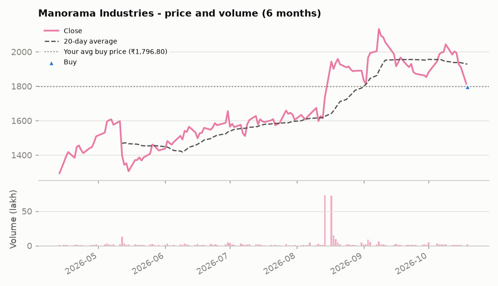

# Core-Equity Virtual Portfolio

> This is a **virtual (paper) portfolio built for learning and skill demonstration**. It is **not investment advice** and not a recommendation to buy, sell or hold any security.

**Last updated:** 20 Oct 2026, 05:26 PM IST  |  **Market data as of:** 2026-10-19  |  **Start date:** 2026-10-16

**Snapshot type:** End-of-day final snapshot

### Data quality notes
- Trade on 20 Oct 2026 (DEPOSIT ) is not applied yet - no market data for that date so far.

**Jump to:** [Summary](#portfolio-summary) · [Holdings](#holdings) · [Allocation](#allocation) · [Performance](#performance) · [Trade book](#trade-book) · [Companies](#company-deep-dives) · [Method](#how-this-works--data-sources)

## Portfolio summary

| Metric | Value |
|---|---|
| Current value | **₹1,19,66,653** |
| Total P&L | **-₹1,33,347 (-1.10%)** |
| &nbsp;&nbsp;Unrealised (open positions) | -₹1,33,347 |
| &nbsp;&nbsp;Realised (shares already sold) | ₹0 |
| Today's change | -₹1,33,347 (-1.33%) |
| Nifty 50 since start (same money invested) | -0.92% |
| Outperformance vs Nifty 50 | -0.18% |
| Cash (uninvested) | ₹1,58,669 |
| Virtual money put in | ₹1,21,00,000 |

_▲ buy · ▼ sell_

## Holdings

| Stock | Shares | Avg buy | Close | Day | Value | Weight | P&L | P&L % |
|---|---:|---:|---:|---:|---:|---:|---:|---:|
| HDFC Bank | 4,572 | ₹728.85 | ₹712.00 | -2.31% | ₹32,55,264 | 27.2% | -₹77,038 | -2.31% |
| Eternal (Zomato) | 10,245 | ₹325.30 | ₹320.20 | -1.57% | ₹32,80,449 | 27.4% | -₹52,249 | -1.57% |
| Maruti Suzuki | 290 | ₹11,489.00 | ₹11,475.00 | -0.12% | ₹33,27,750 | 27.8% | -₹4,060 | -0.12% |
| Ashok Leyland | 1,000 | ₹147.72 | ₹147.72 | -0.80% | ₹1,47,720 | 1.2% | ₹0 | +0.00% |
| Manorama Industries | 1,000 | ₹1,796.80 | ₹1,796.80 | -5.99% | ₹17,96,800 | 15.0% | ₹0 | +0.00% |

**Best since buy:** Ashok Leyland (+0.00%)  ·  **Worst since buy:** HDFC Bank (-2.31%)  ·  **Biggest mover today:** Manorama Industries (-5.99%)

## Allocation

| Sector | Value | Share |
|---|---:|---:|
| Automobiles | ₹34,75,470 | 29.0% |
| Consumer Internet | ₹32,80,449 | 27.4% |
| Financials | ₹32,55,264 | 27.2% |
| Specialty Fats (FMCG inputs) | ₹17,96,800 | 15.0% |
| Cash | ₹1,58,669 | 1.3% |

## Performance

## Trade book

<b>Transaction history</b> - 7 entries, newest first

| Date | Stock | Type | Shares | Price | Amount | Note |
|---|---|---|---:|---:|---:|---|
| 2026-10-19 | Manorama Industries | BUY | 1,000 | ₹1,796.80 | ₹17,96,800 | Added on 19-Oct-26 (CMP 1790.40 per Trendlyne) |
| 2026-10-19 | - | DEPOSIT | - | - | ₹18,00,000 | Fresh virtual money to fund Manorama Industries |
| 2026-10-19 | Ashok Leyland | BUY | 1,000 | ₹147.72 | ₹1,47,720 | Added at ~11:25 AM IST |
| 2026-10-19 | - | DEPOSIT | - | - | ₹3,00,000 | Fresh virtual money to fund Ashok Leyland |
| 2026-10-16 | Maruti Suzuki | BUY | 290 | ₹11,489.00 | ₹33,31,810 | Initial allocation |
| 2026-10-16 | Eternal (Zomato) | BUY | 10,245 | ₹325.30 | ₹33,32,698 | Initial allocation |
| 2026-10-16 | HDFC Bank | BUY | 4,572 | ₹728.85 | ₹33,32,302 | Initial allocation |

<b>Closed positions</b> - 0

_No fully closed positions yet._

## Company deep-dives

---

### HDFC Bank  _(Financials)_

[Google Finance](https://www.google.com/finance/quote/HDFCBANK:NSE) · [All BSE announcements](https://www.bseindia.com/corporates/ann.html?scrip=500180)

| Close | Day change | Day range | Volume | 20d avg volume | Volume vs 20d avg | 20d volatility (ann.) | 52w range |
|---:|---:|---:|---:|---:|---:|---:|---:|
| ₹712.00 | -2.31% | ₹707.15 - ₹733.40 | 33,524,133 | 30,961,951 | 1.08x | 23.74% | ₹687.10 - ₹1,009.50 |

**Research reports**

- [One-page snapshot](analysis/HDFC_Bank_OnePager.pdf)
- [Detailed report](analysis/HDFC_Bank_Detailed.pdf)

<b>Official company announcements (BSE)</b>

- No recent filings fetched; see the link above for the full list.

<b>Latest news (trusted publishers only)</b>

- [Who is Lily Vadera? HDFC Bank reappoints former RBI executive director as Kaizad Bharucha seeks departure](https://news.google.com/rss/articles/CBMi-gFBVV95cUxNbGF6RFpEQnZGTFBmRlBRT2pvVU0zR3NBWXl0ZDZQOThVemZHSHRoQkVhVGtQLWhpTWtmLWYxRWFNOGI0Si1NQnRsZmlWSzNmMkZqaEJhUGxKN0s3Q2NLbk41Z3FwRDFYaVh3aVFTQVZZWk81R1VsWXctdzd3amR4ZnFpUm9uamlzNXMyX2s4aEh4VFZqWklXRE5keDVkZ3JBNGI4NVJFcGNjSWpVbVRFRXNyME1hWnBtWGdMWEJoazVXd0NpUU03UVFMS24ycnRfTUIxeUpWNmFlZEwwTThmWHhjazRCSU12dnhzMlQxWVg2ZGRobV9QRmF30gH_AUFVX3lxTE1Ub3lQZDNUVjlnX3MyXzBmc1YwbkdCS1EzZFBVM041T0E5ZTU1MkdPWGQyekI4V0FhMHhRamtXOU1sVXh4eEo2c3ZyOVExUE9sOE5Demlob0xGNE9xOUNqbm1BRzFzVk9feW1BcW9UUFh4bDlvdmVyZmpoa1VuUW55VGtSZ3Q5Xzl4TWlNV3VuWlpWWjRhdktfaEMxckFjUnpNS0o0cU9BUW1kMUkzN09aRzJwVkdvaWhCRXhjczZFeU9iekJfN2stSXVoeDhSME1PX3dKcEFDZmE0SVRhOF9YMFhRbnkwYVpKU013WmhUbEwzazZXanZ0TmJtQWdsdw?oc=5) - _Livemint, 20 Oct 2026, 01:02 PM IST_
- [HDFC Bank vs ICICI Bank share price targets: Check upside potential, returns, valuations — which stock should you buy?](https://news.google.com/rss/articles/CBMijwJBVV95cUxNdVdXR1JJSGViZm9tNU1HckVRRXBicTc3MnNqcWw5YjNKNVZOeWd6RmtIaks3SGNoUlJGU19aYXFPanZZRzBKN0NTQjlHMm13SlVra2lhdm5yMURXZEJOMDkxRl9wNG9NTHU4UnE0ZEhCTjF4NzFMUFQzdW1QTk5xN19pN1d3VWREZGpBekdDRGJmcGxzdVdzZDU1YUJlV0Vya2l4d1FzVEZRTlFSYVFDSVFNaFM5dXBuVHpzdkxNT2Z4dHhSLUNLM19SWHVOMklVM1ViS0psMEVKVTBuWU5lZFVfTm9ySmNWanhuSXppOERYbUwxcmNhaHRSUG9RRHg2OHdTY3ZCQk1PV2VLRGEw0gGUAkFVX3lxTE9nMjVEYUp4bEVjQnQySXQ1QlJHN3I1aEJqd0ZsbDdxNnp1LW5EWUZDa1YyVEZYRzFmVV9nSW9FbkhSQjY2REprMkMtNHRzZ3hPeTYxeXZXdVlxYzBLbU5fdWZyNkJMMnRvc3AzU0FqeWs2QlhTc3ZGeG1zcy0zdXJyWFRQeWJDYlZNRHFrNUtzU0k2R25qei11R1FDY3RfZG42Mm95dzBNX0tjUVlVYkE0bzVzZnpQWDhUbnY1MGpUMTdnM3JRTGxKbGlyZ21uZFI2cVpNRnhmc1JNZDNoZ2xKcnZyVTZoOWZHclg4YWNnNWpkLUJTSUtpRUF5T1JJRzAzalhISlZhN1FsNl9vZTBkQUYyaw?oc=5) - _Livemint, 20 Oct 2026, 10:29 AM IST_
- [Top banking share to buy after Q2 results 2026? HDFC Bank vs Axis Bank vs ICICI Bank vs Yes Bank vs IDBI Bank - Details](https://www.livemint.com/market/stock-market-news/top-banking-share-to-buy-after-q2-results-2026-hdfc-bank-vs-axis-bank-vs-icici-bank-vs-yes-bank-vs-idbi-bank-details-11792465348383.html) - _Mint, 20 Oct 2026, 09:08 AM IST_
- [Brokerages back ICICI Bank on strong Q2 earnings, see HDFC Bank recovery ahead](https://news.google.com/rss/articles/CBMi5gFBVV95cUxNNUdsMnVnZzAxS2huQWctNi14VHR1dmVWQlR6RXRHRl9vSEZqTGpKUjFHclhncEExbGRFWk85OWQ1MzBoV1hvZlZkeGh3SnViNl9MRjVGQTdiajZVa3g5ZGhNWUk0VXRYRFdLV1hMbERFS2pURkt4SXNwOXFJU3hSUmtvNF8ya1BxRkkzUXpzbGpkbHFOTGFMSjRhZUcxeFlCZG9lRjR6UmZNdkRsT0l0RE4zbUt0WTN5QldSMnk3YmRhaVZOaXNPMnRLc3hFSEhHaU9JSnJqRF9RSUx3QUgwdHB2cHJVQdIB6wFBVV95cUxPVERYYkxlbzVZbGlyUWw5U3phak92eC1Xd2FMTi1JWUtHalB6RUlpTEJfcktfMURJT2Frc0tNM29TWC1aRGx6TGw0bkxWeFRmWjF3QXlSVU9NR1ZiTDA0eVZPb1hEeGtmR00wYWVRaXNXUnNackRXakdqZTExdWpRYkk3WDUzcmJiSHRvVk1jOWZZUWZ0WS1mRFdobFEzX0hCU0xrd1JxS21LeFJZWWQ4T2pXSmJiVVBXNThsd1padloxSDdUVm0wM2NHRUg1ZTJ4ZGlxaHMxTlREWk42YmFBT1o0bG1hX0pfdHNJ?oc=5) - _The Economic Times, 20 Oct 2026, 06:04 AM IST_
- [Buy, Sell Or Hold: HDFC Bank, Laurus Labs, BEL, Havells India, Cummins India And Hindustan Copper — Ask Profit](https://news.google.com/rss/articles/CBMi3wFBVV95cUxQbzRCdlh3ZmRFSS10VHRUV3RHVDFZMldtUEotSHRKY3Vna0NuSWZMb3h2b2JJVl9EMFhIYmhLUG1UdlBCVDN2RXpIRmVPWkZ0M19oMHhFUDZmcS1ZaFE3ZjdUaHFnVGdVdm1MWHpjbjQ1bTZvSHpHa1hIa01WcHpGZEJ0bnZmSVR4RFZZSnZQQXBSbG5NRlgxZ25RYnVwNTB6dWhuNjZZQXRzYnNKT3dsZ2dTQ053X2xXUllnSFQ3TXVoYzFLN2FtczUyckFPdUxWcTJJNW9DZUg1aGR1QTIw0gHnAUFVX3lxTE4tclBQZ0ZPOG9XMjZaQmwySktacmRsay1iWktfM1dhWDNVRVBhNklKaXAyNjNUNzl5Y2FhcDhEdHNmYi02dmNQcnItX1l1QWs1dy1jWmx3NTFfVjlvbmVtaU9yd0tDc243bE9UZzUwQ3M5cjg0M2FCUzNBbDhEZ1ZyQkRCZkw4aURVMjlXWUR6T0NoSlhxN042WGQzZE8xV0czZ0F2WlhpYmtvbFhLSV9iTTVDbUNFNHN6Z1F0SERtVnJtSUtTQ2t3NmhQUEZ5d3R3U0Q3MTF3YUdkanBHNlZtekZQaE1ZSQ?oc=5) - _NDTV Profit, 19 Oct 2026, 10:00 PM IST_

---

### Eternal (Zomato)  _(Consumer Internet)_

[Google Finance](https://www.google.com/finance/quote/ETERNAL:NSE) · [All BSE announcements](https://www.bseindia.com/corporates/ann.html?scrip=543320)

| Close | Day change | Day range | Volume | 20d avg volume | Volume vs 20d avg | 20d volatility (ann.) | 52w range |
|---:|---:|---:|---:|---:|---:|---:|---:|
| ₹320.20 | -1.57% | ₹319.50 - ₹327.10 | 17,850,721 | 21,352,242 | 0.84x | 27.78% | ₹215.68 - ₹342.65 |

**Research reports**

- [One-page snapshot](analysis/Eternal_OnePager.pdf)
- [Detailed report](analysis/Eternal_Detailed.pdf)

<b>Official company announcements (BSE)</b>

- No recent filings fetched; see the link above for the full list.

<b>Latest news (trusted publishers only)</b>

- [Flipkart to challenge Zomato and Swiggy with ‘Eat-in by Minutes’: Launch date, features explained](https://news.google.com/rss/articles/CBMi6AFBVV95cUxONEFEZkdvM3lzVTUwR25JRHI1aEFSM3ctckdwV3Eya2xNTHRGbjlnbW1Vb1dvWlh5cTF2WllmY3VlTWpkaFBLRWhnZFNEQ0JoUE44a2lFdFF2QjZTSkxlU01nbHE2aENVV1c1U29CbHNLd01FQUpxWEVCRkFPbkxmNG1mdlMybmJYb0FKa3JXQXc0QVR0Z2RVNHlLU1JMLVA0X1ppRjBVLW9iUkVPcmYwU05nVjVYb1pMMnc4STNicXZLMUxfdmp2ckVfVnlsOUVLa0NFZkdVNENaaFlFdF9hclpOYmkwRmtr0gHuAUFVX3lxTE1udG5BUWpiMFdHUF82S29xYWozblROb1R4UEI0V2ZwNW5FVVhnX2pPRFpWbGtVWVZ0YzBRSmltNUtWVWpTaWNlclM1UHhQbkhKdi03MXBWQnh1cmZ1TVE1Ql9WLTVrZzJ5alB5SXV6MVNhMmZPVWNxdFhLSDJ3VzBQN0hZYjJWVEVJejY0Mi1GM0N3RUI4SHd1eHR1MU5DNU9Tb0hzZW9TYVlBVXFtMGw2aHRIby0xMlBfMjVrQUppeFFfODFETjJ0VWtiWTBHa0ZHLWNkeEdlREZLQlEwWmJrbUtjT3VET3lEb0c3X2c?oc=5) - _Livemint, 20 Oct 2026, 03:42 PM IST_
- [Eternal Q2 preview: Brokerages expect market share gains, steady margins](https://news.google.com/rss/articles/CBMi0wFBVV95cUxOeG5FdFE5bENaSi02aUZZX19tbnJfOWhWeHRRYWVZLWZBU1J3aW9vUjA0b2EyV05FUGpQeFktU3k2OS1US2FWR0JOejNZVEpUY1dETHhQeERtM0U1d25ZQVJORjh2VlB4SWpoaDBrVG0xaE1EYU16LVhpYkFKXzNLUU55dndfVTMyeTk5R2ZGdUY1SE1VeUNQV1plXzgxS21jcjZGVmF6MG80d3VhMndQRVFYS1ZWM2R3VTJhaWNoVGtsYVVUQW5BTTg1a0xqS1dNZG1j0gHYAUFVX3lxTE5hRFlkQWcxWmM3eHVCM3VJbzhiMTg5UDNWQ3k4RE80WmxOX1JsZFBZeGtCb0JSSmpmTHBTdk5rV0JicEozSFBrXzFRUnh0V09QVWNxNmFZZl9iSk1USjc3Y1NnQTNVd1Vqc0F6REZsSXY3azNuMVRnWHRpcWtpQ3ZISHlMZnpIenFETnRNVG5QRzM5ZzBlRW9DblFJTHpUZk40Sjg3dGo2YWdWbWtJUl9pRVRPRk1VZWFZQ1hLUzVoNlRkNVdMV1htVDRHNW1FT3I3eEdBVGhZZA?oc=5) - _Business Standard, 19 Oct 2026, 01:58 PM IST_
- [Tukaram Mundhe-led FDA cracks down on Reliance warehouse, Blinkit-linked facility; flags ‘cockroaches, spitting’](https://news.google.com/rss/articles/CBMi9gFBVV95cUxPbmUtVnN2RTB5eUJwZWlac0FxWWNYNDdMa3pBOXZFd2pYN25wT0tPV0pKN1VZVlluQ2s5Z3NKQTdFeE1TVTNCTVhVeVd3c3VNRXdFOEdWQ2V3T051VE9ETGNJUHAzVzJBaU9XTGtMY2RWUW1FMjFHYWFETEVYZUV2YXNKdVp2QWk5clFER0V2TGxidXo4cDRpdjEzQUVvSUhuVTQ2UFhNbTlvQ0hZcjd1NzhUOFZpTExzcDRmeEtFQXJCOG15dlF3TGxwMnlib3FuU21qUGs4aUNBV0JTQ3NJdE9sLXhJWEMza1FJeU1QSEhPV0M3UGfSAfsBQVVfeXFMTlcxOERPZGZTRGpvUTJla1ZTMTJkS01QQllVMHdtdm5wdzl5c0RXVVF6Z3hUcWg4RjJMWk5pbG12SklDYTEtMGlMek5XblY2NWFabEY1dzBoQXFXMlRIZXVmMTBic3pJcS1pdkhTM2JTbFBoU3NBNFF4ZkNoeFgxR0dla1BnNEJzS1FxajF0d3NGX3hDcm8xaGtwT3lQNW9lbVljODNGZHVzUVJuaG5hcjVSTEdyVlhKckZvSnhvVHdfMWZZZjk4MHdHMGVUdUFyWHRPRDdub2FwcjR1TEczbVpBTkhmeTl1YUtrbl9FY3lua0ItaWFqQTJRbEU?oc=5) - _Livemint, 18 Oct 2026, 11:25 PM IST_
- [Reliance and Blinkit executives face FIR in food safety case](https://news.google.com/rss/articles/CBMi5gFBVV95cUxPNDBtQ1BmVEF6UWo2NHNUdExkdDRkWExWRHFWc0xGR3RHN1B6UGFuOUdYWGt5TjZiTmwySDZsMTgxZG1TVm1JT0lPTjJXU1djZU5IZ0VzYXpGV3ZmSEZlNkVqWVFmZnBlLVpobHJVTFZmWnNROEdsMWV5ZXZrbXo5UDg4c2hUVkdFRm5MV2VFdGQycS1WcU1wTGZhWHN5OTJhaGZuREplQmJwZnlrdEFzai00czZIS0ZNZ0ZnTWVmdHlQeVRySFFIUjZ1eGE1dG9zUHhjY3dxRldvYzJWT0txaWtQcHBfZ9IB6wFBVV95cUxNbVk5Nm1scVBMbzhWMDR4aElCdWREWnY3LXBWYXBOY2p0X1lmMzBhc2lrSk9jdXU5aFdwbFcxckhoUVFzTmZKZFNtMXJYVXZKMTlpbS1jT2hTOVJMcGtMX2xzVjBueDJHVGNtcUpuY0lRd0tfODdlWUlNV04xMVh1RDZFTElVazhBbzNZV19udWpjYUhrOUNrX3BKVENXbjNVQy1zMEJSZkRQLXlnbTN6WEY3Ql9FRWh1NXE3dlVpQnhvTjk5ejVoNUdldzJ6RE1UMDI3MnJJbjhILXhHczBzNzkxaEo0ZEJJXzlr?oc=5) - _The Economic Times, 18 Oct 2026, 12:00 AM IST_
- [FDA suspends licences of warehouses of Reliance Consumer, Reliance Retail, Blinkit, Zomato Hyperpure](https://news.google.com/rss/articles/CBMiiwJBVV95cUxPMDEwLUZmVDhkTkdJbE5OTEE4S0l3djlTWnpnTmc2N3JibUV3blg5by0wZk5vR2JRa3h6LW5tT2tmemJMUlR5UVZOcTRPeDh1YWRwV2V1TGV2SkcwZE4ySVh4c1FvWGEzdG5ld3hBUzZlRjNidkg5Yy1LZC1sQmdVZE1WQmdhYWtCaUNrcGZzQllaUHZac1ItTERkVXNHMDE5a0dsQnRnZnRiMnFBZF80ZHRxSHZGZVhRZWh2a3pLeXRDTG9tclh4TkFaQllGTDh4VmFzODZMTmRmaXcwcVpwenQxUWtkd2d5RktNT2lzSXNFYWV6TVlta3BMUzdiWHdvZ2cyMGUtU0VCZUnSAZACQVVfeXFMT3Z4TGIzaU9feFl4QV9SZ0hIWkVtd0JYU1BJcWYydC12bFRrZUlZV3BBS1NLdWJoU0JjN1V0NWtDd1lqaXJYcm9VY2NOV0hoSUF6U3FtSkVHQmYxNjgwR2Z2VGZPSUJsOHVkdHZoOTMtRXp3ZGg1MmNGMVpGOW5ZWWNNX0p5LXlSN01kSU9uZnpmNVNTaE9jbkpQRGJxcjZXS1pIUGZINHJNVExTYmdlM1F1MG15T0UtYnB1a2J5bEFoS1I4dGN4dWJsWlF2Wm5MMnpWc2VSOGNLOUYyN0YyMFFLNGtESzI5TEVkZkdjcTNRWEFGYnJETHFkWU1LMnE0a1BjMVpOZS1Qc280QUJBWFI?oc=5) - _The Economic Times, 17 Oct 2026, 10:14 PM IST_

---

### Maruti Suzuki  _(Automobiles)_

[Google Finance](https://www.google.com/finance/quote/MARUTI:NSE) · [All BSE announcements](https://www.bseindia.com/corporates/ann.html?scrip=532500)

| Close | Day change | Day range | Volume | 20d avg volume | Volume vs 20d avg | 20d volatility (ann.) | 52w range |
|---:|---:|---:|---:|---:|---:|---:|---:|
| ₹11,475.00 | -0.12% | ₹11,440.00 - ₹11,702.00 | 453,832 | 459,379 | 0.99x | 25.12% | ₹11,178.00 - ₹17,292.00 |

**Research reports**

- [One-page snapshot](analysis/Maruti_OnePager.pdf)
- [Detailed report](analysis/Maruti_Detailed.pdf)

<b>Official company announcements (BSE)</b>

- No recent filings fetched; see the link above for the full list.

<b>Latest news (trusted publishers only)</b>

- [Maruti Suzuki Grand Vitara festive discount reaches ₹1.36 lakh; check offers on Fronx, Jimny, XL6](https://news.google.com/rss/articles/CBMi5gFBVV95cUxQU1hvNTkzOVFTaUNfQ3dDY1VVYU85YlNCaTR3azNhNE9GZmltQUwyd0F5aHFPaGJUZE4zZldieWo3Rk1yXy1jaDhyQUxVeFA2eTVSQm5NeUI3MUpwVEJoVC1tdXFrcjlXQzRfNlJhR2oyZE9rOWhMUGRKVWVQTDBrT20xalE2WjUzTGYxb0ZPWm0yeUx6RnE1UHJ6c1E2eVF5RUR3alAtbG9HeHY5cUdqX2RwSVFBSXhSUGk0SVNoaVBZUnlwTVJkZXdGTnlYaWh3cks2WVo2eTJ5TXNIZWEtMk1fQmNwZw?oc=5) - _Livemint, 20 Oct 2026, 05:05 PM IST_
- [Maruti Suzuki festive discounts: Save up to ₹1.36 lakh on Grand Vitara, Fronx, Nexa cars? Here's the catch](https://news.google.com/rss/articles/CBMi7wFBVV95cUxOejZfTm5jbzZnTzc5cWpreFNMaW1QWjlLanJiZFUyazJHbjVKN1dpNDViMWhUTzR0cmoxSmpEb2tXdWxmRVJ6eFllZW5qMkJfVktyd0l2d3R4M1hiMk9LeWkyWkhMaWVBVVFJdkYwN2JoMlZoYndkUmpkU0l1ZDlObTVra1FhQjRvVFZUdHNVQzNLeWdjVVV3WW5XM3hWb1ZXZVVoVGs1cnRyZ1Fwa0RNb1RnMks0UE9fSjYtVEtiVzkyM0RuZ05VRmNGdjJwX09GTExiZ0VhSXRKVTVqaWhoUGVEczRUT2Q3NVBfaFlvTdIB9AFBVV95cUxQRC1tVGZBZHBhSUlCTElfajMxM3kxcmhhM1lqWmJaRHRENWtiRzdDMGR3RzM3cG9CZEVfNENRZmZjUF9SR20yUll4N1NsS25FdGNZSk0xQ3hVZmRDcmR4cnZmNlVLY19mWVY5dlJ4TUVLcFZZeVd3WjhKbERYekVrYjNDZ04wM05OSTgzQU9wVUdtRE5oUEMtd1RVaU8wcHFRa01PZkZQWXZKN3luLWlYc2taSWpFRmlCZldhMngzaS02SC10cnlxVGNKZHltYWpkWmhvVXN1NTBOVEZtV0djcTlDdUhTRHY5Vlhzc2NRLWtPVUE0?oc=5) - _Livemint, 19 Oct 2026, 01:39 PM IST_
- [Maruti Suzuki expands Integrated Traffic Management System initiative in Gurugram](https://news.google.com/rss/articles/CBMi7AFBVV95cUxPQnh6TE5aVHQ0cmZtNF9jV2Ryb2NrU3JEUjQ2djZ0UGg1ajJSMTJnTVFIcWtJMXgyeFRoTlhNTjlxamlBNWFsa1hFOC1ndGdwUW9RODhJOHBMeTA5WTFnWUJMa0dxMTRiYThObWVvTmFjRjJWLW9NcHU5cmZ5bDhwV0hKZ1lmMmFBc3NERmd6bVo3Zk0zVV9CS3dna3k3Uk9fXzFXdWJpSHJ1UUNkMlljU2tHbFd3WVcwWFNwQUp0SkxSZlNQSlFDNmpjcVItYTFFWlNVZDhnNW56NWNGeUZMejNyNV8yZ0RwVUVsRNIB8wFBVV95cUxQN3JrVGhYdTRYNUl5Yjl1cVZTbzJFQmk0QUlCQmkzMXpCckRTTmNGc25CdG03SDd1bTZzSW1EcmdmVHlXSUtOaTZqR3JEZkZnbkt4dW5PX0tQVVlCaVdLbVRiSkk5aDJYYmhwRVNIbDFlZjdpbWQ2YUliZWxYNEo1MmxJN0lyUGU4X2lSU2h5UlhpRGdLSkE3Qm1nbjVvTWxJV1BJZE8zVW42VWUwZ0lUTElpUFdIOF9LN09GUzJDN3V2XzdzellfNHFsU3ItbkpSSTFFdEpNLW9yaDFnZHdoUmRWdUJZVk9SaDJYaGpPMWNvSXM?oc=5) - _BusinessLine, 19 Oct 2026, 01:10 PM IST_
- [Maruti Suzuki leaves Alto, S-Presso prices unchanged despite rising costs amid demand rebound](https://news.google.com/rss/articles/CBMi6gFBVV95cUxNY0drVmhyWkFNUFV2ZFc5TlRWa0pTRlUtaWlqeVo2MGxDRk5BR0h4NjJuUVdfSjRlRWVoQUgwLS1NeUd6Y1dCeWVRTXh0c2JiODBoVnFPNmthNHN2MFZSdnFzMnFyNjR5VzFqbEFnYlYweU1scjI5TXVDSVFPV1RkVEd4SEpZUVV4ekdiTkVkODloemJBcno4WS00NDBNc1pFdmsyOUNkU21Pcmc4aU1Ud2otMUV0OUwtODBLazB3T0l3M3RXQkd2bFNnV051ZWx4VXNwQmxqb2FYRUI3TTVwNnlTYVBxZTVKVmfSAe8BQVVfeXFMTlZVeEtHT2ppVTNSbTkyZDN0a3BYRjhERzluRGhWOUJvQ1Y2UmtmSTREWTIwS3JQdHhlT0RnalNkQjlaSVhQNDROVExMSEpwR1U5d1RIV0RKYUJ0NDhnaTF1TGhjWEFQU21QVkxOYjNRekNkRFVUM1YtaDlVdmI2ZV9Hbklpb2xjQVNTZlVhbllVZWowZ2NPMW92UElyMzNNOUExWnJaUnVBYUVFOHk5YnB2SG9BTnhuT2ZpZ01SNDFMUW9QWVZIekJSOFNiNTd6RkdOMTRlMUdkS0MzM1daR25XYTY1YmpqVDFBWG5IcDA?oc=5) - _Moneycontrol.com, 19 Oct 2026, 09:32 AM IST_

---

### Ashok Leyland  _(Automobiles)_

[Google Finance](https://www.google.com/finance/quote/ASHOKLEY:NSE) · [All BSE announcements](https://www.bseindia.com/corporates/ann.html?scrip=500477)

| Close | Day change | Day range | Volume | 20d avg volume | Volume vs 20d avg | 20d volatility (ann.) | 52w range |
|---:|---:|---:|---:|---:|---:|---:|---:|
| ₹147.72 | -0.80% | ₹147.21 - ₹149.40 | 8,502,677 | 12,650,944 | 0.67x | 27.42% | ₹135.84 - ₹211.92 |

**Research reports**

- [One-page snapshot](analysis/Ashok_Leyland_OnePager.pdf)
- [Detailed report](analysis/Ashok_Leyland_Detailed.pdf)

<b>Official company announcements (BSE)</b>

- No recent filings fetched; see the link above for the full list.

<b>Latest news (trusted publishers only)</b>

- No fresh headlines from trusted sources in the last few days.

---

### Manorama Industries  _(Specialty Fats (FMCG inputs))_

[Google Finance](https://www.google.com/finance/quote/MANORAMA:NSE) · [All BSE announcements](https://www.bseindia.com/corporates/ann.html?scrip=541974)

| Close | Day change | Day range | Volume | 20d avg volume | Volume vs 20d avg | 20d volatility (ann.) | 52w range |
|---:|---:|---:|---:|---:|---:|---:|---:|
| ₹1,796.80 | -5.99% | ₹1,785.30 - ₹1,911.20 | 217,222 | 161,026 | 1.35x | 34.54% | ₹1,075.80 - ₹2,132.90 |

**Research reports**

- [One-page snapshot](analysis/Manorama_OnePager.pdf)
- [Detailed report](analysis/Manorama_Detailed.pdf)
- [Brutal verdict](analysis/Manorama_Brutal_Verdict.pdf)

<b>Official company announcements (BSE)</b>

- No recent filings fetched; see the link above for the full list.

<b>Latest news (trusted publishers only)</b>

- No fresh headlines from trusted sources in the last few days.

---

## How this works & data sources

- **Prices / volume:** Yahoo Finance via the open-source `yfinance` library (unofficial; may differ slightly from NSE official data).
- **Trades:** every buy / sell / deposit is a line in `transactions.csv`. A trade happens at the closing price of its date (live price for today). Average-cost method; no brokerage or taxes (virtual portfolio).
- **Benchmark:** every rupee put into the portfolio is also put into the Nifty 50 on the same day, so the comparison is like-for-like.
- **News:** Google News RSS + publisher RSS feeds, filtered to a whitelist of trusted publishers, de-duplicated, last 72 hours only. Each item links to the original article.
- **Official filings:** BSE corporate announcements (best-effort, with link to the full list).
- **Automation:** GitHub Actions refreshes this dashboard on weekdays every 30 minutes from 9:30 AM to 3:30 PM IST (live snapshots) and at 5:45 PM IST (end-of-day final snapshot + AI daily report); skips market holidays.
- **Metrics:** Volatility = 20-day std-dev of daily returns, annualised. Volume ratio = today's volume / average of previous 20 sessions.

> This is a **virtual (paper) portfolio built for learning and skill demonstration**. It is **not investment advice** and not a recommendation to buy, sell or hold any security.
