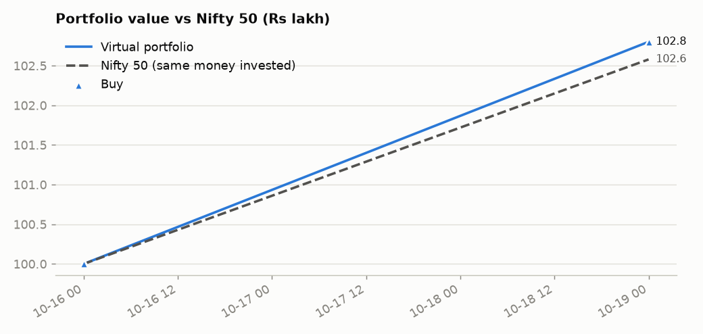
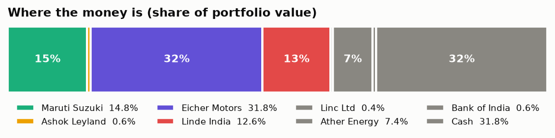
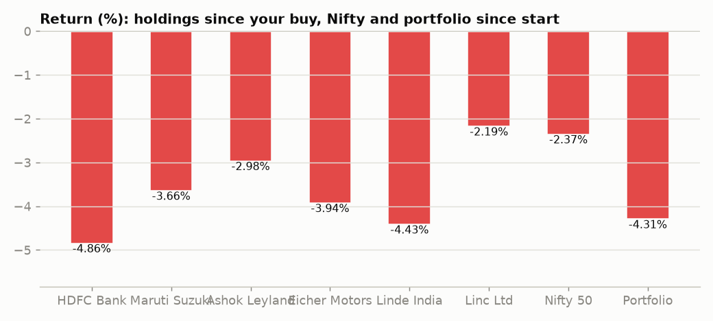
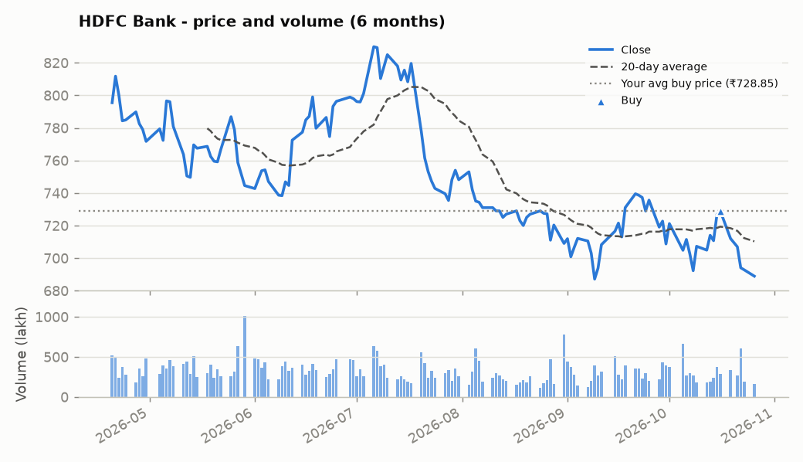
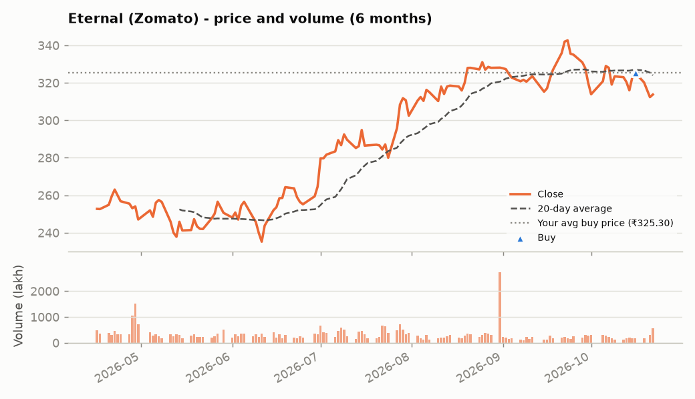
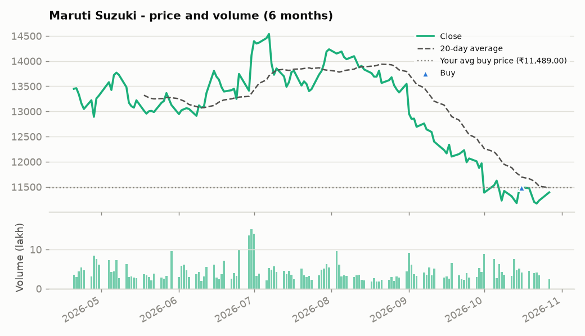
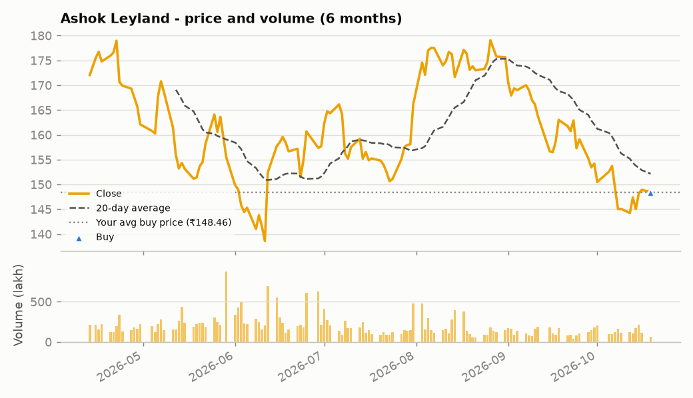
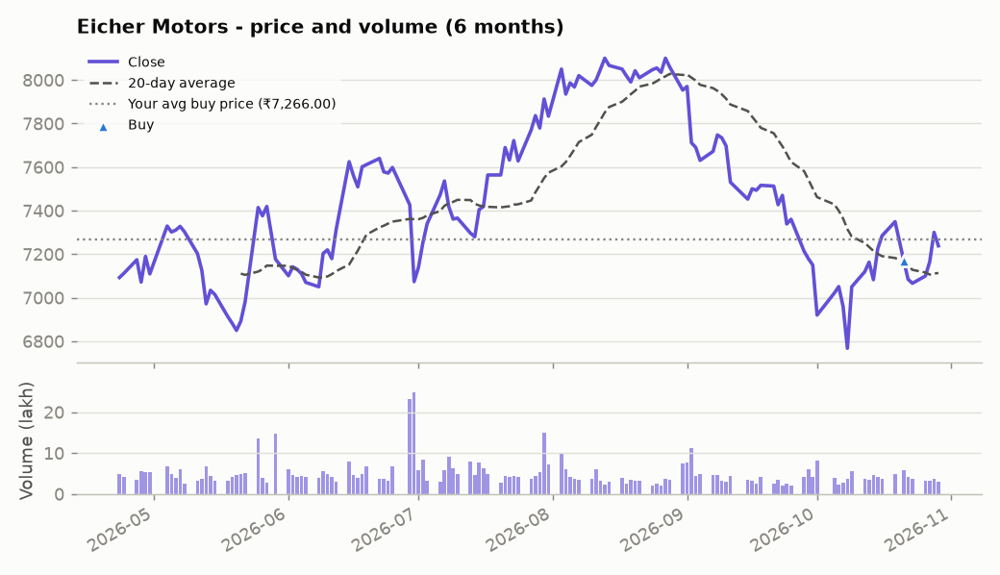
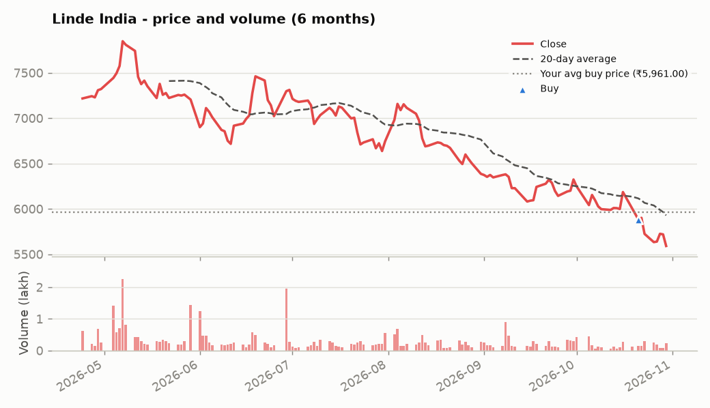

# Core-Equity Virtual Portfolio

> This is a **virtual (paper) portfolio built for learning and skill demonstration**. It is **not investment advice** and not a recommendation to buy, sell or hold any security.

**Last updated:** 21 Oct 2026, 08:05 PM IST  |  **Market data as of:** 2026-10-21  |  **Start date:** 2026-10-16

**Snapshot type:** Live intraday snapshot

_Live snapshot: today's session is still in progress, so volume is partial and "Volume vs 20d avg" will look low. The final end-of-day snapshot is published at 5:45 PM IST._

**Jump to:** [Summary](#portfolio-summary) · [Holdings](#holdings) · [Allocation](#allocation) · [Performance](#performance) · [Trade book](#trade-book) · [Companies](#company-deep-dives) · [Method](#how-this-works--data-sources)

## Portfolio summary

| Metric | Value |
|---|---|
| Current value | **₹2,07,69,161** |
| Total P&L | **-₹4,96,839 (-2.34%)** |
| &nbsp;&nbsp;Unrealised (open positions) | -₹4,52,339 |
| &nbsp;&nbsp;Realised (shares already sold) | -₹44,500 |
| Today's change | -₹3,63,492 (-3.04%) |
| Nifty 50 since start (same money invested) | -0.71% |
| Outperformance vs Nifty 50 | -1.63% |
| Cash (uninvested) | ₹8,30,469 |
| Virtual money put in | ₹2,12,66,000 |

_▲ buy · ▼ sell_

## Holdings

| Stock | Shares | Avg buy | Close | Day | Value | Weight | P&L | P&L % |
|---|---:|---:|---:|---:|---:|---:|---:|---:|
| HDFC Bank | 4,572 | ₹728.85 | ₹706.95 | -0.71% | ₹32,32,175 | 15.6% | -₹1,00,127 | -3.00% |
| Eternal (Zomato) | 10,245 | ₹325.30 | ₹312.35 | -2.45% | ₹32,00,026 | 15.4% | -₹1,32,673 | -3.98% |
| Maruti Suzuki | 290 | ₹11,489.00 | ₹11,200.00 | -2.40% | ₹32,48,000 | 15.6% | -₹83,810 | -2.52% |
| Ashok Leyland | 1,000 | ₹147.72 | ₹146.74 | -0.66% | ₹1,46,740 | 0.7% | -₹980 | -0.66% |
| Eicher Motors | 1,000 | ₹7,266.00 | ₹7,170.50 | -2.43% | ₹71,70,500 | 34.5% | -₹95,500 | -1.31% |
| Linde India | 500 | ₹5,961.00 | ₹5,882.50 | -2.02% | ₹29,41,250 | 14.2% | -₹39,250 | -1.32% |

**Best since buy:** Ashok Leyland (-0.66%)  ·  **Worst since buy:** Eternal (Zomato) (-3.98%)  ·  **Biggest mover today:** Eternal (Zomato) (-2.45%)

## Allocation

| Sector | Value | Share |
|---|---:|---:|
| Automobiles | ₹1,05,65,240 | 50.9% |
| Financials | ₹32,32,175 | 15.6% |
| Consumer Internet | ₹32,00,026 | 15.4% |
| Industrial Gases | ₹29,41,250 | 14.2% |
| Cash | ₹8,30,469 | 4.0% |

## Performance

## Trade book

<b>Transaction history</b> - 14 entries, newest first

| Date | Stock | Type | Shares | Price | Amount | Note |
|---|---|---|---:|---:|---:|---|
| 2026-10-21 | Linde India | BUY | 500 | ₹5,961.00 | ₹29,80,500 | Bought 21-Oct-26 from cash at 5961.00 (NSE last traded 10:53:52 AM IST per Upstox web quote) |
| 2026-10-21 | Fiem Industries | SELL | 1,000 | ₹1,816.90 | ₹18,16,900 | Sold 21-Oct-26 at live NSE price 1816.90 (10:03:32 AM IST; source NSE_CMDATA) |
| 2026-10-21 | Manorama Industries | SELL | 1,000 | ₹1,749.00 | ₹17,49,000 | Sold 21-Oct-26 at live NSE price 1749.00 (10:03:32 AM IST; source NSE_CMDATA) |
| 2026-10-21 | Fiem Industries | BUY | 1,000 | ₹1,813.60 | ₹18,13,600 | Bought 21-Oct-26 at live NSE price 1813.60 (10:00:26 AM IST; source NSE_CMDATA) |
| 2026-10-21 | Eicher Motors | BUY | 1,000 | ₹7,266.00 | ₹72,66,000 | Bought 21-Oct-26 at live NSE price 7266.00 (10:00:26 AM IST; source NSE_CMDATA) |
| 2026-10-21 | - | DEPOSIT | - | - | ₹72,66,000 | Fresh virtual money to fund Eicher Motors |
| 2026-10-20 | - | DEPOSIT | - | - | ₹19,00,000 | Fresh virtual money to fund Fiem Industries |
| 2026-10-19 | Manorama Industries | BUY | 1,000 | ₹1,796.80 | ₹17,96,800 | Added on 19-Oct-26 (CMP 1790.40 per Trendlyne) |
| 2026-10-19 | - | DEPOSIT | - | - | ₹18,00,000 | Fresh virtual money to fund Manorama Industries |
| 2026-10-19 | Ashok Leyland | BUY | 1,000 | ₹147.72 | ₹1,47,720 | Added at ~11:25 AM IST |
| 2026-10-19 | - | DEPOSIT | - | - | ₹3,00,000 | Fresh virtual money to fund Ashok Leyland |
| 2026-10-16 | Maruti Suzuki | BUY | 290 | ₹11,489.00 | ₹33,31,810 | Initial allocation |
| 2026-10-16 | Eternal (Zomato) | BUY | 10,245 | ₹325.30 | ₹33,32,698 | Initial allocation |
| 2026-10-16 | HDFC Bank | BUY | 4,572 | ₹728.85 | ₹33,32,302 | Initial allocation |

<b>Closed positions</b> - 2

| Stock | Bought (avg) | Sold (avg) | Held | Invested | Proceeds | Realised P&L | Return |
|---|---:|---:|---:|---:|---:|---:|---:|
| Manorama Industries | 2026-10-19 @ ₹1,796.80 | 2026-10-21 @ ₹1,749.00 | 2 days | ₹17,96,800 | ₹17,49,000 | -₹47,800 | -2.66% |
| Fiem Industries | 2026-10-21 @ ₹1,813.60 | 2026-10-21 @ ₹1,816.90 | 0 days | ₹18,13,600 | ₹18,16,900 | ₹3,300 | +0.18% |

## Company deep-dives

---

### HDFC Bank  _(Financials)_

[Google Finance](https://www.google.com/finance/quote/HDFCBANK:NSE) · [All BSE announcements](https://www.bseindia.com/corporates/ann.html?scrip=500180)

| Close | Day change | Day range | Volume | 20d avg volume | Volume vs 20d avg | 20d volatility (ann.) | 52w range |
|---:|---:|---:|---:|---:|---:|---:|---:|
| ₹706.95 | -0.71% | ₹698.25 - ₹715.40 | 26,570,226 | 30,668,122 | 0.87x | 23.32% | ₹687.10 - ₹1,009.50 |

**Research reports**

- [One-page snapshot](analysis/HDFC_Bank_OnePager.pdf)
- [Detailed report](analysis/HDFC_Bank_Detailed.pdf)

<b>Official company announcements (BSE)</b>

- No recent filings fetched; see the link above for the full list.

<b>Latest news (trusted publishers + official company newsroom)</b>

- [HDFC Bank governance woes grow: Probe finds 2 executives leaked confidential information](https://news.google.com/rss/articles/CBMipwFBVV95cUxNOEtobVF2clRPLXNSb0ppTlpfal9JeTdBRENNdGNCdWJlU0VXV1pHQUsyTXphY3lKTVl5bjZtWTRqdW1LZlppOE1WU3g4VF9BTU1NTm4wYXdiUXotVE5wVGphYUpDd0pPbTBqMHNhQWhEU2FvZy1pMVdXSUJueXhaa2o0MkgwZmxCYUd1Q0ZSRnBPcGQwY29RVmtnVU1WNGdia0JVdXlPUdIBrgFBVV95cUxNTUNpZEcxOVhWTW1sX1NOZVhOcXdqRFd6UEZ2YjQxVVVVWXdCTVoxRG1BTk9HQWhIdjgyUkhaTzNITGhkWUJoNzBDTS1oVnR2MmtaVnVEME03Vmw0UHRiTUJ2ZlZ0TGQ2VU1QcVJpb2UtNDVYT2hKQ1F1NHhIU3Z6Y2VLcFVjWmlZY1RMNFlaWWtsTlNYV29JRmhDQ09Wc19HWnpXa1RYYXllaWxqcmc?oc=5) - _The Indian Express, 21 Oct 2026, 05:29 PM IST_
- [HDFC Bank Says Probe Into Confidential Information Leak Is Underway](https://news.google.com/rss/articles/CBMisgFBVV95cUxQX1lNb05lRXJWUU9vaGhnMkhWOWo2bFZRT0I0YzhQOER5UjYtWjQ0R184X0g5WkVwMXduVTdQYkY1MEt4NnRYaVFYOENmTHVNTkpZeDRPUWdLbTNPX2QtY1NFcUxqdkNxblYyckR3Q19OSWhxeW1paUZuSXJ2Tnp1SnRjRXZsb0ZjMThaRGlmdmJ5RDJzR2JZNEtCb3VOczUzNXo0SG43TllkRzhZb1c3d2pn0gG6AUFVX3lxTFBpMWg3YmJZTkVjNWtWbVV5ODZ3a1d2RG1mNE0xQTFoLVI0eFoyVlFxdmZfdEhKOGR2LWxnQmJ3MV9fMkUxelBSRV84WmhRU19OMTZPZ3BQallJWU9fZjFBcGhWSGpRaUZLd1piVTlQc2JjYVJiNmROMTMzeGlBODVnUkMzU2JCMTJRNVJBMURRVnh2YTF3SVBlTGJGMXhYLU1iZUowYWJ0SS12TGNzV0pPQnlla3ppWTJndw?oc=5) - _NDTV Profit, 21 Oct 2026, 02:48 PM IST_
- [India's HDFC Bank probe finds executives leaked confidential information, Bloomberg News reports](https://news.google.com/rss/articles/CBMiuwFBVV95cUxPZTAwOTR1Z2FTcGtPLWtCZjdPMER5XzQ4cUo0UnF6WE45bW5iaFBwRmxvb1FldlJZUno2VmducGdDa0hHdHNXbXNfd0tBRzdpMGE1SGJDWTk3akJtYjFtd3hrWGZHXzQ1RzNvUk5teXNNekROTHhMekxlSEFDZ3lNTVpaLWZkN1NjT1JXUC1KYUJWZFBuTGxzUDB4UmdkZGlOazRTQkd2YkZLREhhMkljNkkwLVpubHlaTDBr?oc=5) - _Reuters, 21 Oct 2026, 02:42 PM IST_
- [HDFC Bank probe finds senior executives leaked secrets to outsiders](https://news.google.com/rss/articles/CBMi1wFBVV95cUxNbzJjSmFybXdRV0cyWWE5TENXNFBObkdLWHNzSE9BTEExTnhkX0pHLTV5cTU1UkIwanlRWWVScFA3N1o2Rlk1d0trOTNjdE1vMFhzYXlIS0QyV3ZFaGxDZUtvUUw4X2dfbERjU1I5WG5RY3dwTnVDdDhzYWUweGxrWDRhaENVUzZscElZV1NHaFRqbmdTV1pieHMxNk5iV3oyQXhUZ1Fyem1IX3ljdmVTZ2pFdkpNTVJzeXFlbG9sUExOd2puaUhiRUMwTUhhYWsweVluLS1FNNIB1wFBVV95cUxNbzJjSmFybXdRV0cyWWE5TENXNFBObkdLWHNzSE9BTEExTnhkX0pHLTV5cTU1UkIwanlRWWVScFA3N1o2Rlk1d0trOTNjdE1vMFhzYXlIS0QyV3ZFaGxDZUtvUUw4X2dfbERjU1I5WG5RY3dwTnVDdDhzYWUweGxrWDRhaENVUzZscElZV1NHaFRqbmdTV1pieHMxNk5iV3oyQXhUZ1Fyem1IX3ljdmVTZ2pFdkpNTVJzeXFlbG9sUExOd2puaUhiRUMwTUhhYWsweVluLS1FNA?oc=5) - _Business Standard, 21 Oct 2026, 02:01 PM IST_
- [HDFC Bank share price: 29% down in 2026, Anand Rathi says ‘Long road to catch-up’ | Check stock target price, reasons](https://news.google.com/rss/articles/CBMiiwJBVV95cUxQYzlfVmNlOFBBQ1Zyc0QtZWo3Q0lVMFZiZmx2QnpmeV9WZzhkWFNQUThrZFplbkxSR2oyaEdoNEFVcnVLN3UyaE1sWm5fSEZKYU5RT3p3OXgwSkdPT0VNamdGb0RwYzlDUG5jX1hEeUhjRUZPejRBTVhKdTM0XzdETnJKUlRETFEtWWZkZFZwRl9qODlNV2xFVjJLNHloUnJkUEpvSVYxajhhTnQ2RDhxdkR3UXc1QVMyREdoNkVKY2E0ZGtvR2YwQTVCbVQ0eWtjclUzTFlNRV9xcE05dTlnOHd5OFk5c3VPRDFTWDRvRW4zc1FMT2RMUmVqUEZqd0NYNlJWc3RPQnhMR03SAZACQVVfeXFMUFhfUENZYjFvek5Fem15Nkp0d0VoWElfRWpBMk50X2VzTnRlTHAyRE9KSmZhSTdyOHItbE15ZWVCaDZxOUc1WjFRQmc3SkI3Zm1MM1RQR091Rlpzdk9qSEFXLXU3VVNGU2Z4RWlBejUwc1RobFE4QXJHdkMxQ05VSzdYZUdxeVJXb2V0QkRsaGcydFlKUzFGR0xpRFhoNkxVY1J0X2RxaXRkZ2xlSC1CRHZLOU1XU2RxRXdvWkx1eGR3eTJDOGFOSkdFbDNIaWZNcTlOSm9BWThRNHRuLUdFNUFmVzVzOWNXTzFvNFQxVnRmMVdDU2J3eHRCVEh4Z0F3UTNqOWVqMlVIM1BDUGVnNVc?oc=5) - _Livemint, 21 Oct 2026, 02:00 PM IST_

---

### Eternal (Zomato)  _(Consumer Internet)_

[Google Finance](https://www.google.com/finance/quote/ETERNAL:NSE) · [All BSE announcements](https://www.bseindia.com/corporates/ann.html?scrip=543320)

| Close | Day change | Day range | Volume | 20d avg volume | Volume vs 20d avg | 20d volatility (ann.) | 52w range |
|---:|---:|---:|---:|---:|---:|---:|---:|
| ₹312.35 | -2.45% | ₹305.50 - ₹324.55 | 30,109,569 | 21,359,935 | 1.41x | 26.82% | ₹215.68 - ₹342.65 |

**Research reports**

- [One-page snapshot](analysis/Eternal_OnePager.pdf)
- [Detailed report](analysis/Eternal_Detailed.pdf)

<b>Official company announcements (BSE)</b>

- No recent filings fetched; see the link above for the full list.

<b>Latest news (trusted publishers + official company newsroom)</b>

- [Tech3 | eMudhra and the eight keys of chaos; Eternal goes 'dark' on AI, big on Blinkit; and more](https://news.google.com/rss/articles/CBMi9gFBVV95cUxQTGRSZzR1N0ZmSWh2UExfbVlVSVhNVnFfVDRDSEJNa3dOM0NmN3NDcFVDenhXWTdua1FTWXVlVW91ZmhQODdPSmZIM0hHNFNCeEJTVEtJcDQ5bTJlYUhjRlA1V3MwZDk5bC1FcVdOSHJZS2dmMUtWZ2xiX3RiMzlpUWd3YlRYWktuaEgwOFBLb1V1R05zUmtqblNWVUVGTFg3QVZnUWNvSTRMVDdtOUdpRjlmNy1fQWYxUkFJVGZRN0RFRmtBMG1YWndqRzZtYmZjYVpWVzVteW9lQ3ZHdXFobWZuSUE4dzhUQ2RDYVVKZ2NZOGRGT1E?oc=5) - _Moneycontrol.com, 21 Oct 2026, 07:51 PM IST_
- [Eternal revises Blinkit store target as Q2 net profit rises 92%](https://news.google.com/rss/articles/CBMizgFBVV95cUxNbmR4dHRRemhtOTFmcnRqOWdfelM5b1FHbEVDVjR1QTNsLWt4TS1BdS1UNUl3b0RBVGYwQk5WdFk2OWZXcUkxY0E0dmtEVjNLSjRHZjVxdHFZaGdIQm1IWFhGdUxYdXp1eGFuWFlYc29sLU5YbnFNa25iNEs3TXgzbnFSdy1QMUlfQXBqTW00YWcxRGdjYnR6VWs5b0VaWnZkQ1RtZmRsTnN2YVE1b1JybTdpSG5yczFTVi14QnZ2SHBUSzhTbWVWXzJBa2N2d9IB0wFBVV95cUxNODBnVXp4a3E0QkU0cWt4WnVpWU5vTS1qdld5VXllQjJaSHVMY1pKbmZicXpXOGNwcnRUU2lfaDVEcHJGaWZPM0Fab0lJc25uSUw2NDA4MjB0MXdiTTZqcm5KZUdMMV9qRFJxYkZrMFlZZjdjc3hLYUQ4RUhGWW05MVBHVnFGdXRmSmNGeU1Jb2tBcDVITG5YTXpNRDZXZmxsYzJDTjZRazhtU0JpdUZCWldhd1Fwc3RmOTVUemhYTVJSdTFlS2lIamZsR2FTbi12VVBF?oc=5) - _Livemint, 21 Oct 2026, 07:25 PM IST_
- [Zomato parent Eternal to swap Adonmo stake for ₹156 crore Mygate shares](https://news.google.com/rss/articles/CBMi1gFBVV95cUxQdVN2RXVUTHdCVnJ1UUMxdU1CX1hXVkFxbDhSb0FSWURJeW9NOXA4ZThuaVA5U0FRZGFFNDdGNFVpb3ZlSHFvTVNDdGtPOFo5QTJzX2dOcmNKa2FXSkRoOGRlNjh0ajlvR2xuWlFKcTczU1NNTDNvemlNd3pGRGh6NFpkckFYTnFSYi1UOU1EdUpWdFh4djZOMERjZi1RV29hNW9Bb1E2NC05RE9WcFBhTGZKMHBDdU1RdXV3WHlMbWpSYW5XcXVqTmlNX3FtM0lNenZPZWNB0gHbAUFVX3lxTE5wRHFodi1jN1RaNENKZW84eTRPeFRQVHNqTWg1WVlrellObF93ZTQxYVA2UnhmUl9oT001SElXa1BHU1VPUzdGdzRHZGVPaGl1dEIwamZ1aWJOQ04xeVFVLXFvOW4wdnFtVUllWGpUSkNNeThhTXNZZnJ2eUJaNUZFVHVTOVBmQW9CUEdyZDlxQTRkRmQ4RnJCQmNHZExGU0xCaFhET2oyMl9UMEJ4S2UycFMwX1dOR0w3VTg3djhjRGY2b18yZm02b2FiX0hZQlNYRlNaMUpoM1RHcw?oc=5) - _Business Standard, 21 Oct 2026, 07:13 PM IST_
- [Blinkit sees no compelling case for expanding private labels, says Dhindsa](https://news.google.com/rss/articles/CBMi2AFBVV95cUxPNFE5OXdNeFVwaXhuU3JjLTBpcG1xMi10c2YwSTNHUGxlQ01QeUdrM3FtQS03djRIQXp4M1F6X2RGNnV2WEpwMVNrT0RJbXM5ZmFjOEY0bndxWkt1TFZrZ1pVV3UzQjloOWRPTENDMkRDRG5HWXZzTjlwWWw3N2lhSFRyTnJ1VUpUck9MRWZobzdLajVONXVuVVpsUTVoUFJlazdvS2ZVTW4tVzRkdFIyeGhleHE2X1ZPY0hOa0J6ZGRSTFNnOXNoX3hqTFFSUjZDR0dVOGp2NU7SAd4BQVVfeXFMTnd3d2d6TGdMNjZnQ0ZWNnlaUUNTeUZWWmc2NDFkNE5Fa1pRQlVYWWVpMjJFV09kd1RTQmtKYkMxUWl1THJVMDRmQlB3V1NqNGJ5eUNjWEl3akROVVBkSmlJQm9LS1Y1VU5lMHk3Z1d3QlQ0azMwQndkb2RpcHhEaGxIVUZrWEw3eDFsQW9qWE1IQ1NCY0ZUTE92UVhpNHRFeUtHNmcxdnNfWl85alkwZmhRYm13MnktVEIyU0FVS3F2N0dqQXNKMzZiUlRnT2ptcUNfU2pxVjFQZ0c5T3lR?oc=5) - _The Economic Times, 21 Oct 2026, 07:12 PM IST_
- [India's Eternal expects faster Blinkit growth as quarterly profit nearly doubles](https://news.google.com/rss/articles/CBMixAFBVV95cUxPNWlrdnFzcnJPc0I5SUw2NTAwbFphdVNrZ1hhYXJDWVZPODUwQkxEZnliQ3lfUkUwVFJaSm9wc3JFLXk3cHlRaGZWeF9LbnB5cnNRMVEzaWxHZVVGVjQ3cE1KZnoxWE5hamIyTHlCbFdVVU5zZHV1bGtWMmlVckRPRFFfeGQyaFZqRDlhWTNON0ZYaS1vaWhkeHdzR2Z6cWV0UkJkY3B0cjIzcjNkT1JUQVdGR1ZoWTZwQjg3cEdXT282aUww?oc=5) - _Reuters, 21 Oct 2026, 07:02 PM IST_

---

### Maruti Suzuki  _(Automobiles)_

[Google Finance](https://www.google.com/finance/quote/MARUTI:NSE) · [All BSE announcements](https://www.bseindia.com/corporates/ann.html?scrip=532500)

| Close | Day change | Day range | Volume | 20d avg volume | Volume vs 20d avg | 20d volatility (ann.) | 52w range |
|---:|---:|---:|---:|---:|---:|---:|---:|
| ₹11,200.00 | -2.40% | ₹11,152.00 - ₹11,555.00 | 393,290 | 449,082 | 0.88x | 26.09% | ₹11,178.00 - ₹17,292.00 |

**Research reports**

- [One-page snapshot](analysis/Maruti_OnePager.pdf)
- [Detailed report](analysis/Maruti_Detailed.pdf)

<b>Official company announcements (BSE)</b>

- No recent filings fetched; see the link above for the full list.

<b>Latest news (trusted publishers + official company newsroom)</b>

- [Maruti Suzuki Ertiga gets costlier by up to ₹10,000: 16,911 units sold last month; check new variant-wise prices](https://news.google.com/rss/articles/CBMi9wFBVV95cUxOLTZNeENQY3U3bkZYRmdyWGE1NmpYZ0tYVDJOWGlCdkpBeGliSi1ZU3RLYUN6T1V0VDlmb3BVY2E3RjlhTENyQngxQXEwWWgwd1BOaC1hSkNYMXQ0dTJrZXVET0VuQkl4SmdRU2RXekZ6WGUtSk9wSFRuUVpldDg1aXNRU1VWRTV5cllETDQ5RzFhRXZYSFpad0dtcU9JRXVFTXNUZmhVaXhJS04xRkZqWTlFYmd0OF96c054WElDSE1pcG1WWUY0UUNTU0JiOVBJT3B4dWdtVkxHYzhOMVNoWHBfUzNsVFE4MEJUQk5TV3lsNG1ZcGJV0gH8AUFVX3lxTE9YOE1JaVJaRm9FR1JHTVZJdE43UklsUW5YWWFEcjdTZ1RwQWYwaG9mcFphOWwxTjAwelhEN1JzWGZwaG1fTTFHNHZ4N1diQ1RqVHBna1NhNHF6TzItZkV3RmxrMWFrRElTTjc5bHNoUlp4eDVDRko4T2VrNlRMZ2luTDVYTlRBSjZiOHg2U1hneEg0ZGVYdU1ZaVU4VE5nS2hEWnk5M0dLMGtnc0NnZEVjbUVNUkNuZWFPNzZvUzl1eGJpMUNldXlSYmpPNE9OeTRlTjJRdUtGVzlNN1IzT1dyWllBeFFwYTJMVmk1ZXNaLWRHOER2dE5TSVBJUg?oc=5) - _Livemint, 21 Oct 2026, 05:52 PM IST_
- [Five Stocks To Buy Today: Maruti Suzuki, Karur Vysya Bank, Ratnaveer And More | October 21, 2026](https://news.google.com/rss/articles/CBMiggJBVV95cUxOckRrVmJRbWdHd2dOc0w2c3poVWpNQURDS1F5OWIyNG1vUEhaTlNTTVhfYzFiQnk0Nm43djZaOU9pVnl4OG1FbV9sZ19HUWZ0SDljMFphTjFiZnBhLUNaMjRxUnpKOG9KVUFPTGp6allzQUI1aDlGM1h6dkE4M3k0V1ZnVVJlb2hrQ3NaVTluVnhnWXprY2h0RVQxN2xfXzQwUEF3ZVNQakRCVVJJWUJ2UGpQWHNXYU85NWJ4YXBReEpYLVFRUWJNZ0RtMEpoR01rMkkxQkFKaXlhenA4UEQyb1NCZTA1U0JPWXUxcnZjWFhUTFhwdHNjZGl0RXRNazBUZXfSAYoCQVVfeXFMTkJxelY5b2VXcXNTUDd3VWt4M0wzb3VCQ1RFNXpDdUlvUWViX19velNsXzlJOU9lY0JUVk9XcHMtSW5sZmFnMmtGRjk4a296ajh6bXJJNHlMaHJlaDFiWjJRRnJGbDV1Y2pqSTMwOG5oSXhXbjBxNUFWUjZVOHVhNUtpN1F2SVpEaXdVU2lZelFTdXRDTm15OE9sTTYxbm9ldVF5ZDdlejYzbUZLaS14WEEyNUVjbEF6WDhZcnFOOHFGbXRIcVJhM1lmLWY3c29wX3FUaVpOemVFQ29vTHlKLUVQZ0dYSUk4UDFqWGJzbG1jSExER2tEVzBROHIwT0pYRkROTXA1SFhiQlE?oc=5) - _NDTV Profit, 21 Oct 2026, 06:52 AM IST_
- [Maruti Suzuki Grand Vitara festive discount reaches ₹1.36 lakh; check offers on Fronx, Jimny, XL6](https://news.google.com/rss/articles/CBMi5gFBVV95cUxQU1hvNTkzOVFTaUNfQ3dDY1VVYU85YlNCaTR3azNhNE9GZmltQUwyd0F5aHFPaGJUZE4zZldieWo3Rk1yXy1jaDhyQUxVeFA2eTVSQm5NeUI3MUpwVEJoVC1tdXFrcjlXQzRfNlJhR2oyZE9rOWhMUGRKVWVQTDBrT20xalE2WjUzTGYxb0ZPWm0yeUx6RnE1UHJ6c1E2eVF5RUR3alAtbG9HeHY5cUdqX2RwSVFBSXhSUGk0SVNoaVBZUnlwTVJkZXdGTnlYaWh3cks2WVo2eTJ5TXNIZWEtMk1fQmNwZ9IB6wFBVV95cUxOc0hCeFc0RUF5U1AxcjRNRFc3cmtIM2JtUzVZbWdpSUR1ajdtZDZWSkpqZFhJbHo5Z3lweURaX05pN203UHZmRHRoNGh5alJXY3BPWUs3Z1l2a0cwQ3NzN0w0TlQyc19ReFhfNzBZSnBibURLWXFVR2k0b0ZMWWlJR2dSR3hkSTRMR0NVRy1jZjZJNmY0SmxrR1paTWNhaXJQZGlGVWY3UWhtRnA1ZmlLR005MmhXOEZJTWE3eDlyUG9zekkzV2VTYXJFRWd0dTNQaEktdlZQOXVzUXBXd0VCSEQyQ2xmQThBbFRj?oc=5) - _Livemint, 20 Oct 2026, 05:05 PM IST_
- [Maruti Suzuki festive discounts: Save up to ₹1.36 lakh on Grand Vitara, Fronx, Nexa cars? Here's the catch](https://news.google.com/rss/articles/CBMi7wFBVV95cUxOejZfTm5jbzZnTzc5cWpreFNMaW1QWjlLanJiZFUyazJHbjVKN1dpNDViMWhUTzR0cmoxSmpEb2tXdWxmRVJ6eFllZW5qMkJfVktyd0l2d3R4M1hiMk9LeWkyWkhMaWVBVVFJdkYwN2JoMlZoYndkUmpkU0l1ZDlObTVra1FhQjRvVFZUdHNVQzNLeWdjVVV3WW5XM3hWb1ZXZVVoVGs1cnRyZ1Fwa0RNb1RnMks0UE9fSjYtVEtiVzkyM0RuZ05VRmNGdjJwX09GTExiZ0VhSXRKVTVqaWhoUGVEczRUT2Q3NVBfaFlvTdIB9AFBVV95cUxQRC1tVGZBZHBhSUlCTElfajMxM3kxcmhhM1lqWmJaRHRENWtiRzdDMGR3RzM3cG9CZEVfNENRZmZjUF9SR20yUll4N1NsS25FdGNZSk0xQ3hVZmRDcmR4cnZmNlVLY19mWVY5dlJ4TUVLcFZZeVd3WjhKbERYekVrYjNDZ04wM05OSTgzQU9wVUdtRE5oUEMtd1RVaU8wcHFRa01PZkZQWXZKN3luLWlYc2taSWpFRmlCZldhMngzaS02SC10cnlxVGNKZHltYWpkWmhvVXN1NTBOVEZtV0djcTlDdUhTRHY5Vlhzc2NRLWtPVUE0?oc=5) - _Livemint, 19 Oct 2026, 01:39 PM IST_
- [Maruti Suzuki expands Integrated Traffic Management System initiative in Gurugram](https://news.google.com/rss/articles/CBMi7AFBVV95cUxPQnh6TE5aVHQ0cmZtNF9jV2Ryb2NrU3JEUjQ2djZ0UGg1ajJSMTJnTVFIcWtJMXgyeFRoTlhNTjlxamlBNWFsa1hFOC1ndGdwUW9RODhJOHBMeTA5WTFnWUJMa0dxMTRiYThObWVvTmFjRjJWLW9NcHU5cmZ5bDhwV0hKZ1lmMmFBc3NERmd6bVo3Zk0zVV9CS3dna3k3Uk9fXzFXdWJpSHJ1UUNkMlljU2tHbFd3WVcwWFNwQUp0SkxSZlNQSlFDNmpjcVItYTFFWlNVZDhnNW56NWNGeUZMejNyNV8yZ0RwVUVsRNIB8wFBVV95cUxQN3JrVGhYdTRYNUl5Yjl1cVZTbzJFQmk0QUlCQmkzMXpCckRTTmNGc25CdG03SDd1bTZzSW1EcmdmVHlXSUtOaTZqR3JEZkZnbkt4dW5PX0tQVVlCaVdLbVRiSkk5aDJYYmhwRVNIbDFlZjdpbWQ2YUliZWxYNEo1MmxJN0lyUGU4X2lSU2h5UlhpRGdLSkE3Qm1nbjVvTWxJV1BJZE8zVW42VWUwZ0lUTElpUFdIOF9LN09GUzJDN3V2XzdzellfNHFsU3ItbkpSSTFFdEpNLW9yaDFnZHdoUmRWdUJZVk9SaDJYaGpPMWNvSXM?oc=5) - _BusinessLine, 19 Oct 2026, 01:10 PM IST_

---

### Ashok Leyland  _(Automobiles)_

[Google Finance](https://www.google.com/finance/quote/ASHOKLEY:NSE) · [All BSE announcements](https://www.bseindia.com/corporates/ann.html?scrip=500477)

| Close | Day change | Day range | Volume | 20d avg volume | Volume vs 20d avg | 20d volatility (ann.) | 52w range |
|---:|---:|---:|---:|---:|---:|---:|---:|
| ₹146.74 | -0.66% | ₹144.03 - ₹148.30 | 8,017,749 | 12,198,758 | 0.66x | 27.41% | ₹136.24 - ₹211.92 |

**Research reports**

- [One-page snapshot](analysis/Ashok_Leyland_OnePager.pdf)
- [Detailed report](analysis/Ashok_Leyland_Detailed.pdf)

<b>Official company announcements (BSE)</b>

- No recent filings fetched; see the link above for the full list.

<b>Latest news (trusted publishers + official company newsroom)</b>

- No fresh headlines from trusted sources in the last few days.

---

### Eicher Motors  _(Automobiles)_

[Google Finance](https://www.google.com/finance/quote/EICHERMOT:NSE) · [All BSE announcements](https://www.bseindia.com/corporates/ann.html?scrip=505200)

| Close | Day change | Day range | Volume | 20d avg volume | Volume vs 20d avg | 20d volatility (ann.) | 52w range |
|---:|---:|---:|---:|---:|---:|---:|---:|
| ₹7,170.50 | -2.43% | ₹7,088.50 - ₹7,416.00 | 570,826 | 389,004 | 1.47x | 28.60% | ₹6,586.00 - ₹8,190.00 |

**Research reports**

_Research report coming soon._

<b>Official company announcements (BSE)</b>

- No recent filings fetched; see the link above for the full list.

<b>Latest news (trusted publishers + official company newsroom)</b>

- [Royal Enfield Himalayan 750 to Flying Flea S6: 5 upcoming bikes to watch out for](https://news.google.com/rss/articles/CBMi1AFBVV95cUxNOTBSVGdiS2xNNUhYVjdzVk5CbmFfWk1IblpxUDdwcnNhbFM0VEZqRk9DX19vbWYwUm1odGlfVjhyZjdvb2VaOHNBNW5sV1RTQkEwaEhHb1Utc1EteG1Ea0ZJVHlOX1M3a19yaGxqUVYycXE5V3JlZkNMS2tudjgxNFJmT2Y5dGF3X281THFUQ25pT3Vra0VlWEFiMktDb3BKbDNLQkFtSGxuNmhfXzk1ZzEyUWdSakxOeHFBUEdvLVdMcFlIYy1LMndLWXNVel9iQWsxONIB1AFBVV95cUxNOTBSVGdiS2xNNUhYVjdzVk5CbmFfWk1IblpxUDdwcnNhbFM0VEZqRk9DX19vbWYwUm1odGlfVjhyZjdvb2VaOHNBNW5sV1RTQkEwaEhHb1Utc1EteG1Ea0ZJVHlOX1M3a19yaGxqUVYycXE5V3JlZkNMS2tudjgxNFJmT2Y5dGF3X281THFUQ25pT3Vra0VlWEFiMktDb3BKbDNLQkFtSGxuNmhfXzk1ZzEyUWdSakxOeHFBUEdvLVdMcFlIYy1LMndLWXNVel9iQWsxOA?oc=5) - _Livemint, 21 Oct 2026, 05:27 PM IST_
- [Eicher Motors Ltd Share/Stock Price Live Today](https://news.google.com/rss/articles/CBMib0FVX3lxTE5HN2REZzdJM0F1RnZUMGt2N004ajR6TXRUbVB2a0g2OWdKakM2MW1pUFhqMmQ3NlQ3V2hBVGN2WHNBOGZId0RqVzg1UDJEVnNTTENGM1NIMy10dkpFTWtpdzVWYzFGVWxoTGNxWnFCTQ?oc=5) - _BusinessLine, 19 Oct 2026, 12:30 PM IST_

---

### Linde India  _(Industrial Gases)_

[Google Finance](https://www.google.com/finance/quote/LINDEINDIA:NSE) · [All BSE announcements](https://www.bseindia.com/corporates/ann.html?scrip=523457)

| Close | Day change | Day range | Volume | 20d avg volume | Volume vs 20d avg | 20d volatility (ann.) | 52w range |
|---:|---:|---:|---:|---:|---:|---:|---:|
| ₹5,882.50 | -2.02% | ₹5,875.00 - ₹5,998.50 | 14,340 | 19,096 | 0.75x | 24.93% | ₹5,695.50 - ₹7,847.50 |

**Research reports**

_Research report coming soon._

<b>Official company announcements (BSE)</b>

- No recent filings fetched; see the link above for the full list.

<b>Latest news (trusted publishers + official company newsroom)</b>

- No fresh headlines from trusted sources in the last few days.

---

## How this works & data sources

- **Prices / volume:** Yahoo Finance via the open-source `yfinance` library (unofficial; may differ slightly from NSE official data).
- **Trades:** every buy / sell / deposit is a line in `transactions.csv`. A trade happens at the closing price of its date (live price for today). Average-cost method; no brokerage or taxes (virtual portfolio).
- **Benchmark:** every rupee put into the portfolio is also put into the Nifty 50 on the same day, so the comparison is like-for-like.
- **News:** Google News RSS + publisher RSS feeds, filtered to a whitelist of trusted publishers, de-duplicated, last 72 hours only. Each item links to the original article.
- **Official filings:** BSE corporate announcements (best-effort, with link to the full list).
- **Automation:** GitHub Actions refreshes this dashboard on weekdays every 30 minutes from 9:30 AM to 3:30 PM IST (live snapshots) and at 5:45 PM IST (end-of-day final snapshot + AI daily report); skips market holidays.
- **Metrics:** Volatility = 20-day std-dev of daily returns, annualised. Volume ratio = today's volume / average of previous 20 sessions.

> This is a **virtual (paper) portfolio built for learning and skill demonstration**. It is **not investment advice** and not a recommendation to buy, sell or hold any security.
