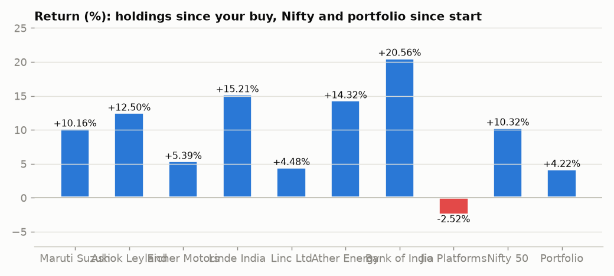

# Core-Equity Virtual Portfolio

> This is a **virtual (paper) portfolio built for learning and skill demonstration**. It is **not investment advice** and not a recommendation to buy, sell or hold any security.

**Last updated:** 16 Nov 2026, 02:32 PM IST  |  **Market data as of:** 2026-11-16  |  **Start date:** 2026-10-16

**Snapshot type:** Live intraday snapshot

_Live snapshot: today's session is still in progress, so volume is partial and "Volume vs 20d avg" will look low. The final end-of-day snapshot is published at 5:45 PM IST._

**Jump to:** [Summary](#portfolio-summary) · [Holdings](#holdings) · [Allocation](#allocation) · [Performance](#performance) · [Trade book](#trade-book) · [Companies](#company-deep-dives) · [Method](#how-this-works--data-sources)

## Portfolio summary

| Metric | Value |
|---|---|
| Current value | **₹2,56,00,542** |
| Total P&L | **₹10,01,812 (+4.07%)** |
| &nbsp;&nbsp;Unrealised (open positions) | ₹14,00,300 |
| &nbsp;&nbsp;Realised (shares already sold) | -₹3,98,488 |
| Today's change | -₹1,01,910 (-0.40%) |
| Nifty 50 since start (same money invested) | +9.63% |
| Outperformance vs Nifty 50 | -5.56% |
| Cash (uninvested) | ₹71,41,482 |
| Virtual money put in | ₹2,45,98,730 |

_▲ buy · ▼ sell_

## Holdings

| Stock | Shares | Buy price | Current price | Today's close | Prev close | Day | Value | Weight | P&L | P&L % |
|---|---:|---:|---:|---:|---:|---:|---:|---:|---:|---:|
| Maruti Suzuki | 290 | ₹11,489.00 | ₹12,592.00 | - | ₹12,854.00 | -2.04% | ₹36,51,680 | 14.3% | ₹3,19,870 | +9.60% |
| Ashok Leyland | 1,000 | ₹147.72 | ₹167.93 | - | ₹169.20 | -0.75% | ₹1,67,930 | 0.7% | ₹20,210 | +13.68% |
| Eicher Motors | 1,000 | ₹7,266.00 | ₹7,611.00 | - | ₹7,650.00 | -0.51% | ₹76,11,000 | 29.7% | ₹3,45,000 | +4.75% |
| Linde India | 500 | ₹5,961.00 | ₹6,873.50 | - | ₹6,850.50 | +0.34% | ₹34,36,750 | 13.4% | ₹4,56,250 | +15.31% |
| Linc Ltd | 1,000 | ₹85.00 | ₹87.56 | - | ₹89.06 | -1.68% | ₹87,560 | 0.3% | ₹2,560 | +3.01% |
| Ather Energy | 1,000 | ₹1,677.20 | ₹1,949.40 | - | ₹1,945.00 | +0.23% | ₹19,49,400 | 7.6% | ₹2,72,200 | +16.23% |
| Bank of India | 1,000 | ₹131.33 | ₹152.44 | - | ₹154.10 | -1.08% | ₹1,52,440 | 0.6% | ₹21,110 | +16.07% |
| Jio Platforms | 1,000 | ₹1,439.20 | ₹1,402.30 | - | ₹1,400.70 | +0.11% | ₹14,02,300 | 5.5% | -₹36,900 | -2.56% |

**Best since buy:** Ather Energy (+16.23%)  ·  **Worst since buy:** Jio Platforms (-2.56%)  ·  **Biggest mover today:** Maruti Suzuki (-2.04%)

## Allocation

| Sector | Value | Share |
|---|---:|---:|
| Automobiles | ₹1,33,80,010 | 52.3% |
| Cash | ₹71,41,482 | 27.9% |
| Industrial Gases | ₹34,36,750 | 13.4% |
| Telecom & Digital Services | ₹14,02,300 | 5.5% |
| Financials | ₹1,52,440 | 0.6% |
| Stationery & Writing Instruments | ₹87,560 | 0.3% |

## Performance (as on 16 Nov 2026, 02:32 PM IST)

## Trade book

<b>Transaction history</b> - 24 entries, newest first

| Date | Stock | Type | Shares | Price | Amount | Note |
|---|---|---|---:|---:|---:|---|
| 2026-11-04 | Jio Platforms | BUY | 1,000 | ₹1,439.20 | ₹14,39,200 | Bought 04-Nov-26 at 1439.20 (10:29 AM IST per Google Finance quote) |
| 2026-11-04 | - | DEPOSIT | - | - | ₹14,39,200 | Fresh virtual money to fund Jio Platforms |
| 2026-10-27 | Bank of India | BUY | 1,000 | ₹131.33 | ₹1,31,330 | Bought 27-Oct-26 at 131.33 (12:54 PM IST per Upstox quote) |
| 2026-10-27 | - | DEPOSIT | - | - | ₹1,31,330 | Fresh virtual money to fund Bank of India |
| 2026-10-27 | Ather Energy | BUY | 1,000 | ₹1,677.20 | ₹16,77,200 | Bought 27-Oct-26 at 1677.20 (12:37 PM IST per Upstox quote) |
| 2026-10-27 | - | DEPOSIT | - | - | ₹16,77,200 | Fresh virtual money to fund Ather Energy |
| 2026-10-27 | HDFC Bank | SELL | 4,572 | ₹687.95 | ₹31,45,307 | Sold 27-Oct-26 at 687.95 (12:08 PM IST per Business Standard quote) |
| 2026-10-22 | Linc Ltd | BUY | 1,000 | ₹85.00 | ₹85,000 | Bought 22-Oct-26 at live NSE price 85.00 (12:30:26 PM IST; source NSE_CMDATA) |
| 2026-10-22 | - | DEPOSIT | - | - | ₹85,000 | Fresh virtual money to fund Linc Ltd |
| 2026-10-22 | Eternal (Zomato) | SELL | 10,245 | ₹309.00 | ₹31,65,705 | Sold 22-Oct-26 at live NSE price 309.00 (12:30:26 PM IST; source NSE_CMDATA) |
| 2026-10-21 | Linde India | BUY | 500 | ₹5,961.00 | ₹29,80,500 | Bought 21-Oct-26 from cash at 5961.00 (NSE last traded 10:53:52 AM IST per Upstox web quote) |
| 2026-10-21 | Fiem Industries | SELL | 1,000 | ₹1,816.90 | ₹18,16,900 | Sold 21-Oct-26 at live NSE price 1816.90 (10:03:32 AM IST; source NSE_CMDATA) |
| 2026-10-21 | Manorama Industries | SELL | 1,000 | ₹1,749.00 | ₹17,49,000 | Sold 21-Oct-26 at live NSE price 1749.00 (10:03:32 AM IST; source NSE_CMDATA) |
| 2026-10-21 | Fiem Industries | BUY | 1,000 | ₹1,813.60 | ₹18,13,600 | Bought 21-Oct-26 at live NSE price 1813.60 (10:00:26 AM IST; source NSE_CMDATA) |
| 2026-10-21 | Eicher Motors | BUY | 1,000 | ₹7,266.00 | ₹72,66,000 | Bought 21-Oct-26 at live NSE price 7266.00 (10:00:26 AM IST; source NSE_CMDATA) |
| 2026-10-21 | - | DEPOSIT | - | - | ₹72,66,000 | Fresh virtual money to fund Eicher Motors |
| 2026-10-20 | - | DEPOSIT | - | - | ₹19,00,000 | Fresh virtual money to fund Fiem Industries |
| 2026-10-19 | Manorama Industries | BUY | 1,000 | ₹1,796.80 | ₹17,96,800 | Added on 19-Oct-26 (CMP 1790.40 per Trendlyne) |
| 2026-10-19 | - | DEPOSIT | - | - | ₹18,00,000 | Fresh virtual money to fund Manorama Industries |
| 2026-10-19 | Ashok Leyland | BUY | 1,000 | ₹147.72 | ₹1,47,720 | Added at ~11:25 AM IST |
| 2026-10-19 | - | DEPOSIT | - | - | ₹3,00,000 | Fresh virtual money to fund Ashok Leyland |
| 2026-10-16 | Maruti Suzuki | BUY | 290 | ₹11,489.00 | ₹33,31,810 | Initial allocation |
| 2026-10-16 | Eternal (Zomato) | BUY | 10,245 | ₹325.30 | ₹33,32,698 | Initial allocation |
| 2026-10-16 | HDFC Bank | BUY | 4,572 | ₹728.85 | ₹33,32,302 | Initial allocation |

<b>Closed positions</b> - 4

| Stock | Bought (avg) | Sold (avg) | Held | Invested | Proceeds | Realised P&L | Return |
|---|---:|---:|---:|---:|---:|---:|---:|
| Manorama Industries | 2026-10-19 @ ₹1,796.80 | 2026-10-21 @ ₹1,749.00 | 2 days | ₹17,96,800 | ₹17,49,000 | -₹47,800 | -2.66% |
| Fiem Industries | 2026-10-21 @ ₹1,813.60 | 2026-10-21 @ ₹1,816.90 | 0 days | ₹18,13,600 | ₹18,16,900 | ₹3,300 | +0.18% |
| Eternal (Zomato) | 2026-10-16 @ ₹325.30 | 2026-10-22 @ ₹309.00 | 6 days | ₹33,32,698 | ₹31,65,705 | -₹1,66,993 | -5.01% |
| HDFC Bank | 2026-10-16 @ ₹728.85 | 2026-10-27 @ ₹687.95 | 11 days | ₹33,32,302 | ₹31,45,307 | -₹1,86,995 | -5.61% |

## Company deep-dives

---

### Maruti Suzuki  _(Automobiles)_

[Google Finance](https://www.google.com/finance/quote/MARUTI:NSE) · [All BSE announcements](https://www.bseindia.com/corporates/ann.html?scrip=532500)

| Close | Day change | Day range | Volume | 20d avg volume | Volume vs 20d avg | 20d volatility (ann.) | 52w range |
|---:|---:|---:|---:|---:|---:|---:|---:|
| ₹12,592.00 | -2.04% | ₹12,535.00 - ₹12,990.00 | 542,137 | 559,180 | 0.97x | 28.75% | ₹11,170.00 - ₹17,292.00 |

**Research reports**

- [One-page snapshot](analysis/Maruti_OnePager.pdf)
- [Detailed report](analysis/Maruti_Detailed.pdf)

<b>Official company announcements (BSE)</b>

- No recent filings fetched; see the link above for the full list.

<b>Latest news (trusted publishers + official company newsroom)</b>

- [Maruti Suzuki Share Price Live Updates: Maruti Suzuki's Stock Price Analysis](https://economictimes.indiatimes.com/markets/stocks/stock-liveblog/maruti-suzuki-share-price-today-live-16-nov-2026/liveblog/135871604.cms) - _Economic Times, 16 Nov 2026, 09:05 AM IST_
- [Maruti drives car exports as rivals lose ground](https://news.google.com/rss/articles/CBMipgFBVV95cUxPYzBKdjd3TlFEMEF2ekxvd21TV2Zpb3VqTjdubWRudHZwRjZOdE9jT0lVYjJsNDBaN3hUNU1WZXZhY1dDQnFYMUFzWThnTHZyWTFUMUlHWHhnM0tRME1INy1hRG5LZmFsVzlrVF9MWDFpS1NmRXNnR1NFbkg1YnNpalBQc28wd096TXdSYTNJb2dNNWhMS2U2dExUdkhTS3VCOS1Yd2p30gGsAUFVX3lxTE1HSXdyeDJKbHZzTFctU21FS296NzVpemlwRkZ5MDdtN2ZPYWJxQXh4ZlBVXzFUanJLdUY3NHZkRWVPQldZbXd4OFA3dEhTRENfdU9GMGYxaWg0aFZsLUpmVklHQUJ3LWtQTGRBZzVuOGgybmRsRUFkN0hLQ2prRC10WXE5WllfZU8xVGVQTEFfUnpiZDVSNjA1UkFoaEllN2RTSGcxczNYdEVhT1A?oc=5) - _The Financial Express, 15 Nov 2026, 07:26 PM IST_
- [Maruti Suzuki surpasses 2025 export numbers by October with over 4 lakh units](https://news.google.com/rss/articles/CBMi3AFBVV95cUxNaXJKWnJHZVFGT3h5Z2o5SFYzc2FJcGthRkYzc042WGJpVFZERldIdFlJeU9pbEVWcTNNNXpMM295ZFU0bWhjV1d3QW04cW5hZThRQU5hd1VneWNveUFGWGstVkVLMzhFWDRoSE9CQ3NPN3lwaTFYNGhaVWZiRVRRYzlNMkRjT1V0ZmYxbi1qdkluZ0dwT2lDcEFiVk5DSmJUM2FoazZib2kxcnF1S09UNG55VWI2ZVJJYVNuV3Q4aFBLenNNSjRmVlkxcmlfeURHdlVXV1pqbG1nQXVn0gHjAUFVX3lxTFBYdVNmSDhrZk9Wdk9tbHJjQWN2NVE1ODNYRVdSbUFWcy1WVnotS2J2ZG5vcy1qLXI3Rk5nbnA3SUxUblBTUTZ6VHNtZ0o3WHhqR3AtUWR1VEdsRjFpT1V4MjJjWUJSTUpQak5tUzBwRWJQYlBEU1BDU3RpcGhVdTBCazZHQmVvSXRfUDJ3VVlRbzRqcVZ1YktrSzRhN0lyNTZzYXVNQk5yTTk4VFp3bzdHMkx4QVhhaG9CZGQ3Sk9mMVNwZlcxMXd1NlVudk5BWkE0VURGSi1mcC1BXzhKZHlXMVhR?oc=5) - _BusinessLine, 15 Nov 2026, 06:36 PM IST_
- [Planning to buy a new Maruti Suzuki car? Here’s a list of top five highest-selling cars in October | Details](https://news.google.com/rss/articles/CBMi8gFBVV95cUxOZ2xnZi1XQ2hDbE9LZFdXd21RZXo2YVhYZlJaZ3pCZXJ5ZG5JY1prY2l4NmFOZmFmQXpuRVNMUE05RUQzUXc2VnB2OEtrTHozdUpvRjE4VDBZV21kbXRJbDlLd0lfUlVVa0lhVDZ4NGF3ZEk4WFhBdFl3QVdWSGNMdUIzcXR2SE5mckRlU202aFZ0RlM2bFNMZ19BZ1pZMGd6ZHRtbXVDcURCMFlQYURPQmFOMUJGUklLblBNZjNfUmVOVWp6VGN3ZG1RakNIM0JrZEt4NHBfc1hGWm9xOTJyNENXODBKWDRMY0RqNVdqTUVCQdIB9wFBVV95cUxQRm12NFdlSEc1NGpTVlp5bUNPcEFtX0lrZm1mMC1QUGt4b0R6X2VYMHd0NExUemNSbkdBcThabldUdDR0S1Vab25wSHVGTHY0VFZVaDNZOG9nTG54YzgydFlmWEVRaUxJRlhITlliUm9ENFhfY1RYS3BScm1GTkVOcVM3UVA1OXhzb1RMaTlPcHJWeFh6X3BwYm5YcW1QYkZyVU5EbHRjdkFIWXVkR25yWnlYZHVJRURrRUM5X1J1LTZZdHhmNUEzTzlxTEJPNlAzLXd6SjJyLUpqbS1paEo0dTJmRzFRWDBDRjhNTXdsemlfQWxOTHBv?oc=5) - _Livemint, 14 Nov 2026, 11:51 AM IST_
- [Maruti vs M&M vs Hyundai vs Tata Motors PV: Which stock offers growth at a better price?](https://news.google.com/rss/articles/CBMi4wFBVV95cUxNZExtc3d3emlYMk1BR1J4TzRLRjVhd29hRnJXaVMwa1AwYW1tdWpFbFR1eGpOMmh5eEZ3M2luNmljRmNWREszVUFFTzVSMnhlRUlRTlJzWGNWQ2JGd21WOGNFbU1rNmdBZjgzT1B4VWRVTEh3UVpvZ0RRYWRSRm1lMTFRa1VsbUtfeVVXOFdDejNiUE9SUWtFMVpQR0NqQXBMSWpTOFVveDlwVC1nNW52RTh0RDZrQTM1V2FkdzVRMmZIZ2N4WWVfRnc2RXlEd2Y1QmY0ZEZEQ0NfamxyZ2w4VkhlMNIB6gFBVV95cUxQYkdiUm45NmVXM1UwZDUtNHpaRTdSV3p4UjVUVWd4S1dEdnctSm4wVF9GOV9XUU85dGx0Z0xMZXB4QWRzQTE4Q3luTXdWelRlQUZSUVhDUmpYczBGZmdFTjMzMU02WVJnb0FnTHJxbnR6dzMyWmw0SEFHVDJFM1h1bV95TXBKM0lpZ2pIeVNId2dsQkpIZzlXYnBvT3k5SWl5ZmltMHBDZHdoRXFKSFBBcUEtekZqdXVKWEhwX2ZpM1lZcVJMN1lMZWMwWnYwSFl1QVRhUzVnZXRBQ25qcUFxTFZrV2RVSllZUFE?oc=5) - _The Financial Express, 14 Nov 2026, 05:15 AM IST_

---

### Ashok Leyland  _(Automobiles)_

[Google Finance](https://www.google.com/finance/quote/ASHOKLEY:NSE) · [All BSE announcements](https://www.bseindia.com/corporates/ann.html?scrip=500477)

| Close | Day change | Day range | Volume | 20d avg volume | Volume vs 20d avg | 20d volatility (ann.) | 52w range |
|---:|---:|---:|---:|---:|---:|---:|---:|
| ₹167.93 | -0.75% | ₹167.30 - ₹172.76 | 20,119,721 | 19,665,739 | 1.02x | 43.06% | ₹138.58 - ₹211.92 |

**Research reports**

- [One-page snapshot](analysis/Ashok_Leyland_OnePager.pdf)
- [Detailed report](analysis/Ashok_Leyland_Detailed.pdf)

<b>Official company announcements (BSE)</b>

- No recent filings fetched; see the link above for the full list.

<b>Latest news (trusted publishers + official company newsroom)</b>

- [Earnings call transcript: Ashok Leyland posts Q2 2026 revenue beat as margin pressure lingers By Investing.com](https://news.google.com/rss/articles/CBMi6AFBVV95cUxPblN0Skk0TWR3UWducEFOQmQ1RWN1aVZaY2FTb25EOUtrYkRZU05QU0o2eWxPYzZ2UHo5dTBxQVl4VjJha2tjUFlpTWdFbUpCS2M3a09mM2Fzcm9lWVkySXQ2QklDRW5DSFVjakpVVmdYNUlUWGwzejdOMlNlR2h5SGtjQ0kyaWpybUY3ZUEzYXVzSHowd3AyOWRzWWtVOUVhd1FFd0FNUG1BZnh3WnRxNGszOTJ6dzFzUHBvZkpGbjlxaFhvcEhPd1VqWHVxaHpjU3lQNzhmWVQ4YmduUHFUVUt0eFM2NWxm?oc=5) - _Investing.com India, 16 Nov 2026, 12:20 PM IST_
- [Video | Ashok Leyland Delivers Stellar Q2 Performance, But Rising Costs Dent Margins](https://news.google.com/rss/articles/CBMixAFBVV95cUxPVnhKQ3lKUGVTUWJrOEZrdFNXYzR4MjZRX2VCUFdrMEs2UDBEYVhVMkphclE4ZVFTSU5SNmVMcDRaRDZSMFBSSkp0UEJYck1oNlY5dFZqRnVDNjhfc2tCaHF6c0xac1RBRkxwVy1DT1dudG9KUDBxaEZINTVHaC1uQXlHYUVXUGc4Zk1EOVB3dk1YcjhxVHBEM0lraDc0NTdGeDhST0d4SWpnVzB5UUtRMzFIeHhxZkVqNThvTVprZnJGWHJK?oc=5) - _NDTV Profit, 16 Nov 2026, 09:44 AM IST_
- [Stocks to watch: Ashok Leyland, BEL, Hero Moto, Coal India, Tata Motors PV](https://news.google.com/rss/articles/CBMi0gFBVV95cUxPTlVXcGJHeWVYWTItUm1EZDZkUUhDOHN2aS12WktQMXpnMjRqY1htX1MtWlpSQTBqMnVzMmFrNkVZdWlmc01ZeHMzQUliVTk2eHFtQUMzelhaLXhXMkJtSkJoeFo2XzhReEQ4NGVGSlhkRE1ROUpfeVdMT0hmVW1lSVU1SHVRQnRTZkh5UHVKcllEejNIS0lwWXVkdXVMVVpCc0FldkN5UGRkRGFVSVNtOUxuaW5QYUQ5MTJUU2w1bVNGT2dmWUtndnhpWFRwdGl4RUHSAdcBQVVfeXFMT2ZXbTRBQllnSmlKWURreS1RZWhCQWwwRU1OTmE0WmNqa1RlTjBLYV9NeVFZLS1FdzdoOWJDTkVPUTFTZ2oxekVZUHJHUGVOVXRIUC1sVEt3WU5VRkI5eUh0X3dXcm5VTzVmTkZfbVptY2lWNy1oaTVYcGhweU1icjhlbEtPbFQwenJLMXl4a1FTXzVaZm8zWWdoU1ZXbGtmMUxkcmRpSUFvSXhhd3B1NThyT2UzQzJ6Y1U1NGtyc3B1ZDRZYXJ3a3B1djJWRmliai1BeW1PSmM?oc=5) - _Business Standard, 16 Nov 2026, 08:00 AM IST_
- [Stock Picks Today: Tata Motors PV, Amber Enterprises, Ashok Leyland, Paytm, And More On Brokerages' Radar](https://news.google.com/rss/articles/CBMinwJBVV95cUxPN0J1U3g2VkFfckc3VUd6TzVlUzNKeXQ3d0tLcjBDeXRSeWJYT3RHaG5QSF9aYjhjOXlfV0VlZVFTSUxsNW5CdHZlUlZkRnJWSGtKZXQ5ZHphY09DNEtQbi1jNHpYdGhCNVdvRjlWLTBaalFoSVBjb2VBbDVSV214MXIxcTBQSVZIZ0RRZ0lSRWVkSmc5S1dtVWRrTVBQZUNSczZBd1RSR0pxY250ZHUtd3JFa0EzZTlSV2VFRkR0MkZudndBOXJGM1lUaVdSZ2h6SzI5MXJpbjF4RjVvUWtSeXdLR3dhS2VyV2ZzallsRWlERXlmY1h4N19BMGNiN2ZZTG44QTBNVU1PTThNcWJhb1VibG0zX3FGOFRVSnVvWdIBpwJBVV95cUxPMHBPb2dyNnpQMHhyN3JTSzNBcElJNEp2Wm1DRzhPckw0Zm1kOHJ0U0RuTkN5YzlpSS1lNjUwZkNZTUpRR2kwYmEzNER2TkItQU9VdVp6MGttaXhBeWxWMERnWUFrMlNLZEVFZFRMZExhZ3R6YTBFUmhaSkNwWW9CVi13ZVhiNUkwWjZzR0dQTlJ2SFBnTkdQa19sRWNZeVB2cnhHQ2dCRENUa0NCNURVTFMtVjRiSzdFajRFN2tfTzRtOUhvMGVWcFlzcnJmX3BBSUVRb1ZjaC1jR091OHRTX2tRLVlCUFN3aWZzWHZZN2pRSnMyUTVIS05RNmEtWDRfZllsYkY0QmdsS0dfZ1VEek1iT2xlMTdJTXJxRGpuWTZZUHktcUYw?oc=5) - _NDTV Profit, 16 Nov 2026, 06:55 AM IST_
- [Stock Radar: Ashok Leyland stock showing signs of recovery after falling by about 20% from highs; what sho](https://news.google.com/rss/articles/CBMingJBVV95cUxPM1JRSlliLUY5Zk42TTN2UnlQYWZFN3VLQ1BOajR5a2tqR2tpVnN3WlNTVzVtYXdVTTdFUnF4c0N4eDczOWJPbVZBaDJnM24ySTZwMXNfQXFWcnF0cUdDRTJpNHVPWnMwNkJhYlRkU3VtdV94bHV1eURrYW9DYzh4cVYtU283QWpNT2NndzB3cXJNRm5RaUtFTjNxOThzU0pvMjc5ZTFUTWppN05Qdm9hY0ViN0U0VjNURXoweGVqdHlwUmU5MDBCbEFlVzlkNGRDb1pfelVKMVZicGRpd3lEaVdMSXhGRVlNRDVPSE9FYmRvVnR3V1hnY2ozS2E2QjBiTEUwYUJSNnh3ZDJiajBwNUo5X1VUNnBlTGNTWG1n0gGjAkFVX3lxTE5CY0xRTXlCdThYejN0TkRRNUQ4QUE3ZURZdFZfcTJhTjBJWmR5aVZmeFBqRFdMQloyY0QxbXhaMGhoaXlya09wMzU1M3E5V0dRc3NQWU1TRDJEZ3E1SVQ2SHVyc0s1VHJLUWxOWlI1UFRqOEFKTzB5Y0swZHhHdVh0VjdWcmRlTndTekxWYmF6ZWx5VTZoaHZ2emtvMnFHd0EwOWdGdjVKMkVIU0dNTEZCbE83MUZVTVBTWnRvS0xNN0RWS1RvV0FyTm9WZmJPUjBXMFBFYmRieXNQNTJMVmYwZGpsOTA0WDEtc25Ra3c1MWlDZTEzcy1nZkNqaUNwbFpIb0RUbUxkTUUycGVzWWdiRXZ2cGFUMXFucVNZYTRSVTNkYw?oc=5) - _The Economic Times, 16 Nov 2026, 05:00 AM IST_

---

### Eicher Motors  _(Automobiles)_

[Google Finance](https://www.google.com/finance/quote/EICHERMOT:NSE) · [All BSE announcements](https://www.bseindia.com/corporates/ann.html?scrip=505200)

| Close | Day change | Day range | Volume | 20d avg volume | Volume vs 20d avg | 20d volatility (ann.) | 52w range |
|---:|---:|---:|---:|---:|---:|---:|---:|
| ₹7,611.00 | -0.51% | ₹7,575.00 - ₹7,947.00 | 1,472,254 | 468,559 | 3.14x | 23.49% | ₹6,586.00 - ₹8,190.00 |

**Research reports**

- [One-page snapshot](analysis/Eicher_OnePager.pdf)
- [Detailed report](analysis/Eicher_Detailed.pdf)

<b>Official company announcements (BSE)</b>

- No recent filings fetched; see the link above for the full list.

<b>Latest news (trusted publishers + official company newsroom)</b>

- [Tata Motors PV vs Eicher Motors: Which auto stock is set to race ahead, and which should you buy after Q2 results?](https://news.google.com/rss/articles/CBMijgJBVV95cUxONGw0eE55S29NaE80UWUwYXhUaUE1U1MwMnhjblE5NEJhd3lZNzljN3F6RUduQk9kWE11Vkk4V3hRbDVoVlk2aGdWVDVHRXp0ZmRpQWRHOFctX21TalNHUHpEOW0tcFdFenRtQzJkR0FJX2UzdExTZWRMa1prN0huNDVUVTZRc3VXUWtpNDhLYk9vSDF3bHUtTHNEOG5zX3hrMnJOV2g0dFlCa1BRMU1UR3lRem82MDRsREtwZWdtMEp6eUhuYmZSVkJIbVlBNHYtSzAwNmZFS3hFZ3dvWXFjZllFTlVPYk9JVnRLVksxckV0U1BWbTQ4ZXAyb19CaENiVS1sQzM1MWpWY0pwNHfSAZMCQVVfeXFMTmFzMEVqMlRHM1hxZ2ZJeDNCQnN6TklmQ2w3N19kTUJfcUVHTEpUYzlMU1kybkE3WWlXUUw5clNIMWpmajRLNEJzRlFvR1RVWUZjbHBrdlVnVmxkY0ZIM2FuQ2Mwc1V1dFpaQmNCYVdrbXFidUNTSm5RVTVCSFIzRXNiM2V3d052UXpRbExRTE1pdGNNRThsekRwOHljaWwySmozelQ0Slg1Qko2Y0xFUTMwSHozQ2N2cmNCTXFNbXVsRVByVlNFcGVodl9KeTE0ajZ2aXhyNDNUR1p6Y0E2ZDJoMzNuTzlCNkVUMnFZU2dvX3p1SS0yQTZXUVdoNFJaSEV6WEN4YmpwQnE3R2ZVd2paVTQ?oc=5) - _Livemint, 16 Nov 2026, 02:12 PM IST_
- [Buy Eicher Motors: target of Rs 9000: ICICI Securities](https://news.google.com/rss/articles/CBMitwFBVV95cUxOZHV6aDFrYWJ5SlM3bThEOTNMS1JVTXJycUhMbFJfUnVSUHNFTnp6aW14M0lUMUx4UldFOUxQNkhvdFBqZ2ZVdkVZYm5iM1Jzb2xDb2ZQbkhzcG53Y0I3NXlROU5ZZ25Oc0hZRGJlN21wbVg2OEI4RFdnU3lkamwwWHQ4Y3ZtLWlpblFTdjZyVXJXUndNalhxNGNwY21PNE1ZS3htUC0tVFFNSEpSM2JuZG5HUTl3M1XSAbwBQVVfeXFMTmx0STdXZFlGYlFVSTZjSGwtNDJYVlNxWklYRFkxM0d2eEh5SEwxcWJub2VOaUtIbTVORkxWZTc5VUFkamJpS0ZtcWZFek1EVDFkZ2lpeXhMQTVaVHNMcUM2cE55YWZLNThBdVU2akVuQVVSNkk4azRWX292VjJwQk5pTm5jZU9SanRMXzJ2Mm1wSXlGcFJKLUhVX2ZhOEktcHRfdWozUkdabnNGU3EzdFZFckxfdFdsQk90bm8?oc=5) - _Moneycontrol.com, 16 Nov 2026, 01:12 PM IST_
- [Buy Eicher Motors; target of Rs 9100: Emkay Global Financial](https://news.google.com/rss/articles/CBMivwFBVV95cUxQWmIzb1o2MzNpTXpOOGxfZUJxYmpTTDg5X2xER3djM3lUc3ZEcWtjUUtWTmdKenI3bnptRUJnZHRzV3lBU3d2aVQ0TjA0S29DMDZxemtRV1E2ejVfUml2cDBfSDdtT0o4dHFZbU16c3RwUklzM3FKRF9mN0hJeVVZa0hNY2hWMzhuMlRXdEhXNzNHY29GVlVkUGMtY2VidHdrWGtKQ0o0SVotamlQWWJ6WmE5Yk9LeUFTZ3N6ZHVsYw?oc=5) - _Moneycontrol.com, 16 Nov 2026, 12:22 PM IST_
- [Eicher Motors, Oil India And More Q2 Review: Check PL Capital's Revised Target Prices, Ratings](https://news.google.com/rss/articles/CBMi2gFBVV95cUxOTGJfVXNFVEVWZnZ0ZzNJZWR5NHpuaGZZa2lCYk1WcE5xVlh4RkVKeTJZR1h2WTJ5RjlPSGdmUG5HLW9IRUlpVVRILU5uRzVFcWpaVndYVWN2ZDFtWWlNV2JhUVRBZklxQkR5cHpXRWdnY1NaSldBczJSUGNXR2pIVWRXOW9SZzc4Rl9Va0wyT0ZUcU1JeEhneTYzSUx3NWdfUkFxUDRidUp2VURQTlkwNDFEd1pWVGVTNnpzaVZPa1hFY2pWWGQyTExxenkyemZOdTQyVzlqaEhmUQ?oc=5) - _NDTV Profit, 16 Nov 2026, 12:14 PM IST_
- [Hero Xpulse 450 vs Royal Enfield Himalayan 450: Engine, features, suspension and price compared](https://news.google.com/rss/articles/CBMi4AFBVV95cUxQM0ZaVVVkUWlKOTlFOVJOVkl1UW5TbFByN3UxZzJpMnNER2FUV2ZuQ0k4Qnl5bnJsVmI0V1lCbmpzdzNIYnNQWEViVDdHSjFBTENGeFVvY0JMdUNYdk1qdjFlbUE3VWRraEtScV9UU2ZfSl9kbHJ2LTh5ZDk2aG15UXN2SE9uaWR0VHJlMmkxclVVQzk2ZFc1T1BYQVd6YXRPYkwteGltWjVrUTJYX1MyVnFBM09jbmplTFlBTmRCTjVIWjNSdUVvbnE4T09IMW5hNzlrMUk3NW1VWmE0RG1iYdIB5gFBVV95cUxPZlJpY1FXalFkdk5FQVZsNjhHbXJPZVVNOWtZeGJHWmh0UGRVZGV1NkpRdUdWOVg1YWlxNERmdG5GQVkwdHNiR2ZhQjFuX0hkaVpYS2ZObmJ5WGpwcVloRGc1bGcySm9vVmRxdGNVLXRLUXJaRjlKMHp2cTg5cGtNVHA1WDRtYzFjZi1EMkNpWGNiWDVaTkpzUlI2RVk3MUxLRk9KUms4S2stbVN2NG5XZGxsYllzVGV0Q2drdXFwSWVGVjA4RmRWYV8xclZ2aDZjUFZaOG9xQ2MycDQ0SGdBLWxENU9QUQ?oc=5) - _Livemint, 16 Nov 2026, 12:08 PM IST_

---

### Linde India  _(Industrial Gases)_

[Google Finance](https://www.google.com/finance/quote/LINDEINDIA:NSE) · [All BSE announcements](https://www.bseindia.com/corporates/ann.html?scrip=523457)

| Close | Day change | Day range | Volume | 20d avg volume | Volume vs 20d avg | 20d volatility (ann.) | 52w range |
|---:|---:|---:|---:|---:|---:|---:|---:|
| ₹6,873.50 | +0.34% | ₹6,830.00 - ₹6,994.50 | 24,893 | 45,298 | 0.55x | 51.31% | ₹5,632.50 - ₹7,847.50 |

**Research reports**

_Research report coming soon._

<b>Official company announcements (BSE)</b>

- No recent filings fetched; see the link above for the full list.

<b>Latest news (trusted publishers + official company newsroom)</b>

- No fresh headlines from trusted sources in the last few days.

---

### Linc Ltd  _(Stationery & Writing Instruments)_

[Google Finance](https://www.google.com/finance/quote/LINC:NSE) · [All BSE announcements](https://www.bseindia.com/corporates/ann.html?scrip=531241)

| Close | Day change | Day range | Volume | 20d avg volume | Volume vs 20d avg | 20d volatility (ann.) | 52w range |
|---:|---:|---:|---:|---:|---:|---:|---:|
| ₹87.56 | -1.68% | ₹87.00 - ₹89.86 | 5,424 | 62,077 | 0.09x | 107.08% | ₹76.41 - ₹125.23 |

**Research reports**

_Research report coming soon._

<b>Official company announcements (BSE)</b>

- No recent filings fetched; see the link above for the full list.

<b>Latest news (trusted publishers + official company newsroom)</b>

- No fresh headlines from trusted sources in the last few days.

---

### Ather Energy  _(Automobiles)_

[Google Finance](https://www.google.com/finance/quote/ATHERENERG:NSE) · [All BSE announcements](https://www.bseindia.com/corporates/ann.html?scrip=544397)

| Close | Day change | Day range | Volume | 20d avg volume | Volume vs 20d avg | 20d volatility (ann.) | 52w range |
|---:|---:|---:|---:|---:|---:|---:|---:|
| ₹1,949.40 | +0.23% | ₹1,934.00 - ₹2,021.50 | 3,797,869 | 3,530,727 | 1.08x | 61.24% | ₹601.35 - ₹1,949.40 |

**Research reports**

_Research report coming soon._

<b>Official company announcements (BSE)</b>

- No recent filings fetched; see the link above for the full list.

<b>Latest news (trusted publishers + official company newsroom)</b>

- [Markets poised for a breather after sharp rally](https://www.livemint.com/market/stock-market-news/market-poised-for-short-term-breather-after-sharp-rally-11794740556586.html) - _Mint, 16 Nov 2026, 06:00 AM IST_
- [US Market Outlook: Bourses get a breather](https://www.thehindubusinessline.com/portfolio/technical-analysis/us-market-outlook-bourses-get-a-breather/article71701084.ece) - _BusinessLine, 14 Nov 2026, 09:54 PM IST_
- [Ather Energy - Mutlibaggers: 7 stocks held by 100+ MF schemes in October rally up to 300% in FY27](https://news.google.com/rss/articles/CBMi9wFBVV95cUxPemJ0TmRBcFRkWHFJQ3pBeVhpZXRMVENoQXl1cUJGRmNFNDdkS3c3LVFlN2VxXzZydzJxY3NmRXFneUhTZGZMUF9WQmQ3c1NUOUZsMmtJcThsZmxEMmJOVExEOHlzUmJCMm1oOEhWTEN3RGJyd3Vuc2U4OTZnRDk4QmZ6QjZRU1JIOXRkNTJVQVRpalZWWXc0MHhfUlY0MHJfdHJyeGJ6ZXRMVlpSUFN5bHRXTUhDZlhoWUthNUlDaDd0SU5ucGotRXF0NFJpWmVQMDFRT0dvSXdQSFBYQ0czWFFEcUd1blJ4TmVlWEhuWHFmTjFJbnFR?oc=5) - _The Economic Times, 13 Nov 2026, 09:34 PM IST_
- [Ather Energy Has A Demand Problem It Would Love To Have. But Can It Fix Supply Fast Enough?](https://news.google.com/rss/articles/CBMizwFBVV95cUxQYlZJQUNjZFZyUm8wbGZMWXhLTHVDNWh6YUFSbzBOdjdrejAwX3M0MDZzb3VkQ2V2MGF2U1FjUDZMQkFsTWhvZmpkYjBBQl9uSVhjVEdndnRMaHZzMnIzazItSldYTGhaYWttMXNZdFNZMVhha3hLZ2lZbnJ2YldfbXV2T2dRV1JVdUFfY0RrNWRCYlJRODRsNWFDaktkQ05FbkpnY2Q4MW83bzBLaWZ4ODd1aHZKNUlPRTRvc3NEZ3FnYlE2cTNlNDNZaEFRaUnSAdcBQVVfeXFMT01TNl9COGRwRGxhM1dsaUVmSVpRS21mcmh4ckhEa2k0SGhTMklSXzQ4Q2U1UGxudnp4MDBfVXNQR2xZdVBhY1NNNTVRb0J2NF9POW1HTjdrSFhzNXdSZ1R1QWRBamdycFhHcXlZejVGb2o4Wm9oWUZBcm5pcHZYRk9SSlZlTXdTX0lSbXRCVXFnUmM4S3BOZURfeXV5dFV5QkJGejlodkF1cm1nMHEzQl8wMzVhTG1vVkpCR0RfeDU1NkFrQ2JtTzJ3QWFUTEpicU5hUzEtNmc?oc=5) - _NDTV Profit, 13 Nov 2026, 04:12 PM IST_

---

### Bank of India  _(Financials)_

[Google Finance](https://www.google.com/finance/quote/BANKINDIA:NSE) · [All BSE announcements](https://www.bseindia.com/corporates/ann.html?scrip=532149)

| Close | Day change | Day range | Volume | 20d avg volume | Volume vs 20d avg | 20d volatility (ann.) | 52w range |
|---:|---:|---:|---:|---:|---:|---:|---:|
| ₹152.44 | -1.08% | ₹151.37 - ₹156.78 | 11,375,774 | 10,436,429 | 1.09x | 39.55% | ₹126.32 - ₹177.20 |

**Research reports**

_Research report coming soon._

<b>Official company announcements (BSE)</b>

- No recent filings fetched; see the link above for the full list.

<b>Latest news (trusted publishers + official company newsroom)</b>

- [Bank of India waives 100% processing charges on home, four-wheeler loans till March 2027](https://news.google.com/rss/articles/CBMi9wFBVV95cUxNMXhPOERVMmF5NGc2UzhhWmdRelB1NFR2TlJSYTl6ZUVScjVaR2V2aG1KZktPUWUtTHhnaTI1dVpCUmJWQ1hlZTVXLVQtYmJPMl9vZzZuc0VuTzBrSk5CcFJDNGpnMTN5eTNwTklwQ2hMbDFvVm5RazBhUTNwemdFQWVUaWhKd3RlQWpqTjVCWlYxaW9FRWl0SFJXQjBINXRrRGlCdW1MWjRsUVE4Zy14QkxSakpYMS1wb1dTYW5fMzJzbkFGZVV0OUEtOEdXMEd6TDhBU2V4cGpxMTlIa1NwM2xfOEl6VnhSamVUSmZySHdRSWFSX3FB0gH3AUFVX3lxTE0xeE84RFUyYXk0ZzZTOGFaZ1F6UHU0VHZOUlJhOXplRVJyNVpHZXZobUpmS09RZS1MeGdpMjV1WkJSYlZDWGVlNVctVC1iYk8yX29nNm5zRW5PMGtKTkJwUkM0amcxM3l5M3BOSXBDaExsMW9WblFrMGFRM3B6Z0VBZVRpaEp3dGVBampONUJaVjFpb0VFaXRIUldCMEg1dGtEaUJ1bUxaNGxRUThnLXhCTFJqSlgxLXBvV1Nhbl8zMnNuQUZlVXQ5QS04R1cwR3pMOEFTZXhwanExOUhrU3AzbF84SXpWeFJqZVRKZnJId1FJYVJfcUE?oc=5) - _Moneycontrol.com, 16 Nov 2026, 12:07 PM IST_
- [Bank of India - Suzlon Energy among 5 midcap stocks that saw highest mutual fund buying in October](https://news.google.com/rss/articles/CBMi8gFBVV95cUxObGRtTVVrbHJselpCUzdVcm8tQVpnenRQSkFKNW5qWlkzNDZseHBnR09UOXdkWld1TUdEQnhlUlJkUEROVktEZHJEdVlFODZOdTFLM05aOC1SSFZwdDRpUUxkbzdEZzFaczJ6cUhlT2lyUWcyYWJFQ1BTZTI0RlM5dmhrQzdRXzA4aC1yNDg1eV82cEh6VnlGdHl6SlBncjFvdjlWbWFfMHhsa2NHLVVZU1g0VENEdjlxUlhnaTBCcUVibHhFb0FMSmoxQkdDTXhUWm44NEthOGp5d2NaVUI4WWdNTUR4MXRqenNLYmEtTE1xZw?oc=5) - _The Economic Times, 15 Nov 2026, 09:38 PM IST_
- [SCoR, Central Bank of India ink pact to extend welfare facilities for railway staff](https://news.google.com/rss/articles/CBMi7AFBVV95cUxPaGtWbkFVM084cEFDWGFoZ09HRzdxbjB5OWJRY19rR1JvWWlHcmRJQVg4OXlsYUJOZERocDlaSHNLNmcyMWQwUHhBMGRvRTA3M0FvZHFEd0ZQMHE3dDNTcXl2UmJpVUIwU2FQek1ib3NtZmMwVWJkUGNLaDZiR3A3OFVnbGNXbHFnZ3YzOVI2dHlTOWV3Ny1JSHI4QTJ5dS1kTVBVZERwNjA1Q0NuSXhtaUR1dmFrQnVVMkxhczloTTRWbXZlcTRnWUwzTUJaQVg0UVpqMEhUQXh0LUViLVY1SS1kN2Q3T0RJYkFqdtIB8wFBVV95cUxPbXFsSWZtczVlSlViVFpNcDNsdzdaeHo4MjEyd05qazFHb3Y4dkI0TzlBYm9fZFY5bG8xeGZVZE1TcmpyWmRtZUxNVDJodXZ4djFmQmpSNmgweFIyTEpsVlJoVHVEUTlTY0hVcEllNmtEdE9MM3ZHSkRhTnNmMTRJOUlMSHpUdzYxcGlzWkprbnBpVmdDZU5pTnBObmFNOTk1SFBKYUJRZERpcUtCOF9BbnR6YWF4UkNXVjVsVGlDN3Q5SnNwNnlOdFVQSXdTcmg2dzZ1QTY3b1VXWXRYQmpwRjRrQ0J2TEExT1lGZEk3N1dHYkk?oc=5) - _The Hindu, 14 Nov 2026, 11:49 PM IST_

---

### Jio Platforms  _(Telecom & Digital Services)_

[Google Finance](https://www.google.com/finance/quote/JPL:NSE) · [All BSE announcements](https://www.bseindia.com/corporates/ann.html?scrip=545004)

| Close | Day change | Day range | Volume | 20d avg volume | Volume vs 20d avg | 20d volatility (ann.) | 52w range |
|---:|---:|---:|---:|---:|---:|---:|---:|
| ₹1,402.30 | +0.11% | ₹1,399.00 - ₹1,434.00 | 5,989,290 | 26,766,707 | 0.22x | 11.07% | ₹1,395.90 - ₹1,437.40 |

**Research reports**

_Research report coming soon._

<b>Official company announcements (BSE)</b>

- No recent filings fetched; see the link above for the full list.

<b>Latest news (trusted publishers + official company newsroom)</b>

- [23 companies to see IPO lock-in expiry by Nov-end; Jio Platforms in focus](https://news.google.com/rss/articles/CBMi1gFBVV95cUxQOXF4c3ppMEZXcjJweGg1MzlMZ1JsWHFqdmx5U3BHUjZESWZjRUZDb1FLNzlmaktta3BjZ1VXYi1BYXNIYVZxbXF5SVo2UENBSjVHU1l0RmNrRzg1YmxscmJYWS1lMUpXOGI5WGdUbkFYX1JkTFltbE5VU2RwYWpSWms5UzFFVlNLa2ZlSmFSY1hzVEJQR2duQlJCQVlhN3BpcmdYUzNldEJ1RGxuMmliemR4V3huTWtZVzlkYVdtNUV2aFAwSC1QRjE3clktRWt3dlhWVi1B0gHbAUFVX3lxTE9iLXVxYWMzSEp5WjExaGlwc2RLQ2x1SHJNc2UtVS01OFoxcWJHTFlJcC1HN1ljWEVWbVRfNUZFd01pQnVzSWljTVJ3WTkzQmNXOXhtUU9mbENjbWFScWZhVWZuVTZjUGJQbE9JakpyZURXVTd2LU1GcEJpbGJPNVlIWVdGRi0yMGkzZ2hIZkh2ajc3WVdueFU1eEhXcTVwZHZsWFNDeE5SWHNvSHpxNnV2VlY2NEZoQXdFWnpCU25hMXViSTlNSGRWbUJJZEFmTXpIaXJ1SVg3NWdkUQ?oc=5) - _Business Standard, 16 Nov 2026, 11:49 AM IST_
- [Video | Mutual Funds' October Stock Picks: Jio Platforms, Airtel Among Top Buys; HDFC Bank Sold](https://news.google.com/rss/articles/CBMivwFBVV95cUxQOE1FN3VaWlZzSkxQU05oTkMyVU5uQmlIbnluVXFjQnduYTJJWWlwVGZKcHBISjBHV01mbnRnTXNkZDVNVkM1T1Mwb0Q0emhNWVlMVmpkTXRzcnhXSmtUb3RidTdJNk5ycW9iajhIV18tRm9YWVNWRG1yR1NaQ2EzWUlmcGpSTWZ6UkpnR0tlbFJkOGxGUk1LanBadXcza1RmT0FrOTJMOG9JOFl6WGJoWlBQUDFtX2xrVkVDaGdGaw?oc=5) - _NDTV Profit, 16 Nov 2026, 11:28 AM IST_
- [Mutual Funds Buy Jio Platforms, Airtel, Infosys In October; Dump HDFC Bank, ICICI Bank, Reliance](https://news.google.com/rss/articles/CBMiiwJBVV95cUxOZlA2bFdGaG1zcno3UkljblhTNXFxazFSbDV5SlJCTmZ3ek9qSng0MFN6RVRfUVR3cTNJR0NRaXhMS09fMmE0YWp5YTkwM2lXZEZPaHBPX3RYdW1mWjFvRTlPNndTLW9MTnlwWm5VZnZBQkZmaEFaRFJUdmdYRVdVYVdVZmg3bUpEc1pSaHVJZkRsQm42RU5jRnRrYi1kNkR4ai1EM0taOUsxZTFrcnNHcldQNnJHc1Z3cnp6cTEwc0N2Wml4SXhWSVlrbUtzUUZ1VWROUmhuN3lLdzdDODFjcTJxYlRMRW93bEkzZVBmc3dMeVB1dWw4RVJFQ0o4Mm11WmpKY2MySG5FUVXSAZMCQVVfeXFMT3FlczhJSkF3VWlMdzFqdTFaWmUyYVhPeUJZa0FHZTdNa3UwUmJEcEdSQlhvZWdheGpaLUk3djVxRmdQdGlsLW1ITHY5YTl6TGd5dC1jazlaV2Z6blJneTZVV044eGFkRzNPV0d5UlBXdUxHbi1nV01sMEFSeFJXZGhLMlloUno1XzRJNDVTMHJGUzlLaUlUck1kMnhUcVpHWk9VQVhiUDZreTVXeGNDWlhlTmRhMHlhOS1WcEI0SnN5Z3JtOXhaRk5lWVBpRm5KZEF5SzVUQ2ZqcG5fdnBuQ1FVYy1mQU5lUTFlTTZvTndhRXd2aktrT2d3czNjbWhLTWpubE1PdWFianZ0Y0VBeGFoQVE?oc=5) - _NDTV Profit, 16 Nov 2026, 10:16 AM IST_
- [Jio Financial Services Share Price Live Updates: Jio Financial Services Current Market Status](https://economictimes.indiatimes.com/markets/stocks/stock-liveblog/jio-financial-services-share-price-live-updates-16-nov-2026/liveblog/135870485.cms) - _Economic Times, 16 Nov 2026, 08:10 AM IST_
- [Jio Platforms begins talks with Indian firms for satellite launch- Mint](https://news.google.com/rss/articles/CBMizAFBVV95cUxPN1lEV090ekdMNmM2TXl4YWk0VzM2Q0dRUmE2T1R4dVhfX1FBRGRXdnA1SmZuVVJBcXNOMy1VYjZaZWdLOFRlaEtjM3dlaklTZ0lkYi1rdXROMkFSNEJhSUw1SzFvWXJiakQwemRqdnRQVzF1S3QxanphY2VQQURIX201WXVoYVZlM2ZJVEV3dkFVejR4Q2JvcU1XQmNYNWZJa3hGc3pqWUdKakd0ZFZscWZITktLODJtaXFyS01ISkRoOGNkYU9tbDV2RHQ?oc=5) - _Investing.com, 16 Nov 2026, 06:49 AM IST_

---

## How this works & data sources

- **Prices / volume:** Yahoo Finance via the open-source `yfinance` library (unofficial; may differ slightly from NSE official data).
- **Trades:** every buy / sell / deposit is a line in `transactions.csv`. A trade happens at the closing price of its date (live price for today). Average-cost method; no brokerage or taxes (virtual portfolio).
- **Corporate actions:** splits, bonus issues and dividends are detected from Yahoo Finance and added to `transactions.csv` as event lines on the ex-date (nothing old is edited). A split multiplies the share count and divides the average cost, so the invested amount stays the same; dividends add cash.
- **Benchmark:** every rupee put into the portfolio is also put into the Nifty 50 on the same day, so the comparison is like-for-like.
- **News:** Google News RSS + publisher RSS feeds, filtered to a whitelist of trusted publishers, de-duplicated, last 72 hours only. Each item links to the original article.
- **Official filings:** BSE corporate announcements (best-effort, with link to the full list).
- **Automation:** GitHub Actions refreshes this dashboard on weekdays every 30 minutes from 9:30 AM to 3:30 PM IST (live snapshots) and at 5:45 PM IST (end-of-day final snapshot + AI daily report); skips market holidays.
- **Metrics:** Volatility = 20-day std-dev of daily returns, annualised. Volume ratio = today's volume / average of previous 20 sessions.

> This is a **virtual (paper) portfolio built for learning and skill demonstration**. It is **not investment advice** and not a recommendation to buy, sell or hold any security.
