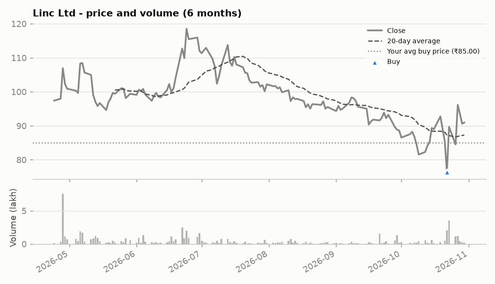
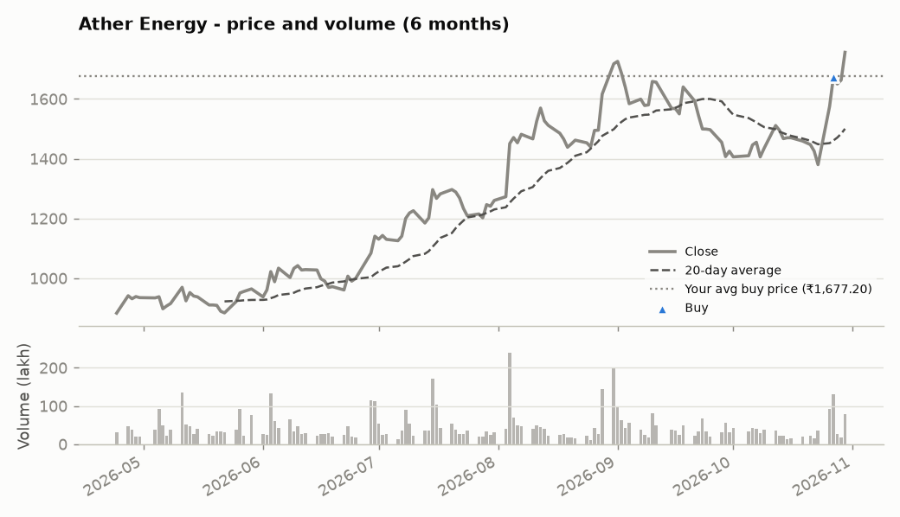
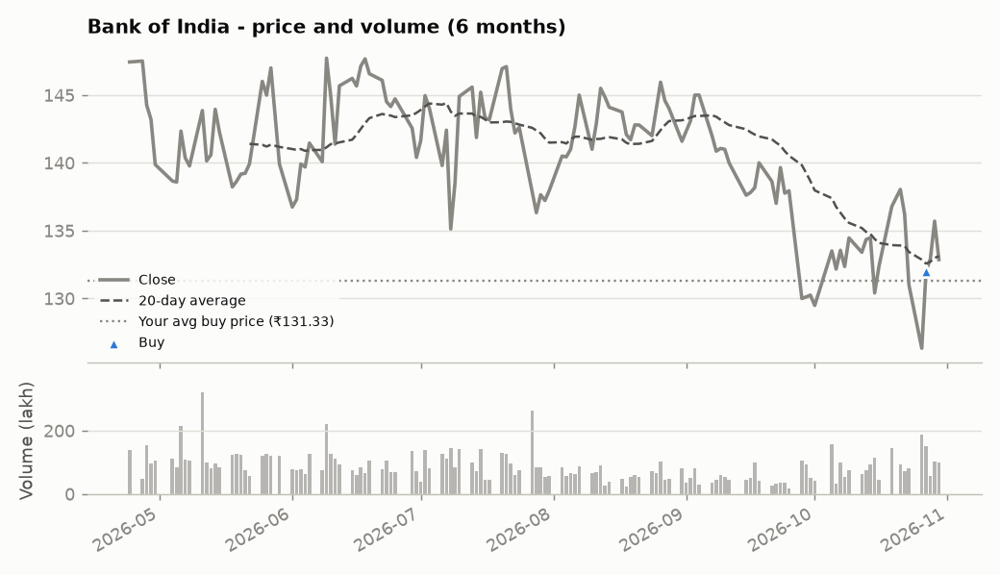

# Core-Equity Virtual Portfolio

> This is a **virtual (paper) portfolio built for learning and skill demonstration**. It is **not investment advice** and not a recommendation to buy, sell or hold any security.

**Last updated:** 30 Oct 2026, 03:33 PM IST  |  **Market data as of:** 2026-10-30  |  **Start date:** 2026-10-16

**Snapshot type:** End-of-day final snapshot

**Jump to:** [Summary](#portfolio-summary) · [Holdings](#holdings) · [Allocation](#allocation) · [Performance](#performance) · [Trade book](#trade-book) · [Companies](#company-deep-dives) · [Method](#how-this-works--data-sources)

## Portfolio summary

| Metric | Value |
|---|---|
| Current value | **₹2,26,16,992** |
| Total P&L | **-₹5,42,538 (-2.34%)** |
| &nbsp;&nbsp;Unrealised (open positions) | -₹1,44,050 |
| &nbsp;&nbsp;Realised (shares already sold) | -₹3,98,488 |
| Today's change | ₹30,660 (+0.14%) |
| Nifty 50 since start (same money invested) | +0.42% |
| Outperformance vs Nifty 50 | -2.76% |
| Cash (uninvested) | ₹71,41,482 |
| Virtual money put in | ₹2,31,59,530 |

_▲ buy · ▼ sell_

## Holdings

| Stock | Shares | Buy price | Current price | Today's close | Prev close | Day | Value | Weight | P&L | P&L % |
|---|---:|---:|---:|---:|---:|---:|---:|---:|---:|---:|
| Maruti Suzuki | 290 | ₹11,489.00 | ₹11,397.00 | ₹11,397.00 | ₹11,426.00 | -0.25% | ₹33,05,130 | 14.6% | -₹26,680 | -0.80% |
| Ashok Leyland | 1,000 | ₹147.72 | ₹144.82 | ₹144.82 | ₹145.00 | -0.12% | ₹1,44,820 | 0.6% | -₹2,900 | -1.96% |
| Eicher Motors | 1,000 | ₹7,266.00 | ₹7,220.00 | ₹7,220.00 | ₹7,238.00 | -0.25% | ₹72,20,000 | 31.9% | -₹46,000 | -0.63% |
| Linde India | 500 | ₹5,961.00 | ₹5,651.50 | ₹5,651.50 | ₹5,718.00 | -1.16% | ₹28,25,750 | 12.5% | -₹1,54,750 | -5.19% |
| Linc Ltd | 1,000 | ₹85.00 | ₹90.95 | ₹90.95 | ₹90.61 | +0.38% | ₹90,950 | 0.4% | ₹5,950 | +7.00% |
| Ather Energy | 1,000 | ₹1,677.20 | ₹1,756.00 | ₹1,756.00 | ₹1,663.00 | +5.59% | ₹17,56,000 | 7.8% | ₹78,800 | +4.70% |
| Bank of India | 1,000 | ₹131.33 | ₹132.86 | ₹132.86 | ₹135.70 | -2.09% | ₹1,32,860 | 0.6% | ₹1,530 | +1.17% |

**Best since buy:** Linc Ltd (+7.00%)  ·  **Worst since buy:** Linde India (-5.19%)  ·  **Biggest mover today:** Ather Energy (+5.59%)

## Allocation

| Sector | Value | Share |
|---|---:|---:|
| Automobiles | ₹1,24,25,950 | 54.9% |
| Cash | ₹71,41,482 | 31.6% |
| Industrial Gases | ₹28,25,750 | 12.5% |
| Financials | ₹1,32,860 | 0.6% |
| Stationery & Writing Instruments | ₹90,950 | 0.4% |

## Performance

## Trade book

<b>Transaction history</b> - 22 entries, newest first

| Date | Stock | Type | Shares | Price | Amount | Note |
|---|---|---|---:|---:|---:|---|
| 2026-10-27 | Bank of India | BUY | 1,000 | ₹131.33 | ₹1,31,330 | Bought 27-Oct-26 at 131.33 (12:54 PM IST per Upstox quote) |
| 2026-10-27 | - | DEPOSIT | - | - | ₹1,31,330 | Fresh virtual money to fund Bank of India |
| 2026-10-27 | Ather Energy | BUY | 1,000 | ₹1,677.20 | ₹16,77,200 | Bought 27-Oct-26 at 1677.20 (12:37 PM IST per Upstox quote) |
| 2026-10-27 | - | DEPOSIT | - | - | ₹16,77,200 | Fresh virtual money to fund Ather Energy |
| 2026-10-27 | HDFC Bank | SELL | 4,572 | ₹687.95 | ₹31,45,307 | Sold 27-Oct-26 at 687.95 (12:08 PM IST per Business Standard quote) |
| 2026-10-22 | Linc Ltd | BUY | 1,000 | ₹85.00 | ₹85,000 | Bought 22-Oct-26 at live NSE price 85.00 (12:30:26 PM IST; source NSE_CMDATA) |
| 2026-10-22 | - | DEPOSIT | - | - | ₹85,000 | Fresh virtual money to fund Linc Ltd |
| 2026-10-22 | Eternal (Zomato) | SELL | 10,245 | ₹309.00 | ₹31,65,705 | Sold 22-Oct-26 at live NSE price 309.00 (12:30:26 PM IST; source NSE_CMDATA) |
| 2026-10-21 | Linde India | BUY | 500 | ₹5,961.00 | ₹29,80,500 | Bought 21-Oct-26 from cash at 5961.00 (NSE last traded 10:53:52 AM IST per Upstox web quote) |
| 2026-10-21 | Fiem Industries | SELL | 1,000 | ₹1,816.90 | ₹18,16,900 | Sold 21-Oct-26 at live NSE price 1816.90 (10:03:32 AM IST; source NSE_CMDATA) |
| 2026-10-21 | Manorama Industries | SELL | 1,000 | ₹1,749.00 | ₹17,49,000 | Sold 21-Oct-26 at live NSE price 1749.00 (10:03:32 AM IST; source NSE_CMDATA) |
| 2026-10-21 | Fiem Industries | BUY | 1,000 | ₹1,813.60 | ₹18,13,600 | Bought 21-Oct-26 at live NSE price 1813.60 (10:00:26 AM IST; source NSE_CMDATA) |
| 2026-10-21 | Eicher Motors | BUY | 1,000 | ₹7,266.00 | ₹72,66,000 | Bought 21-Oct-26 at live NSE price 7266.00 (10:00:26 AM IST; source NSE_CMDATA) |
| 2026-10-21 | - | DEPOSIT | - | - | ₹72,66,000 | Fresh virtual money to fund Eicher Motors |
| 2026-10-20 | - | DEPOSIT | - | - | ₹19,00,000 | Fresh virtual money to fund Fiem Industries |
| 2026-10-19 | Manorama Industries | BUY | 1,000 | ₹1,796.80 | ₹17,96,800 | Added on 19-Oct-26 (CMP 1790.40 per Trendlyne) |
| 2026-10-19 | - | DEPOSIT | - | - | ₹18,00,000 | Fresh virtual money to fund Manorama Industries |
| 2026-10-19 | Ashok Leyland | BUY | 1,000 | ₹147.72 | ₹1,47,720 | Added at ~11:25 AM IST |
| 2026-10-19 | - | DEPOSIT | - | - | ₹3,00,000 | Fresh virtual money to fund Ashok Leyland |
| 2026-10-16 | Maruti Suzuki | BUY | 290 | ₹11,489.00 | ₹33,31,810 | Initial allocation |
| 2026-10-16 | Eternal (Zomato) | BUY | 10,245 | ₹325.30 | ₹33,32,698 | Initial allocation |
| 2026-10-16 | HDFC Bank | BUY | 4,572 | ₹728.85 | ₹33,32,302 | Initial allocation |

<b>Closed positions</b> - 4

| Stock | Bought (avg) | Sold (avg) | Held | Invested | Proceeds | Realised P&L | Return |
|---|---:|---:|---:|---:|---:|---:|---:|
| Manorama Industries | 2026-10-19 @ ₹1,796.80 | 2026-10-21 @ ₹1,749.00 | 2 days | ₹17,96,800 | ₹17,49,000 | -₹47,800 | -2.66% |
| Fiem Industries | 2026-10-21 @ ₹1,813.60 | 2026-10-21 @ ₹1,816.90 | 0 days | ₹18,13,600 | ₹18,16,900 | ₹3,300 | +0.18% |
| Eternal (Zomato) | 2026-10-16 @ ₹325.30 | 2026-10-22 @ ₹309.00 | 6 days | ₹33,32,698 | ₹31,65,705 | -₹1,66,993 | -5.01% |
| HDFC Bank | 2026-10-16 @ ₹728.85 | 2026-10-27 @ ₹687.95 | 11 days | ₹33,32,302 | ₹31,45,307 | -₹1,86,995 | -5.61% |

## Company deep-dives

---

### Maruti Suzuki  _(Automobiles)_

[Google Finance](https://www.google.com/finance/quote/MARUTI:NSE) · [All BSE announcements](https://www.bseindia.com/corporates/ann.html?scrip=532500)

| Close | Day change | Day range | Volume | 20d avg volume | Volume vs 20d avg | 20d volatility (ann.) | 52w range |
|---:|---:|---:|---:|---:|---:|---:|---:|
| ₹11,397.00 | -0.25% | ₹11,342.00 - ₹11,473.00 | 298,977 | 499,091 | 0.6x | 26.91% | ₹11,170.00 - ₹17,292.00 |

**Research reports**

- [One-page snapshot](analysis/Maruti_OnePager.pdf)
- [Detailed report](analysis/Maruti_Detailed.pdf)

<b>Official company announcements (BSE)</b>

- No recent filings fetched; see the link above for the full list.

<b>Latest news (trusted publishers + official company newsroom)</b>

- [Market wrap: Adani Ports SEZ, Adani Ent, Trent, Maruti Suzuki top gainers and losers on Nifty and Sensex](https://news.google.com/rss/articles/CBMioAJBVV95cUxQTExDS2xDVEJ0RTZvRW9FLTN2bkxpSEYzWTliaW80d0NSdjRLUjZhQS1rX283NjBEdTNlejFVZkpwQVdIbWh0cmpMaE5FdW1VcFJtM1kzUkJQVDB6VW84TWNJQ1cybVd4RU9CLWJBa1FwaWpmMkpjVEg1VHBfZnB3MVFqaWowYXZfWndZdkdpOUV4V3dDQk9BbHl5bDREeUpsZHRFb3JQZ0tGamp5YnBvNVN4SUIxVFBWRnRpVzlmVl9HUDFOd0swb1VkWUpERkxET1dYMzRNM2dGc3Y4eTE5c0FXMWJ6ZU1Ub2tId2d0UlJhcE1qUHlNazU0dHF6TURFNmRwUUpxSl9YS2lkVjVhcTkxZmdLSkxiWmlkeXgwRUHSAZoCQVVfeXFMTUVUZkk1X094YUVObmFiZ2JMOTB5Zkw3RkVSbTluYkpDRDdrRW1GUVh4VjZXNU56OTVnOWxGaTdIOUdfUXl3WEdjRGpUd1dyenZXcnZZSE84anV6NUMyeThKVzkxR0k0UWYxN2ctSURpTkc5bGhpVkdEdlBtcjkyc1VsTVpGYW5GRlRxc2oxNGdDWk50d2prREhfd1B4Z0Jmd3lnWlFVNmFyY3ZUVU1JdEc2ZXFvZTJIU2dmNmtUTlRSaXo2YnZId05xQUdLcmxfZ0ZRaGd1eUJjVmxkSHRPZFhjYnBVQXF4eFEzN3I5NzlsYWNSblhaTF9Ec0kxTFlfMHktdHIxQzBVNjNnV2xfZnRLeDlrengtbktR?oc=5) - _The Economic Times, 29 Oct 2026, 05:37 PM IST_
- [Maruti Suzuki achieves exports of 50,000 EVs since August 2025](https://news.google.com/rss/articles/CBMixwFBVV95cUxNaGJjeHhsb2lQTmRzQnhFcFo5NUxLTW15bEJYcHlaek4wSG9lU3ZxY0RJVHkzeHdGZThrdmhWZTV5aGZwOXFRN0hSYWUxSzR6czRHUEdhT2JOQkV3ZFJ2TGxaNlQ1SlBkQno5N0h1cGZ1VUM3ZDRYZWZQc0ZOYTE5dXFwN0VZakl0WjBkR3VidDNrMlVwUlFqY1hrWm8tRWFmX0dwMmFGbDdGN2VmYkRTT1FOd2FOUlBMbGNtZF90ZVNaZ3k1U2I00gHOAUFVX3lxTE5tTTFibGRQNmk1dUZ1cTJrb3dWdTA1ZkxhR2RlZXBPdVUtMlNhVEFNdnpBbnhTaXFVaWxkWFJhODJGc2tJWkNSUnZzN3FGMHBSZzF0TktmdHJDSmFpVG4zaEhvZVJRZXhzVTVOYm01NXppQU03YjFJTjFkSExqeW9JUEZxbjh3UG9HSzN0NXAwbmVDU2ltclhUQU1DNmRTRWJOazZtdG4tOUkxTFZENWZQVFR0LW1ucHY0U2hKdk9Ca2d0OXlNSmxEdW1JeGVR?oc=5) - _BusinessLine, 29 Oct 2026, 01:22 PM IST_
- [Maruti Suzuki crosses 50,000 EV exports with e Vitara, accounts for 93% of India’s electric car shipments](https://news.google.com/rss/articles/CBMi7wFBVV95cUxOSTZpSVpJcHYzbU5yUkJ2UlpFQWVhWU1KY0VEbl9YOS1HdTdmVUZlSjBSQlEyZy1JYkZGUU1POXAtZXNIRHdjS2RFN2VJdFdqSGdadUFwWUEyOFhyUEV1UmRWbU84NE9qR291d3Nib3diVGxNanFKSWozc0JDYXpVREtWVG9obExuTUdtWmJ4M2pmdDgxNW1iWWdBRUZwQldSVWdOY1ZrX1JuRmlpaTZ1U1NHaGpmZHA0SHBrTTNBYkw0QjhvTkdJTEhoaFVuM2UtNGdrMWVFRXYzTkw1NHdkYUhkcDZReC1McFJfM3RFRdIB9AFBVV95cUxNQW80VnVZbXZMSXNHYVY0SUxTS3BKcHp0ZnRsazAzZFVWX0xqWmpoeGdKYWt5cHhrUEhnajZMcndNMzZWb1l2ZXQ0b0VGM2UtOV94RFpPclk5WDl4czdBWk5MaXMweTRWcE9MT3ZtbDNiWEJERXIxS3FsTVhqZVNiczA2TTJwYWtsWXFGR3pJT0RUSi1ZNzZmb0RYLWEzQ1gyX2hLQ1A0Wlp1Vm93azhNSk5PWGpqNDc3WkVOTzIxUnBCdi0xYXByNXBqTV9KQWtTSVV5SDJuVmpjZ3YtQXZPaXBnYTBub25MYzZqdEVVNnVJOTVh?oc=5) - _Livemint, 29 Oct 2026, 12:08 PM IST_
- [Auto biggies Q2 result compared: Bajaj Auto vs Maruti Suzuki - Who wins the earnings race? Profit, revenue, target price](https://news.google.com/rss/articles/CBMikgJBVV95cUxOUzhHZWFhMXNuNHVLQUdXcVBEcGdQRXBTdXhlT1A4ZWhjbkRjRmYzRlVwTGdvcFV1VFVwTnhGM2oyRF9Fd3hMMHU5SE9EdFJ3eTBzUVRXOG5TZllMRG1KNnMxdWEtSW5mdmJGYVFwejJpYzRqYjJHM0h4TXpSNXFWNmRTMzdJb1ladjdJSUhmandlVGxWQk53OEtEdkwtR0U4YXhLMGJVNk8ydWNQTEVfaER3NnVYaUx0aDR0YkM0SlR0N2FFcVVwY29WQTJ1anYyQkJlcVlJWVhPOEFhbXVsSElKcHBxWHY0bTV6d3BhYWdtNm1NdHIyb0RMOXZYSjhCUlFCQ0lkWjh6X196aF9oREpR0gGXAkFVX3lxTE9YZFlucE5aVHZaQ0hPNFk4bENGdTNaR0tMb25KUjJxUF9mMVF1MkFjSVducmtNZEFhWTJ6Rk85Q21oaE9hN2JQOEZiT2NRbDJfY0tZeFpuSUJudzFPbFlBZEpnajREemxRRTdDb1ZmS2tNZnRhZDBCNjViY3ZuM3A5UVBBNTdKaWxSYWxtUzRCODFQOWhsZTg3X21QZlFMeUdQUkdybWJIX1JRZDhITzdFaFQ3STA4VkJmMFpNdVo0NUgtUnBVQUNCNEhpOUlnX2ZVQ25oVVM5NFFBbEtWRXRDYzVwMGFnYXlPSXZUSjNyYVhjSVBiWVlFR2ZSZEdXZVdyNkxhWFRybk9YRXZoY0luWl9yZkE4OA?oc=5) - _Livemint, 28 Oct 2026, 06:31 PM IST_
- [Maruti Suzuki’s Q2 paradox: record volumes, shrinking margins](https://news.google.com/rss/articles/CBMiwwFBVV95cUxPelB4NVN2YXNILWNaZnlGaTdSRnFPUDhfaDBHX0FmcVFkRWNSSGVsb3ZqM2l4U1MxWHU0ZmdOcHZKa1U3TDBHUjlwdjdTVGlXNjJZY01FSFBqU3g0NFRJTnc0MVotTnBBMHhEMzVaZmZUSnZqLXowazN3cFFOcTBxbko5SV84Y1ZudjhOQklnWmQtalFlbUlPZkJrVE8zeFNaZHUzQXY1WW05TDRDVXlmYWx2LTdla1pSR2Jic1pIYmM1clnSAcgBQVVfeXFMTlNxQXE3YmNIVVVHZjF1cHprSUE2Y1ZaX2tNNkplZmEya2lVMXRNNVNFbmdGNzdOWi02V3JCVjNrU0JiZWd6Yk9oSktlRE5lUHIzUEE5MzlfVnlmTmFFSFdnWlBIQ3pfeGRLMWhqTEVjNkt4V0FoVXdWZ2hOUVNwX0tFcEhjWXBRcEwtY2xFN3JmZTc4eF9xOE52R2VsQ3ZiN25jNFAxTEhFeG5TUnBfZ2NVVXFmV0xBZVVZOVpkQzBqSXNQQVlydHo?oc=5) - _Livemint, 28 Oct 2026, 03:56 PM IST_

---

### Ashok Leyland  _(Automobiles)_

[Google Finance](https://www.google.com/finance/quote/ASHOKLEY:NSE) · [All BSE announcements](https://www.bseindia.com/corporates/ann.html?scrip=500477)

| Close | Day change | Day range | Volume | 20d avg volume | Volume vs 20d avg | 20d volatility (ann.) | 52w range |
|---:|---:|---:|---:|---:|---:|---:|---:|
| ₹144.82 | -0.12% | ₹143.06 - ₹147.80 | 11,133,687 | 13,689,028 | 0.81x | 24.67% | ₹138.58 - ₹211.92 |

**Research reports**

- [One-page snapshot](analysis/Ashok_Leyland_OnePager.pdf)
- [Detailed report](analysis/Ashok_Leyland_Detailed.pdf)

<b>Official company announcements (BSE)</b>

- No recent filings fetched; see the link above for the full list.

<b>Latest news (trusted publishers + official company newsroom)</b>

- No fresh headlines from trusted sources in the last few days.

---

### Eicher Motors  _(Automobiles)_

[Google Finance](https://www.google.com/finance/quote/EICHERMOT:NSE) · [All BSE announcements](https://www.bseindia.com/corporates/ann.html?scrip=505200)

| Close | Day change | Day range | Volume | 20d avg volume | Volume vs 20d avg | 20d volatility (ann.) | 52w range |
|---:|---:|---:|---:|---:|---:|---:|---:|
| ₹7,220.00 | -0.25% | ₹7,198.00 - ₹7,343.00 | 415,230 | 409,513 | 1.01x | 28.27% | ₹6,586.00 - ₹8,190.00 |

**Research reports**

- [One-page snapshot](analysis/Eicher_OnePager.pdf)
- [Detailed report](analysis/Eicher_Detailed.pdf)

<b>Official company announcements (BSE)</b>

- No recent filings fetched; see the link above for the full list.

<b>Latest news (trusted publishers + official company newsroom)</b>

- [Fardeen Khan’s new bike is a ₹2.5 lakh India-made Royal Enfield Guerrilla 450 Apex: Engine, features and price explained](https://news.google.com/rss/articles/CBMiggJBVV95cUxNeVMxZG5LYWR1c2hidnZRXzJzOUNLOVdtY0Z2LWdLRTlPZkpkOHlBZEw4MkdjYjFCZ19zWTFBNENRUEtPNlo4TjAzWERXNDlrRmtfOVh0U3FZRWFvQ3o5MGZzZDFSRGdydEp5V3JJdHdMMHl2dS1JMXpKdy1LaFR6dVU5dUxtTWw5WGMtOXpDY1hXYXRJbF9DbTU0Y1hFbUtURnl2XzdaaEU4UmtKcG51ajJNeFZacjd1eGVoRnFQU0NuTFk0ZHZWZ3dZRVJuNS1nRmZ5UzdCYktHaWY2SFFxVzdxOWl1M0NlYTgtZVVDSS1uWk9wWW1ZRFRyaGo2a0pWa0HSAYcCQVVfeXFMT1NIeWZJQV85QXBWNkJwc3I2YTUtWGV1UllKMnk5a0wzOVU0cmhiN3R0d0otR0RFMGNNZ0ZLXzFpSVdRY1o5aktxQWVPekNKcFk2LUhRYmRQbW5uS2xDMVk4X21RRTRXSHhVNmFJNm5iUU9vSkxVaFN6TEQwM3hIbm5xcHoxQU1sLXUxdXlEN0hWNWQ1WktLdmN6WTNocW1vNW9FaEpqaWwzZE1FVnFxRHNnbUJ2WDNQYllLdlZtUW13LV9qbzIwTmJYaXhUbE5LMTc1RzM3TlgzR3BkMHZVYTI0UHpaeVZHTDVGb3JyZk5xZDJzU192TjZvM3Bic2o2UE1Ba19hSjQ?oc=5) - _Livemint, 28 Oct 2026, 10:11 PM IST_

---

### Linde India  _(Industrial Gases)_

[Google Finance](https://www.google.com/finance/quote/LINDEINDIA:NSE) · [All BSE announcements](https://www.bseindia.com/corporates/ann.html?scrip=523457)

| Close | Day change | Day range | Volume | 20d avg volume | Volume vs 20d avg | 20d volatility (ann.) | 52w range |
|---:|---:|---:|---:|---:|---:|---:|---:|
| ₹5,651.50 | -1.16% | ₹5,544.00 - ₹5,725.50 | 34,449 | 17,693 | 1.95x | 25.74% | ₹5,632.50 - ₹7,847.50 |

**Research reports**

_Research report coming soon._

<b>Official company announcements (BSE)</b>

- No recent filings fetched; see the link above for the full list.

<b>Latest news (trusted publishers + official company newsroom)</b>

- [Linde reports Q3 sales of $9.4bn](https://news.google.com/rss/articles/CBMihgFBVV95cUxQMGc3ZFh2OXB1N0lmUDRiajBjUzRVdVBMQW8zY2l5UC1halVsTGlGS0tJUUFSNWVGSWtYOTcyZXZxb0x2YmpfWmktWVZGNFlEck5rV1RzWkhvRnhFTXNkMDBSc0lVVk40R1NuZklSNVQtRldESHpXTFA3SDYtVF92WW1xZXNBQQ?oc=5) - _gasworld, 29 Oct 2026, 05:29 PM IST_
- [Linde stock rises 3% on third-quarter earnings, revenue beats By Investing.com](https://news.google.com/rss/articles/CBMiqAFBVV95cUxQSG5GNTA2VHpNNGh3UUtXM3FHZG1mOWxEVHhadTB1cHV4dXpLWDFjcDlnS2hzYkdSV1Fod21ZRUt6UHZaWm1XX0JWTE8zeGp2ZEFZLXEyNGlTTUwyWEVTMGhJNkI4UDVBd0hYT29GNDNCc1kyM2hCaldxQVlRWTBlOUdSWk16cTJEbERuMlh4UW9GX0tER1piTmRPb1BnNGlJcHRvNURROWI?oc=5) - _Investing.com India, 29 Oct 2026, 03:56 PM IST_

---

### Linc Ltd  _(Stationery & Writing Instruments)_

[Google Finance](https://www.google.com/finance/quote/LINC:NSE) · [All BSE announcements](https://www.bseindia.com/corporates/ann.html?scrip=531241)

| Close | Day change | Day range | Volume | 20d avg volume | Volume vs 20d avg | 20d volatility (ann.) | 52w range |
|---:|---:|---:|---:|---:|---:|---:|---:|
| ₹90.95 | +0.38% | ₹90.00 - ₹92.79 | 18,183 | 61,833 | 0.29x | 102.57% | ₹76.41 - ₹130.64 |

**Research reports**

_Research report coming soon._

<b>Official company announcements (BSE)</b>

- No recent filings fetched; see the link above for the full list.

<b>Latest news (trusted publishers + official company newsroom)</b>

- No fresh headlines from trusted sources in the last few days.

---

### Ather Energy  _(Automobiles)_

[Google Finance](https://www.google.com/finance/quote/ATHERENERG:NSE) · [All BSE announcements](https://www.bseindia.com/corporates/ann.html?scrip=544397)

| Close | Day change | Day range | Volume | 20d avg volume | Volume vs 20d avg | 20d volatility (ann.) | 52w range |
|---:|---:|---:|---:|---:|---:|---:|---:|
| ₹1,756.00 | +5.59% | ₹1,663.00 - ₹1,784.50 | 7,955,744 | 3,587,069 | 2.22x | 65.02% | ₹601.35 - ₹1,756.00 |

**Research reports**

_Research report coming soon._

<b>Official company announcements (BSE)</b>

- No recent filings fetched; see the link above for the full list.

<b>Latest news (trusted publishers + official company newsroom)</b>

- [Ather Energy Share Price Today, Ather Energy Stock Price Live NSE/BSE Updates](https://news.google.com/rss/articles/CBMiigFBVV95cUxNMmpPVXcxeVFIRHF1aHV6dFRLVnhXV3djOWRQN2tuMmxVTnhDeVNJSnFoV2ZscmFoaEtaWXhCT0tabGNHdVhlOV8zcG45eTJrYS04ek9hSlNlMEZPYlpyeS1pbXNqbjlVVklKeEFrX1R6OUEzXzhRdjNneFZzbEFFMjc4MmZ4T3dSMnc?oc=5) - _The Economic Times, 30 Oct 2026, 11:43 AM IST_
- [Range anxiety: Ather set to challenge Ola with low-range electric scooters](https://news.google.com/rss/articles/CBMirgFBVV95cUxPWUZkYTVTMFRzZTcwYm9SS2R4RWc0a3ktbG81THhxUnVtQ25VbzA0QjRkMlhhZEp1Y2RZMnNLU1dBdU5RUTFZM1RXY1JYdEk5a0N1bmRkTTZGUlVZVEtaZDFnOTMyNFh5NjVYSlB4bXhvMy1TalhVU1ZETG8wRURVTHowM0JrZ2ctTzdfTGV4MEROQ3hhVDdvMG5RRENlWi1ocjZnajZ5Uko5UGxGbWfSAbMBQVVfeXFMTTY3Smo0Ry10aWtleUViZUl5SldpUzlZb3RvbVZfcE9VS3huODh6VHlhb0JoUzJUVXhZa3hqX2dSVmM1S1BBMmZhWlhlRXNxM0JNUTlmeDlkQlBxdGJnNThSQXFUTE5oVElvazB1WTJTWVM5bGJKQ1duVjRIenUwNkotZW82RjBOb2tvUVdXWkdCR3E5WXppOV9SeUNnaXdBNGhPZGNLbnBoNkVfU2pQeXJoejg?oc=5) - _Livemint, 30 Oct 2026, 10:59 AM IST_
- [Ather Energy Q2 Review: Nomura, HSBC Raise Target Prices After Q2 Surprise, See Up To 24% Upside; Should You Buy?](https://news.google.com/rss/articles/CBMi0AFBVV95cUxPWHpDVGJDWGVHamY2elQxcmxIRjNyNXY5dGtKLTktQ3NtdXpHaG9HYl8yQUhhRUMxT2hEajF6UVdQR1dNT2lhaV9GLWgtbVRxUXFVUXdsWXA1Wl9KUWhhNGs4NmIyVUFKV1h5NEd1ZnNjWUduTmR4OGhnNy1YQWFUbTNMMkZ0bUdWcW96Z0ZoZ1pSZVRWRndnZVFmc2pWSVVwZWY1em1PbTRrVkpZdDZ6czVXcUZtRVRRVkhvT21RYS1UX1gtR2tEeld4aXNYQzFB0gHYAUFVX3lxTFBSdkJuZUk2NjRpTm1DRXNEZDNtRnhwYUtyMVdOMTRZdkZYdVlObXd1ZVVVbmVVUDdTTWJPLXdFN0VneElnYWd0MVdrblhzSHotb0hJWkxERldKdnA1dVBIRm1aOWtzajgxLUVTbjlDQTZhRmdpaERvalRDZHZFZVFWNy1wRVVQN0tVSEVud1F6RTZrNHpKNVNubEEtd29sRFJ2Ui1EOURuZWh2RUVqNWlUeTNOb3duYVdhbk85dFJZRXZBcktySmhXeHRPQUhseE54Y1N1YzVMRw?oc=5) - _NDTV Profit, 28 Oct 2026, 07:56 AM IST_
- [Cognizant eyes Sarvam stake; Ather aims for higher market share](https://news.google.com/rss/articles/CBMi5AFBVV95cUxNMUlzbzFXY1VSa1JoYS1ORmNXR3RTdEdkZk5ucVVRSTRVQnR1WHlmQjRJUThhbmtaeXVUMVJEcFN6RmVhaERnbm1KODdIWEVybmxwc0ZtN1BYRU85WlJIQUN2ZmVVR3FuelAtZVRIS2pCa0VkOXYtOXBlcjBPU1dicFdFNlNwVFkzZWtuQmd6VXBlT1VoM2dXdVZzVUJ4VkNBX052VFVzM1F1TUU3MEtYb2dGLUlJWnIxZ1BrRUoxend4VGZ4djE1S0FmeW1yMUQtTVR3d0xJTWpjcml4dGdnV3pSVjTSAeoBQVVfeXFMTXA1dm82WGxZTGgtcDJFV2p6SlhuR1FUeVc3MzVKQ3Zwa29LWmx0QWU1Vmg5RGU4TUttcG5OZjB6Q0IwbnJTMzExYVdfSEVCcnF2dXVoZVpiS25xTXFfSHhFdmlRNkNFdl9mTTdXWG14NWlXTFBpcE9PMXR3a1B1NDI4STFnR0RzeGd4QWticWh6cmhmUWNQVS1DSlgyMmVlRERFN2YwakVmZE5pV1FSUTAtekU5ekZ0Mk12dUVkd0pKbkRrS1FINVpWcm14NDZ1SnBPM2tGN1pBU2NjSHFtbFNJdmJoUU5aOTBn?oc=5) - _The Economic Times, 28 Oct 2026, 07:25 AM IST_
- [Stock to buy today: Ather Energy (₹1,671) – BUY](https://news.google.com/rss/articles/CBMixAFBVV95cUxNUzlLcWpwcTVBbkFfQm00WFNiZkVMMXR5VjZCRTY0ay16VkFDNkc3dXlHZmNkcGRPNmZMTmZqbEFHazdBeHNKU3lTaXJTN3U5TXp2YXhmU0ZDYWZVcDdiak90SzQyeEtxUkNScWlhanZOQTlRVXdjcWJpVFlZSnJnSk81dzJUUW9hbE5CZ3pkZnUyOUkyTVBXeTVKYWk0NFpzZnd4Njhwb01sVnNPZ0lIa0JLZ281RW9rNXJGa050bkJyYm1u0gHLAUFVX3lxTE04NkdOT2s1X0g2QnhpNkVjcnJ4TWpjVl9sSkpudWxac1NNbkZCQTFVaFZwZk5DblkweHkwc19sQmQ3Y1JWaDM5TC03SGtrYjdYbTBiUldDNi1nUTZWTXdqQU1JV21MLUtXQzNhakdWWDROTmRiYmZ2S3Rib1dVV2VqNmExSGJXY3dqUGRjZEwzeGlpSWFQNzZNM0RmMzZSQzZZSkRrMlByMDRBUGl0bzlhU1Vkakw2eUl5OXZlVVFmS1loR3BfT1lPeVhV?oc=5) - _BusinessLine, 28 Oct 2026, 06:30 AM IST_

---

### Bank of India  _(Financials)_

[Google Finance](https://www.google.com/finance/quote/BANKINDIA:NSE) · [All BSE announcements](https://www.bseindia.com/corporates/ann.html?scrip=532149)

| Close | Day change | Day range | Volume | 20d avg volume | Volume vs 20d avg | 20d volatility (ann.) | 52w range |
|---:|---:|---:|---:|---:|---:|---:|---:|
| ₹132.86 | -2.09% | ₹131.80 - ₹136.42 | 9,824,284 | 8,957,751 | 1.1x | 36.14% | ₹126.32 - ₹177.20 |

**Research reports**

_Research report coming soon._

<b>Official company announcements (BSE)</b>

- No recent filings fetched; see the link above for the full list.

<b>Latest news (trusted publishers + official company newsroom)</b>

- [Reserve Bank of India steps in to support rupee- Reuters](https://news.google.com/rss/articles/CBMiuAFBVV95cUxNdjlmN0p2eEc5QVVfcG9DeGRxX0kyTVI5dDFWTTNPZlhEajU1UXBUNEY2dnRFNHNVaXJyTjg0YzlRY09JeE1jZnBMWGZDUS1MX1c4M0p3b01XUFRDTnRINU5LX1Jqci1BZnRsdWJWb3ZnT3B2X3hCalc1ZU8yU2RINGRGREpiSzIteERWZkNhTzRWMVFpajlfMUZ1MjBIQXVuZTFwT2tGMzcwTjF1Yk5KR1pJdHlBZWh3?oc=5) - _Investing.com, 29 Oct 2026, 09:20 PM IST_
- [Broker’s Call: Bank of India (Buy)](https://news.google.com/rss/articles/CBMimwFBVV95cUxQRWd0QTlmWVp1LUllWmhrU1JCV1h6bkFKWTRqSFpGQk0xZERIXzA5V2hpOUk5NmprZDMzcnhTYWRzMGVJY09CV1JDUmlvVmNpLW9tMXBPVWdWTExOQ1BvQ0V6YU04aS1BZWxZaDRFWk5EbEtmLUJmNldOZG1yZzAzYnpTbkNEdlctMWlOdjRLVk80M1pHZnVWWlJFQdIBogFBVV95cUxNaDZQOGxuTlBYdW1ZLW9kbUJJeWVvNFk1TmhxdVZhalRqOGJickpqSWRCY2ZFcUxGcmRVbFdnNE9ZbHJGUGZGTUxSMUxicTNHUmpNbDM3ZERqOXZWQVU4NldnTElYVW4yOHJaMnZJOUx3d1RMNF94cE9CVnU1NkRlRUFGY3hWbDd4S09XMnVhNlNSd2xSVElRSHlnUmdaU0dFOEE?oc=5) - _BusinessLine, 27 Oct 2026, 06:58 PM IST_
- [Central Bank of India RTGS glitch: What to know about your deposits](https://news.google.com/rss/articles/CBMi3gFBVV95cUxPM1l0Y09RN2x2NTNuaU1LbU5IZU1WN0dHQnV2ZlZfYU5qejZtRy1vMzVMcEhoeHVheUVRSlhaUEp4VE5TYWstNjVDLW53OU9XR2k4MzB3TUJUOTdiejNWcmRtTjhFaFBFaURvb0l0MzVnQU9BQnN4YWNhTWUwSmhMaDBlRlpxTzl0YkFORGpkdWl3LVEwbFZyNk5lZlZZUmFOVC05Qnd2WHprOGZKMDdxNVdxQV9FZUUtN1FrZnZOVnZfWV9TZTFTWEh3bHMxc2RXOFJWRXpKcTF0SnQtSXfSAeMBQVVfeXFMUDJsOHRNcDIwRlNJRGs0MWlLRWg1Mi1CTXRqbk4ycWdLRGtPbGtQWTZjbTkyc0pobmpleXFSZUlrc0JXYWQ5bHY0QXc1WGdGYmxWUGhLZWdFUWg4cFYtLWtiVVUzcmxkamZNX3pCbVhNNDhMMFNRck16UFJtM0s5eHg0U2d2ZXQwdVdiNGdjQnJEa0JuSGVmRjlVZ0pEcDJ1ZVFqODFOaGRsOUVBbkJRMXkyUGFUa1RVOGRwN3M0QzVHUVB3Y3dXZzhjQnptQnFGTldfR0lsYUJzNUpfN2pXMklVTlk?oc=5) - _Business Standard, 27 Oct 2026, 04:49 PM IST_

---

## How this works & data sources

- **Prices / volume:** Yahoo Finance via the open-source `yfinance` library (unofficial; may differ slightly from NSE official data).
- **Trades:** every buy / sell / deposit is a line in `transactions.csv`. A trade happens at the closing price of its date (live price for today). Average-cost method; no brokerage or taxes (virtual portfolio).
- **Benchmark:** every rupee put into the portfolio is also put into the Nifty 50 on the same day, so the comparison is like-for-like.
- **News:** Google News RSS + publisher RSS feeds, filtered to a whitelist of trusted publishers, de-duplicated, last 72 hours only. Each item links to the original article.
- **Official filings:** BSE corporate announcements (best-effort, with link to the full list).
- **Automation:** GitHub Actions refreshes this dashboard on weekdays every 30 minutes from 9:30 AM to 3:30 PM IST (live snapshots) and at 5:45 PM IST (end-of-day final snapshot + AI daily report); skips market holidays.
- **Metrics:** Volatility = 20-day std-dev of daily returns, annualised. Volume ratio = today's volume / average of previous 20 sessions.

> This is a **virtual (paper) portfolio built for learning and skill demonstration**. It is **not investment advice** and not a recommendation to buy, sell or hold any security.
