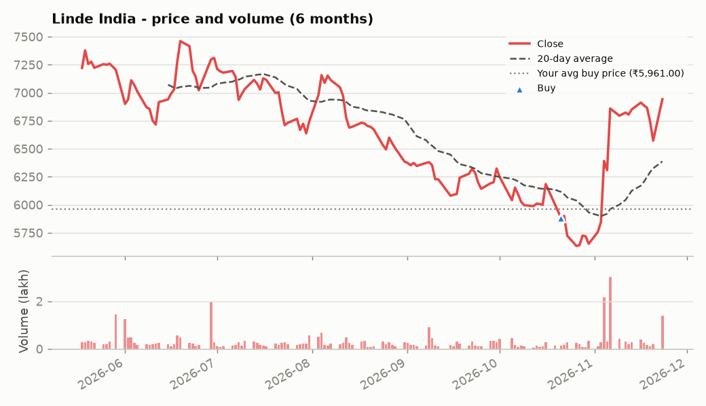

# Core-Equity Virtual Portfolio

> This is a **virtual (paper) portfolio built for learning and skill demonstration**. It is **not investment advice** and not a recommendation to buy, sell or hold any security.

**Last updated:** 26 Nov 2026, 05:26 PM IST  |  **Market data as of:** 2026-11-26  |  **Start date:** 2026-10-16

**Snapshot type:** End-of-day final snapshot

**Jump to:** [Summary](#portfolio-summary) · [Holdings](#holdings) · [Allocation](#allocation) · [Performance](#performance) · [Trade book](#trade-book) · [Companies](#company-deep-dives) · [Method](#how-this-works--data-sources)

## Portfolio summary

| Metric | Value |
|---|---|
| Current value | **₹2,65,78,212** |
| Total P&L | **₹19,79,482 (+8.05%)** |
| &nbsp;&nbsp;Unrealised (open positions) | ₹23,76,970 |
| &nbsp;&nbsp;Realised (shares already sold) | -₹3,98,488 |
| &nbsp;&nbsp;Dividends received (already inside Total P&L) | ₹1,000 |
| Today's change | -₹1,66,450 (-0.62%) |
| Nifty 50 since start (same money invested) | +12.48% |
| Outperformance vs Nifty 50 | -4.43% |
| Cash (uninvested) | ₹71,42,482 |
| Virtual money put in | ₹2,45,98,730 |

_▲ buy · ▼ sell_

## Holdings

| Stock | Shares | Buy price | Current price | Today's close | Prev close | Day | Value | Weight | P&L | P&L % |
|---|---:|---:|---:|---:|---:|---:|---:|---:|---:|---:|
| Maruti Suzuki | 290 | ₹11,489.00 | ₹14,015.00 | ₹14,015.00 | ₹14,200.00 | -1.30% | ₹40,64,350 | 15.3% | ₹7,32,540 | +21.99% |
| Ashok Leyland | 1,000 | ₹147.72 | ₹156.15 | ₹156.15 | ₹158.00 | -1.17% | ₹1,56,150 | 0.6% | ₹8,430 | +5.71% |
| Eicher Motors | 1,000 | ₹7,266.00 | ₹8,180.00 | ₹8,180.00 | ₹8,336.00 | -1.87% | ₹81,80,000 | 30.8% | ₹9,14,000 | +12.58% |
| Linde India | 500 | ₹5,961.00 | ₹6,998.50 | ₹6,998.50 | ₹6,950.00 | +0.70% | ₹34,99,250 | 13.2% | ₹5,18,750 | +17.40% |
| Linc Ltd | 1,000 | ₹85.00 | ₹84.39 | ₹84.39 | ₹85.79 | -1.63% | ₹84,390 | 0.3% | -₹610 | -0.72% |
| Ather Energy | 1,000 | ₹1,677.20 | ₹1,906.00 | ₹1,906.00 | ₹1,871.90 | +1.82% | ₹19,06,000 | 7.2% | ₹2,28,800 | +13.64% |
| Bank of India | 1,000 | ₹131.33 | ₹160.29 | ₹160.29 | ₹159.89 | +0.25% | ₹1,60,290 | 0.6% | ₹28,960 | +22.05% |
| Jio Platforms | 1,000 | ₹1,439.20 | ₹1,385.30 | ₹1,385.30 | ₹1,397.60 | -0.88% | ₹13,85,300 | 5.2% | -₹53,900 | -3.75% |

**Best since buy:** Bank of India (+22.05%)  ·  **Worst since buy:** Jio Platforms (-3.75%)  ·  **Biggest mover today:** Eicher Motors (-1.87%)

## Allocation

| Sector | Value | Share |
|---|---:|---:|
| Automobiles | ₹1,43,06,500 | 53.8% |
| Cash | ₹71,42,482 | 26.9% |
| Industrial Gases | ₹34,99,250 | 13.2% |
| Telecom & Digital Services | ₹13,85,300 | 5.2% |
| Financials | ₹1,60,290 | 0.6% |
| Stationery & Writing Instruments | ₹84,390 | 0.3% |

## Performance (as on 26 Nov 2026, 05:26 PM IST)

## Trade book

<b>Transaction history</b> - 25 entries, newest first

| Date | Stock | Type | Shares | Price | Amount | Note |
|---|---|---|---:|---:|---:|---|
| 2026-11-20 | Ashok Leyland | DIVIDEND | 1,000 | ₹1.00 | ₹1,000 | Auto-detected from Yahoo Finance: dividend Rs 1 per share; ex-date 2026-11-20 |
| 2026-11-04 | Jio Platforms | BUY | 1,000 | ₹1,439.20 | ₹14,39,200 | Bought 04-Nov-26 at 1439.20 (10:29 AM IST per Google Finance quote) |
| 2026-11-04 | - | DEPOSIT | - | - | ₹14,39,200 | Fresh virtual money to fund Jio Platforms |
| 2026-10-27 | Bank of India | BUY | 1,000 | ₹131.33 | ₹1,31,330 | Bought 27-Oct-26 at 131.33 (12:54 PM IST per Upstox quote) |
| 2026-10-27 | - | DEPOSIT | - | - | ₹1,31,330 | Fresh virtual money to fund Bank of India |
| 2026-10-27 | Ather Energy | BUY | 1,000 | ₹1,677.20 | ₹16,77,200 | Bought 27-Oct-26 at 1677.20 (12:37 PM IST per Upstox quote) |
| 2026-10-27 | - | DEPOSIT | - | - | ₹16,77,200 | Fresh virtual money to fund Ather Energy |
| 2026-10-27 | HDFC Bank | SELL | 4,572 | ₹687.95 | ₹31,45,307 | Sold 27-Oct-26 at 687.95 (12:08 PM IST per Business Standard quote) |
| 2026-10-22 | Linc Ltd | BUY | 1,000 | ₹85.00 | ₹85,000 | Bought 22-Oct-26 at live NSE price 85.00 (12:30:26 PM IST; source NSE_CMDATA) |
| 2026-10-22 | - | DEPOSIT | - | - | ₹85,000 | Fresh virtual money to fund Linc Ltd |
| 2026-10-22 | Eternal (Zomato) | SELL | 10,245 | ₹309.00 | ₹31,65,705 | Sold 22-Oct-26 at live NSE price 309.00 (12:30:26 PM IST; source NSE_CMDATA) |
| 2026-10-21 | Linde India | BUY | 500 | ₹5,961.00 | ₹29,80,500 | Bought 21-Oct-26 from cash at 5961.00 (NSE last traded 10:53:52 AM IST per Upstox web quote) |
| 2026-10-21 | Fiem Industries | SELL | 1,000 | ₹1,816.90 | ₹18,16,900 | Sold 21-Oct-26 at live NSE price 1816.90 (10:03:32 AM IST; source NSE_CMDATA) |
| 2026-10-21 | Manorama Industries | SELL | 1,000 | ₹1,749.00 | ₹17,49,000 | Sold 21-Oct-26 at live NSE price 1749.00 (10:03:32 AM IST; source NSE_CMDATA) |
| 2026-10-21 | Fiem Industries | BUY | 1,000 | ₹1,813.60 | ₹18,13,600 | Bought 21-Oct-26 at live NSE price 1813.60 (10:00:26 AM IST; source NSE_CMDATA) |
| 2026-10-21 | Eicher Motors | BUY | 1,000 | ₹7,266.00 | ₹72,66,000 | Bought 21-Oct-26 at live NSE price 7266.00 (10:00:26 AM IST; source NSE_CMDATA) |
| 2026-10-21 | - | DEPOSIT | - | - | ₹72,66,000 | Fresh virtual money to fund Eicher Motors |
| 2026-10-20 | - | DEPOSIT | - | - | ₹19,00,000 | Fresh virtual money to fund Fiem Industries |
| 2026-10-19 | Manorama Industries | BUY | 1,000 | ₹1,796.80 | ₹17,96,800 | Added on 19-Oct-26 (CMP 1790.40 per Trendlyne) |
| 2026-10-19 | - | DEPOSIT | - | - | ₹18,00,000 | Fresh virtual money to fund Manorama Industries |
| 2026-10-19 | Ashok Leyland | BUY | 1,000 | ₹147.72 | ₹1,47,720 | Added at ~11:25 AM IST |
| 2026-10-19 | - | DEPOSIT | - | - | ₹3,00,000 | Fresh virtual money to fund Ashok Leyland |
| 2026-10-16 | Maruti Suzuki | BUY | 290 | ₹11,489.00 | ₹33,31,810 | Initial allocation |
| 2026-10-16 | Eternal (Zomato) | BUY | 10,245 | ₹325.30 | ₹33,32,698 | Initial allocation |
| 2026-10-16 | HDFC Bank | BUY | 4,572 | ₹728.85 | ₹33,32,302 | Initial allocation |

<b>Closed positions</b> - 4

| Stock | Bought (avg) | Sold (avg) | Held | Invested | Proceeds | Realised P&L | Return |
|---|---:|---:|---:|---:|---:|---:|---:|
| Manorama Industries | 2026-10-19 @ ₹1,796.80 | 2026-10-21 @ ₹1,749.00 | 2 days | ₹17,96,800 | ₹17,49,000 | -₹47,800 | -2.66% |
| Fiem Industries | 2026-10-21 @ ₹1,813.60 | 2026-10-21 @ ₹1,816.90 | 0 days | ₹18,13,600 | ₹18,16,900 | ₹3,300 | +0.18% |
| Eternal (Zomato) | 2026-10-16 @ ₹325.30 | 2026-10-22 @ ₹309.00 | 6 days | ₹33,32,698 | ₹31,65,705 | -₹1,66,993 | -5.01% |
| HDFC Bank | 2026-10-16 @ ₹728.85 | 2026-10-27 @ ₹687.95 | 11 days | ₹33,32,302 | ₹31,45,307 | -₹1,86,995 | -5.61% |

## Company deep-dives

---

### Maruti Suzuki  _(Automobiles)_

[Google Finance](https://www.google.com/finance/quote/MARUTI:NSE) · [All BSE announcements](https://www.bseindia.com/corporates/ann.html?scrip=532500)

| Close | Day change | Day range | Volume | 20d avg volume | Volume vs 20d avg | 20d volatility (ann.) | 52w range |
|---:|---:|---:|---:|---:|---:|---:|---:|
| ₹14,015.00 | -1.30% | ₹13,912.00 - ₹14,165.00 | 455,857 | 743,259 | 0.61x | 37.58% | ₹11,170.00 - ₹17,292.00 |

**Research reports**

- [One-page snapshot](analysis/Maruti_OnePager.pdf)
- [Detailed report](analysis/Maruti_Detailed.pdf)

<b>Official company announcements (BSE)</b>

- No recent filings fetched; see the link above for the full list.

<b>Latest news (trusted publishers + official company newsroom)</b>

- [Tata Motors join Maruti Suzuki, Hyundai, Audi in announcing price hikes- How much will you pay from December?](https://news.google.com/rss/articles/CBMi8gFBVV95cUxNOGdlcXByeUNkazJHM3V6QUpIbnRWTm10cG9FSkVKNUlOb1pfc3BDeVJKWVdwT1RadWZMMkgwblpDSXduV3V6ZTVNb1piUHh4VDZpbEpPVk5hOWx4UjFvVzN5RFRicHNtZUtlVHlVU0NpVzBucXhfaDNoN2EtNy0tbXFBTWdCTWRnMDB2R21DbTB1WHEtSEpJLWxWbEZSajdPQ2xSd2lERzVRVlpjcWdjNzR0ZWR5NEZjLU8xb0ZPeTRmWThVLXp4WWJUdTVuSkZkMUx4QjZLeURrS3RwMk9KSlJnMDhuMDM1SlNGSHR6VHExd9IB9wFBVV95cUxOS0lhLW9zS01EUHB3ZjdlcHFsd2hfTzdsRWNJUlU4TDRVYUV6a2hUNlhPSTZLM0hGOXVvMEpla0s4NXhFVHJVMTROLTRIa1hQdnRBN0o4ZGRyM213MGxQWUw5WU5NVlVrS280UW1obU9VMzRHX3NqN2NFTjdjRFI1MnRNcV9aVS1Ddy1SSDdiQzVJZ3Q2WW5LVmFVTWJWN09pV3RrNDZkN2FWNkc3bVNWYjEzRWJTS3QzQVBJNUxPNUtFTmpGSWVyeFhfNWhGd3JFcHliYjhfWjlWRkV3c1hoTk5lYVZmbjVhaU95NEFMZlphSnIyZThJ?oc=5) - _Livemint, 25 Nov 2026, 05:57 PM IST_
- [Maruti Fronx facelift spotted with new cabin features, updated engine, safety upgrades: What buyers can expect](https://news.google.com/rss/articles/CBMi9AFBVV95cUxOc2dQUW9JcVhyNTUzQm5YTDN4QUgycXBpUWxqQk1reWd0cmo3MHZFcjUzc3BEMUp1dEE5WTFNYlBrTWdaNEhwRFVSYzVaeWhvUkh4T2w4cVFOUFFYNlVLSXFkUDVMNHpORE5TWkt1NXU2TzhqT0ZQX2F4ektCNy1ieXJUcnBIdjVuOGVuRjFfeGhtWUNBd2V0U0hvVEdJQXdmd1g1RlY4b2J4cXltWURYSzhOc3k4NkYxODRSbXVNVHRTTG5KWjU0LTBNUC1OQk1Zc3BJWndEZDByYmZPNkk4VE5OZnFRR3R0R1pxLXBRakxRUWpF0gH6AUFVX3lxTFB6a0dMUXFKR2lzUjdzWE9VbDE1NnVTLTJ6cE94TU52cHRJcURobVNGNklrVmZST042UHJhN2pxX3BITFZMS1JoY3AyMzVkYVVpQ3VCY2ZzWEk5T1VCVFJfXy1EZDNmMjVvWTFJYkx0MmoyU1VMLTlQa3hQQzMwNEM0LTBKUVZKWEJzU3ZFUzdvS09UUEQ5OHpqaUg4M0ZWanl2RkpGMnYwc1VQeklGeldScU5BTW5MRzR2bHFWQ09vaExPbk1UM2RrR2MxUVdLZXFUa0Q4enF4ZVBqMHFfNUoybTQ1TkZaclpOemxlanlxa1ZKNmNlU0NZa3c?oc=5) - _Livemint, 25 Nov 2026, 10:46 AM IST_
- [Maruti Suzuki Share Price Highlights: Maruti Suzuki Stock Price History](https://economictimes.indiatimes.com/markets/stocks/stock-liveblog/maruti-suzuki-share-price-today-live-updates-25-nov-2026/liveblog/136148282.cms) - _Economic Times, 25 Nov 2026, 10:03 AM IST_
- [Tata Motors, Audi India raise vehicle prices following Maruti Suzuki's move](https://news.google.com/rss/articles/CBMi2wFBVV95cUxQMllSME5UU1UxTTFJZFZ3X3U5THcyQnY4UjE1cjJpU2NXTlBGMlNzNUJTSlNSRWRraWh6cXgyWWF4bENLNExXV3ZOZ0ZINWM1Q0lMb0hoUXg1UmZLb2Z3LVBpOXJRbmtUdXZRdHdweEZHdmIxekV6Qy1Oc0o5SHpVeHdWazVLUm1tWW5ZUHRmRDg1WUtzeU5WNGh6M3pLT1cxZ0ExankyeDZfZ3ZxVjBYd0dMbDlDRDZ5V3oweGlud19aRzc3T1M0dWpZS09MZXU0VFg2aGt0LUtFenfSAeABQVVfeXFMTUhXdEtDS1AtVkRFV2RpUUQ1WUVsS3ZTQ1NNdHBDSXQ1eF9QZzBlcE9VVkUtRWJqYVZVQUVmcDdvZlhOVl91TVpBRGQtMzREWld3ckZfM3N6MURvOUx4RFg2ekhNb2oxUDNhbVlWc2VCT0FjRlVSSGVjbXF5Mmh2bHlmaTFDZmhsQ1czY0htU3k1S0ZKMm9OTTZJaGtWMFphZXVGWENKTy1SZ0wycjR3bjVoQVNBUlJ4Y2JlaUhBVng2MWRnZmpHSzRkdkJ3X2NDOFQ1LWFUemhvazZhRWpLR0U?oc=5) - _Business Standard, 24 Nov 2026, 07:57 PM IST_
- [Rising input costs drive Tata Motors, Hyundai, Audi and Maruti to raise vehicle prices](https://news.google.com/rss/articles/CBMi4AFBVV95cUxPTUxHR1NRYWFzOXVqbUNYV0xlZS1qYXlQOVNINlBmczRrWnFJS3VHR3d4Qk02MmlBRzBzY080V29NRk9TNUc3WWVNZEdDaVVUZV9kUTFualRmV1hEVFpDTFB2dzd6bEdWSFlNaDRxYlExMVJxVlh6M2w4c0QwVkFmVGc2V3hXUmxyUV9CVTRjQ1l1MHVtM1FWckhoSlRHaWgtTlpyUEhvNkplUm9QTzVlRUVRNncwV24xTFV4MW51V3k0ZUkwRm40VGc4M2RRT1NraGxvWENqdUxxY1ZuNVBUY9IB5wFBVV95cUxPM3Q2X3JBMnFjNDdsdE9GblVWT2VYejBETFJNOG92Si1ueUVsOWRvajF5S25qQlZ2a0tmYXQtcXJyRERoRVdqN2FYLWtxck5IempkUG9aTGh6c0JBY1Q3VGdnR3hSU2xNZnFZYUNCSkVDVF9BV3BBOElaWW9qREhQb0VOaU5wR2ZiMk03MkJFM2RIa04ydUxBdW9LYUlGWDhobUhDRGs3ejQyekx6MHAxVTFWTU1LQ0czU0xrWVdMdkdMZC1Bd0JkaTFMdEd3S0FlMGg5MFBpUjBaU3FsajRnOGVmQmdvMUU?oc=5) - _The Hindu, 24 Nov 2026, 07:32 PM IST_

---

### Ashok Leyland  _(Automobiles)_

[Google Finance](https://www.google.com/finance/quote/ASHOKLEY:NSE) · [All BSE announcements](https://www.bseindia.com/corporates/ann.html?scrip=500477)

| Close | Day change | Day range | Volume | 20d avg volume | Volume vs 20d avg | 20d volatility (ann.) | 52w range |
|---:|---:|---:|---:|---:|---:|---:|---:|
| ₹156.15 | -1.17% | ₹156.00 - ₹158.90 | 13,394,133 | 24,350,080 | 0.55x | 48.00% | ₹138.58 - ₹211.92 |

**Research reports**

- [One-page snapshot](analysis/Ashok_Leyland_OnePager.pdf)
- [Detailed report](analysis/Ashok_Leyland_Detailed.pdf)

<b>Official company announcements (BSE)</b>

- No recent filings fetched; see the link above for the full list.

<b>Latest news (trusted publishers + official company newsroom)</b>

- [Ashok Leyland turns to Bengal for manufacturing expansion: What is the company planning to make in Singur? Details here](https://news.google.com/rss/articles/CBMiiAJBVV95cUxPV0lsT3RIMUpGa3FIYkQ2cTdQdFFaVThKa2dTY1pQRHlXZzJkZDdFYk9oRGZiWUFxZGhLV0UtZ2VuZnVYOUxrcE85VFN4c3hEcXl4ck9ncG5IMUVvVFBXUi1MR2ZWSHNDQzkzd0R2dUxkeTFtakNEQU1tU2pHYnI1WHFhMWJWd2NkLWM5R0tvY01CM3ozTGgwcVdFOGtobE94cEFWaDc3M3lyZGNlOFNNTjZvY0tYaGVpZ2pSM1huRVg1dG5IUWZYX0RJSmtBRUZlRVYyLVk1NW1FMzlWSlVNNENHXzA3dGpadmwzRVE3Wk0xdEVhZDVaM1BRX0gwMllXRnM5RmlTVm7SAY4CQVVfeXFMT0J6cmJaV1ZEYmpOTVFZVnhzV3NnNDZPcHpyREdhUFR1VnZZdGx2NmJtVnVJdlltNGdNOGdxM0R4N3hzNmhRTXRWamRJN1AzX3BFbjYxU3kxVkZBOTlVZ050Qk5OWVFuVFhTSGVFOGNvaXJhLVFFSHBoTzZFallSWGxESW5EV1p5dTN3STZQS2xKQ3lzVzVDeGlXMlJlS1E2a0hNTEV3UDJQazBicFVHOVBrVmdIWllXbjdfYnlxbXpfZXZERXR4Q0FlTW5NZkJ4N3J1bDZDbmtyY1lta1UyR1dwMjVQX0xJajRLZ3ItazFtU0dTTjJmNlV6N1hIdkNnNlMtdkphZW1xaGdleUZ3?oc=5) - _Livemint, 24 Nov 2026, 06:34 PM IST_
- [Ashok Leyland Celebrates Milestone Delivery of 1,000+ Vehicles to Thriveni Transport and Logistics](https://www.ashokleyland.com/in/pressrelease/ashok-leyland-celebrates-milestone-delivery-of-1000-vehicles-to-thriveni-transport-and-logistics) - _Ashok Leyland (official newsroom), 17 Nov 2026_

---

### Eicher Motors  _(Automobiles)_

[Google Finance](https://www.google.com/finance/quote/EICHERMOT:NSE) · [All BSE announcements](https://www.bseindia.com/corporates/ann.html?scrip=505200)

| Close | Day change | Day range | Volume | 20d avg volume | Volume vs 20d avg | 20d volatility (ann.) | 52w range |
|---:|---:|---:|---:|---:|---:|---:|---:|
| ₹8,180.00 | -1.87% | ₹8,180.00 - ₹8,325.00 | 392,854 | 622,508 | 0.63x | 29.58% | ₹6,586.00 - ₹8,336.00 |

**Research reports**

- [One-page snapshot](analysis/Eicher_OnePager.pdf)
- [Detailed report](analysis/Eicher_Detailed.pdf)

<b>Official company announcements (BSE)</b>

- No recent filings fetched; see the link above for the full list.

<b>Latest news (trusted publishers + official company newsroom)</b>

- [Royal Enfield to invest ₹1,000 crore in Tamil Nadu: 7-year pact to boost EV business, create 500 jobs | Check details](https://news.google.com/rss/articles/CBMi_wFBVV95cUxOWlZ2M1JIbUxUTlNVTzBlc0lXOFo5ZTl1eVNBMGtBMHI3X1dWMmltak9nZlRWa2IxV3B2RHBKSUUxakpRRE1WM05hUUgtTTk1UlRic1hvMGZZLUl2ZHdyQmlLOGRMcHNoeUZnWWNUMC1hMFhldDE4Si1PRDJJRTVrYVpMeHNwLWhSTmdlYjYxRmVaeW9aa1VFSnppQ0FLM19VOG11MmFHb2M0ZDN4R2xYR25vaEtibldOM3BfY2VzdXZmOWMzVjBJOGt5MWNGNWNjd2dqZ3BwUXFZb3FFcklEQjFWVnZ6YVkyVkFsX1lRaG1Zbzg0V2xneVBkMF8wVDDSAYQCQVVfeXFMTlNKWUpwSkZIZ3lZNDRjVThBOHBrV0Y2dkROLTdrR2tiV0FpQkgxWnM4LTdaazFSckdkQXo2V3dlRE12c1VlNXMwb3RsZkN0TVRZWFpxM2g4N29QTFpRRmFreVBhVmpwRU1LSlZWd3NxMzJqVUFnYThYWjQyZkZBN3FGUXJZWTcxR3U0N0J3ZDlaSzZHT1dLbFdJdHg0cTB2QkpfTk9qMEZpNG11MXBUeWJrNHY1Xzh3TkVTc2dtOTU5azNSczA1WWxLOGUyNWh4T1dWODJjLWFYekxpVEYzMXVtZ1FJTFVNU1J6RnFFZjBqdnR3V1RtZy11c1NnNVl5Si03aXU?oc=5) - _Livemint, 26 Nov 2026, 04:19 PM IST_
- [Eicher Motors Share Price Live Updates: Eicher Motors Bonus Updates](https://economictimes.indiatimes.com/markets/stocks/stock-liveblog/eicher-motors-stock-price-today-live-26-nov-2026/liveblog/136178686.cms) - _Economic Times, 26 Nov 2026, 10:05 AM IST_
- [Eicher Motors shares hit 52-week high on Royal Enfield’s Rs 1,000-cr investment plan; Emkay says...](https://news.google.com/rss/articles/CBMikgJBVV95cUxPNHF1UTY4MXFTX2dLM2JiQ1BtZ3ZmamdieHE4Vk9tUV9wWGhJeXVwa3EtY2xIb0UxejRGaHdkQ3dabEVxVXNUSDdETzg5bk9rdlpuakhCT252TDBQQ205OUUxS2d1eVpVZURRT3NXcXlJX1R2Sk12eG85RnBTU0pOVmJqaXJURlJ5VV9mSU95UDRPc2x5cmk1aDJoaXp1MjFyUVBhNHVHU29yWk9YMVVObjhJaXJ5VDdBT29lLUZJdVdHY2JmcXNEaDktdU1uT2VjRWJtVjBZQ0l1MW8waUcxN1p5TkVHQUFlTU9kOUFHWWsyNUhHMUdGZHV1NU1IMFFOWVBuQkE4WEVKdmNaUHpkSE130gGXAkFVX3lxTE1CbjI4MVgwV2FFNkVLQTIwM3VWcXBXUjNKM1UwbUlEUGU3bTlWRWZISU4zRUJDSWszaUhCWTl3SlF6bjduMG5sX3FVVHM0QU1Xc2JzWk1GOVJnbWdaS21qMWt6Vnl3cTVBcDNrSFlxWE9KRWhhWVhjTzZGNjAyOV85YUItNHRBQVJtRlF1Q2w5aHBjSC1kaHEzcFlobXRVVndwekpMcm5ZSTRlb0diLXU0eXR5YW94U0V2OWMwLTd1d1Q2T3VOLS1UQndWaEZfYjNwbEMxb3hkb0ZabWhWSm0xTTlXekE4V2F3Um42RVZPNE1fRGVYc2JvcGdwUkxWOUpxY1dIZ1FMM0JvOVI3ejhQQVFIX29taw?oc=5) - _Moneycontrol.com, 25 Nov 2026, 05:39 PM IST_
- [Royal Enfield to invest Rs 1,000 crore in Tamil Nadu to expand EV operations](https://news.google.com/rss/articles/CBMi1AFBVV95cUxNaFRHaUVRLS1JWDhKT0VNTVpGejZNUDktXzlPdjlDWjZHbVVIQ1BndEhGVjFsaG9QTDIwdTU1cnpYWWNLNzM5b0VuWngxVFY4S2IwNWxvVEpDaU5aeVdQZFpKX2NhblBQWDZtUEp1MW96S1Jzd0NhUS1YMTZud0hNNm5ZUFpqS2ZJUUdvTHh0QjdLQ0ZKTnY2RDBXUXJwUUYtX0NYWG9EVEh6S09fSjBpYlJSSjE3aTJjODBqS016Ylp4WnpOWWJnQ09fM0duNjQycDRUc9IB2gFBVV95cUxPQ3ZMTFdzcENselR4dTRiXzRkYktmcmdIWElYVFVHbnhCMThUVy1yTzZKbTMyMmtBZ2VQSC1ndF9JczlMMXN5aE9OVXBXZmNnMFA5NFVpNkI5eDJEQ2lHNGEydnpUQ1h0b1VZeE1WWWNtZ2tEU1ZCRUhnLXNVNzllNjZoRXdUdWR4TXMxdnRXRzhmX1UtMTFXQm9kWGFoLWxJeGNKOVRhMGNPYW04OHd1MzdIUzBuZWttcnJBeE1Ud2dPLWpBZTRQbndrSXhzRVZueldXUF8yME1MUQ?oc=5) - _Moneycontrol.com, 25 Nov 2026, 04:22 PM IST_
- [Royal Enfield signs Rs 1,000 crore MoU with Tamil Nadu government for EV expansion](https://news.google.com/rss/articles/CBMi6wFBVV95cUxOZGFzUm1zbU1QbXpBZ1dlX3VFeGZ3bFBUOVdhaTc1SDBWbTJvWGk4anNRdkVUcDBIRXZUdzdweVhyWmYtZUVjZTdvWmE1dFROVFA1MnAyRjdUVGJXaHQxUkg3MUZqajF5dmhBVHZjMmhMZUVQaEFVRHhqTlJJaF9ZNVA3NUU5U3FrTkV0Y25pYTM2RS0tVDB5bTltU2wzLUVISXZ2M21YRlpNWkVKSEFmYThJeUdrSGN1M1JtWTBsYm4wYjZ4THo1TGhqRDJYM0VRQ2RObzQxTUl5R1hwWmlZMkV3YVQwRWlncGFr0gHwAUFVX3lxTE5hbXpRSWcwalJwTVRVNVctNEszQnVfZmVzSVFYcHFRaUlHcVN3UEFzMGpQRENiSVZXVmtDZUJqU1JrajFwcUFzWnBPbnpnem9HQTVLak43MjNJSkxRWjZTZ2NaTUZVQzB1M2FjbTFZSVkyQWUzZnNfUzJsNWwxRVRMeWJpYmZacGxtbnRLeXg2dm4xOVZoXzJSZ18xUmlMcER1U1lhdlZCQmpuWnRsSEppWUZSUzN3dUR0LTRrT1dRQk5aSGRUaU9wSnBTTVptMTRYY0NybkQyNTBnVXA0M0d4ZHRRZWJ1WVZCQkRWY2p3ZA?oc=5) - _The Economic Times, 25 Nov 2026, 03:57 PM IST_

---

### Linde India  _(Industrial Gases)_

[Google Finance](https://www.google.com/finance/quote/LINDEINDIA:NSE) · [All BSE announcements](https://www.bseindia.com/corporates/ann.html?scrip=523457)

| Close | Day change | Day range | Volume | 20d avg volume | Volume vs 20d avg | 20d volatility (ann.) | 52w range |
|---:|---:|---:|---:|---:|---:|---:|---:|
| ₹6,998.50 | +0.70% | ₹6,920.00 - ₹7,093.00 | 44,687 | 57,047 | 0.78x | 50.95% | ₹5,632.50 - ₹7,847.50 |

**Research reports**

_Research report coming soon._

<b>Official company announcements (BSE)</b>

- No recent filings fetched; see the link above for the full list.

<b>Latest news (trusted publishers + official company newsroom)</b>

- No fresh headlines from trusted sources in the last few days.

---

### Linc Ltd  _(Stationery & Writing Instruments)_

[Google Finance](https://www.google.com/finance/quote/LINC:NSE) · [All BSE announcements](https://www.bseindia.com/corporates/ann.html?scrip=531241)

| Close | Day change | Day range | Volume | 20d avg volume | Volume vs 20d avg | 20d volatility (ann.) | 52w range |
|---:|---:|---:|---:|---:|---:|---:|---:|
| ₹84.39 | -1.63% | ₹83.80 - ₹85.82 | 5,996 | 23,343 | 0.26x | 44.25% | ₹76.41 - ₹123.36 |

**Research reports**

_Research report coming soon._

<b>Official company announcements (BSE)</b>

- No recent filings fetched; see the link above for the full list.

<b>Latest news (trusted publishers + official company newsroom)</b>

- No fresh headlines from trusted sources in the last few days.

---

### Ather Energy  _(Automobiles)_

[Google Finance](https://www.google.com/finance/quote/ATHERENERG:NSE) · [All BSE announcements](https://www.bseindia.com/corporates/ann.html?scrip=544397)

| Close | Day change | Day range | Volume | 20d avg volume | Volume vs 20d avg | 20d volatility (ann.) | 52w range |
|---:|---:|---:|---:|---:|---:|---:|---:|
| ₹1,906.00 | +1.82% | ₹1,868.20 - ₹1,910.00 | 1,495,015 | 3,301,044 | 0.45x | 37.75% | ₹601.35 - ₹1,979.20 |

**Research reports**

_Research report coming soon._

<b>Official company announcements (BSE)</b>

- No recent filings fetched; see the link above for the full list.

<b>Latest news (trusted publishers + official company newsroom)</b>

- [India’s kharif foodgrains estimate 5% lower on weather woes](https://www.thehindubusinessline.com/economy/indias-kharif-foodgrains-estimate-5-lower-on-weather-woes/article71745520.ece) - _BusinessLine, 26 Nov 2026, 02:37 PM IST_
- [Six Stocks To Buy Today, November 25: Ather Energy, TCS, M&M, Coal India, And More](https://news.google.com/rss/articles/CBMimgJBVV95cUxPYU5EcEYydkJyLTF4eUp0NUJUTmZOQXZuOHc4LVFRai1iLUozejE2ME5uNEY2bV9aaDBFc0lvcnotOHU2Y2I5VVJiSlphWXlaYXp0SFdXNk41eEg2c2hPV1RELVNoMmIwZXdPVmlrd2FuQ1labVFWT3hIeG9oMHZBbzR2VmdPTi1LUmg5MjFZUVZWWDZCT1h3dDhwNnJHbF9ndG0zZ0FrS2xSV2V6VlVpY0FRX2xHNER0Z05IdFFLWTFPOUpRdEZWa0FQOUNyYk05b1ZKWW4yV2l6c1RjX0xuY1QwYUtmeGxETmcxUmcxd3VBNEdRWmlFZFJBdWpJVS1yNGlVRUxQM1JYcWJLdFhydGlfMTNZeE9MdHfSAaICQVVfeXFMTnYwRzRhbF92dHBDQlFiT0F4SlpheFZ3OWpHR1h2YlhHaTF1b0VFU0xyUGx3V3NpdlRlWFE5RW5yYjZGLWh5dHRqZTVDakhiUFNPSVlTbkFpVnMxWXNBWk1IeU1hRTE0ZnplYVdMLVZBc2Q0eHJQM1BVQUdSZ0RLbGtlcjBfei1qdzVQa3NKMzFNVnFGdHlvVlBIOFZLU2RiTzNXZXRmME9BYUpIUTlmd0IxaDQ4V2c2OWhQWENBYlNfbndlVF9nLU05c3MtVUFMdXJVWXpzbDhvNEtjNXZSMWtPNkFnUFJia2h5bzVXNzI4LUUyTkNHamkwQWhnckxDRDFmb3otOFpkLWpHNTZPa2c0V1o3Q1dWeDFZWUNLZE5LbWc?oc=5) - _NDTV Profit, 25 Nov 2026, 08:10 AM IST_
- [Persistent Systems, Ather Energy shares: Top 2 stocks to buy on 25 Nov; check expected returns, stop loss, target price](https://news.google.com/rss/articles/CBMikgJBVV95cUxNbk5Sc0ppYWF5czdQeWZQbzNDMkljYW55d0FQX0V6ck1VYi1DaG5sRFZIMmJYNENseGNHT2FPSU0wZ3dJS0hGSVVuZldDYldnSkVhenZzRnJ4MFQ1TnUzS3pjdlVRTkpyYW5KYjZSak81bWpfNFlxelhydVB2b1UzaGxkS1o1ZlcyNlIwSFNnNk13NlpfaHYtZHRDb25COVZ2QXZQeUZHVjlPamJtendsMk5fMUNPT2ZPZXIxdWUwRklqNU5WcHJFdUhxVHBQNXdOUW8yelkxYlEwOTIwaGJ6XzVhRF9UYml4dnNxVEluVlRjMWFhVmx1WGZ6QjdseGJZQ1E3a1V4eUV1aFpBUDR4a3ln0gGXAkFVX3lxTE85eURFdTZRajdpbkM2dXF0am9odHN3NkM2Q19nZ05KZXVXaUp4LUdlUTVsWDlYVUlZdUUxbUwxWXRabDJhT2JDWmFGZ2djcHNJT05QUjM2dWV1YS1xVU5SMlJUbjhaNERtcjEwTWh3dVI2OUlmdGlvdnVvbE1ObUUtdUxJazRnU0NVT1hjTFhSYmpiMlRnTVdmOS1FWFJtbjFySU9XTlJPMWpIZVY4aWk0WWZDXzFCVEdDak9JN0RnanFMSV9CT2JwRDB4QV8xWXhOaWRQMGsxallFci1Ka3k5Yk1BZDVBR0diaS1xa2tsQ0pSRlNUeDB3TTc1UUFidGVnWGUxcDZoNUZ4bm9kbjZQVWNtZHlHUQ?oc=5) - _Livemint, 24 Nov 2026, 08:45 AM IST_

---

### Bank of India  _(Financials)_

[Google Finance](https://www.google.com/finance/quote/BANKINDIA:NSE) · [All BSE announcements](https://www.bseindia.com/corporates/ann.html?scrip=532149)

| Close | Day change | Day range | Volume | 20d avg volume | Volume vs 20d avg | 20d volatility (ann.) | 52w range |
|---:|---:|---:|---:|---:|---:|---:|---:|
| ₹160.29 | +0.25% | ₹159.95 - ₹164.45 | 10,547,085 | 11,714,339 | 0.9x | 33.77% | ₹126.32 - ₹177.20 |

**Research reports**

_Research report coming soon._

<b>Official company announcements (BSE)</b>

- No recent filings fetched; see the link above for the full list.

<b>Latest news (trusted publishers + official company newsroom)</b>

- [Student ‘loses’ MSc year over delayed loan, Bank of India told to pay Rs 70,000](https://news.google.com/rss/articles/CBMiygFBVV95cUxPUmFpMWVCYlI2a0xkMkx6YV9OVS1hX0Q3MXVGNTQ5eTlMYlkySWJEV0NhZTFVbmV1MFN2UmFjcmR6OE9tZzk4S1FyTlNYVjhmUUswSmQyZW5faU9OUkNZaWtraFpRbEZOdXB1d0RyckpjZHp2bUpEV0JxZWUzQUEwTnVsckhYUVlFVkswN0Y0ZWI3WlF0azl5clhnbFZ4VWpqQ01Xckd0Y3ZfRE15R2c5M0s2enBxMzMweHhJeGpxS1RDSWJuaWZUMHJB0gHQAUFVX3lxTE1hczFNcFJqekZ2Z21lOTY3di1VNTUySFdoRW9uVGM1THUxRXhMOVBTNk5iWHM1UUVxbjJCZUhFa0RsZUo1UmRKUnB0Rm1KbFR4SWVieEJSQy1DaDRVeFhqa3JtM1pOc1I5UHFHMzBWZjdNUFp2empHeUt4Z3g3STlrMkVQQTB6RGlLLWhoaVJGRzZGOEdwUlFjYkxqZWJsend0X0xIam5fZFp0WWlxSW5EV0pBU19Xbk96UktPYUJHUHFOTEtPU2VBNmE1MzJ4b0Y?oc=5) - _The Indian Express, 26 Nov 2026, 01:14 PM IST_
- [Bank of India 500-day FD offers up to 7.65% interest: Check rates for senior citizens and other depositors](https://news.google.com/rss/articles/CBMiggJBVV95cUxOUkdrLWhfaEFYZlliR0hTWXJpN2ZET0duUWktOElwR0FLc1FNeXVRcWExemtCTnZtVEJnazcwZ0t3UDVrdHN6MS1tSWtZY1dSYk0tM2VOc08wdnNBdmloVFJzQmpEekZaRmtmbE5qbi11cFNCWDlVTGFFTUJLbGt1dGt1N21NTDhmb0VVS2gtRU1MRVl5YXg4dkpzcjY1UlpJbjJDNzBmRmJDb21fQkEyT0FjcHIzLXV3VkZ5aDFsd09HWmJOVWNMNThTSmZqdHRFTlVtTlNLNDAyTnJEaXdSNENWUTllbmVOb1pWYW53R1lLVS0yWkNDeEhOU2FNMHNrSFHSAYcCQVVfeXFMTnZDWFR0TUxvb09aWVVfUDl1TmpIMGpmTG9ZOElYLXB3VHRhaDctTm9mcFlFNnBjclhMaGhSYXo4Rno0S0xvQnNGeFRvOTFYSTZSbHc0ajZJMEFEQnZwckJmc0R3cXVLNGFXckV4T3l1ZzdMWnBRNTlXTUUtT29kRWNSZHlaaUN3UFZ2YU5ZaHNEMDZYTDVYdF9pVE14Zm5oTW51cFltNjQyNWYyODVya211aGY4ZXh0ZVctVFBTQ08wQ2pfZnVFd3VUYkpCZEVHRUcwaGhacE9sY0syNFM5SUFIVkFLTzZzb01HOTZXTjVyRjdrU09VZHBOUTJFZEJJQnhIZDNBRFU?oc=5) - _Livemint, 24 Nov 2026, 05:27 PM IST_
- [Bank of India offers up to 7.65 percent interest on 500-day Akshay Fixed Deposit](https://news.google.com/rss/articles/CBMi6gFBVV95cUxOcmppN09mbkNDaFYzMWRDektCeldkVU03bXJrdS1fUHg0ZUZDanRQcTlfZHRqdFd0WVFUbEd6ekotLUxwOGpHR3Nja0daYWgtRFVva2R1WGZjUkp0LU52ZzBha05YWUZnRFBvRXhKbVkwNk5DbHBKVUQzUVN2aFNNdjJCUUVSWmdWWGxzRm81SDBkMFdiSjZWNWZrZ2ljSkxKU2hGdk9ZYW4zQXJ4Q2JjeUJDQ0xFSGhPYnBmSE14NXRObkJ3ZWhVNkRXb05mckNuVkpxdmh0Yk1pZ3VTalJwaGF6aEJabm51N3fSAe8BQVVfeXFMTWp0UjlhMmlZS1d4ZjhVX044YVVNdnZ5emRhY0VwWFh0S3BfRHVkQm01bHJtcFlQV1hPLVJEMXhycG9JZWJsTGozcHpROW9CM1hDWkIyNDV2enE1Wjh0ZlBZQ2Y4b0VtMFNkaXlOLWs2VkJwZDlTeWlPbURTa01zMzdqTWRaTFlmSmxmeVNpVC1PNGJLQlpJZ2kyUzhvRFVKSlVfcm9nY19sUkp1RjBmWHRYYjZFdmZBLXE3SW0wRUZRY0Z1ekNCcFRzOXV0VXFOUVFuUXVDUUtBYVlEVUZTUEpjYzJUaHRNWWh4MGNLLUU?oc=5) - _Moneycontrol.com, 24 Nov 2026, 11:57 AM IST_
- [AI risks, Reserve Bank of India nudge spur a cybersecurity talent rush](https://news.google.com/rss/articles/CBMi1wFBVV95cUxQQXNub25wTmtvUEp6b0VOaDB5bEJ2LUY3ckhwVUxSRGc4R1YwX2twRk9jb3A5MUZDdFo0MmM3WTJQRFM1WmdVMl9jTEZqR3ByOVpXWmN2QTh2Qm5TSVVfenZrV1Jjb25RYUl4N0lDaUJaa19lX1F5bTVsWHZDcDdydVBxaVo4VmFobnZOSnpvNDVjZFgxSThPcm9mSFByOERsZTlud1ItVjV0bXpDQk1vc3NKdzF2MnAwSXowZHdySEF0b1dHU1RZUmFac0d0VUhiTFh2VXRFRdIB3AFBVV95cUxQVlZiQ2g3MkVKNkxkampZTEpHbkR2Vm11VFI0WWJ1cW9nbHpJMzJSdWRFVmtMZV84eWNfOXNXcWdyNVhPSDZRS29MQUV4OFdWQ2VKSlkwR0k1M2tHLVZTb2dWS2U3ZlFiTnZoUHROdVgzYThhUGRiSXZKdjgyZFpQVlpPbGpHbl8xS3h4NHRqdnlkdU8zYzRTWktSWU1zZ1BXbFlQN2RDMzVZd2dOZkswLXNXQVpJazJXd3NtbzZwaGkwd3B4eF93ZUtHNnFVX2p2VmFCNTdWNmJ1bV8z?oc=5) - _Business Standard, 23 Nov 2026, 11:54 PM IST_

---

### Jio Platforms  _(Telecom & Digital Services)_

[Google Finance](https://www.google.com/finance/quote/JPL:NSE) · [All BSE announcements](https://www.bseindia.com/corporates/ann.html?scrip=545004)

| Close | Day change | Day range | Volume | 20d avg volume | Volume vs 20d avg | 20d volatility (ann.) | 52w range |
|---:|---:|---:|---:|---:|---:|---:|---:|
| ₹1,385.30 | -0.88% | ₹1,383.00 - ₹1,410.00 | 4,015,698 | 19,241,328 | 0.21x | 13.57% | ₹1,369.10 - ₹1,437.40 |

**Research reports**

_Research report coming soon._

<b>Official company announcements (BSE)</b>

- No recent filings fetched; see the link above for the full list.

<b>Latest news (trusted publishers + official company newsroom)</b>

- [Reliance enters India's growing digital astrology market with JioAstro](https://news.google.com/rss/articles/CBMi1gFBVV95cUxOVXBJU3J0OEJKY2dMcnJtZU1hSnNUbmt1Y3I3LUtTbHBkSC1PNkxDbUM3OFFlVU9ieWJzeFg5bHJ6ME5ZbWpWYVZFVEJfUm1Uakh4QW55VjRjWG1nZGczM1pDQXBFRFlucWtYYmNyakFER25EMkJKdHlwQWoySlV4ZkdQQi1qc2x6d0lJOXJKR1czU1dtZGRSVkhYb2Z1TVFPbEtRSlk1clZSR3c3Mmp0czdGVElhcnJLbTYwYTFCN0VzQnhkTV9NYnhoT1ZVLW9oSGk0UXR30gHbAUFVX3lxTE53Mzl6aU95cEZ1X1ZZWmEyRE9IQzlDLVVPYktGcW1iM19HZDZQdzVLajhHbTFJOG1sTzBiX1ZzT3NUUGRxMU9DSFVES2hjSWJuMWtNX2IwM2Z3VUhheGdaM09US3dNMks4NTAyUFdDelNXOEJmNXhLVVVwN21yMmd0dHROc1lWN3RyYmxpQlZGRDZxZDczV1hYUmh3S1Z6SzJ6SllCVXlGOWlzdTl1MEgxVVVqdkFaTVRpbTJnclVRR2FXemlFcFNON0ZxaWtfX0dWOEJEU1FOc2hrbw?oc=5) - _Business Standard, 26 Nov 2026, 11:15 AM IST_
- [Jio Financial Services vs Reliance vs Jio Platforms shares: Which Mukesh Ambani's stock to buy amid Dalal Street rally?](https://news.google.com/rss/articles/CBMilAJBVV95cUxNMThQczI3WlYyOWpfaXZ2MXZJM2M0Ml9RQUtCM3U3U3F4RFNWQnhnLUJURnJSQmpQZmVHS2xBdFRyN3VBRW5IZnVpUXpzLVJwWXZBLTkwaEVrN0JKWFlDSldvNm5BNXQ0SkJrc01MckZlMDBoWE9xbHNGVEFzOXFlZE9WbE03VVpiTXB3U0hjMndleWtQVHg3c0oteUlxOXA1LVBmZ1IwY0tmZDBad2tnR3RaRzJ0bFlsdGNiVWh1aUl2NGZSSzNNWndLT3Y5Y1ptUWNBQjRpSGhmV3F0NDd5SGdMTFRtVDNjNEg2ZEFBVlBZOFIwTTBOaGRXWmk2aWFaVF9keWtSZmNuSjhWS29icjR4elnSAZoCQVVfeXFMTWVrNWhPU3ZMa01lZEFlZ3J5SjNIaERSbHNrUU56TnN1R2dZT0lhZTg1VGc1OHZOMUxXa2F4NWR1bzMzbFVwQWx1VHQ3STIxRUFXMVI2V19XTUNCY0FwMDB6M3BDbGNwdU9URnhyNEFIVzR2MWtXS0lKZ0VlWmtCNHhrVWN0VjYtN3JyNHplX0JGd2M1NDA1dnFKNXBKUndoT2JIZTVqRkJwRzhJUFlkbE1EX3dyNFZLQS1od1kzd2M5VWtKcXBrZWkxeG11MzJORVdhS25JRDZrWXRCLXVtak5GWjRScndFX01CaE16X3ZMaml4R3pTWlFYMkdhSmdHcmM2a3pXNHJJZG1UNWdUbXRpTlF4Y0syYlln?oc=5) - _Livemint, 25 Nov 2026, 01:09 PM IST_

---

## How this works & data sources

- **Prices / volume:** Yahoo Finance via the open-source `yfinance` library (unofficial; may differ slightly from NSE official data).
- **Trades:** every buy / sell / deposit is a line in `transactions.csv`. A trade happens at the closing price of its date (live price for today). Average-cost method; no brokerage or taxes (virtual portfolio).
- **Corporate actions:** splits, bonus issues and dividends are detected from Yahoo Finance and added to `transactions.csv` as event lines on the ex-date (nothing old is edited). A split multiplies the share count and divides the average cost, so the invested amount stays the same; dividends add cash.
- **Benchmark:** every rupee put into the portfolio is also put into the Nifty 50 on the same day, so the comparison is like-for-like.
- **News:** Google News RSS + publisher RSS feeds, filtered to a whitelist of trusted publishers, de-duplicated, last 72 hours only. Each item links to the original article.
- **Official filings:** BSE corporate announcements (best-effort, with link to the full list).
- **Automation:** GitHub Actions refreshes this dashboard on weekdays every 30 minutes from 9:30 AM to 3:30 PM IST (live snapshots) and at 5:45 PM IST (end-of-day final snapshot + AI daily report); skips market holidays.
- **Metrics:** Volatility = 20-day std-dev of daily returns, annualised. Volume ratio = today's volume / average of previous 20 sessions.

> This is a **virtual (paper) portfolio built for learning and skill demonstration**. It is **not investment advice** and not a recommendation to buy, sell or hold any security.
