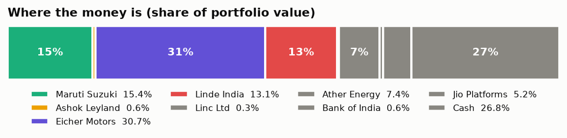

# Core-Equity Virtual Portfolio

> This is a **virtual (paper) portfolio built for learning and skill demonstration**. It is **not investment advice** and not a recommendation to buy, sell or hold any security.

**Last updated:** 23 Nov 2026, 09:32 AM IST  |  **Market data as of:** 2026-11-23  |  **Start date:** 2026-10-16

**Snapshot type:** Live intraday snapshot

_Live snapshot: today's session is still in progress, so volume is partial and "Volume vs 20d avg" will look low. The final end-of-day snapshot is published at 5:45 PM IST._

**Jump to:** [Summary](#portfolio-summary) · [Holdings](#holdings) · [Allocation](#allocation) · [Performance](#performance) · [Trade book](#trade-book) · [Companies](#company-deep-dives) · [Method](#how-this-works--data-sources)

## Portfolio summary

| Metric | Value |
|---|---|
| Current value | **₹2,64,13,002** |
| Total P&L | **₹18,14,272 (+7.38%)** |
| &nbsp;&nbsp;Unrealised (open positions) | ₹22,11,760 |
| &nbsp;&nbsp;Realised (shares already sold) | -₹3,98,488 |
| &nbsp;&nbsp;Dividends received (already inside Total P&L) | ₹1,000 |
| Today's change | ₹71,530 (+0.27%) |
| Nifty 50 since start (same money invested) | +11.48% |
| Outperformance vs Nifty 50 | -4.10% |
| Cash (uninvested) | ₹71,42,482 |
| Virtual money put in | ₹2,45,98,730 |

_▲ buy · ▼ sell_

## Holdings

| Stock | Shares | Buy price | Current price | Today's close | Prev close | Day | Value | Weight | P&L | P&L % |
|---|---:|---:|---:|---:|---:|---:|---:|---:|---:|---:|
| Maruti Suzuki | 290 | ₹11,489.00 | ₹14,035.00 | - | ₹14,011.00 | +0.17% | ₹40,70,150 | 15.4% | ₹7,38,340 | +22.16% |
| Ashok Leyland | 1,000 | ₹147.72 | ₹161.30 | - | ₹163.35 | -1.25% | ₹1,61,300 | 0.6% | ₹13,580 | +9.19% |
| Eicher Motors | 1,000 | ₹7,266.00 | ₹8,157.00 | - | ₹8,113.00 | +0.54% | ₹81,57,000 | 30.9% | ₹8,91,000 | +12.26% |
| Linde India | 500 | ₹5,961.00 | ₹6,621.00 | - | ₹6,572.00 | +0.75% | ₹33,10,500 | 12.5% | ₹3,30,000 | +11.07% |
| Linc Ltd | 1,000 | ₹85.00 | ₹85.67 | - | ₹86.15 | -0.56% | ₹85,670 | 0.3% | ₹670 | +0.79% |
| Ather Energy | 1,000 | ₹1,677.20 | ₹1,940.50 | - | ₹1,935.40 | +0.26% | ₹19,40,500 | 7.3% | ₹2,63,300 | +15.70% |
| Bank of India | 1,000 | ₹131.33 | ₹161.80 | - | ₹164.70 | -1.76% | ₹1,61,800 | 0.6% | ₹30,470 | +23.20% |
| Jio Platforms | 1,000 | ₹1,439.20 | ₹1,383.60 | - | ₹1,387.20 | -0.26% | ₹13,83,600 | 5.2% | -₹55,600 | -3.86% |

**Best since buy:** Bank of India (+23.20%)  ·  **Worst since buy:** Jio Platforms (-3.86%)  ·  **Biggest mover today:** Bank of India (-1.76%)

## Allocation

| Sector | Value | Share |
|---|---:|---:|
| Automobiles | ₹1,43,28,950 | 54.2% |
| Cash | ₹71,42,482 | 27.0% |
| Industrial Gases | ₹33,10,500 | 12.5% |
| Telecom & Digital Services | ₹13,83,600 | 5.2% |
| Financials | ₹1,61,800 | 0.6% |
| Stationery & Writing Instruments | ₹85,670 | 0.3% |

## Performance (as on 23 Nov 2026, 09:32 AM IST)

## Trade book

<b>Transaction history</b> - 25 entries, newest first

| Date | Stock | Type | Shares | Price | Amount | Note |
|---|---|---|---:|---:|---:|---|
| 2026-11-20 | Ashok Leyland | DIVIDEND | 1,000 | ₹1.00 | ₹1,000 | Auto-detected from Yahoo Finance: dividend Rs 1 per share; ex-date 2026-11-20 |
| 2026-11-04 | Jio Platforms | BUY | 1,000 | ₹1,439.20 | ₹14,39,200 | Bought 04-Nov-26 at 1439.20 (10:29 AM IST per Google Finance quote) |
| 2026-11-04 | - | DEPOSIT | - | - | ₹14,39,200 | Fresh virtual money to fund Jio Platforms |
| 2026-10-27 | Bank of India | BUY | 1,000 | ₹131.33 | ₹1,31,330 | Bought 27-Oct-26 at 131.33 (12:54 PM IST per Upstox quote) |
| 2026-10-27 | - | DEPOSIT | - | - | ₹1,31,330 | Fresh virtual money to fund Bank of India |
| 2026-10-27 | Ather Energy | BUY | 1,000 | ₹1,677.20 | ₹16,77,200 | Bought 27-Oct-26 at 1677.20 (12:37 PM IST per Upstox quote) |
| 2026-10-27 | - | DEPOSIT | - | - | ₹16,77,200 | Fresh virtual money to fund Ather Energy |
| 2026-10-27 | HDFC Bank | SELL | 4,572 | ₹687.95 | ₹31,45,307 | Sold 27-Oct-26 at 687.95 (12:08 PM IST per Business Standard quote) |
| 2026-10-22 | Linc Ltd | BUY | 1,000 | ₹85.00 | ₹85,000 | Bought 22-Oct-26 at live NSE price 85.00 (12:30:26 PM IST; source NSE_CMDATA) |
| 2026-10-22 | - | DEPOSIT | - | - | ₹85,000 | Fresh virtual money to fund Linc Ltd |
| 2026-10-22 | Eternal (Zomato) | SELL | 10,245 | ₹309.00 | ₹31,65,705 | Sold 22-Oct-26 at live NSE price 309.00 (12:30:26 PM IST; source NSE_CMDATA) |
| 2026-10-21 | Linde India | BUY | 500 | ₹5,961.00 | ₹29,80,500 | Bought 21-Oct-26 from cash at 5961.00 (NSE last traded 10:53:52 AM IST per Upstox web quote) |
| 2026-10-21 | Fiem Industries | SELL | 1,000 | ₹1,816.90 | ₹18,16,900 | Sold 21-Oct-26 at live NSE price 1816.90 (10:03:32 AM IST; source NSE_CMDATA) |
| 2026-10-21 | Manorama Industries | SELL | 1,000 | ₹1,749.00 | ₹17,49,000 | Sold 21-Oct-26 at live NSE price 1749.00 (10:03:32 AM IST; source NSE_CMDATA) |
| 2026-10-21 | Fiem Industries | BUY | 1,000 | ₹1,813.60 | ₹18,13,600 | Bought 21-Oct-26 at live NSE price 1813.60 (10:00:26 AM IST; source NSE_CMDATA) |
| 2026-10-21 | Eicher Motors | BUY | 1,000 | ₹7,266.00 | ₹72,66,000 | Bought 21-Oct-26 at live NSE price 7266.00 (10:00:26 AM IST; source NSE_CMDATA) |
| 2026-10-21 | - | DEPOSIT | - | - | ₹72,66,000 | Fresh virtual money to fund Eicher Motors |
| 2026-10-20 | - | DEPOSIT | - | - | ₹19,00,000 | Fresh virtual money to fund Fiem Industries |
| 2026-10-19 | Manorama Industries | BUY | 1,000 | ₹1,796.80 | ₹17,96,800 | Added on 19-Oct-26 (CMP 1790.40 per Trendlyne) |
| 2026-10-19 | - | DEPOSIT | - | - | ₹18,00,000 | Fresh virtual money to fund Manorama Industries |
| 2026-10-19 | Ashok Leyland | BUY | 1,000 | ₹147.72 | ₹1,47,720 | Added at ~11:25 AM IST |
| 2026-10-19 | - | DEPOSIT | - | - | ₹3,00,000 | Fresh virtual money to fund Ashok Leyland |
| 2026-10-16 | Maruti Suzuki | BUY | 290 | ₹11,489.00 | ₹33,31,810 | Initial allocation |
| 2026-10-16 | Eternal (Zomato) | BUY | 10,245 | ₹325.30 | ₹33,32,698 | Initial allocation |
| 2026-10-16 | HDFC Bank | BUY | 4,572 | ₹728.85 | ₹33,32,302 | Initial allocation |

<b>Closed positions</b> - 4

| Stock | Bought (avg) | Sold (avg) | Held | Invested | Proceeds | Realised P&L | Return |
|---|---:|---:|---:|---:|---:|---:|---:|
| Manorama Industries | 2026-10-19 @ ₹1,796.80 | 2026-10-21 @ ₹1,749.00 | 2 days | ₹17,96,800 | ₹17,49,000 | -₹47,800 | -2.66% |
| Fiem Industries | 2026-10-21 @ ₹1,813.60 | 2026-10-21 @ ₹1,816.90 | 0 days | ₹18,13,600 | ₹18,16,900 | ₹3,300 | +0.18% |
| Eternal (Zomato) | 2026-10-16 @ ₹325.30 | 2026-10-22 @ ₹309.00 | 6 days | ₹33,32,698 | ₹31,65,705 | -₹1,66,993 | -5.01% |
| HDFC Bank | 2026-10-16 @ ₹728.85 | 2026-10-27 @ ₹687.95 | 11 days | ₹33,32,302 | ₹31,45,307 | -₹1,86,995 | -5.61% |

## Company deep-dives

---

### Maruti Suzuki  _(Automobiles)_

[Google Finance](https://www.google.com/finance/quote/MARUTI:NSE) · [All BSE announcements](https://www.bseindia.com/corporates/ann.html?scrip=532500)

| Close | Day change | Day range | Volume | 20d avg volume | Volume vs 20d avg | 20d volatility (ann.) | 52w range |
|---:|---:|---:|---:|---:|---:|---:|---:|
| ₹14,035.00 | +0.17% | ₹13,989.00 - ₹14,333.00 | 187,989 | 685,270 | 0.27x | 36.89% | ₹11,170.00 - ₹17,292.00 |

**Research reports**

- [One-page snapshot](analysis/Maruti_OnePager.pdf)
- [Detailed report](analysis/Maruti_Detailed.pdf)

<b>Official company announcements (BSE)</b>

- No recent filings fetched; see the link above for the full list.

<b>Latest news (trusted publishers + official company newsroom)</b>

- [Stocks to watch: Tata Steel, Waaree, Adani Energy, Maruti, IndusInd Bank](https://www.business-standard.com/markets/news/stocks-to-watch-tata-steel-waaree-adani-energy-maruti-indusind-bank-126112300090_1.html) - _Business Standard, 23 Nov 2026, 08:02 AM IST_
- [Top stocks to watch today: Tata Steel, APL Apollo Tubes, Maruti Suzuki, RVNL, Waaree Energies &amp; 17 others in focus](https://www.livemint.com/market/stock-market-news/top-stocks-to-watch-today-tata-steel-apl-apollo-tubes-maruti-suzuki-rvnl-waaree-energies-17-others-in-focus-11795399384907.html) - _Mint, 23 Nov 2026, 07:57 AM IST_
- [Stocks to watch, Nov 23: Tata Steel, APL Apollo Tubes, IndusInd Bank, NSE, Adani Energy, Waaree Energies, Premier Explosives, Maruti Suzuki, Texmaco Rail, RVNL, Ashoka Buildcon](https://www.thehindubusinessline.com/markets/stock-markets/stocks-to-watch-nov-23-tata-steel-apl-apollo-tubes-indusind-bank-nse-adani-energy-waaree-energies-premier-explosives-maruti-suzuki-texmaco-rail-rvnl-ashoka-buildcon/article71733190.ece) - _BusinessLine, 23 Nov 2026, 06:59 AM IST_
- [Stocks in news: Adani Energy, Maruti Suzuki, RailTel, Waaree Energies and Indian Bank](https://news.google.com/rss/articles/CBMi6wFBVV95cUxPbG1LNVlQci11WVg5WW9wYTRRcVpRRFk3ZmM4dFlXeWc4TkZ2cno1WDNjdmRyWHBJSDhvT1FWUmNlcDFhVDhZTGZ3OXVIQ1JNQmFTaDUzQlJ3Q3JlcXlJR281MzRZSWlrT0ZFVUZjU3BLVjJLZXN4OGJlS2NtbjMyS0Q3YjJJWUtpX2pOczgyQzhxYnVtZXByUW9CMTlxLWE0U3NRdkJUbkMwQnpjVlc2YUxpbk1CZlpBZUVRWWd1a3REc2JRNGtMZTNveGx3WF9UNU43VFdRNGVxUFpxZlE3YkUtRHo0T1doeTFN0gHwAUFVX3lxTE41SUVpVWZtRmItZXhYR01qLS1yRW5ycnhiZ080aUhiYUtqQURzZi14VlppU1dkOGE4NGVYMkp1WnoybUFTQklHSjktN0dVTXhhUklnZERvZWRoeGJjWF81cGNZRzlrQ1gyTDUyUFZ6ajI2QTVHMEdEOU5rY3BILWd5WkVnZkMxWWxuekxXSkZyLU9vSUh4V2MzSl80RjFvLW5UcU5NOE55RjgxblFTd3ZaMGt1S2RDaXJaX2VnSlVTeG9Sd1BqWFRUeDlVSm8taFYwSmZLOUMyVTVTblVHV3I2LU5LNW9iSjRSX0xRWVpNdg?oc=5) - _The Economic Times, 23 Nov 2026, 06:00 AM IST_
- [Delhi policeman walks out of his wedding after bride’s family gifts him Hyundai Aura instead of Maruti Bre](https://news.google.com/rss/articles/CBMipgJBVV95cUxPOUpYRVlRNkh1a2xnWlBnMnNEY25XSXVUSzM0VTVNRUpzX0xlSlJjaXBZRkJkYXN6QzdRQXdJaE5zUlpneXhBRE1SMUdjOWFtM29vLVlZSG5WcWhPWF9kbzgwU09MRmhHd2l2NzFCX2QyU0dDX3QxamhTSGNnOEV5b0Nqdmp1Sm1CRUpBeVUweWRvcUgtZjZGZlNGYV9iNEEtV2ZVdDNWN19udUpwWlBzYWZvbE14V2Y5dWI3RDRlNHB5WW5tV3A1bUhGT2NXUThmN3FEaGVQdDVMRlBxRE1HVDl0VWlTbEo4TXlEZzhYMjhVTUtGVGZfajhCdDQ2Zl83QmIycXp4cmNQdnIySzBiNENWN3R4UFRvV3NhRGl4UWZkSmZLeUHSAasCQVVfeXFMT0tHQ0ZBeGkwM0R1WEd4Tm5ZbGpqR0hpWXlod0ttU1FrT096RkJZT1RURzJEdHJxRmV6ZWZzRTF2M0dlMElETUdOZXZDdFpWMWFSUGN0ZERQZVE3X1lQSHhiczhzWUxMelp1ci05YV9pcWhIblZ1dXZPNW9FM2FGZzE2a1NURU9RQ2pEMVBCcFEtdGotVkxJak5DNFBxQThYd083OEtyOGhENUtOXzF3WUg5Z2ZEc21BUE1rblo2b3JQZ1ZNUFBJeXUxU3NOaG4yMmsyT3l6NVFnR3RwU3JnRHM2NUszTF9Vc1E4SG5pSkZmSU4wY2ZEb0R6OFR0UEc4WWh5Q3ZZY0hPTHBzUnVJZnRHSHpQWko2YmFpQnY1M19oNHhpeHRtc0MtX1E?oc=5) - _The Economic Times, 22 Nov 2026, 07:11 PM IST_

---

### Ashok Leyland  _(Automobiles)_

[Google Finance](https://www.google.com/finance/quote/ASHOKLEY:NSE) · [All BSE announcements](https://www.bseindia.com/corporates/ann.html?scrip=500477)

| Close | Day change | Day range | Volume | 20d avg volume | Volume vs 20d avg | 20d volatility (ann.) | 52w range |
|---:|---:|---:|---:|---:|---:|---:|---:|
| ₹161.30 | -1.25% | ₹161.30 - ₹165.00 | 1,861,880 | 24,298,146 | 0.08x | 47.31% | ₹138.58 - ₹211.92 |

**Research reports**

- [One-page snapshot](analysis/Ashok_Leyland_OnePager.pdf)
- [Detailed report](analysis/Ashok_Leyland_Detailed.pdf)

<b>Official company announcements (BSE)</b>

- No recent filings fetched; see the link above for the full list.

<b>Latest news (trusted publishers + official company newsroom)</b>

- [Ashok Leyland expands EV push with order of 200 trucks for cement transport, eyes wider LCV market](https://news.google.com/rss/articles/CBMi9wFBVV95cUxPMDJOY3E0T25CWWZqLXZaN0xXUEduZGxNQzl5ZmlWM1NuWmpPR0NwRHl0czJib09fYjRXbDFULU5ZWWNDbDI1NHVZeFBxd1RiVU9EV2F4VmVxbFNQUURmMkh1NVo0cW9qVnhqWjF0OUdKN1BnTHVzNVRTc242TnE2VHhjRG9tXzRaYnEzMnhuV2x6SDVUMzRXMXhac0U3akFrYlloQURDYWtDLUU5UktHV01lY20yN3JQZ0xCWmZ4VnlHdmZnQS1VQ1UzLUZxNEZmbXBCZWlFOXhJenR0ZlpNeWRzQzZ5RmtfcnVqbXhMUFRKTEVTdG1V0gH-AUFVX3lxTE5jXzdLQi0teV9qLWVpbWo3WWVMb0o4aWNLQldsNUR3VHp6V2pPa1RHaE1GdXRxeHBTX1BSNTJjRXR3LVEwc2dKYWFJakllcU5qSGlzMG9QTnRWblhsQXB4NUhWa0ZWM1N3dTl4VExLNlJNTEh0d3dwaFh1ZGZ0Q3VnNFZ3R0VVMUo4RU5KNlhqdTMzazJoS3lJdFNQUjJjLXlibElBWkZjZ3lLM0FBVFdNbDV1N3MxelN4SHBsbzdwYXc1YmFuZWJDcFpDRW1vT25iR0xhajVPUjUyc3p1LTVPcko0UW94ekV2TXp2X0ktVEppTkVVNVVtSkh3U3JR?oc=5) - _BusinessLine, 22 Nov 2026, 10:59 AM IST_
- [Ashok Leyland truck plant to be set up in Singur, work to begin soon: Sukanta Majumdar](https://news.google.com/rss/articles/CBMi5gFBVV95cUxNNWJlT1haZzBtUk5xOWpFR2xRV2cySXlJVEhpeVFKMmprUVdqS00yU1ZXXzRYQ3ZFbFBDQi1lY1BYTXd3Q3oycmZ4U0V1XzRnUF9Od3BBc0QtaVJ1RjFuMmxxbDByNjc1WktJd2t4R2xXQTRCd3RvZXZxSV9EM0RrZjV3c0JtcklSRV9oOEtmYzNXMzlLX2ZxWXhrZXFrQ3I3TDN1Nkh5cGljdkE1a055VGFNRm4wQU5WWFdJZGo0ZjFZVTJZV1E0cWFpc0x0Z2pvbkNtNDhMc2F1eFh2Tm1Xa3hzVDlSUdIB7AFBVV95cUxNTXpITXVKWFgwX3ZBZHd5YUpjbUwtdlN2YnRwRVZsR2h1eWJZQ012WXllYWdSb0dOWFNVZUdWaVl6SFJfdWxzX0VaMXhpVTJQUUFEd0k1T2FWd1VXcVdyRjZ3TDhCRnk2WmVXZm1jZ1ZfdXhSVjYzTUJzZS1mQUExbjBSaXA0NWxMNDdRZTNxYlh6blpnTUtRQ05kVUY1SDRfeVlOWnZvQjJ2WDZnRFhlcm5sZG5LNWVxclFVMEpPNlRvNVpKTDM5ZFR3WjRVVWk2cWo3OVJoYjZidGZ4NFl6WUM2WFliZ3FaQmtxNw?oc=5) - _BusinessLine, 21 Nov 2026, 07:28 PM IST_
- [Stock Market Update: Stocks Radar Ashok Leyland, ONGC, Rain Industries](https://news.google.com/rss/articles/CBMilgFBVV95cUxQdGFGa28tSUpjSjljampOUk9fYVF6eFgtUXBRS0tMYUZfeGQ5SEFNSHhndWFmNTh6NG41ODJnVC1uVmRWQmlsMHJNcUY1RFR3b2ZQNjh0cERUR0Vzd0V3Wkt3ZXdxemdjM0tUQjJZV3dSZDc3S3VaT2M4YmNfOERmdDNVNFpTUHlfWmhUcDFYOUJteU15TFE?oc=5) - _NDTV Profit, 21 Nov 2026, 06:11 PM IST_

---

### Eicher Motors  _(Automobiles)_

[Google Finance](https://www.google.com/finance/quote/EICHERMOT:NSE) · [All BSE announcements](https://www.bseindia.com/corporates/ann.html?scrip=505200)

| Close | Day change | Day range | Volume | 20d avg volume | Volume vs 20d avg | 20d volatility (ann.) | 52w range |
|---:|---:|---:|---:|---:|---:|---:|---:|
| ₹8,157.00 | +0.54% | ₹8,128.00 - ₹8,275.00 | 106,962 | 574,796 | 0.19x | 27.68% | ₹6,586.00 - ₹8,190.00 |

**Research reports**

- [One-page snapshot](analysis/Eicher_OnePager.pdf)
- [Detailed report](analysis/Eicher_Detailed.pdf)

<b>Official company announcements (BSE)</b>

- No recent filings fetched; see the link above for the full list.

<b>Latest news (trusted publishers + official company newsroom)</b>

- [Royal Enfield 250cc hybrid bikes in the works, 40–45 kmpl mileage expected: Price, launch details and more](https://news.google.com/rss/articles/CBMi7wFBVV95cUxOSE9JNWdpSnRRVXZYdXJ0OXk1ekNQdXNKWGE3Qkp3VDRHZm1BT1U4NlNZMHZvT25sZmUya29NZHdkTFA5ZmxXRktUNGNWZV9rUXVDMGk2NHhSUHZwNEpMSEk4c3d1NnhIekJWVUtVU1RqZzBlaUZYdVNLX1NfYmN2cTZQbUhscEdFdHF2a2NseFQ2WUtlTTJBS1VEWkRfMVMteVdDcVJlekhxeU1oX0RQZEJwcUtnZWU1QjNJdjZWZGlwWHRPLUdrQmxsMEYzVWtkZ1pvQkR2U1QxeGt4R2k2aGpoeVFZd0ZKQkQ3T3VGMNIB9AFBVV95cUxOSF9rZ3Z3V0FRd2tVM1JmZzBJMFk2VS00V1pJZVlPbFlPQVRLVFpOU01DY2hkUDJNVUljUHZKUjV3LW1zNERBdnd1V3Y3NFFlQmdNSzBMNlBxa01raEpnd0ktWk90Vjh4R1Bwa04xRkc4bEFMZzFQT0RPUzVOWFkwanpkOHp0bXJfVHJGYVhxQS1zZUFvZkcyWTdTbEVGSHVRWWFLOURva2lXWnFRUDM1Nm5mWS13eW5TWVZQV1U2VlA5b25ETnUwRUVCbmVyQ3RYUGEyRldfN0VPaDBFMXNTU3c5eEgtZ2QwQXJESU9NOUFRN1N1?oc=5) - _Livemint, 20 Nov 2026, 03:24 PM IST_
- [Eicher Motors Share Price Live Updates: Eicher Motors Stock Price History](https://economictimes.indiatimes.com/markets/stocks/stock-liveblog/eicher-motors-share-price-live-20-nov-2026/liveblog/136016875.cms) - _Economic Times, 20 Nov 2026, 12:17 PM IST_

---

### Linde India  _(Industrial Gases)_

[Google Finance](https://www.google.com/finance/quote/LINDEINDIA:NSE) · [All BSE announcements](https://www.bseindia.com/corporates/ann.html?scrip=523457)

| Close | Day change | Day range | Volume | 20d avg volume | Volume vs 20d avg | 20d volatility (ann.) | 52w range |
|---:|---:|---:|---:|---:|---:|---:|---:|
| ₹6,621.00 | +0.75% | ₹6,573.00 - ₹6,647.50 | 2,223 | 46,834 | 0.05x | 48.43% | ₹5,632.50 - ₹7,847.50 |

**Research reports**

_Research report coming soon._

<b>Official company announcements (BSE)</b>

- No recent filings fetched; see the link above for the full list.

<b>Latest news (trusted publishers + official company newsroom)</b>

- [Linde India Investor Analysis | StockIQ](https://news.google.com/rss/articles/CBMiiwFBVV95cUxQVE9OU3JlUkpUMGRUZ2NRSEdMWUtRTzhzZWNDYmFxRHQ1TjM5RnhVU3M4b3RZUWdNQl94N0cwUkliamRheG8tWWhrWVNORWNCS3BGZEZ0emVXTi1FNkVJUGZ5elFsR2dYRC11OFlUREJ6NXN4NGdoMmdGYzBjbUZtbVl6QXBOU2NXMFFZ?oc=5) - _The Economic Times, 20 Nov 2026, 01:30 PM IST_

---

### Linc Ltd  _(Stationery & Writing Instruments)_

[Google Finance](https://www.google.com/finance/quote/LINC:NSE) · [All BSE announcements](https://www.bseindia.com/corporates/ann.html?scrip=531241)

| Close | Day change | Day range | Volume | 20d avg volume | Volume vs 20d avg | 20d volatility (ann.) | 52w range |
|---:|---:|---:|---:|---:|---:|---:|---:|
| ₹85.67 | -0.56% | ₹85.00 - ₹86.00 | 212 | 46,357 | n/a | 70.57% | ₹76.41 - ₹123.36 |

**Research reports**

_Research report coming soon._

<b>Official company announcements (BSE)</b>

- No recent filings fetched; see the link above for the full list.

<b>Latest news (trusted publishers + official company newsroom)</b>

- No fresh headlines from trusted sources in the last few days.

---

### Ather Energy  _(Automobiles)_

[Google Finance](https://www.google.com/finance/quote/ATHERENERG:NSE) · [All BSE announcements](https://www.bseindia.com/corporates/ann.html?scrip=544397)

| Close | Day change | Day range | Volume | 20d avg volume | Volume vs 20d avg | 20d volatility (ann.) | 52w range |
|---:|---:|---:|---:|---:|---:|---:|---:|
| ₹1,940.50 | +0.26% | ₹1,936.40 - ₹1,960.00 | 180,273 | 3,715,231 | 0.05x | 58.13% | ₹601.35 - ₹1,945.00 |

**Research reports**

_Research report coming soon._

<b>Official company announcements (BSE)</b>

- No recent filings fetched; see the link above for the full list.

<b>Latest news (trusted publishers + official company newsroom)</b>

- [Asia’s stock rescue efforts gather pace after Wall Street plunge](https://economictimes.indiatimes.com/markets/us-stocks/news/asia-steps-up-stock-rescue-efforts-after-wall-street-rout/articleshow/136086374.cms) - _Economic Times, 23 Nov 2026, 06:53 AM IST_
- [InvIT IPO rush gathers pace, 4-5 trusts likely to go public by Mar 2027](https://www.business-standard.com/markets/ipo/invit-ipo-rush-gathers-pace-4-5-trusts-likely-to-go-public-by-mar-2027-126112200225_1.html) - _Business Standard, 22 Nov 2026, 12:26 PM IST_
- [​Ather Energy - Stocks to buy: HSBC lists 19 Indian stocks that saw FY27 earnings upgrades, check target prices](https://news.google.com/rss/articles/CBMiigJBVV95cUxOSC1tZ0pkRFVjdDNUNE42U092cGRKQ013Rlc3LVd4b0pTTlpGV19mdnNrVmdybUhXWjRWRnhWOHdXbXlWUGJKd2ttdHhMVFZQWGlETmVLU3UyRTdBVk9SVENuUDA5UWNYT25SamxVRmIxZHItSXZxSVJ5QVFjWjdMX2RteGxqVW1UbGI5SnJmbV91MjNkN2l4MnhOTGJvNW43SmZobkNzdjNQb2VNNFFmR21oVE5heTVmOUFId241V1RaandiY3NhUTc1RGo5Z2FLUkdNZEl6RUo3N05SUHpabWhaeWRJVHF1bF83WXJjUUU3R1FYY1FCWkkwdThoclRiUUZzY2EtX0ppdw?oc=5) - _The Economic Times, 21 Nov 2026, 01:38 PM IST_
- [Ather staggers entry-level Konarc launch as capacity catches up with demand](https://news.google.com/rss/articles/CBMizAFBVV95cUxOZEFXSXV5VXV1d0dQZXFLSnZzZG5BY3F1b0g0czh4N2J2NHhSZkZVbnNYU3luTUVYS1RaMFlZSVg5MjRkaDZSYTJGUU5fRE1TaVE5Q1NHNlpnaWxNYjl0MnZiVWRBQ2NHYVpubG1taU10VFdEbmFqcDFkVUtMQy1kYjBDNVFDODNHSTNZUnFVdE82LU9jWjFtWXBfWGszc21pRDN1RGZFNGRQMDNRVXlVeEpDOUR0aVg1RC1jbkxnWGtyeE5SMkVjYUNMRzDSAdMBQVVfeXFMT3dQdm5RZUdjMTVmclZjYzVkODB4OGFMQW1yY3Q4MHQxbEt0TXIzWWs0NlEzWTlxb2tCSzN6dkV2UngxYzlpVi1FTzZrM0JlaDctOWZpUzlxSHM4YlBTb3RtYndWenZBU2ZNVERaSUxWb19BOE9LcVNLTEFsS1FWQmZsS2pGeVc3REQ2cGRtSUY1OEx6aDgtWFlsREZ0VUlUV3Q4dmlDaHc1UTZoVmRYRzNnbU9XNU84Ty10UWZQOXd1bl9zMEtCeFMxOXl5Nm9ZSzNuZw?oc=5) - _The Financial Express, 20 Nov 2026, 06:14 PM IST_

---

### Bank of India  _(Financials)_

[Google Finance](https://www.google.com/finance/quote/BANKINDIA:NSE) · [All BSE announcements](https://www.bseindia.com/corporates/ann.html?scrip=532149)

| Close | Day change | Day range | Volume | 20d avg volume | Volume vs 20d avg | 20d volatility (ann.) | 52w range |
|---:|---:|---:|---:|---:|---:|---:|---:|
| ₹161.80 | -1.76% | ₹161.04 - ₹166.85 | 1,940,199 | 11,787,747 | 0.16x | 37.51% | ₹126.32 - ₹177.20 |

**Research reports**

_Research report coming soon._

<b>Official company announcements (BSE)</b>

- No recent filings fetched; see the link above for the full list.

<b>Latest news (trusted publishers + official company newsroom)</b>

- No fresh headlines from trusted sources in the last few days.

---

### Jio Platforms  _(Telecom & Digital Services)_

[Google Finance](https://www.google.com/finance/quote/JPL:NSE) · [All BSE announcements](https://www.bseindia.com/corporates/ann.html?scrip=545004)

| Close | Day change | Day range | Volume | 20d avg volume | Volume vs 20d avg | 20d volatility (ann.) | 52w range |
|---:|---:|---:|---:|---:|---:|---:|---:|
| ₹1,383.60 | -0.26% | ₹1,383.60 - ₹1,394.00 | 202,035 | 20,910,590 | 0.01x | 9.99% | ₹1,383.60 - ₹1,437.40 |

**Research reports**

_Research report coming soon._

<b>Official company announcements (BSE)</b>

- No recent filings fetched; see the link above for the full list.

<b>Latest news (trusted publishers + official company newsroom)</b>

- No fresh headlines from trusted sources in the last few days.

---

## How this works & data sources

- **Prices / volume:** Yahoo Finance via the open-source `yfinance` library (unofficial; may differ slightly from NSE official data).
- **Trades:** every buy / sell / deposit is a line in `transactions.csv`. A trade happens at the closing price of its date (live price for today). Average-cost method; no brokerage or taxes (virtual portfolio).
- **Corporate actions:** splits, bonus issues and dividends are detected from Yahoo Finance and added to `transactions.csv` as event lines on the ex-date (nothing old is edited). A split multiplies the share count and divides the average cost, so the invested amount stays the same; dividends add cash.
- **Benchmark:** every rupee put into the portfolio is also put into the Nifty 50 on the same day, so the comparison is like-for-like.
- **News:** Google News RSS + publisher RSS feeds, filtered to a whitelist of trusted publishers, de-duplicated, last 72 hours only. Each item links to the original article.
- **Official filings:** BSE corporate announcements (best-effort, with link to the full list).
- **Automation:** GitHub Actions refreshes this dashboard on weekdays every 30 minutes from 9:30 AM to 3:30 PM IST (live snapshots) and at 5:45 PM IST (end-of-day final snapshot + AI daily report); skips market holidays.
- **Metrics:** Volatility = 20-day std-dev of daily returns, annualised. Volume ratio = today's volume / average of previous 20 sessions.

> This is a **virtual (paper) portfolio built for learning and skill demonstration**. It is **not investment advice** and not a recommendation to buy, sell or hold any security.
